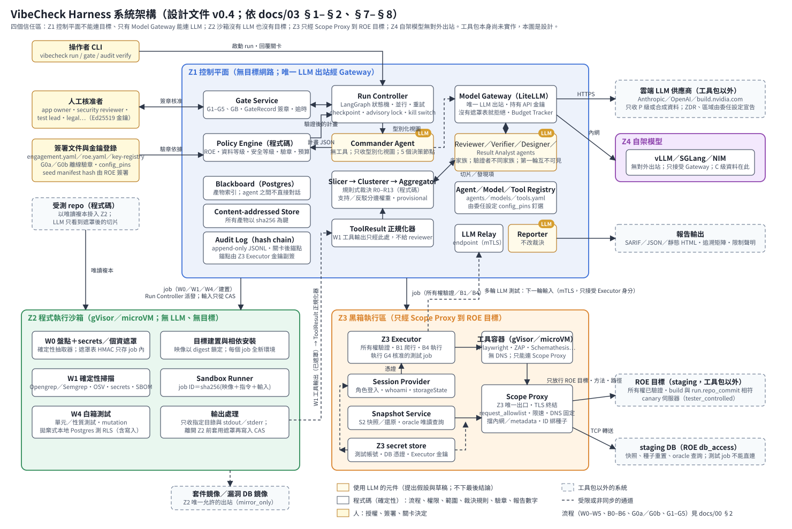

# VibeCheck Harness（暫定名）— Multi-Agent Vibe Coding 測試工具包：方法論與系統架構

> **狀態**：設計文件，第十輪審查（2026-10-27）後；裁決規則版本 `05-v0.10`（版本規則見 [CHANGELOG](CHANGELOG.md) 開頭）。每輪審查的紀錄在 [docs/evidence/](docs/evidence/)，最新一份是第十輪；逐版變更見 [CHANGELOG](CHANGELOG.md)，各文件過去的變更摘要見 [docs/evidence/doc-history.md](docs/evidence/doc-history.md)。工具包本身**尚未實作**；本 repo 附可執行的資料模型驗證器與參考演算法（`tools/`），以及三個完整的端到端範例（[04 §6](docs/04-threat-to-testcase.md#6-完整範例)）與一組簽署過的範例 bundle（`docs/schemas/examples/`）。v0.2（2026-09-24）起可據以實作：每個階段、關卡、元件都有輸入、輸出、失敗路徑、資料 schema、負責里程碑與驗收標準；實作規格見 [08](docs/08-implementation-spec.md)。
> **第一次讀**：先看 [docs/00 總覽](docs/00-overview.md)（端到端流程、自動與人工的分界、依角色的閱讀路徑）。
> **目的**：替 vibe-coded（由 AI 生成、開發者未必逐行讀過）的 Web／API 應用與含 LLM／Agent 功能的應用，建立一套**防禦性**、**先白箱後黑箱**的多代理測試方法與系統架構。
> **語言**：正體中文；證據原文保留英文（見 [`docs/evidence/ledger.md`](docs/evidence/ledger.md)）。

## 一句話說明

一個 **Harness**（程式碼寫成的流程控制器）加上一個 **指揮官 Agent**（LLM）調度多個子代理：
- **白箱階段**：每個子代理可以綁不同廠商的 LLM（Claude／ChatGPT／Nemotron…），彼此獨立審查程式碼，再由**不同家族**的模型交叉驗證，以降低單一模型的偏誤；
- **黑箱階段**：**一定先做威脅建模**，人工簽核後，才依威脅模型推導測試案例，再在隔離環境中對 **staging** 執行。

## 系統架構圖



- 四個信任區：**Z1** 控制平面（Run Controller、Policy Engine、Gate Service、Blackboard、CAS、Audit Log、Model Gateway）不能連目標，只有 Gateway 能連 LLM；**Z2** 沙箱跑 W0／W1／W4 與目標建置，沒有 LLM 也沒有目標；**Z3** 執行所有權驗證與黑箱測試，唯一出口是 Scope Proxy；**Z4** 自架模型只接受 Gateway，可處理 C 級資料；雲端供應商預設只收 P 級，ZDR 已確認且委任設定允許時也可收 C 級（[03 §8](docs/03-system-architecture.md#8-model-gateway)）。Calibration Lab 在 run 以外離線執行，產出的權重與門檻經委任設定釘選後才生效。元件責任與里程碑見 [03 §1](docs/03-system-architecture.md#1-元件總覽)，信任區與隔離要求見 [03 §2](docs/03-system-architecture.md#2-部署與信任區)。
- 黃底是用 LLM 的元件（指揮官、審查／驗證／設計／結果分析 agent、Reporter）：它們只提出假設與草稿；流程、範圍、安全等級、裁決規則與驗章都是程式碼。人只在簽署與關卡（G0a／G0b、G1–G5、GB）出現。
- 端到端流程（W0–W5、B0–B6 與關卡）見 [00 §2](docs/00-overview.md#2-端到端流程)；圖檔是手工維護的 SVG（[docs/architecture.svg](docs/architecture.svg)），改架構時一併更新。

## 範圍與界線

| 會做 | 不會做 |
|---|---|
| 測試**使用者自己擁有**、且基礎設施擁有者**書面授權**的程式碼與 staging 環境；共享平台（例如 `*.supabase.co`）上的目標要有平台專案證明加技術證明，否則只做 S0 的被動讀取（[06 §2.1](docs/06-security-legal-limitations.md#21-授權範圍)） | 測試正式環境、第三方系統、或無法證明所有權的主機 |
| 以測試案例證明「安全需求沒有被滿足」（失敗的安全斷言） | exploit 開發、通用攻擊 payload 庫、破壞性測試（S3） |
| 以程式碼強制 ROE（交戰規則）、範圍白名單、限速、人工關卡 | 只靠文件宣示的「請勿濫用」 |

## 需求對照表

| 需求 | 做法 | 文件位置 | 誠實的限制 |
|---|---|---|---|
| 一個主 AI agent 當 harness／指揮官，負責調度其他 agents | Harness＝Run Controller（程式碼：順序、並行、重試、限速、checkpoint）＋ Commander Agent（LLM，在 5 個決策節點規劃與加派）；Policy Engine 以程式碼強制範圍與關卡 | [03 §4](docs/03-system-architecture.md#4-harness指揮官如何滿足需求) | 指揮官刻意不能判定漏洞真偽、不能擴大範圍、不能跳過關卡 |
| 白箱每個 agent 可接不同 LLM（Claude、Nemotron、ChatGPT 等）以減少模型偏誤 | `agents.yaml` 逐一綁模型；LiteLLM 接 Anthropic／OpenAI／NVIDIA（雲端＋自架）；規則：驗證者必須不同家族、不跨家族 fallback、第一輪互不可見 | [02 §2](docs/02-methodology.md#2-白箱階段w0w5)、[05](docs/05-bias-calibration.md)、[examples](docs/examples/) | 多家族**只能降低、不能消除**偏誤；是否勝過「單一最佳模型多次取樣」必須自己量 |
| 黑箱階段一定先做威脅建模，再依結果設計 test cases | B2 威脅建模是強制關卡（G3 人工簽核）；B3 以「威脅→需求→測試」可追溯鏈產生案例；附兩個完整範例 | [02 §3](docs/02-methodology.md#3-黑箱階段b0b6)、[04](docs/04-threat-to-testcase.md) | 追溯鏈並非每一環都有官方對照，需人審對照表 |
| 先上網搜尋可參考的專案與資料 | 8 個主題、456 條發現（v0.1 的 321 條＋v0.2 新增 125 條＋v0.3 新增 10 條），逐條獨立查核 | [01](docs/01-research-survey.md)、[ledger](docs/evidence/ledger.md) | 搜尋未窮盡（部分產品與論文未查） |
| 完整的方法論 | 白箱 W0–W5、黑箱 B0–B6、事先簽署 G0a／G0b 與人工關卡 G1–G5、偏誤控制、校準實驗 | [02](docs/02-methodology.md)、[05](docs/05-bias-calibration.md) | — |
| 詳細的系統架構 | 元件、信任區部署、LangGraph 狀態機、資料模型（JSON Schema）、設定範例、成本模型、CI 兩條線 | [03](docs/03-system-architecture.md)、[08](docs/08-implementation-spec.md)、[schemas](docs/schemas/) | 尚未實作，數字皆為設計假設 |
| 目標應用：Web＋REST／GraphQL API、含 LLM／Agent 功能的應用 | Binding 表涵蓋 REST 與 GraphQL（輸入驗證、欄位層級授權、查詢深度、introspection）與 LLM／Agent 威脅（OWASP LLM Top 10、ASI、MAESTRO） | [04 §4.3](docs/04-threat-to-testcase.md#43-binding-表)、[02 B2](docs/02-methodology.md#b2-威脅建模g3-強制簽核) | 行動 App 不在本版範圍 |
| 以 Python 實作 | LangGraph＋LiteLLM＋Pydantic；套件配置、介面、CLI、錯誤分類、測試與完成定義見 08；資料模型驗證器與參考演算法（裁決規則、安全等級、JCS、Ed25519 驗章）已用 Python 撰寫並有測試 | [03 §3](docs/03-system-architecture.md#3-框架選型)、[07](docs/07-roadmap.md)、[08](docs/08-implementation-spec.md)、[tools/](tools/) | 本次只交付文件、驗證工具與參考實作，工具包本體尚未實作 |
| Nemotron 同時支援雲端（build.nvidia.com）與自架（NIM／vLLM） | 兩種模式都接在 LiteLLM；雲端只收公開或合成程式碼，機密碼只用自架 | [03 §8.2](docs/03-system-architecture.md#82-nemotron-雙模式)、[examples/serving](docs/examples/serving/README.md) | 雲端試用條款禁止機密資訊與正式用途；自架需要 GPU |
| 文件放在 repo 根目錄 | `README.md`＋`docs/` | — | — |
| 做不到的事就說做不到 | 43 條明列，分成四類（LLM 與方法的本質限制、環境與平台、組織與法務前提、本版範圍） | [06 §3](docs/06-security-legal-limitations.md#3-做不到不承諾的事) | — |
| 所有內容經交叉比對核實 | 每個事實陳述帶狀態標記與證據 ID；計畫與文件都經獨立代理對抗式審查；2026-09-26 的深度審查逐項記錄在 [review-2026-09-26](docs/evidence/review-2026-09-26.md)，2026-10-24 的設計審查在 [review-2026-10-24](docs/evidence/review-2026-10-24.md) | [01 §1](docs/01-research-survey.md#1-查證方法)、全文 | 部分條目只有單一或廠商來源（已標示） |

## 文件導覽

| 文件 | 內容 |
|---|---|
| [docs/00-overview.md](docs/00-overview.md) | 總覽：端到端流程、自動與人工的分界、輸出樣本、分段 MVP、主要限制、依角色的閱讀路徑 |
| [docs/01-research-survey.md](docs/01-research-survey.md) | 查證方法、參考專案與文獻調查、研究缺口 |
| [docs/02-methodology.md](docs/02-methodology.md) | 方法論：白箱 W0–W5、黑箱 B0–B6、人工關卡、完成條件 |
| [docs/03-system-architecture.md](docs/03-system-architecture.md) | 系統架構：元件、信任區、狀態機、指揮官、閘道、成本、CI |
| [docs/04-threat-to-testcase.md](docs/04-threat-to-testcase.md) | 威脅→需求→測試案例：追溯鏈、對照表規則、工具綁定、安全等級、完整範例、ROE 樣板 |
| [docs/05-bias-calibration.md](docs/05-bias-calibration.md) | 降低模型偏誤：偏誤定義、證據、規則、叢集與裁決、校準實驗 |
| [docs/06-security-legal-limitations.md](docs/06-security-legal-limitations.md) | 工具包自身安全、法遵與授權、做不到的事 |
| [docs/07-roadmap.md](docs/07-roadmap.md) | 分段 MVP（MVP-0～3）與實作里程碑 M1–M5 |
| [docs/08-implementation-spec.md](docs/08-implementation-spec.md) | 實作規格：模組、介面、CLI、設定、錯誤、持久化、測試、完成定義、待決事項、元件規格補充（§11） |
| [docs/09-backlog.md](docs/09-backlog.md) | 待辦清單：低優先與延後的項目 |
| [docs/references.md](docs/references.md) | 參考文獻 |
| [docs/schemas/](docs/schemas/) | 資料模型 JSON Schema＋範例實例（`python tools/validate_schemas.py` 驗證；說明見 [schemas/README](docs/schemas/README.md)） |
| [docs/examples/](docs/examples/) | `models.yaml`、`agents.yaml`、`engagement.yaml`、`roe.yaml`、`key-registry.yaml`、`tools.yaml`、`toolkit.yaml`、`licenses.yaml`、`invariants.yaml`、`seed-manifest.yaml`、`calibration.yaml`、`crosswalk.yaml`、自架模型啟動範例（關卡紀錄等 JSON 範例在 [docs/schemas/examples/](docs/schemas/examples/)） |
| [tools/](tools/)、[tests/](tests/) | 驗證器、參考演算法（`tools/vchlib`：裁決規則、安全等級、Scope Proxy 位址與內容綁定、面向、JCS、Ed25519）、範例簽章工具、證據帳本與參考文獻產生器、共享平台清單與 Public Suffix List 的比對工具（選用）；pytest 測試 |
| [docs/evidence/](docs/evidence/) | 研究證據（JSON）、自動產生的證據帳本、連結檢查，以及每一輪的審查紀錄（逐項列出問題、證據與處理）：[2026-09-26](docs/evidence/review-2026-09-26.md)、[2026-10-24](docs/evidence/review-2026-10-24.md)、[2026-10-25（第六輪）](docs/evidence/review-2026-10-25.md)、[第七輪](docs/evidence/review-2026-10-25-r7.md)、[第八輪](docs/evidence/review-2026-10-26-r8.md)、[第九輪](docs/evidence/review-2026-10-27-r9.md)、[第十輪](docs/evidence/review-2026-10-27-r10.md) |

## 標記說明

文件中的事實陳述帶有下列標記：

| 標記 | 意義 |
|---|---|
| **[V]** | 已查證：獨立查核代理確認 |
| **[P]** | 部分查證：部分細節未能確認，或查核者提出限定條件 |
| **[C]** | 已依查核更正：原主張有誤，文件採用更正後的說法 |
| **[單源]** | 只能以原始、廠商或單一來源確認 |
| **[H]** | 設計假設：沒有研究直接證實，工具包必須自己量測 |
| `[E:xxx-NN]` | 證據 ID，對應 [`docs/evidence/ledger.md`](docs/evidence/ledger.md) |
| `[S-NN]` | 撰寫文件時補做的查證，見 [01 §4](docs/01-research-survey.md#4-撰寫文件時補做的查證) |

## 術語表

| 英文 | 本文用語 | 說明 |
|---|---|---|
| harness | 測試控制框架 | 以程式碼控制流程、權限、關卡的外殼 |
| commander agent | 指揮官 | 負責規劃與派工的 LLM agent |
| finding | 發現項 | 審查者回報的疑似問題 |
| oracle | 測試判定準則 | 判斷測試通過或失敗的依據 |
| crosswalk | 對照表 | 不同分類體系之間的對應關係 |
| ROE (Rules of Engagement) | 交戰規則 | 授權範圍、禁止事項、停止條件、簽核 |
| PoV (Proof of Vulnerability) | 漏洞觸發證明 | 能重現問題的輸入或測試 |
| DFD (Data Flow Diagram) | 資料流程圖 | 元件、資料存放、資料流、信任邊界 |
| family / lineage | 模型家族／血統 | 同一廠商或同一基礎模型衍生的模型歸為同家族 |
| staging | 預備環境 | 與正式環境分離的測試環境 |
| engagement | 委任 | 一次受授權的測試委託；委任設定（G0a）記錄程式碼所有權、資料等級、允許的模型 |
| RLS (Row-Level Security) | 列層級安全 | 資料庫依使用者限制可存取的資料列（例如 Supabase／PostgreSQL） |
| ZDR (Zero Data Retention) | 零資料保留 | LLM 供應商不保留請求與回應內容的合約選項 |
| IDOR／BOLA／BOPLA | 不安全的直接物件參照／物件層級授權失效／物件屬性層級授權失效 | 修改物件 ID 或欄位就能存取不屬於自己的資料 |
| canary | 金絲雀標記 | 我方控制的標記字串或網址；出現或被存取就代表發生外洩或越權 |
| quorum | 法定票數 | fan-in 時至少要有幾個家族回傳結果 |
| missing vote | 缺票 | 因逾時、限速、schema 錯誤等原因沒有取得的一票 |
| seed threat | 種子威脅 | 由白箱叢集轉成、交給黑箱威脅建模的威脅 |
| slopsquatting | — | 搶註 LLM 常幻覺出來的套件名稱 |
| 共同輸入上限 | （同等性單位） | 所有參與模型中最小的可用 context；確保各家族看到相同切片 |
| 裁決狀態 | — | `CONFIRMED_EXECUTABLE`、`CONFIRMED_CORROBORATED`、`LIKELY`、`UNCORROBORATED`、`DISPUTED`、`REJECTED`，定義見 [05 §4.2](docs/05-bias-calibration.md#42-裁決狀態與有序規則) |
| SARIF | — | OASIS 靜態分析結果交換格式 2.1.0 |
| run 狀態 | — | `RUNNING`、`WAITING_GATE`、`SUSPENDED`、`STOPPED`、`ABORTED`、`FAILED`、`COMPLETED`、`COMPLETED_WITH_GAPS`，見 [02](docs/02-methodology.md)、[03](docs/03-system-architecture.md) |
| 關卡結果 | — | `APPROVED`、`PARTIALLY_APPROVED`（只限 G3、G4）、`REJECTED`、`NEEDS_INFO`、`EXPIRED`；G0a／G0b 為離線驗章，結果只有 `VERIFIED`、`VERIFY_FAILED`、`EXPIRED`；另有預算關卡 GB |
| key registry | 金鑰登錄 | 唯一的簽章信任來源；以 toolkit.yaml 釘選的組織根金鑰指紋驗證 |
| audit log | 稽核紀錄 | 雜湊鏈接的 append-only JSONL，每個關卡決定後寫入錨點 |
| legal_reviewer | 法務審查者 | 簽署 `legal_review` 的角色，見 [06 §2.1.1](docs/06-security-legal-limitations.md#211-roe-的法務審查聲明legal_reviewg0b-檢查h) |
| 法務閘門 | — | 授權登錄表的狀態：該元件在指定里程碑前必須經法務確認，否則停用 |
| S0–S3 | 安全等級 | 由程式碼依請求計算：S0 唯讀、S1 只碰種子資料的低風險寫入、S2 需要快照還原與 G5、S3 破壞性（永遠不執行），見 [04 §5](docs/04-threat-to-testcase.md#5-安全等級計算規則) |
| Z1–Z4 | 信任區 | Z1 控制面、Z2 白箱沙箱、Z3 黑箱執行、Z4 自架模型，見 [03 §2](docs/03-system-architecture.md#2-部署與信任區) |
| Lane A／Lane B | CI 兩條線 | Lane A：每個 PR 同步執行的確定性檢查；Lane B：非同步的完整流程，見 [03 §12](docs/03-system-architecture.md#12-ci-整合兩條線) |
| Scope Proxy | 範圍代理 | Z3 內所有黑箱請求必經的代理；在網路層強制目標、方法、路徑與預算 |
| GateRecord | 關卡紀錄 | 簽章的人工關卡決定，綁定產物與逐項 hash |
| `b1_diff` | — | W0 盤點與 B1 系統建模之間的差異清單，G3 前必須逐項處置 |
| `E_proof`／`E_fail_u`／`E_pass`／`E_inc` | 測試證據分類 | 可執行證明／未確認的重現失敗／合格 PASS／不確定，見 [05 §4.2](docs/05-bias-calibration.md#42-裁決狀態與有序規則) |
| control | 對照 | 測試案例宣告的對照步驟（reachability、oracle_can_pass、oracle_can_fail）；任一個沒通過，結果就是 `INVALID`，不算 PASS |
| provisional | 暫定裁決 | 受投票影響、但沒有經校準的投票支撐的裁決（v0.4 起 R0／R1／R9／R10 決定的裁決與黑箱叢集一律不標）；報告會標示 |
| facet | 審查面向 | W2 審查的 13 個面向；必要面向由 W0 inventory 以程式碼決定，見 [02 W2](docs/02-methodology.md#w2-多家族獨立審查) |
| rubric 嚴重度 | — | 由程式碼依 inventory、G1 規格與 DFD 骨幹計算的嚴重度；G2 路由與 W4 輸入用它，不用 LLM 自報的嚴重度，見 [08 §11.17](docs/08-implementation-spec.md#1117-確定性輔助規則) |
| 收件時間 | — | Audit Writer 收到 `gate_decision` 事件的時間；v0.4 起關卡時間、金鑰效期與 G4「最新紀錄」都以它為準，不用自填的 `timestamp` |
| `object_refs` | 種子綁定 | 請求在 body、query、GraphQL variables 或 PostgREST 過濾條件中碰到的種子物件；路徑沒有變數段的寫入靠它進入寫入範圍，見 [04 §5](docs/04-threat-to-testcase.md#5-安全等級計算規則) |
| `config_pins` | 設定檔釘選 | 委任設定記錄 `models／agents／tools／licenses／calibration／crosswalk／toolkit.yaml` 七份設定的內容 hash；改設定就要重簽（`E-ENG-CONFIG-PIN`） |
| Lite／Team／Full | 保證等級 | 單人、團隊、完整三種模式；職責分離與允許的安全等級不同，安全底線相同，見 [02 §1.7](docs/02-methodology.md#17-保證等級liteteamfull) |
| P／C 級 | 資料等級 | P＝公開或合成資料；C＝機密資料（未標記即視為 C；只能送到委任設定允許的模型，見 [03 §8](docs/03-system-architecture.md)） |
| Audit Writer | 稽核寫入者 | Z1 中唯一寫稽核紀錄的服務；關卡、金鑰與時間窗都以它的收件時間判定 |
| `anchor_counter` | 錨點編號 | Z3 對本委任每個副簽錨點的遞增編號（跨所有 run）；缺號代表有錨點被刪掉（`E-AUDIT-ANCHOR-GAP`），見 [03 §13.1](docs/03-system-architecture.md#131-稽核事件格式audit-eventschemajsonh) |
| `run_end` 錨點 | 結束錨點 | run 結束時的最後一個錨點；之後不能再有任何行（`E-AUDIT-TAIL`） |
| base lineage／root | 基底血統／根 | 依 models.yaml 的 `derived_from` 追到底的血統；獨立性、多樣性與分數 S 都以根計算 |
| `root_score` | 根分數 | S＝各根一個觀察的加總；根內票立場一致時取最強的一票，見 [05 §4.3](docs/05-bias-calibration.md#43-投票加權) |
| abstention | 棄權 | 驗證者不表態；校準時當作擲硬幣（半對半錯）計入，棄權率超過 `abstain_rate_max` 時該邊權重為 0 |
| Calibration Lab | 校準實驗室 | 以人標註語料估計每個模型在每個 CWE 桶的權重與門檻的流程，見 [05 §5](docs/05-bias-calibration.md#5-calibration--bias-lab) |
| `carried_from` | 沿用來源 | 跟進或回歸 run 沿用祖先 run 的叢集或關卡決定時，指回來源的欄位（`E-CLUSTER-CARRY`、`E-RUN-G1`） |
| followup／regression run | 跟進／回歸 run | 由上一個 run 的跟進草稿建立、帶 `parent_run_id` 的 run；回歸 run 重測已修正的問題 |
| `cluster_sha256`／`gate_record_sha256` | 內容釘選 | 裁決釘住叢集、`gate_decision` 釘住關卡紀錄的 content hash；之後改內容就對不上 |
| `observations_source` | 觀察來源 | W4 結果的觀察從哪裡讀：`harness`（可信）或 `sut`（受測程式自己的輸出，只能是 `E_inc`） |
| `pr_origin` | PR 來源 | Lane A run 的 PR 來自本 repo（`same_repo`）或 fork；fork 不做 LLM 審查 |
| spot check（`item_kind`） | 抽查（項目種類） | ASI09 的獨立重看：關卡紀錄（g1～g5）、裁決、叢集或回饋；Lite 沒有抽查 |
| checkpoint | 檢查點 | Run Controller 在關卡等待時保存的狀態，續跑時從這裡開始 |
| `technical_proof` | 技術證明 | 共享平台目標除了平台專案證明之外，部署提供的 token 或回應標頭 |
| `db_comment` | 資料庫註解證明 | DB 目標的所有權證明：token 放在 `COMMENT ON DATABASE`，Z3 以唯讀憑證讀出 |
| infrastructure_owner | 基礎設施擁有者 | ROE 的必要簽署角色，證明對受測環境有權限 |

## 快速驗證本 repo 的資料模型

```bash
python -m pip install -r requirements.lock      # CI 用的精確版本；requirements.txt 是版本範圍
python tools/validate_schemas.py      # 印出 "all checks passed (..., 1 warning(s))"：W-MODEL-PLACEHOLDER（nemotron_cloud，沒有 agent 會用到），屬預期
python -m pytest tests                 # 1556 個測試，約 8–15 分鐘
python tools/build_evidence_ledger.py --check   # 產生的證據帳本與 JSON 一致
python tools/build_references.py --check        # 參考文獻與文件引用一致
python tools/check_doc_links.py                 # 文件內連結與錨點
python tools/build_error_table.py --check       # schemas README 的錯誤碼表與 validator 一致
python tools/build_variants.py --check          # 變體 bundle（lite、edge、suspend）是最新的且零錯誤
python tools/check_platform_suffixes.py --check  # 選用，需要網路：手寫的共享平台清單對照 Public Suffix List
```

- **貢獻**：修正錯誤一定要附回歸測試，並證明拿掉修正時測試會失敗，見 [CONTRIBUTING.md](CONTRIBUTING.md)。
- **Windows**：驗證器需要 `tzdata`（已列在 requirements.txt）；在 cp950 主控台上執行其他工具時請設定 `PYTHONUTF8=1`。
- **簽章**：範例檔帶有真正的 Ed25519 簽章，但使用的是 `tests/fixtures/TEST_ONLY_private_keys/` 裡的 **TEST ONLY** 金鑰；這些簽章**不代表任何真實的核准**。
- CI：[.github/workflows/validate.yml](.github/workflows/validate.yml)（Ubuntu／Windows × Python 3.11／3.13；Actions 鎖 commit SHA、token 只有 `contents: read`；也跑上面四個 generator 的 `--check`）。外部連結檢查不在 CI 中，需要時手動執行 `python tools/check_external_links.py`。
- 依賴與授權：`requirements.txt`、`pyproject.toml`；授權見 [examples/licenses.yaml](docs/examples/licenses.yaml) 與 [06 §2.3](docs/06-security-legal-limitations.md#23-授權登錄表)。

## 授權

- **文件**（`README.md`、`docs/` 下的 Markdown、JSON Schema 與範例）：[CC BY-SA 4.0](LICENSE-docs)。
- **工具與測試**（`tools/`、`tests/`、`.github/`）：[Apache-2.0](LICENSE)。
- `docs/evidence/` 中引用的外部來源（摘錄、標題、ID）仍屬原作者；本 repo 只引用並附上來源連結。
- 已查過授權的 OWASP 內容為 CC BY-SA 4.0：ASVS、WSTG、AISVS [V][E:threat_modeling-67]；LLM Top 10 與 Agentic Top 10（genai.owasp.org 網站頁尾聲明）[P][E:threat_modeling-68]；AI Testing Guide [V][E:threat_modeling-78]。引用時標示來源（見 [06 §2.3](docs/06-security-legal-limitations.md#23-授權登錄表)）。OWASP API Security Top 10 2023 的授權尚未查證，目前只引用 ID 與名稱（見 [06 §4](docs/06-security-legal-limitations.md#4-開放的法務與查證項目)）。
- 工具包實作時使用的第三方工具與模型各有授權義務，見 [06 §2](docs/06-security-legal-limitations.md#2-法遵與授權)。
