# 00 總覽：一頁看懂 VibeCheck Harness

> 這份總覽給第一次讀的人：這套工具包要做什麼、流程怎麼走、哪些步驟是程式、哪些是 LLM、哪些一定要人，以及依角色該先讀哪幾份文件。細節都在後面的文件裡，這裡只放連結，不重複規則。標記說明見 [README](../README.md#標記說明)。
>
> **狀態**：設計文件 v0.4。工具包本身尚未實作；repo 內只有資料模型、驗證程式與參考演算法。

## 1. 它是什麼、不是什麼

**VibeCheck Harness 是**一套防禦性的測試方法與系統架構，對象是 AI 生成（vibe-coded）的 Web／API 應用與含 LLM 功能的應用：
- **先白箱**：多個來自不同廠商的 LLM 各自獨立審查程式碼，再由不同家族的模型交叉驗證。
- **後黑箱**：一定先做威脅建模，並經人工簽核，才依威脅推導測試案例，再到**自己的 staging** 執行。
- 一個 **Harness**（程式碼寫成的流程控制器）加上一個 **指揮官**（LLM）負責規劃與派工。指揮官不能判定漏洞真偽、不能擴大範圍、不能跳過關卡（[03 §4](03-system-architecture.md#4-harness指揮官如何滿足需求)）。

**它不是**：
- exploit 開發工具，也不是攻擊 payload 庫。
- 正式環境或第三方系統的掃描器。
- 「跑完就保證安全」的工具。PASS 只代表在測試條件下沒有重現問題，完整的「做不到」清單見 [06 §3](06-security-legal-limitations.md#3-做不到不承諾的事)。

## 2. 端到端流程

```mermaid
flowchart LR
  subgraph W["白箱（不碰目標網路）"]
    G0a["G0a 委任設定驗章"] --> W0["W0 盤點＋secrets 遮罩"]
    W0 --> W05["W0.5 安全不變量草稿"] --> G1["G1 人工簽核"]
    G1 --> W1["W1 確定性掃描"] --> W2["W2 多家族獨立審查"]
    W2 --> W3["W3 交叉驗證與裁決"] --> G2["G2 人審爭議項"]
    G2 --> W4["W4 白箱測試"] --> W5["W5 白箱報告與種子威脅"]
  end
  subgraph B["黑箱（只測自己的 staging）"]
    G0b["G0b ROE 驗章"] --> B0["B0 範圍與所有權"]
    B0 --> B1["B1 系統建模"] --> B2["B2 威脅建模"] --> G3["G3 人工簽核"]
    G3 --> B3["B3 威脅到測試案例"] --> G4["G4 人工簽核"]
    G4 --> B4["B4 執行"] --> B5["B5 結果驗證"] --> B6["B6 報告"]
    B4 -. "S2 每個 job" .-> G5["G5 人工核准"]
  end
  W5 --> G0b
```

- 關卡的角色與結果見 [02 §1.3](02-methodology.md#13-人工關卡一覽)；每個階段的輸入、輸出與失敗路徑見 [02 §5](02-methodology.md#5-階段與關卡規格總表)。
- 狀態機與節點見 [03 §5](03-system-architecture.md#5-run-controllerlanggraph-狀態機)。

## 3. 自動與人工的分界

| 誰做 | 做什麼 | 例子 |
|---|---|---|
| **程式碼（確定性）** | 流程順序、權限、範圍、限速、安全等級計算、叢集與裁決規則、簽章驗證、報告的數字 | W0 盤點、secrets 遮罩、W1 掃描、Clusterer、Aggregator（規則 R0–R13）、Scope Proxy、Policy Engine |
| **LLM** | 提出假設與草稿；不能自己下最後結論 | 安全不變量草稿、程式審查（W2）、交叉驗證的投票（W3）、測試草稿、威脅建模、結果解讀（只在 oracle 不是確定性時） |
| **人** | 授權、確認需求、決定爭議、核准會碰到 staging 的東西 | G0a、G0b 的簽署；G1–G5 五種人工關卡；預算關卡 GB；對照表審查 |

三個重要的設計選擇：
- **LLM 永遠看不到未遮罩的程式碼**：secrets 掃描與遮罩是 G0a 之後的第一步，也是程式碼進入任何 LLM 的唯一路徑（[02 W0](02-methodology.md#w0-盤點與-secrets-遮罩確定性無-llm)）。
- **掃描器的結果不交給審查者**：避免審查者只是重述掃描結果。掃描結果只由確定性的規則使用；校準前只算「弱訊號」（[05 §4.2](05-bias-calibration.md#42-裁決狀態與有序規則)）。
- **確定性的測試失敗不需要 LLM 就能確認**：前提是 oracle 是確定性的，而且解讀事先登記過（黑箱在 G4 核准；白箱綁定 G1 已簽核的需求並有對照），可重播的 FAIL 就是可執行證明（[05 §4.2](05-bias-calibration.md#42-裁決狀態與有序規則)）。

## 4. 會拿到什麼

| 輸出 | 內容 | 規格 |
|---|---|---|
| 裁決清單 | 每個叢集一個狀態：`CONFIRMED_EXECUTABLE`、`CONFIRMED_CORROBORATED`、`LIKELY`、`UNCORROBORATED`、`DISPUTED`、`REJECTED`；附規則軌跡（`rule_trace`）與證據；校準前標 `provisional` | [05 §4.2](05-bias-calibration.md#42-裁決狀態與有序規則) |
| 追溯矩陣 | 發現項 → 叢集 → 威脅 → 需求 → 測試案例 → 結果，每一列都能往回追 | [02 B6](02-methodology.md#b6-報告)、[08 §11.16](08-implementation-spec.md#1116-sarif-輸出與報告回饋) |
| SARIF 2.1.0 | 給 IDE 與 CI 用；跨 run 以指紋比對 new／unchanged／updated／absent | [08 §11.16](08-implementation-spec.md#1116-sarif-輸出與報告回饋) |
| 報告的限制頁 | 未測試的項目、版本未驗證的目標、盲點、單人模式標示、對照通過率 | [02 B6](02-methodology.md#b6-報告) |

範例：兩個完整的端到端範例見 [04 §6](04-threat-to-testcase.md#6-完整範例)（Web／API 的 IDOR、LLM 功能的 prompt injection 與工具濫用（confused deputy；v0.4 更正：不是第三方內容的間接注入））；對應的 JSON 範例在 [schemas/examples/](schemas/examples/)。

## 5. 怎麼開始：保證等級與分段 MVP

**保證等級**（[02 §1.7](02-methodology.md#17-保證等級liteteamfull)）：

| 模式 | 適合 | 重點 |
|---|---|---|
| Lite | 一個人的專案 | 明確聲明一人兼多角色；只跑 S0／S1；報告標示「未經職責分離」 |
| Team | 有第二個人能審查 | 發起者、核准者、ROE 各角色由不同的人擔任 |
| Full | 對外交付或高風險 | Team 之上，G5 需兩人核准；才允許 adaptive relay |

三種模式的**安全底線相同**：授權與所有權證明、Scope Proxy、排除清單、kill switch、先遮罩再送 LLM、只測 staging。

**分段 MVP**（[07 §1.1](07-roadmap.md#11-分段-mvp)）：

| 階段 | 一句話 |
|---|---|
| MVP-0 | 白箱、不連網；先支援 Next.js＋Supabase：找出沒有 RLS 的資料表、bundle 裡的公開金鑰、幻覺套件 |
| MVP-1 | 對本地的拋棄式應用跑完整黑箱流程 |
| MVP-2 | 對真實 staging 只跑 S0／S1 |
| MVP-3 以後 | S2＋G5、LLM 功能測試、校準、完整 CI |

## 6. 最重要的幾個限制

完整的 43 條見 [06 §3](06-security-legal-limitations.md#3-做不到不承諾的事)；最常被誤解的是：

1. **多家族只能降低偏誤，不能消除**；是否勝過「單一最佳模型多次取樣」必須自己量（#1）。
2. **PASS 不代表沒有漏洞**（#28）；LLM 功能的 0/n 只給違反率上界，n＝20 時約 13.9%（#32）。
3. **校準完成前，所有裁決都是暫定的**（#38）。
4. **staging 不等於正式環境**；只存在平台後台的設定看不到（#27、#29）。
5. **單人模式沒有職責分離**（#26）；簽章只證明誰核准，不證明有仔細審（#39）。
6. **受測程式碼與目標回應都可能對工具包的 LLM 注入**；只能隔離、降低並持續量測（#11、#33）。

## 7. 依角色的閱讀路徑

| 你是 | 先讀 | 再讀 |
|---|---|---|
| 想測自己應用的開發者（單人） | 本頁 → [02 §1.7](02-methodology.md#17-保證等級liteteamfull) → [07 §1.1](07-roadmap.md#11-分段-mvp) | [04 §6](04-threat-to-testcase.md#6-完整範例) 的兩個範例、[06 §3](06-security-legal-limitations.md#3-做不到不承諾的事) |
| 資安審查者（關卡核准者） | [02 §1.3](02-methodology.md#13-人工關卡一覽) → [05 §4.2](05-bias-calibration.md#42-裁決狀態與有序規則) | [04](04-threat-to-testcase.md) 的 binding 表與安全等級、[06 §1](06-security-legal-limitations.md#1-工具包自身的安全) |
| 實作者 | [03](03-system-architecture.md) → [08](08-implementation-spec.md)（含 §11 元件規格） | [schemas/README](schemas/README.md)、[07](07-roadmap.md) 的出口準則、[09 待辦](09-backlog.md) |
| 法務或管理層 | [06 §2](06-security-legal-limitations.md#2-法遵與授權) → [06 §3](06-security-legal-limitations.md#3-做不到不承諾的事) | [07 §3](07-roadmap.md#3-入口閘門法務與查證) 的入口閘門、[08 §10](08-implementation-spec.md#10-尚未決定需使用者決定) 待決事項 |
| 想知道根據什麼 | [01](01-research-survey.md) | [證據帳本](evidence/ledger.md)、[深度審查紀錄](evidence/review-2026-09-26.md) |

術語見 [README 術語表](../README.md#術語表)。
