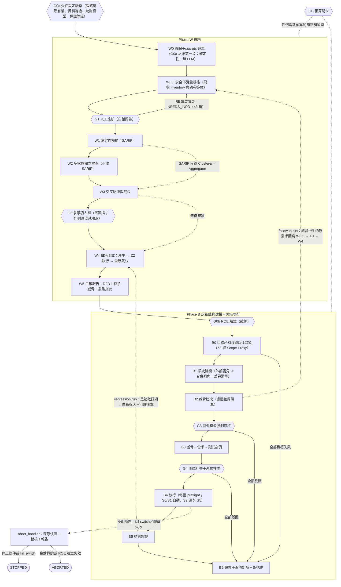

# 02 方法論：先白箱、後黑箱（威脅建模強制在前）

> 標記說明見 [README](../README.md#標記說明)。證據 ID 對應 [evidence/ledger.md](evidence/ledger.md)。

## v0.4 變更摘要

依 [2026-10-24 設計審查](evidence/review-2026-10-24.md) 的第一優先項目修正裁決規則與 validator（規則細節見 [05 v0.4 變更摘要](05-bias-calibration.md#v04-變更摘要)；`rule_version` 為 `05-v0.4`）：
- **R0** 在叢集另有 SARIF 或 FAIL 類測試證據時不成立；**R10**：G2 駁回後出現 `E_proof` → `CONFIRMED_EXECUTABLE`（加註 `post_g2_conflict`）；**R11** 只有在 PASS 有正對照（`oracle_can_fail`）時才降級。
- 只有 `NOT_CHECKED` 證據的發現項不計入獨立家族；程式片段至少 12 個非空白字元並含識別字，且必須在發現項的切片中。
- SARIF 只佐證自己位置（檔案、符號、桶）的叢集；黑箱叢集不收 SARIF。
- CMD-1 計畫必須涵蓋 run 的**每個**切片，且每個切片的 reviewer 至少 min(2, 合格家族數) 個家族（`E-PLAN-COVERAGE`、`E-PLAN-FAMILIES`）。
- 自架（Z4）模型改由 `toolkit.yaml` 的 `z4_model_hosts` 確切主機名稱判定，不再看 `z4-` 前綴。
- `graphql_operation: query／introspection` 只在 ROE 為該目標宣告的 GraphQL 路徑（`targets[].graphql_paths`）、方法為 GET／POST 時才算讀取；其他帶這個標籤的請求一律 S3。
- **第二優先**（v0.4 第二輪）：G0a 增加跨境聲明（`data_transfer`，`E-ENG-TRANSFER`）與設定檔釘選（`config_pins`，`E-ENG-CONFIG-PIN`）；W0 增加個資掃描（遮罩表 `kind: pii`）；ROE 增加事故應變（`incident_response`，`E-ROE-INCIDENT`）；關卡時間以 Audit Writer 收件時間為準。架構面的修正見 [03 v0.4](03-system-architecture.md#v04-變更摘要)。

## v0.3 變更摘要

- **保證等級**：新增 [§1.7](#17-保證等級liteteamfull)，定義 `lite`／`team`／`full` 三種等級：
  - `lite`：一人可以兼任多個角色，但必須有 `role_consolidation` 聲明；只允許 S0／S1，所以沒有 G5。兼任的 `test_lead` 可以自己做法務審查聲明（警告 `W-L5-LITE`，報告首頁標示為自行簽署）。
  - `team`：ROE 的每個簽署角色都由不同的人擔任。
  - `full`：G5 需要兩位資安審查者；只有 `full` 可以用 adaptive relay。
  - 三種等級的安全底線相同 [H]。
  - （M-G3、L-13、N-11）
- **簡化**：
  - G2 維持不阻擋。
  - `lite`，或測試計畫只有 S0／S1 job 時，G3 與 G4 可以在同一次審查中處理，但仍是兩份簽章紀錄。
  - B3 優先用樣板 adapter。
  - Commander 保留，但它的計畫必須是覆蓋下限計畫的超集合，並且要量測它的額外價值。
  - （M-G4）
- **W0 是 G0a 之後的第一步**：
  - secrets 掃描與遮罩在任何 LLM 呼叫之前完成。
  - 程式碼只能經 Slicer（已套用遮罩）送往 LLM。
  - W0.5 的 Invariant Drafter 只收 W0 inventory（名稱與事實，不含程式碼）與 G1 問卷答案，工具只有 `read_inventory`。
  - （H-C1）
- **W0 inventory 欄位**：新增 `frameworks[]`（支援程度）、endpoint 的 `kind`、`db.tables[]` 的 RLS 狀態與 policy、`auth`、`env_vars[]`（只有名稱）、`blind_spots[]`、`features[]`；完成條件改用這些欄位。（H-E1、A-1）
- **W0.5／G1**：
  - 不變量新增資料分級、LLM 工具、`limits`、`policies` 與結構化的 `ownership`。
  - 基準是 ASVS 5.0 L1，依功能觸發 L2／L3（`level_triggers`）。
  - G1 改用白話問卷。
  - （H-E4、A-2）
- **工具輸出只給程式碼**：W1 的 SARIF 只交給確定性的 Clusterer／Aggregator；W2 與 W3 的 LLM 輸入不再含 SARIF。（H-A1）
- **W1** 新增兩項檢查：前端 bundle 的公開前綴環境變數、以 migration 分析 RLS。CodeQL 的授權說法改成與 07 一致。（M-G5、A-10）
- **W2 審查面向**：
  - 由 6 個增為 12 個，分成 3 組，每組一次呼叫。
  - 新增面向與 CWE 桶的對照表。
  - 必要面向由 W0 `features[]` 決定（`E-PLAN-FACETS`）。
  - （H-F1、L-22）
- **W2 證據種類**：分成 `code_snippet`／`inventory_fact`／`config_fact`。片段比對的對象是遮罩後的文字，容許空白差異與 ±3 行位移。（H-A5、L-16）
- **Commander**：
  - 沒有任何工具，只收程式碼建立的型別化視圖。
  - `extra_dispatch.target` 有型別。
  - CMD-2 至多 2 輪。
  - 輸出不合規 → 修復 ≤2 次 → 改用程式碼的預設（覆蓋下限計畫）。
  - （H-C2、N-6）
- **W4**：
  - 輸入加入 `DISPUTED`，以及成員最高嚴重度為 critical／high 的 `UNCORROBORATED` 叢集。
  - 解讀已事先登記的確定性 FAIL 直接是 `E_proof`；Result Analyst 池只在解讀無法事先登記時使用。
  - 新增兩種測試：以腳本式假模型輸出測試工具防護；在 Z2 以拋棄式本地 Postgres 測試 RLS。
  - （A-4、H-A3、M-G5）
- **W5**：
  - 叢集有跨 run 的指紋與 `baseline_state`（new／unchanged／updated／absent）。
  - 核准綁定逐項 hash，下一個 run 只重審變更的項目；G5 永遠不沿用。
  - 報告加入覆蓋指標。
  - （H-B5、M-G5）
- **關卡核准者的來源**：G0a／G1／G2 取自委任設定的 `gate_approvers`；G0b／G3／G4／G5 取自 ROE；G3／G4／G5 必須在 ROE 有效期間內決定，G0b 除外（它本身就是發現 ROE 未生效並讓 run 暫停的檢查；[§1.3](#13-人工關卡一覽)）。（H-D2）
- **G0b 結果的寫法統一**：ROE 尚未生效或不在時間窗內 → `VERIFIED`，run → `SUSPENDED`；`EXPIRED` 只用於 ROE 已過期。（A-9）
- **B0**：
  - 共享平台網域改用 `platform_project` 證明，並在 ROE 記錄 `platform_policies[]`。
  - B0 與 `B4_preflight` 檢查 staging 的版本識別。
  - 每批開始前，對每個測試角色做 whoami。
  - （H-D3、H-B4、H-E8）
- **B1**：
  - 爬行只用 GET／HEAD／OPTIONS，過濾登出與刪除連結，有請求上限與 allowlist。
  - 沒有 OpenAPI 的應用，由 W0 inventory 起草 spec，在 G4 審查。
  - （H-E7、L-17、H-E10）
- **B2**：merger 改為確定性（合併鍵＝DFD 元素＋STRIDE 類別＋CWE 桶），另由 LLM critic 找遺漏；呼叫數的寫法與流程一致。（M-G5、L-03）
- **B3／B4**：
  - 測試案例必須有 `controls[]`；任一對照未通過 → `INVALID`。
  - 所有寫入都要綁種子或 create-only 端點（`{seed:}`、`{created:}`）。
  - （H-B1、H-B3）
- **B5**：黑箱起源的叢集（`origin: black_box`）也走同一套裁決；Result Analyst 改為每個家族一位的池。（H-A3）
- **B6**：新增 SARIF 匯出規格、對照通過率、`build_unverified_targets`、暫定（`provisional`）標記。（M-G6、H-E11）
- **流程圖**：補上 G3／G4／B0 → B6，以及 abort_handler → `STOPPED`／`ABORTED` 的邊。（L-10）
- [§4](#4-階段之間的交接與回饋) 交接表與 [§5](#5-階段與關卡規格總表) 規格總表已同步更新。

## v0.2 變更摘要

- **Secrets 先於任何 LLM**：W0 改為完全確定性（盤點＋secrets 掃描＋路徑黑名單＋`secrets-redaction-map`）；W1 不再負責 secrets；W0.5 以後所有 LLM 只收遮罩後內容；沒有 `redaction_map_ref` 的 run，Model Gateway 一律拒絕 [H]。
- **關卡結果與終止狀態**：每個人工關卡回傳 `APPROVED`／`PARTIALLY_APPROVED`（只 G3、G4）／`REJECTED`／`NEEDS_INFO`／`EXPIRED`，各有處理路徑；run 狀態 enum 固定為 8 種（[§1.4](#14-關卡結果與-run-狀態)）。
- **新節點**：`B0_ownership_verify`（Z3）、`B4_preflight`（每批重驗）、`W4_exec`／`W4_readjudicate`、`GB_budget_gate`（預算關卡）、`abort_handler`（補償）、`claim_run`（自動觸發的人工認領）。
- **執行種類**：`run_kind` = `initial`／`followup`／`regression`／`lane_a`，附 `parent_run_id` 與 `reuse`（[§1.6](#16-執行種類與後續執行)）。
- **種子威脅與 G3**：規則改為「每個非 REJECTED 叢集都有 ≥1 個 B3 測試案例，**或**有 G3 駁回紀錄（附理由）」。
- **G2 路由**：只有 DISPUTED 與高嚴重度的 UNCORROBORATED 進 G2；佇列為空就略過 G2。
- **B1 差異清單**成為 B2 的正式輸入，B2 critic 必須逐項處置。
- 定義「**高風險威脅**」（[B2](#b2-威脅建模g3-強制簽核)）。
- Lane A 的單一家族 diff 審查只有**參考性**，結果最高 `UNCORROBORATED`（05 R9），且在下一個 Lane B run 中不計入 `independent_families`。
- **G2 之後才出現的爭議**：由 `W4_readjudicate` 產生的 `DISPUTED` 不重開 G2，而是在 G3 的種子威脅清單標為「W4 後轉為爭議」；由 `B5_readjudicate` 產生者列入 B6 的人工複核清單 [H]。裁決規則對齊 05 的 R0–R13。
- 儀表板移出範圍；報告為靜態 HTML＋SARIF＋JSON。
- 新增 [§5 階段與關卡規格總表](#5-階段與關卡規格總表)：每個階段與關卡的輸入、輸出、執行區、是否用 LLM、失敗處理、完成條件、schema、里程碑。
- 模型命名統一為 GPT-6 Astra／Sol（[P][E:providers-31]）。
- **W0 預設 secrets 掃描器**改為 Betterleaks／gitleaks（MIT）；TruffleHog（AGPL-3.0）改為選用，須通過授權登錄的法務閘門。
- **G0b 加入法務審查聲明檢查**（`legal_review`，規則 L-1～L-6，見 [06 §2.1.1](06-security-legal-limitations.md#211-roe-的法務審查聲明legal_reviewg0b-檢查h)）。
- **G0b 之前不讀 ROE**：W0 只用 G0a 已驗章的委任設定與工具包設定；W0 能不能用 TruffleHog，只看工具包層級的法務閘門是否已結案，不看 ROE 的 `legal_review`。依 `component_licenses` 過濾元件（L-6）在 G0b 進行，結果記入 G0b GateRecord，供 B 階段使用 [H]。
- **ROE 或 `legal_review` 在執行中到期** → `SUSPENDED`（保留 checkpoint；resume 需要一份新的有效 ROE，由 `B4_preflight` 強制）。只有驗章失效（金鑰撤銷、簽章無效、文件被改）才 `ABORTED` [H]。

## 1. 總覽

### 1.1 流程

完整狀態機（含失敗、駁回、逾時、終止狀態與 resume）見 [03 §5](03-system-architecture.md#5-run-controllerlanggraph-狀態機)。

### 1.2 為什麼先白箱、後黑箱
- NIST SP 800-115 附錄 C：白箱技術對自製應用的缺陷**較有效率、成本較低**；黑箱技術用於元件之間、與使用者、其他系統、環境的互動；兩者合用稱為 gray-box [V][E:blackbox-31]。
- NIST SSDF SP 800-218 v1.1（目前的正式版；v1.2 仍是草案 [V][E:threat_modeling-48]）的三項實務剛好對應三個階段 [V][E:threat_modeling-49]：
  - PW.1.1 風險建模 → B2
  - PW.7 審查程式碼 → W1–W3
  - PW.8 測試可執行碼 → W4、B4
- 白箱產物（DFD、發現項、安全不變量）讓黑箱的威脅建模有具體依據。所以 **B 階段的威脅建模是灰箱**，**測試執行只經外部介面，是黑箱**。另外保留一組**只看外部視角**的威脅建模 agent，維持純黑箱觀點（見 [B1](#b1-系統建模兩個獨立視角)）。

### 1.3 人工關卡一覽

| 關卡 | 位置 | 核准內容 | 必要核准角色 | 可能結果 | 為何必要 |
|---|---|---|---|---|---|
| G0a | W0 之前（每次 run 開始都重驗；通過後的第一個節點就是 W0） | 委任設定（[schemas/engagement.schema.json](schemas/engagement.schema.json)）：程式碼所有權聲明、資料等級、每個等級允許的模型、保證等級（`assurance_profile`，[§1.7](#17-保證等級liteteamfull)）、關卡核准者清單（`gate_approvers`） | 應用擁有者（另可加管理層）；簽署人必須列在 `gate_approvers.G0a` | 離線驗章：`VERIFIED`／`VERIFY_FAILED`／`EXPIRED` | 程式碼要送往 LLM、在 Z2 執行之前，必須先有授權 |
| G0b | B 階段入口（每次 run 與每次 resume 都重驗） | ROE（範圍、時間窗、停止條件、目標所有權、版本識別方式、測試角色、法務審查聲明 `legal_review`） | 測試負責人＋管理層＋**基礎設施擁有者**（NIST SP 800-115 的簽核頁至少要測試負責人與管理層 [V][E:blackbox-29]）；`team`／`full` 必須是三個不同的人（`E-ROE-SOD`），`lite` 可由一人兼任（須有 `role_consolidation` 聲明） | 離線驗章：`VERIFIED`／`VERIFY_FAILED`／`EXPIRED`。ROE 尚未生效或不在時間窗內，結果仍是 `VERIFIED`（另記「不在有效期間或時間窗內」），run → `SUSPENDED`；`EXPIRED` 只用於 ROE 或 `legal_review` 已過期 | 沒有授權就不能碰網路 |
| G1 | W0.5 | 安全不變量規格（ASVS 5.0 L1 基準＋依功能觸發的 L2／L3、存取控制矩陣與 `ownership`、資料分級、LLM 工具權限、`limits`、`policies`）；以白話問卷蒐集答案 | 應用擁有者；必須列在 `gate_approvers.G1` | APPROVED／REJECTED／NEEDS_INFO／EXPIRED | vibe-coded 應用通常沒有安全需求，oracle 必須有人確認的來源 |
| G2 | W3 | DISPUTED 叢集與高嚴重度 UNCORROBORATED 叢集（逐項） | 資安審查者；必須列在 `gate_approvers.G2` | 逐項 accept／reject／needs_info；整體 APPROVED／EXPIRED（**不阻擋**：逾時的未決項視同 needs_info） | 跨家族衝突無法自動判定 |
| G3 | B2 | 威脅模型（可部分核准） | 資安審查者＋應用擁有者；列在 ROE 中，且在 ROE 有效期間內簽署 | APPROVED／PARTIALLY_APPROVED／REJECTED／NEEDS_INFO／EXPIRED | LLM 威脅建模準確度有限 [V][E:threat_modeling-20][E:threat_modeling-21] |
| G4 | B3（`lite`，或測試計畫只有 S0／S1 job 時，可與 G3 在同一次審查中處理，仍是兩份紀錄） | 測試計畫、每個產生的可執行產物、每個測試案例的 `controls[]`、（沒有 OpenAPI 時）起草的 spec；全部綁定 hash | 資安審查者；列在 ROE 中，且在 ROE 有效期間內簽署 | APPROVED／PARTIALLY_APPROVED（逐測試案例）／REJECTED／NEEDS_INFO／EXPIRED | 產物可能被受測 repo 的內容影響 |
| G5 | B4 | 每一次 S2 侵入性執行（`lite` 沒有 S2，所以沒有 G5） | 資安審查者，且**不得是發起者**；`full` 需要兩位不同的資安審查者（`E-G5-TWO-PERSON`）；列在 ROE 中，且在 ROE 有效期間內簽署 | APPROVED／REJECTED／NEEDS_INFO／EXPIRED（逐 job） | 可能影響 staging 可用性 |
| GB | 任何節點觸及預算上限時 | 延長（新上限）／停止本階段／中止 | run_owner 或委任設定指定的預算核准者 [H] | APPROVED（附選項）／REJECTED（＝停止本階段）／EXPIRED | 預算用盡時不能靜默刪減覆蓋 |

- 核准者必須登錄在組織的**金鑰登錄**（`key-registry.yaml`，由組織根金鑰簽署；見 [03 §6](03-system-architecture.md#6-人工關卡服務)）中，且具備該關卡要求的角色。ROE 與委任設定**不能**引入新的金鑰。
- **核准者清單的來源** [H]：
  - **G0a、G1、G2**：委任設定的 `gate_approvers`（每個關卡一份非空清單；範例為 `G0a: [frank, carol]`、`G1: [frank]`、`G2: [erin, heidi]`）。validator 檢查每位核准者都在該關卡的清單中（`E-GATE-APPROVER-ENG`）。G0a 另有一條：核准者必須恰好是委任設定的簽署人（`signatories`，`E-GATE-G0-APPROVERS`），所以 `gate_approvers.G0a` 要列出全部簽署人。這三個關卡都在 G0b 之前，那時還不能讀 ROE（見 [W0](#w0-盤點與-secrets-遮罩確定性無-llm)），所以核准者清單只能來自已在 G0a 驗章的委任設定。
  - **G0b、G3、G4、G5**：核准者必須列在 ROE 的 `signatories` 或 `gate_approvers`（`E-GATE-ROE-APPROVER`），G0b 的核准者必須恰好是 ROE 的簽署人（`E-GATE-G0-APPROVERS`）。**G3、G4、G5 的決定時間必須在 ROE 的 `not_before`–`not_after` 之內**（`E-GATE-ROE-VALIDITY`）；v0.2 只對 G4／G5 檢查，v0.3 擴大到 G3。G0b 不受這條限制：它本身就是發現 ROE 尚未生效、並讓 run 進入 `SUSPENDED` 的檢查（§1.4）。
  - **同一份關卡紀錄中，一個人只能以一個角色核准**（`E-GATE-SOD`）；唯一的例外是 `lite` 且有已確認的 `role_consolidation`，而且那個人就是兼任者（[§1.7](#17-保證等級liteteamfull)）。
- **保證等級**（[§1.7](#17-保證等級liteteamfull)）只決定誰可以兼任、G5 要幾個人；不改變金鑰登錄與驗章規則。
- **發起者（initiator）**：啟動該次執行、認領自動觸發的執行（`initiator_claim`），或核准 G4 的**人**；不能是自動化帳號（`toolkit.yaml` 的 `automation_accounts`，例如 `run-controller`、`scheduler`、`ci-bot`；這些帳號也不能當任何關卡的核准者，驗證器會強制檢查。見 [§1.5](#15-自動觸發與發起者)）。

核准記錄是**簽章紀錄**（核准者身分、角色、時間、產物 hash、逐項決定），由 Policy Engine 驗證；詳見 [03 §6](03-system-architecture.md#6-人工關卡服務)。

### 1.4 關卡結果與 run 狀態

**run 狀態 enum**（`run.schema.json` 的 `status`）：

| 狀態 | 意思 | 是否終止 |
|---|---|---|
| `RUNNING` | 正在執行節點 | 否 |
| `WAITING_GATE` | 停在人工關卡或 `claim_run` 的 interrupt | 否 |
| `SUSPENDED` | 關卡逾時、時間窗外、預算關卡逾時，或 ROE／`legal_review` 在執行中到期；checkpoint 保留，可在委任設定到期前 resume（B 階段的 resume 另需當時有效的 ROE；ROE 已到期 → 需要一份新簽署的有效 ROE，由 G0b 重驗與 `B4_preflight` 強制） | 否（可續跑） |
| `STOPPED` | 停止條件或 kill switch 觸發；已執行補償 | 否（需測試負責人簽署 resume） |
| `ABORTED` | 授權不成立（驗章失敗）、G1 三輪未通過、GB 選擇中止、ROE 在執行中驗章失效（金鑰撤銷、簽章無效、文件被改；**到期不算**，到期 → `SUSPENDED`） | 是 |
| `FAILED` | 無法恢復的技術錯誤（例如 W0 失敗、快照還原失敗） | 是 |
| `COMPLETED` | 全部完成，未能測試清單中只有設計上的 `MANUAL` 項 | 是 |
| `COMPLETED_WITH_GAPS` | 完成，但有計畫中的覆蓋沒做到（例如 G3 全部駁回、目標所有權失敗、版本識別不符、G5 駁回、執行錯誤或 `INVALID` 結果、GB 停止階段） | 是 |

**各關卡結果的處理**（[H]，依共同設計決定 D2）：

| 關卡 | APPROVED／PARTIALLY_APPROVED（後者只限 G3、G4） | REJECTED | NEEDS_INFO | EXPIRED |
|---|---|---|---|---|
| G0a／G0b | 離線驗章，結果只有 `VERIFIED`／`VERIFY_FAILED`／`EXPIRED`；`VERIFIED` 即繼續。例外（只 G0b）：ROE 尚未生效（`not_before` 未到）或不在測試時間窗內時，結果仍是 `VERIFIED`，另記「不在有效期間或時間窗內」，run → `SUSPENDED`，時間到了再 resume | `VERIFY_FAILED`（驗章失敗）→ `ABORTED`（例外：06 L-5 → `SUSPENDED` 等 ROE 修正） | — | G0a：委任設定已過期 → `ABORTED`。G0b（ROE 的 `not_after` 或 `legal_review.expires_at` 已過）：**進入 B 階段時**已過期 → 跳到 B6 → `COMPLETED_WITH_GAPS`（沒有提供 ROE 時也這樣處理）；**B 階段已開始後**（resume 或 `B4_preflight`）才到期 → `SUSPENDED`，等新的有效 ROE |
| G1 | 進入 W1 | 附審查意見回到 W0.5 重擬，最多 3 輪；第 3 輪仍未通過 → `ABORTED` | 同 REJECTED（共用 3 輪上限） | `SUSPENDED` |
| G2 | 逐項：accept → 維持狀態，成為種子威脅。整關結果只有 `APPROVED` 或 `EXPIRED` | 只能逐項（不接受整關 `REJECTED`）：該叢集 → `REJECTED`（附理由；對投票、SARIF 與 `E_fail_u` 是最終決定，之後的這類證據只註記 `post_g2_conflict`。例外：之後出現可執行證明 `E_proof` → `CONFIRMED_EXECUTABLE`，加註 `post_g2_conflict` 並列入 B6 人工複核，05 R10，v0.4） | 逐項：維持 `DISPUTED`／`UNCORROBORATED`，成為種子威脅並在報告列出 | 未決項視同 NEEDS_INFO，run 繼續 [H] |
| G3 | 已接受的威脅進入 B3；被駁回的種子威脅在 B6 列為「未做黑箱驗證（G3 駁回：理由）」 | 全部駁回 → 跳到 B6（只含白箱結果）→ `COMPLETED_WITH_GAPS` | 回到 `B2_merge_critic` 補充，最多 3 輪；之後仍 NEEDS_INFO 的項目視同駁回 [H] | `SUSPENDED` |
| G4 | 已核准的測試案例進入 B4 | 全部駁回 → 跳到 B6 → `COMPLETED_WITH_GAPS`；部分駁回的測試案例不執行，列入 B6 | 該測試案例回到 `B3_derive` 重做，最多 2 輪；之後視同駁回 [H] | `SUSPENDED` [H] |
| G5 | 執行該 S2 job（`full`：兩位不同的資安審查者都要 APPROVED） | 該 job 略過並記錄 | 該 job 略過並記錄（可在後續執行重提）[H] | 該 job 略過並記錄 |
| GB | 延長：以新上限回到觸頂的節點 | 停止本階段：W → 以現有結果直接到 W5；B → 直接到 B6；run 以 `COMPLETED_WITH_GAPS` 結束 | — | `SUSPENDED` [H] |
| GB（中止） | 選擇中止：B4 中 → `abort_handler`；其他 → `ABORTED` | | | |

各關卡的逾時預設值見 [03 §6](03-system-architecture.md#6-人工關卡服務)。

### 1.5 自動觸發與發起者
- 排程或合併到主幹觸發的 Lane B run，只能自動執行 **W0–W3**：沒有網路出站（Z2 只到鏡像）、不執行受測程式（W4 執行屬於「執行」）。紀錄上的發起者是委任設定指定的人類 **`run_owner`** [H]。
- 在做任何 **G1 決定**、進入 **W4** 或任何 **B 階段節點**之前，必須有一位人類以 `vibecheck run claim` **認領**該 run（稽核事件 `initiator_claim`，附簽章）。狀態機中是 `claim_run` 節點（interrupt）。
- 若 G1 可沿用上一版已簽核規格（[§1.6](#16-執行種類與後續執行)），自動觸發的 run 可以一路跑到 W3 後才停在 `claim_run`。
- 認領者成為發起者；**G5 核准者 ≠ 發起者**，G4 核准者也計入發起者集合。

### 1.6 執行種類與後續執行

| `run_kind` | 用途 | 從哪裡開始 | 關卡重簽規則 |
|---|---|---|---|
| `initial` | 第一次完整評估 | W0 | 全部 |
| `followup` | B2 衍生的新需求回寫、CMD-5 追加的測試 | W0（新 commit 時重算）→ W0.5 帶入「威脅衍生需求」草稿 | G1 只在不變量有變時重簽；G3、G4 只審新增或變更的項目（逐項 hash，見 [W5](#w5-白箱報告dfd種子威脅)）；G5 每個 S2 job 都要 |
| `regression` | 修正後重跑已確認問題的白箱回歸測試與對應黑箱測試 | W0 → W1 → W4（只跑回歸集）→ B 階段只跑對應測試案例 | 同上；通常沿用 G1 與 G3 |
| `lane_a` | 每個 PR 的同步檢查 | W0 → W1 →（可選）單一家族 diff 審查 → 結束 | 只需 G0a；不進 B 階段 |

- 每個 run 有 `parent_run_id`（`initial` 可為空）與 `reuse` 清單：以 content hash 引用上一個 run 的產物。只有當產物的**所有輸入 hash**（repo commit 或切片 `slice_id`、設定、模型 ID 與版本）都相同時才能沿用，否則重算 [H]。
- `followup`／`regression` run 另以 `baseline_run_id` 指定比較基準（通常就是 `parent_run_id`；`initial` 為 `null`）。W5 用它計算每個叢集的 `baseline_state`。
- **逐項沿用核准** [H]：
  - 新 run 仍有自己的 G3／G4 GateRecord；一個 run 只能列出自己的關卡紀錄。
  - 某個項目的 `item_sha256` 與基準 run 已核准的項目相同，而且 ROE 是同一份、仍在有效期間內時，標為「沿用」；審查者只需對新增或變更的項目做決定。
  - **G5 永遠不沿用**。
  - **紀錄方式**：沿用的項目仍逐項列在新 run 的 GateRecord `decisions[]`（`item_id`、`item_sha256`、`decision`），由該關卡的合格核准者簽署整份紀錄；validator 從項目內容重算每一項的 `item_sha256`。`decisions[]` 目前**沒有**標示「沿用」或指回基準 run 紀錄的欄位，validator 也不比對跨 run 的沿用。run 層級只有 `reuse[]` 列出沿用產物的 hash（範例 `followup` run 沿用上一個 run 的不變量與威脅模型）。
- **G0a／G0b 簽章每次 run 開始（與每次 resume）都重新驗證**，不能沿用。
- 回饋不在同一張圖內迴圈：CMD-5 只**建立**後續 run 的草稿（`followup` 或 `regression`），由人啟動或認領。

### 1.7 保證等級（Lite／Team／Full）

委任設定的 `assurance_profile`（`lite`／`team`／`full`）決定兩件事：**需要幾個人**，以及**允許哪些安全等級**。它在 G0a 驗章，run 中途不能改；要改就要重新簽署委任設定、開新的 run [H]。預設是 `team`，範例委任設定也是 `team`。下表的分級方式是設計選擇 [H]。

| 項目 | `lite` | `team` | `full` |
|---|---|---|---|
| 適合 | 單人開發者檢查自己的應用 | 有獨立資安審查者的團隊（v0.2 的規則，另加「ROE 簽署角色必須是不同的人」） | 處理個資或金流，或需要對外證明雙人核准 |
| 一人兼任多個角色 | 可以，但委任設定必須有 `role_consolidation`：`acknowledged: true`、`person_id` 是金鑰登錄中的兼任者、`statement` 寫明理由（`E-ENG-PROFILE`；其他等級不能有已確認的 `role_consolidation`）。沒有這份聲明就套用 `team` 的規則 | 不可以：ROE 的每個必要簽署角色（測試負責人、管理層、基礎設施擁有者）都要不同的人（`E-ROE-SOD`）；同一份關卡紀錄中一人只能有一個角色（`E-GATE-SOD`） | 同 `team` |
| 允許的安全等級 | 只有 S0／S1：工具包會執行的測試案例（`MANUAL` 除外）與 run 的每個 job 都檢查（`E-PROFILE-SAFETY`）；S3 一律拒絕 | S0、S1 自動；S2 逐次 G5；S3 一律拒絕 | 同 `team` |
| G5 | 沒有（因為沒有 S2） | 一位資安審查者，不得是發起者 | **兩位不同的**資安審查者，都不得是發起者（`E-G5-TWO-PERSON`） |
| G3 與 G4 同一次審查 | 可以 | 只在測試計畫只有 S0／S1 job 時 | 同 `team` |
| 多輪 LLM relay | 只有 `scripted` | 只有 `scripted` | `scripted` 或 `adaptive` |
| 法務審查聲明（06 L-5） | 兼任者可以自己聲明：警告 `W-L5-LITE`，報告首頁寫明「法務審查聲明為自行簽署」 | 聲明者不能是 `test_lead`（`E-L5`） | 同 `team` |
| 報告首頁 | 標示「單人模式，未經職責分離」，並附聲明全文；有 `W-L5-LITE` 時另標示法務審查聲明為自行簽署 | — | — |

- **兼任者**在金鑰登錄中仍須具備每個兼任的角色；兼任只免除「必須是不同的人」，不免除角色登錄與簽章。
- **G3 與 G4 同一次審查** [H]：
  - 做法：G3 簽核後，`CMD4_testplan` 與 B3 立即產生測試案例並開 G4，審查者接著在同一次審查中處理。
  - 兩者仍是兩份 GateRecord，各自簽章、各自綁定產物 hash。G4 在 G3 之後才開，所以 G3 駁回的威脅不會有測試案例出現在 G4。
  - 這樣只省去等待與排程，不省去任何一個決定。
- **不隨等級改變的安全底線**：
  - 遮罩先於任何 LLM 呼叫（W0）；沒有 `redaction_map_ref`，Model Gateway 就拒絕。
  - 只測 staging，不測正式環境。
  - 目標所有權證明（共享平台用 `platform_project`，並在 ROE 記錄已接受的平台測試政策 `platform_policies[]`）；B4 每批重驗。
  - Scope Proxy 與出站白名單；ROE 排除清單。
  - 停止條件與 kill switch。
  - 關卡簽章、金鑰登錄與驗章；自動化帳號不能核准任何關卡。
- **已知限制**：`lite` 無法提供職責分離。
  - 同一個人起草、核准並執行時，簽章只證明「這個人核准了」，不能證明有第二個人看過。
  - `lite` 用「只允許 S0／S1」限制可能的損害，但不能取代第二位審查者。
  - 這列在 [06 §3](06-security-legal-limitations.md#3-做不到不承諾的事)（#26）；職責分離的整體規則見 [06 §1.6](06-security-legal-limitations.md#16-人工關卡的完整性與簽章d11)。
  - **`legal_review` 的 L-5**（聲明者不能是 `test_lead`，[06 §2.1.1](06-security-legal-limitations.md#211-roe-的法務審查聲明legal_reviewg0b-檢查h)）在 `lite` 下已定案 [H]：
    - `lite`、`role_consolidation` 已確認（`acknowledged: true`），而且 `legal_review.attested_by` 就是 `role_consolidation.person_id` 這位兼任的 `test_lead` → 不是錯誤，而是警告 `W-L5-LITE`。報告首頁必須寫明「法務審查聲明為自行簽署」。
    - 其他情況（`team`、`full`，或 `lite` 但沒有已確認的兼任聲明，或聲明者不是兼任者）照舊：聲明者是 `test_lead` → `E-L5`（G0b `VERIFY_FAILED`，理由 `legal_attester_is_test_lead`；run `SUSPENDED` 等 ROE 修正）。
    - 自行簽署的聲明只證明兼任者自己確認過法務範圍，不能取代法務人員的審查；L-1～L-4、L-6 照常檢查。

**怎麼選**：一個人開發、想在上線前檢查自己的 vibe-coded 應用，選 `lite`。白箱階段完整執行；黑箱只做被動與良性主動測試（S0／S1），不需要第二個人，但報告會標示沒有職責分離。要跑可能寫入資料或影響 staging 可用性的 S2 測試（例如 `zap:active`），就需要另一位資安審查者核准 G5，選 `team`。處理個資或金流、要用 adaptive 多輪 LLM 測試，或需要對外證明「兩人核准」，選 `full`。另外，G5 抽查發現不符時，該 engagement 從下一個 run 起改用 `full`（[06 §1.1](06-security-legal-limitations.md#11-以-owasp-agentic-top-10-檢視工具包)）。以上選擇建議是設計假設 [H]。

## 2. 白箱階段（W0–W5）

### W0 盤點與 secrets 遮罩（確定性，無 LLM）
- **位置**：W0 是 **G0a 通過後的第一個節點**（Lane A 也一樣）。W0 完成、`redaction_map_ref` 寫入 run 紀錄之前，沒有任何 LLM 呼叫 [H]。
- **前提**：G0a 委任設定已驗章（[03 §6](03-system-architecture.md#6-人工關卡服務)）；未標記資料等級的 repo 視為 C。
- **W0 不讀 ROE** [H]：W0 在 G0b 之前執行，此時 ROE 的簽章還沒驗過，所以 W0（以及 G0b 之前的任何節點）**不使用 ROE 的任何欄位**，只用 G0a 已驗章的委任設定（資料等級、允許模型等）與工具包設定（`toolkit.yaml`、`tools.yaml`、`licenses.yaml`）。
- **輸入**：repo（唯讀，固定 commit SHA）、`toolkit.yaml` 的路徑黑名單。執行位置：Z2。
- **做法**（全部是確定性工具與解析器，**不用 LLM**）：
  1. **Secrets 掃描最先跑**：**預設**用 Betterleaks [P][E:whitebox-09] 或 gitleaks（已宣布只修安全問題），兩者都是 MIT 授權。TruffleHog（AGPL-3.0）[V][E:whitebox-10] 是**選用**：[06 §2.3](06-security-legal-limitations.md#23-授權登錄表) 把它列為法務閘門；只有在工具包層級的法務閘門已結案（[07 §3](07-roadmap.md#3-入口閘門法務與查證) 確認、`trufflehog:scan` 已註冊，見 [08 §2.3](08-implementation-spec.md#23-擴充介面)）時，W0 才能使用它 [H]。這個判斷不讀 ROE 的 `legal_review`（ROE 此時尚未驗章）；ROE 的 `component_licenses` 只在 G0b 用來過濾 B 階段的元件（06 L-6）。TruffleHog 的驗證會把找到的憑證送到供應商 API → W0 一律 `--no-verification`；若要驗證，那是 B 階段的另一個步驟：必須寫進 ROE（`secrets_verification`），通過 G0b 與所有權驗證後從 Z3 發出、留紀錄，否則建議直接輪替。
  2. **路徑黑名單**（`.env*`、金鑰與憑證檔、auth-state 目錄、CI secrets 檔）**完全不進任何後續產物**。
  2a. **個資掃描**（v0.4）[H]：secrets 之後，以確定性個資偵測器（候選為 Presidio，[08 §11.17](08-implementation-spec.md#1117-確定性輔助規則)）掃描所有文字檔；repo 中的測試 fixture、種子 dump、提交進來的日誌可能含真實個資。命中的值像 secrets 一樣遮罩，記入遮罩對照表（`kind: pii`）。偵測器有漏報，只能降低風險（[06 §1.3](06-security-legal-limitations.md#13-秘密與資料)）。
  3. **遮罩對照表 `secrets-redaction-map`**（`redaction-map.schema.json`，run 以 `redaction_map_ref` 參照）：`hash_alg`、`hmac_key_ref` 與 `entries[]`；每筆只存位置、類型、值的 **HMAC** 與遮罩代號，**不存值**；再以 pattern＋entropy 作第二層遮罩規則（掃描器 recall 不完美，Betterleaks 的 98.6% recall 只是廠商宣稱 [P][E:whitebox-09]）。
  4. 以遮罩後的檔案，由各框架的確定性抽取器（`inventory:<name>`）建立 `inventory.json`，欄位見下表。支援矩陣與各抽取器的限制見 [08 §11.1](08-implementation-spec.md#111-w0-盤點抽取器與支援矩陣)。
  5. 相依清單；Syft 產生 SBOM（CycloneDX／SPDX）[V][E:whitebox-14]。

**inventory 的欄位**（`inventory.schema.json`；陣列可以是空的）[H]：

| 欄位 | 內容 |
|---|---|
| `frameworks[]` | 偵測到的框架、版本、使用的抽取器、支援程度（`full`／`partial`／`unsupported`） |
| `endpoints[]` | 每個 entry point 的 `method`、`path`、handler 位置（`file`、`line`）、`kind`（`http`／`server_action`／`graphql`／`rpc`／`baas_direct`／`webhook`）、`auth_required`（無法判定時為 `null`，不猜）、套用的 auth middleware（`middleware_refs[]`，指向 `auth.middleware[].middleware_id`）。排程工作沒有對應的 `kind`，記為一筆 `blind_spots[]`（`other`；schema 尚未涵蓋，見 [09 BL-19](09-backlog.md)） |
| `db` | `engine`；`tables[]`（`table_id`、`schema`、`name`、`rls_enabled`〔`true`／`false`；無法判定或引擎沒有 RLS 時為 `null`〕、`policies[]`〔`name`、`command`、`roles`、`source`〕、`source`）；`functions[]`（`name`、`security_definer`、`source`）；`storage_buckets[]`（`name`、`public`、`source`）。`source` 都是 `{file, line}` |
| `auth` | `providers[]`（字串）、`middleware[]`（`middleware_id`、`name`、`file`、`line`）、`roles[]` |
| `env_vars[]` | **只有名稱**，永遠不取值：`name`、`public_prefix`、`referenced_in[]`（`{file, line}`）。`public_prefix` 為 true ⇔ 名稱以 `NEXT_PUBLIC_`、`VITE_`、`EXPO_PUBLIC_` 或 `PUBLIC_` 開頭（會被打包進前端；validator 重算，`E-INVENTORY`） |
| `llm_integrations[]` | LLM 相關的程式位置（`file`、`line`）與 `kind`：`llm_call`、`tool_definition`、`prompt_template`、`rag_store`。工具的權限不在 inventory，而在 G1 的 `llm_tools[]` |
| `features[]` | 由程式碼判定的功能：`file_upload`、`outbound_http`、`webhook_inbound`、`payments`、`oauth`、`llm_tools`、`frontend_bundle`、`crypto`。它決定 W0.5 的 L2／L3 觸發與 W2 的必要面向 |
| `blind_spots[]` | W0 看不到的地方，各有 `kind` 與 `description`：`dashboard_only_setting`（只在平台後台設定的 RLS、認證、storage 規則）、`unsupported_framework`、`dynamic_route`、`generated_code`、`other` |

- 另有 `files[]`（每個檔案的 `path`、`sha256`、`language`、`bytes`、是否 `excluded` 與 `exclude_reason`）、`manifests[]`、`redaction_map_ref`、`sbom_ref`。validator 檢查每個來源位置的 `file` 都列在 `files[]`、`middleware_refs` 都存在、`table_id` 不重複（`E-INVENTORY`）。
- 範例 `inventory.example.json`：`features` 為 `file_upload`、`llm_tools`、`payments`；`db.tables[0]` 是 `invoices`，`rls_enabled: false`（F-061 的 `inventory_fact` 就指向 `/db/tables/0/rls_enabled`）。
- 公開前綴的清單是設計選擇；各框架「這類前綴的變數會被打包進前端」的行為，本輪沒有另外查證 [H]。
- **輸出**：`inventory.json`、SBOM、`secrets-redaction-map`、secrets 發現清單（只含位置與 hash）。
- **強制點**：
  - `redaction_map_ref` 寫入 run 紀錄之後，Model Gateway 才接受該 run 的任何請求；沒有就拒絕（fail-closed）[H]。
  - 所有之後送往 LLM 的內容（切片、inventory、Z2 輸出、測試日誌）都先套用遮罩。
  - **程式碼只能經 Slicer 送往 LLM** [H]：Slicer 從遮罩後的檔案產生切片，`slice_id` 納入遮罩對照表的 hash（[08 §11.3](08-implementation-spec.md#113-slicer)）；沒有其他路徑能把檔案內容放進 prompt。
- **重點**：Commander 的輸入是程式碼從這些確定性產物建立的**型別化視圖**（ID、狀態、數量等），不含 LLM 對程式碼的自由文字摘要，也不含 repo 的文字（見 [W2](#w2-多家族獨立審查) 的 CMD-1）。原因：受測 repo 可能含有影響 LLM 的文字，已有預印本顯示經 LLM 最佳化的 PR metadata 框架攻擊能讓 LLM 安全審查漏判 33 個 CVE 中的 32 個（範本式攻擊無效）[V：預印本][E:whitebox-29]。
- **完成條件** [H]：
  - `frameworks[]` 的每一項都有支援程度；`unsupported` 的框架在 `blind_spots[]` 各有一筆。
  - 每個 `endpoints[]` 項目都有 `kind` 與 handler 位置。
  - 每個 `db.tables[]` 項目都有 `rls_enabled`；值為 `null` 且原因是設定可能只在平台後台時，`blind_spots[]` 有一筆 `dashboard_only_setting`。
  - `env_vars[]` 只有名稱；`features[]` 已判定（可以是空陣列）。
  - 遮罩對照表已寫入。
  - W0 任何子步驟失敗 → run `FAILED`（沒有遮罩就不能繼續）。抽取器只有 `partial` 支援不算失敗，但報告首頁會列出。

### W0.5 安全不變量規格（Security Invariants Spec）＋ G1
- **問題**：LLM 產生的測試傾向記錄程式「實際行為」而非「預期行為」[V][E:whitebox-43]。vibe coding 的原始定義就是「忘了程式碼的存在」、不讀 diff [V][E:vibe_risks-01]，因此通常也不會有書面安全需求 [H]，oracle 沒有可靠來源。
- **輸入（只有這些）** [H]：
  - W0 inventory：名稱與事實（路由、資料表與 RLS 狀態、角色、環境變數名稱、`features[]`）。**不含程式碼**，也沒有切片；切片要到 G1 之後的 W2 才產生。
  - G1 問卷答案（見下）。
  - `followup` run：B2 衍生的需求草稿。
  - Invariant Drafter 的工具只有 `read_inventory` 與 `write_blackboard`，沒有 `read_slice`。inventory 裡的名稱仍來自受測 repo，所以照樣視為不可信資料：系統提示區分指令與資料，而且每一條都要人在 G1 確認。
- **G1 問卷** [H]（格式見 [08 §11.4](08-implementation-spec.md#114-g1-問卷與-invariants-格式)）：
  - 程式碼依 W0 inventory 產生白話問題，由應用擁有者在 W0.5 起草之前回答。例如：
    - 「使用者 A 能不能看到使用者 B 的發票？」（每個角色 × 資源一題）
    - 「哪些欄位是個資或機密？」
    - 「AI 助理的哪些動作要先經人確認？」（每個 LLM 工具一題）
    - 「每位使用者每分鐘最多可以送幾次請求？」
  - 能用選項的就用選項。答案原文保存；G1 呈現每一條草稿時，並列它來自哪一個答案。
  - 後續 run 沿用上一版答案，只問新增的項目。
- **做法**：
  1. **基準需求**：OWASP ASVS 5.0 **Level 1** 是基準，依 W0 `features[]` 篩選適用的條目。L1 共 70 條，約佔全部需求的 20% [V][E:threat_modeling-43]，需求 ID 格式如 `v5.0.0-8.2.2` [V][E:threat_modeling-40]。
  2. **依功能觸發 L2／L3**（`invariants.yaml` 頂層的 `level_triggers[]`：`feature`、`standard`〔`asvs`／`aisvs`〕、`level`〔2／3〕、`sections[]`；各標準的整體基準等級另記在 `baseline_levels`〔`asvs`、`aisvs`，1–3〕。`baseline` 本身是條目陣列，所以觸發不放在它底下）[H]：
     - `feature` 必須是 W0 `features[]` 的值，或某條不變量的 `applies_to_features` 值；兩者都不是 → `E-INVARIANT-LEVEL`。
     - 例：有 `llm_tools` 時，加入 AISVS C9 的 L2 條目，例如 9.5.2（代表使用者行動時，下游呼叫帶有限定範圍的授權 token）與 9.5.3（存取控制由程式或政策引擎決定，不由模型決定）[V][E:threat_modeling-63]。
     - 例：有 `oauth` 時，加入 ASVS 5.0 V10（OAuth 與 OIDC）[V][E:threat_modeling-40] 的 L2 條目。
     - 範例 `invariants.yaml`：`baseline_levels` 為 ASVS 1、AISVS 1；`{feature: invoices, standard: asvs, level: 2, sections: ["8.2"]}` 涵蓋 ASVS 8.2.3，`{feature: support_agent, standard: aisvs, level: 2, sections: ["9.5"]}` 涵蓋 AISVS 9.5.2 與 9.5.3。`invoices`、`support_agent` 是不變量的 `applies_to_features` 值。
     - 任何引用 L2 以上條目的地方（`baseline` 條目本身、測試案例的 `requirement_ids` 與 `oracle.requirement_refs`），都必須有 `standard` 相同、`level` 夠高、`sections` 以章節前綴涵蓋該條目的觸發，或該標準的 `baseline_levels` ≥ 該等級（`E-INVARIANT-LEVEL`）。
  3. **應用專屬不變量**（`invariants.schema.json`）：
     - 存取控制矩陣：角色 × 資源 × 動作 → 允許／拒絕。每一格有結構化的 `ownership`（`none`／`owner_field`／`tenant_field`／`membership`，附 `field` 與 `via`），讓程式碼能產生測試；原本的 `condition` 文字保留給人讀。
     - 資料分級（`data_classification[]`）：每個 store／欄位的等級（`public`／`internal`／`confidential`／`restricted`），以及是否含個資。
     - LLM 工具權限（`llm_tools[]`）：副作用（`none`／`read`／`write`／`external`）、可觸發的角色、可接觸的資料分級、是否 `requires_human_confirmation`。OWASP 對 Excessive Agency 的建議是最小權限＋高影響動作需人核准 [V][E:blackbox-32]。
     - 上限（`limits[]`）：例如每位使用者每分鐘的請求數（範圍 `per_user`／`per_tenant`／`global`）。
     - 政策（`policies[]`）：CORS 與 redirect 允許清單、可上傳的檔案類型、允許的外連主機、webhook 簽章、CSP 等。
  4. 由 Invariant Drafter agent 根據 inventory 與問卷答案**起草**；`followup` run 另帶入 B2 衍生的需求草稿。再由人在 **G1** 逐條確認、修改或刪除。
  5. G1 `REJECTED`／`NEEDS_INFO` 時，審查意見連同上一版草稿回到 Drafter 重擬，最多 3 輪；之後 run `ABORTED`。`EXPIRED` → `SUSPENDED`。
- **輸出**：`invariants.yaml`（依 `invariants.schema.json`；每條有 `requirement_id`、`source`〔`asvs-5.0.0`／`aisvs-1.0`／`invariant`＝應用專屬；schema 沒有另外區分威脅衍生的需求〕、`signoff`）。逐項的 approval hash 不寫在 `invariants.yaml`，而是記在 G1 GateRecord 的 `decisions[].item_sha256`，由 validator 從條目內容重算。
- **完成條件**：
  - 已簽核。
  - W4 與 B3 的 oracle **只能引用 G1 已核准的條目**；G1 駁回的條目不能被測試（`E-TC-REQ-UNAPPROVED`）。
  - L2 以上的引用都有觸發（`E-INVARIANT-LEVEL`）。

### W1 確定性掃描（建立基準，不用 LLM）
- **輸入**：repo、SBOM、`secrets-redaction-map`、W0 inventory。執行位置：Z2 程式執行沙箱（見 [03 §2](03-system-architecture.md#2-部署與信任區)）。
- **工具**（輸出一律轉為 **SARIF 2.1.0** [V][E:whitebox-17]；SARIF 內的程式片段也套用遮罩；多工具結果的正規化與合併見 [08 §11.2](08-implementation-spec.md#112-工具結果正規化與合併)）：

| 類別 | 工具 | 注意 |
|---|---|---|
| SAST | Opengrep（LGPL-2.1，Semgrep CE 1.100.0 的 fork，含檔內跨函式 taint，需啟用 `--taint-intrafile`）[V][E:whitebox-06] 或 Semgrep CE | Semgrep 引擎是 LGPL，但官方規則自 2024-12 改用非開源的 Semgrep Rules License；CE 只做單檔、單函式分析 [V][E:whitebox-04]。官方規則（`semgrep:scan`）用於私有碼前須通過法務閘門；結案前 W1 只用 Opengrep＋自有規則（[07 §3](07-roadmap.md#3-入口閘門法務與查證)） |
| SAST（Python） | Bandit（Apache-2.0，有 SARIF formatter）[V][E:whitebox-08] | — |
| SAST（選用） | CodeQL（`codeql:analyze`） | CodeQL 條款允許在 GitHub.com 上託管與維護的開源碼庫做 CI／CD 的資料庫產生，限制只及於其他情境，例如私有碼 [P][E:whitebox-07][E:whitebox-53]。法務閘門結案前不註冊；CodeQL 只可用於符合上述條件的開源 repo（[07 §3](07-roadmap.md#3-入口閘門法務與查證)） |
| 相依漏洞 | OSV-Scanner（Apache-2.0）[V][E:whitebox-11]、Grype（EPSS／KEV 排序）[V][E:whitebox-14] | OSV-Scanner 的可達性判斷（call analysis）是選配功能，且不是每個生態系都支援 [V][E:whitebox-11] |
| 套件存在性 | 自建檢查：每個相依到 registry（經 Z2 的鏡像或 metadata 代理）查存在性、首次發布時間、下載量 | 對應套件幻覺：19.7% 的套件引用是幻覺名稱；43% 的幻覺名稱在 10 次重複查詢中每次都出現 [V][E:vibe_risks-13][E:vibe_risks-15] |
| RLS（自有規則） | 從 repo 的 SQL migration 確定性解析 `ENABLE ROW LEVEL SECURITY`、`CREATE POLICY`、`SECURITY DEFINER`，與 W0 `db` 對照 | 規則例：資料表沒有啟用 RLS；啟用了但沒有 policy；policy 對所有資料列都成立（例如 `USING (true)`）；`SECURITY DEFINER` function。只看得到 migration 中的設定；只在平台後台改過的設定屬於 `blind_spots[]`，由 B 階段補測 [H] |
| 前端公開變數（自有規則） | 對 W0 `env_vars[]` 中 `public_prefix` 為 true 的變數套用名稱規則；Z2 能 build 前端時，再對 build 輸出跑 W0 的 secrets 掃描器 | 名稱含 `SECRET`、`SERVICE_ROLE`、`PRIVATE_KEY` 等字樣的公開變數 → 發現項；bundle 內命中的值只記位置與 HMAC。已有報告指出 vibe-coded 應用常把 token 放進前端 bundle [P][E:vibe_risks-26]。build 失敗 → 只做名稱規則，並列為缺口 [H] |

- Secrets 掃描已移到 W0（v0.2）。
- **輸出**：`w1.sarif`、`deps-check.json`。
- **工具輸出只交給程式碼** [H]：W1 的輸出只交給 W3 的確定性 Clusterer 與 Aggregator，**不交給任何 LLM**；W2 reviewer、CMD-2 加派的 reviewer、W3 verifier 都看不到。原因：reviewer 若先看到工具結果，它的發現項就不再獨立於工具，之後「工具與模型互相佐證」等於同一個來源算了兩次（[05 §4.2](05-bias-calibration.md#42-裁決狀態與有序規則)）。
- **完成條件**：所有工具以鎖定版本執行完畢；任何工具失敗都要在報告中列出，不能靜默略過。

### W2 多家族獨立審查
- **輸入**：inventory、G1 已簽核規格、遮罩後切片、CMD-1 計畫。**不含 W1 的工具輸出**（SARIF、`deps-check.json`；見 [W1](#w1-確定性掃描建立基準不用-llm)）。
- **切片器（Slicer，確定性）**（完整規格見 [08 §11.3](08-implementation-spec.md#113-slicer)）：
  1. 以每個 entry point 為錨，依靜態呼叫圖納入 handler、被呼叫函式、相關 model／schema／RLS policy、auth middleware，直到 token 預算上限。
  2. **共同輸入上限（同等性單位）**：取所有參與模型中**最小的可用 context**。例如自架 Nemotron 3 Nano 的 Hugging Face 設定預設 256K [V][E:providers-05]，Claude 約 1M [V][E:providers-23]、OpenAI GPT-6 Astra／Sol 為 1,050,000 tokens [P][E:providers-31]。這樣可以確保各家族看到**相同輸入**。重新命名函式或變數就可能改變 LLM 的安全判斷 [P][E:multi_llm_bias-26]，所以輸入必須一致，比較才有意義。
  3. 流程超過上限時，以重疊方式切割並記錄；若某模型放不下某切片，就把該模型排除在此切片之外，並記錄缺少的家族。**不允許靜默截斷**。叢集裁決用的 `diversity_degraded` 另由 validator 從驗證票推導：可合格驗證的家族集合 E（家族與血統都不在叢集中的 verifier 家族）不是空的，而且計權合格票中不同家族的數目 < min(2, |E|) → true（[05 §4.2](05-bias-calibration.md#42-裁決狀態與有序規則)）[H]。
  4. 每個切片有 `slice_id`＝sha256(JCS({檔案範圍, 遮罩對照表的 hash, prompt 範本的 hash}))（依 `slice.schema.json`）。遮罩或 prompt 範本改變，切片就是新的 [H]。
- **規劃（CMD-1）** [H]：
  - 程式碼先從 W0 inventory 產生**覆蓋下限計畫**：每個切片 × 每個必要面向（見下）× 預設 reviewer。
  - Commander（LLM）收到的是程式碼建立的**型別化視圖**：切片 ID、entry point 的 `kind` 與數量、必要面向、可用家族、預算；**不含** repo 的文字或其他 LLM 的輸出。Commander **沒有任何工具**，不能讀 Blackboard。
  - 它的計畫必須是覆蓋下限計畫的**超集合**：只能加切片、面向或 agent，不能減。Policy Engine 檢查覆蓋、必要面向（`E-PLAN-FACETS`）、資料等級與模型相容、預算。v0.4 起 validator 另外檢查：run 的每個切片都在計畫中（`E-PLAN-COVERAGE`），每個切片指派的 reviewer 至少來自 min(2, 合格 reviewer 家族數) 個不同家族（`E-PLAN-FAMILIES`；合格家族的定義見 [05 §3 規則 3 的 quorum](05-bias-calibration.md#3-設計規則)）。v0.3 只檢查計畫列出的切片有沒有必要面向，計畫可以漏掉切片或每個切片只派一個家族。輸出不合規 → 修復 ≤2 次 → 改用覆蓋下限計畫。
  - Commander 是使用者要求的核心元件，所以保留；但它比覆蓋下限計畫**多帶來什麼**（多確認的問題、多花的 token），要逐里程碑量測：[07 M2-X12](07-roadmap.md#m2-白箱多家族審查) 要求報告列出 Commander 在下限之外加派的切片、面向與 CMD-2 輪次，以及其中產生 `LIKELY` 以上叢集的比例（只量測、不設門檻）。
- **審查方式**：
  - 同一切片平行交給 N 個不同家族的 reviewer。**第一輪彼此看不到對方結果**。多輪辯論中模型常由對轉錯，原因未定，作者列出從眾、諂媚等可能因素 [P][E:multi_llm_bias-21]；多數決本身就拿到辯論的大部分效益 [V][E:multi_llm_bias-16]。
  - **審查面向（facet）**：共 12 個，分成 3 組。
    - 每次呼叫處理一組（切片 × 面向組 × agent），只問該組中必要或計畫加入的面向；一組都沒有就不呼叫。
    - 所以 [03 §11](03-system-architecture.md#11-成本與延遲模型) 成本模型中的 G＝面向組數（≤3）[H]。

| 組 | 面向（`facet`） | 看什麼 | 對應的 CWE 桶（`cwe_bucket`） |
|---|---|---|---|
| A 存取與身分 | `authz` | 授權、IDOR／BOLA、功能層級授權 | `authz` |
| | `authn_session` | 認證、session、token 驗證 | `authn`、`crypto`、`config` |
| | `data_access` | 資料存取、RLS、查詢範圍 | `authz`、`injection`、`config` |
| | `business_logic` | 商業邏輯（對照 G1 規格） | `authz`、`other` |
| B 輸入與對外互動 | `injection` | 輸入處理與注入（SQL、命令、XSS、反序列化） | `injection`、`deserialization`、`path_traversal` |
| | `llm_integration` | LLM 整合：prompt 組裝、工具權限、輸出處理 | `llm_specific`、`authz`、`injection` |
| | `ssrf_outbound` | SSRF 與對外請求 | `ssrf` |
| | `webhooks_integrations` | webhook 與第三方 API 整合 | `authn`、`crypto`、`ssrf`、`config` |
| C 設定、檔案與前端 | `secrets_config` | secrets 與設定 | `secrets`、`config`、`crypto` |
| | `file_handling` | 檔案上傳、下載與路徑 | `path_traversal`、`deserialization`、`injection`、`config` |
| | `frontend_client` | 前端 bundle、XSS sink、瀏覽器直接呼叫 BaaS | `secrets`、`config`、`injection`、`authn` |
| | `crypto` | 加密、雜湊、簽章與隨機數 | `crypto`、`secrets` |

  - **對照表**就是 `tools/vchlib/facets.py` 的 `FACET_BUCKETS`。validator 檢查每個發現項所屬叢集的 `cwe_bucket` 落在該發現項 `facet` 的範圍內（`E-FINDING-FACET`）。
  - **分組與對照表是設計假設** [H]：
    - 同一組的面向通常看同一段程式（例如授權與資料存取都看查詢條件），合在一次呼叫可以少讀一次切片。分組只決定呼叫方式：schema 與 `facets.py` 沒有分組欄位，commander-plan 的 `slices[].facets` 記錄的是面向本身。
    - 對照表讓「面向的覆蓋」可以換算成「CWE 桶的覆蓋」；校準權重也是以桶計算（[05 §4.3](05-bias-calibration.md#43-投票加權)）。
  - **必要面向**：由程式碼從 W0 inventory 決定；Commander 計畫與覆蓋下限計畫都必須涵蓋（`E-PLAN-FACETS`）。
    - 一律：`authz`、`authn_session`、`injection`、`data_access`、`secrets_config`、`business_logic`
    - `llm_integrations[]` 不是空的 → 加 `llm_integration`
    - `features[]` 有 `file_upload` → 加 `file_handling`
    - 有 `outbound_http` → 加 `ssrf_outbound`
    - 有 `webhook_inbound` → 加 `webhooks_integrations`
    - 有 `frontend_bundle`，或任何 `env_vars[]` 的 `public_prefix` 為 true → 加 `frontend_client`
    - 有 `crypto` → 加 `crypto`
    - 規則實作在 `facets.mandatory_facets`（別名 `MANDATORY_FACETS`）。範例 inventory 有 `llm_integrations[]` 與 `file_upload`，所以必要面向是基本 6 個再加 `llm_integration`、`file_handling`。
  - reviewer 沒有 shell、沒有網路，工具只有 `read_slice`。系統提示明確區分「指令」與「待審資料」。
- **發現項要求**：每個發現項至少有一項證據，種類三選一（`finding.schema.json` 的 `evidence[].kind`）[H]：

| 種類 | 內容 | 用在 |
|---|---|---|
| `code_snippet` | `file`、`line_start`–`line_end`、遮罩後的逐字片段 | 程式裡「有」的問題 |
| `inventory_fact` | `fact_ref`：指向本 run W0 inventory 的 JSON Pointer（例如 `/db/tables/0/rls_enabled`）；`asserted`：主張的值（例如 `false`） | 「缺少某物」的問題，例如沒有 RLS、沒有 auth middleware |
| `config_fact` | `file`＋`key_path`（指向解析後、已遮罩設定檔的 JSON Pointer）＋`asserted`（值，或 `"<absent>"` 表示該鍵不存在） | 設定錯誤或缺少設定 |

  - `code_snippet` 的片段必須有實質內容（v0.4）：正規化後至少 12 個非空白字元，並含一個 3 字元以上的識別字；`file` 必須是該發現項切片中的檔案。不符 → `NOT_FOUND`，validator 報 `E-FINDING-EVIDENCE` [H]。

  每個發現項另附 CWE（可多個）、嚴重度、推理、引用的 G1 條目（若有）。模型只填這些內容；`finding_id`、`snippet_sha256`、`match`、`status` 等欄位由 harness 填。
- **比對**（harness，程式碼）：
  - `code_snippet` 比對的對象是**遮罩後**的切片文字：
    1. 先正規化空白：去掉每一行頭尾的空白、合併連續的空白與 tab、統一換行；片段前後的空白行不計（`vchlib.evidence.match_snippet`）。
    2. 在 `line_start − 3` 到 `line_end + 3` 的範圍內搜尋。
    3. 結果：在原位置找到 → `MATCHED`；位移後找到 → `MATCHED_SHIFTED`，由 harness 改寫行號；找不到 → `NOT_FOUND`；沒有檢查 → `NOT_CHECKED`。
  - `inventory_fact`：pointer 解析得到，且值等於 `asserted` → `MATCHED`；否則 `NOT_FOUND`。`config_fact` 同理（`"<absent>"` 在該鍵不存在時成立）。
  - 發現項的證據全部 `NOT_FOUND` → 發現項標 `UNVERIFIED`，但不刪除（STRIDE-GPT 的證據比對做法）[V][E:threat_modeling-15]。叢集要所有成員的每一項證據都 `NOT_FOUND`，**而且**沒有已解析的 SARIF、也沒有 FAIL 類測試證據，才依 R0 成為 `REJECTED`（v0.4；[05 §4.2](05-bias-calibration.md#42-裁決狀態與有序規則)）。
  - 只有已接地（`MATCHED`／`MATCHED_SHIFTED`）證據的發現項才計入獨立家族；只有 `NOT_CHECKED` 證據的不計入（v0.4）。
- **輸出**：`findings[]`（依 [schemas/finding.schema.json](schemas/finding.schema.json)）。
- **完成條件**：覆蓋下限（每個切片 × 每個必要面向）都有結果，或有記錄在案的缺票原因。

### W3 交叉驗證與裁決（＋G2）
- **輸入**：W2 發現項；W1 工具結果（**只給 Clusterer 與 Aggregator**，verifier 看不到）。
- **做法**（詳見 [05 §4](05-bias-calibration.md#4-叢集與裁決)）：
  1. **叢集**：以確定性叢集鍵合併不同模型描述的同一問題。只有工具結果、沒有模型發現項的位置怎麼成為叢集，見 [08 §11.2](08-implementation-spec.md#112-工具結果正規化與合併)。每個叢集都有跨 run 穩定的 `fingerprint`（見 [W5](#w5-白箱報告dfd種子威脅)）。
  2. **跨家族反駁式驗證**：驗證者的 `family` 與 `lineage` 都不能出現在叢集的回報者中；驗證時去除來源模型資訊、隨機排列候選順序；驗證者被要求「嘗試反駁」。verifier 只收切片與叢集成員的證據，不收 SARIF。
  3. **與工具結果相互佐證**（由程式碼）[H]：Aggregator 把對應同一位置與 CWE 桶的 SARIF 結果分成兩級：
     - **強佐證**（`tool_corroboration`）：該結果的 `(adapter, rule_id, tool_version)` 列在 `calibration.yaml` 的 `result.high_precision_rules`，桶等於叢集的桶，且 `precision_lower95` ≥ `result.thresholds.high_precision_min.value`（預設 0.90；設在校準檔，不在 `toolkit.yaml`）。`rule_id` 與 `tool_version` 取自該結果所屬稽核事件（`tool_invocation_end`）的 `payload.sarif_results[]` 與 `payload.tool_version`。校準之前這份清單是空的，所以沒有強佐證。
     - **弱訊號**（`tool_signal`）：其他所有 SARIF 結果，以及 W4／B5 的 `E_fail_u`。弱 SARIF 與 `E_fail_u` 各只算**一個**獨立來源（`independent_sources`），不能單獨確認。
  4. **規則式裁決**（Aggregator 是程式碼，不是 LLM），依 [05 §4.2](05-bias-calibration.md#42-裁決狀態與有序規則) 的有序規則 R0–R13：`CONFIRMED_CORROBORATED`／`LIKELY`／`UNCORROBORATED`／`DISPUTED`／`REJECTED`。裁決的 `rule_version` 是 `05-v0.4`。沒有經校準的投票支撐的裁決標為 `provisional`（暫定）：沒有 `calibration_version`、`theta_confirm` 為 null，或所有合格驗證模型在該桶的權重都是 0（定義見 05 §4.2）；報告照樣標示（[08 §11.11](08-implementation-spec.md#1111-校準前的預設)）。
  5. **CMD-2 加派** [H]：
     - 對 `DISPUTED` 與 `UNCORROBORATED` 叢集加派審查者或驗證者，**最多 2 輪**（`E-PLAN-ROUNDS`）。
     - Commander 收到的是程式碼建立的型別化視圖：叢集 ID、狀態、CWE 桶、嚴重度、家族、票數。視圖不含發現項的推理，也不含 repo 的文字。
     - `extra_dispatch[].target` 有型別：`{kind: cluster|slice|threat, id}`。
     - 加派的 reviewer 同樣看不到工具輸出。
     - 輸出不合規 → 修復 ≤2 次 → 不加派。
  6. **G2 佇列**（加派結束後，由程式碼計算）[H]：
     - 所有 `DISPUTED` 叢集；
     - 成員最高嚴重度為 `critical` 或 `high` 的 `UNCORROBORATED` 叢集。
     - 其他 `UNCORROBORATED` 叢集不進 G2，直接成為種子威脅並在報告中列出。
     - `no_eligible_verifier` 的叢集（所有 verifier 家族都已回報，沒有人能驗證）通常是 `LIKELY`，不進 G2；它們成為種子威脅，由 W4 與 B 階段的測試確認（[05 §3](05-bias-calibration.md#3-設計規則)）。
     - **佇列為空就略過 G2**（稽核事件 `gate_skipped`，附原因）。
  7. G2 逐項：accept → 維持狀態；reject → `REJECTED`（附理由）；needs_info 或逾時 → 維持狀態並在報告列出。三者除 `REJECTED` 外都成為種子威脅。**G2 不阻擋**：逾時的未決項視同 needs_info，run 繼續（[§1.4](#14-關卡結果與-run-狀態)）。
- **輸出**：`clusters[]`、`verdicts[]`（含 `rule_trace`、`tool_corroboration`、`tool_signal`、`independent_sources`、`provisional`）、G2 GateRecord（若有）。
- **完成條件**：每個叢集都有裁決與 `rule_trace`；缺票與多樣性降低都已註記；G2 佇列中每項都有決定或已標逾時。

### W4 白箱測試（oracle 只取自 G1 規格）
- **輸入**：
  - G1 已簽核規格；
  - 叢集：裁決為 `LIKELY` 以上者、**所有 `DISPUTED`**、成員最高嚴重度為 critical／high 的 `UNCORROBORATED`；
  - 遮罩後的程式碼（經 Slicer）。
  - W4 要化解爭議，所以必須拿到爭議叢集；v0.2 只給 `LIKELY` 以上，與「化解跨家族爭議」的目的矛盾。
- **節點**：`W4_testgen`（Z1，LLM）→ `W4_exec`（Z2，無網路）→ `W4_readjudicate`（Z1，程式碼；解讀未事先登記時才呼叫 Result Analyst 池）。
- **做法**：
  - 對每條安全不變量產生單元測試或性質測試：Python 用 Hypothesis，JS／TS 用 fast-check [V][E:whitebox-40]。可參考 agentic PBT 的做法，由 agent 推論性質並寫 Hypothesis 測試 [V][E:whitebox-41]。
  - 用覆蓋率回饋補測試（CoverUp 式迭代）[V][E:whitebox-36]：Z1 產生測試 → Z2 執行並回傳覆蓋率與失敗日誌（套用遮罩後）→ Z1 依未覆蓋行補測試。**最多 3 輪**，或覆蓋率連續一輪沒有增加就停止 [H]。Z1 與 Z2 之間只透過 Blackboard 交換產物，不直接連線。
  - 用 mutmut（Python）或 Stryker（JS／TS）評估測試強度 [V][E:whitebox-45]。
  - **對照（`controls[]`）** [H]：每個測試宣告對照，執行結果逐一記錄。
    - `reachability`：sink 行被覆蓋、前置條件到達（至少一個）。
    - `oracle_can_pass`：在已知良好的輸入上（例如擁有者存取自己的資料），同一個 oracle 會通過。
    - `oracle_can_fail`：在 mutmut／Stryker 的變異體或植入缺陷的版本上，oracle 會失敗。
    - 任一對照不是 PASS → 結果為 `INVALID`，不算 PASS 也不算 FAIL（`E_inc`）。
    - W4 的產生器預設為每個測試產生 `oracle_can_pass` 對照，讓確定性結果不需要 LLM 解讀（見下）[H]。這是產生器的預設，不是 validator 的檢查：validator 只強制每個測試案例至少一個 `reachability` 對照（`E-TC-CONTROLS`）。沒有 PASS 的 `oracle_can_pass` 對照時，W4 的 FAIL 不算事先登記，要由合格的 Result Analyst 確認，否則只是 `E_fail_u`。
    - 測試結果的 `controls[]` 必須恰好涵蓋測試案例的每個對照（`E-RESULT-CONTROLS`）；有對照不是 PASS 時 `outcome` 必須是 `INVALID`，全部 PASS 時不能是 `INVALID`（`E-RESULT-INVALID`）。
  - **TestGen-LLM 濾網**：只保留能 build、重複執行都通過、且有增加覆蓋的測試 [V][E:whitebox-34]。例外：**斷言安全不變量而失敗**的測試不丟棄，它就是發現。
  - A 家族生成、B 家族審查（Test Critic）。
  - **oracle 只能引用 G1 已簽核條目**。程式本身可能已有 bug 時，覆蓋率與變異分數不再是可靠指標 [V][E:whitebox-44]，所以只能當輔助訊號。
  - 測試只能 import 鎖定、預先核准的相依套件；在 Z2 執行（無憑證、無 LLM 出站、無網路）。Pynguin 的文件也警告，執行受測模組可能傷害主機 [V][E:whitebox-38]。
  - **工具防護測試（假模型）** [H]：inventory 有 `llm_integrations[]` 時，以**腳本式假模型**取代上游 LLM。
    - 假模型依腳本輸出指定的工具呼叫，例如以一般使用者身分要求退款別人的訂單。
    - 測試斷言受測程式的防護有擋下：角色檢查、`requires_human_confirmation` 的確認步驟、參數與 `policies` 檢查。
    - 假模型是確定性的，所以 oracle 也是確定性的（工具呼叫紀錄、狀態差異）。
    - 這測的是**程式的防護**，不是模型的行為；模型行為留給 B4。範例應用見 [08 §8.3](08-implementation-spec.md#83-範例應用整合測試的目標)。
  - **本地 RLS 測試** [H]：inventory 有 `db.tables[]`，且 repo 有 migration 時：
    - 在 Z2 啟動一個**拋棄式本地 Postgres**（無網路，run 結束即銷毀），套用 repo 的 migration 與合成種子。
    - 以 G1 矩陣中各角色的身分查詢，斷言 `access_matrix[].ownership`（例如 `tenant_field`）成立。
    - **只在本地，永遠不連 staging**。staging 上的實際設定（包括只在後台改過的設定）由 B 階段經 Scope Proxy 測試。
  - `W4_readjudicate`：測試結果寫回相關叢集，由 Aggregator 重新裁決（規則見 [05 §4.2](05-bias-calibration.md#42-裁決狀態與有序規則)）。
    - **不需要 LLM 的證明**：下列條件都成立 → `E_proof`（依 R1 → `CONFIRMED_EXECUTABLE`）[H]。
      - FAIL 來自確定性 oracle：`fail_oracles` 含 `HUMAN`、`LLM_GRADER` 以外的類型；
      - `fail_k_min` 與重播規則成立；
      - 所有對照都 PASS；
      - 解讀是**事先登記**的：測試的 `requirement_ids` 不是空的、全部經 G1 核准，而且有 `oracle_can_pass` 對照、全部 PASS。
      - 理由：這個 FAIL 代表什麼，在結果出來之前已經由人簽核；對照證明 oracle 不是永遠失敗。
    - **解讀未事先登記時**：由 **Result Analyst 池**中的一位確認 → `E_proof`。池中每個家族一位；選家族與血統都不在叢集中的那一位；有個資時只用自架模型。沒有合格的分析者 → `E_fail_u`（弱工具訊號）。
    - 只有 `LLM_GRADER` 或 `HUMAN` 判定違反 → `E_inc`。
    - G2 已 `REJECTED` 的叢集：之後出現的 `E_fail_u` 只註記 `post_g2_conflict`，維持 `REJECTED`；之後出現的可執行證明（`E_proof`）→ `CONFIRMED_EXECUTABLE`，加註 `post_g2_conflict`（05 R10，v0.4）。兩者都列入 W5 報告與 B6 的人工複核清單。
    - 重新裁決後才轉為 `DISPUTED` 的叢集**不重開 G2**；它們照常成為種子威脅，並在種子清單中標為「W4 後轉為爭議」，由人在 G3 處理 [H]。
    - 合格的測試 PASS 不會自動使叢集變成 `REJECTED`（05 R11）。
- **輸出**：測試檔、執行結果（`testresult.schema.json`，`phase: W4`，含 `controls[]` 的結果與 `fail_oracles`）、覆蓋率、mutation score、新版裁決。
- **完成條件**：每條 G1 不變量都有至少一個測試，或被標記 `MANUAL`（附原因）；每個結果都有對照結果；所有結果已回寫並重新裁決。

### W5 白箱報告＋DFD＋種子威脅
- **DFD 骨幹由確定性方法產生**：
  - 路由與 handler → process
  - DB schema 與 RLS → data store
  - 外部 API 呼叫與 LLM 工具點 → external entity
  - 認證邊界、網路邊界、租戶邊界 → trust boundary
  - 每個元素都記錄出處（`provenance`：`deterministic`／`g1_declared`／`llm_proposed`）；信任邊界有種類（`tenant`／`auth`／`network`／`process`／`third_party`／`browser`）；也允許瀏覽器直接到 BaaS 的資料流（[08 §11.5](08-implementation-spec.md#115-dfd-元素出處)）。

  LLM 只**提議**標籤與邊界，由人在 G3 確認。pytm 也是從明確的模型產生 DFD，不是推論出來的 [V：該條只有日期與數字被更正，此部分成立][E:threat_modeling-11]。
- **種子威脅**：除了 `REJECTED` 以外的叢集（`CONFIRMED_CORROBORATED`、`LIKELY`、`UNCORROBORATED`、`DISPUTED`，以及 W4 已升級的 `CONFIRMED_EXECUTABLE`）都轉成 B2 的種子威脅，帶 `source_cluster_id` 與 `source_finding_ids`。
  - **規則（v0.2）**：每個種子威脅**必須出現在 B2 威脅模型中**；之後要嘛有 ≥1 個 B3 測試案例，要嘛有 **G3 駁回紀錄（理由必填）**。被 G3 駁回的叢集保留其白箱狀態，B6 列為「未做黑箱驗證（G3 駁回：理由）」。
  - `W4_readjudicate` 時才轉為 `DISPUTED` 的叢集（前一版裁決不是 `DISPUTED`，例如 `LIKELY` 經 R11 → `DISPUTED`；與 G2 是否已決定無關）在裁決上加註 `w4_became_disputed`；種子威脅與 run 的 `disputed_after_g2` 由這些註記推導，G3 呈現時標為「W4 後轉為爭議」[H]（[05 §4.2](05-bias-calibration.md#42-裁決狀態與有序規則)）。
  - 這樣動態測試可以把確認升級為 `CONFIRMED_EXECUTABLE`、化解跨家族爭議，並替已確認的問題留下回歸測試。
- **跨 run 指紋與基準狀態** [H]：
  - 每個叢集有 `fingerprint`＝sha256(JCS({`cwe_bucket`, `file`, `symbol`}))。它不含行號，所以無關的修改不會改變它。黑箱起源的叢集改用 {`cwe_bucket`, `target_id`, `method`, `path_template`}。
  - 與 `run.baseline_run_id` 指定的基準 run 比較，得到 `baseline_state`。名稱與 SARIF 2.1.0 的 `baselineState` 相同 [V][E:whitebox-56]：
    - `new`：基準中沒有這個指紋。
    - `unchanged`：指紋相同，成員證據的 hash 也相同。
    - `updated`：指紋相同，但證據改變。
    - `absent`：基準中有、本次沒有；只出現在報告清單的 `absent_fingerprints[]`。「本次沒有再出現」不等於「已修正」。
    - 沒有基準 run 時為 `null`。本次為 `new`、但更早的 run 曾是 `absent` 的叢集，另標 `reopened`（只供參考）。
  - **只重審變更的項目**：
    - GateRecord 的逐項決定都綁定該項目的 `item_sha256`；核准綁的是逐項 hash，不是整份檔案。
    - 下一個 run 中，hash 沒變的 G1 條目、G3 威脅、G4 測試案例可以沿用上次的決定（條件見 [§1.6](#16-執行種類與後續執行)）；新增或變更的才要重新核准。
    - **G5 永遠不沿用**：每個 S2 job 每次都要核准。
- **覆蓋指標** [H]（寫入白箱報告；B6 延續）：
  - 存取控制矩陣：G1 矩陣中至少有一個測試的格數 ÷ 總格數。
  - entry point：出現在切片中的 `endpoints[]` ÷ 總數；有測試的 `endpoints[]` ÷ 總數。
  - 必要面向：每個切片 × 必要面向的完成率（缺票列出）。
  - 對照通過率（`control_pass_rate`）：本 run 所有測試結果的對照中，結果為 PASS 的對照數 ÷ 對照總數（四捨五入到 4 位；沒有任何對照時為 `null`）。
  - 報告清單（`report-manifest.schema.json`）的 `metrics` 目前只有 `results_total`、`results_invalid`、`control_pass_rate`，由 validator 重算（`E-REPORT-METRICS`）。存取控制矩陣與 entry point 的覆蓋率 schema 尚未涵蓋，先寫在報告正文（見 [09 BL-20](09-backlog.md)）；必要面向的完成率同樣只在報告正文。
- **輸出**：`whitebox-report.md`、`w.sarif`（欄位對應見 [08 §11.16](08-implementation-spec.md#1116-sarif-輸出與報告回饋)）、`dfd.json`（`dfd.schema.json`）、`seed-threats.json`（`seed-threats.schema.json`）、報告清單（`report-manifest.schema.json`）。

## 3. 黑箱階段（B0–B6）

### B0 ROE 與範圍（G0b，機器可驗證）
- **節點**：`G0b_roe_check`（Z1，離線驗章）→ `B0_ownership_verify`（Z3，經 Scope Proxy）。
- **輸入**：已簽章的 `roe.yaml`、金鑰登錄（`key-registry.yaml`）、G0a 委任設定。**輸出**：ROE 驗章結果、每個目標的所有權驗證結果（由 Z3 取得並簽署回傳）、每個目標觀察到的版本、出站白名單。
- **內容**：依 NIST SP 800-115 附錄 B 的 ROE 樣板 [V][E:blackbox-29]：
  - 範圍、目標清單與排除清單
  - 允許與禁止的活動、授權工具
  - 測試時間窗
  - 停止條件（criteria for halting）、事件處理
  - 資料處理
  - 簽核頁
- **程式碼強制**（詳見 [04 §7](04-threat-to-testcase.md#7-roe-樣板) 與 [schemas/roe.schema.json](schemas/roe.schema.json)）：
  1. ROE 是 YAML，驗章前先轉為標準形式（canonical form）；每位簽署人（至少測試負責人、管理層、基礎設施擁有者）在 `signatures[]` 中各有一筆**數位簽章**（`signer`、`key_fingerprint`、`alg`、`value`；簽署對象是移除 `signatures` 後的文件），金鑰必須在金鑰登錄中、角色相符且未撤銷；ROE 有 `not_before`／`not_after` 與時間窗，且不得超過委任設定的有效期間。`team`／`full` 中這三個角色必須是不同的人（`E-ROE-SOD`）；`lite` 見 [§1.7](#17-保證等級liteteamfull)。標準形式與簽章演算法見 [03 §6](03-system-architecture.md#6-人工關卡服務)（方案是 [H] 提案；所依據的外部事實見 [01 §7](01-research-survey.md#7-v02-補充研究2026-09-24)，已經獨立查核 [V][E:orchestration-43][E:orchestration-44]）。簽署的 YAML 必須通過嚴格載入（拒絕重複鍵等），違反就視為簽章無效。
  1a. **法務審查聲明**（`legal_review`，[06 §2.1.1](06-security-legal-limitations.md#211-roe-的法務審查聲明legal_reviewg0b-檢查h)）[H]：G0b 同時檢查 L-1～L-6：聲明存在且每個 `scope` 項目為 `true` 或附 `not_applicable_reason`；`attested_by` 在金鑰登錄中、未撤銷、角色含 `legal_reviewer`（沒有法務人員時可用 `management`，報告首頁標示「未經法務人員審查」）；簽章有效；`attested_at` ≤ ROE `not_before` 且 `expires_at` ≥ ROE `not_after`；`attested_by` 不是 `test_lead`（否則 `E-L5`：`VERIFY_FAILED`，理由 `legal_attester_is_test_lead`，但 run 不中止，而是 `SUSPENDED` 等 ROE 修正；`lite` 兼任者自己聲明時例外，改為警告 `W-L5-LITE`，見 [§1.7](#17-保證等級liteteamfull)）；法務閘門元件在 `component_licenses` 不為 `true` 時從允許清單移除並列入 B6。L-1～L-4 失敗 → G0b 不通過（稽核 `roe_verify_failed`，理由如 `legal_review_missing`）。
     - **元件授權過濾只在這裡做**（L-6）：過濾後的允許工具清單寫入 G0b GateRecord 的驗證結果，B 階段（B3 的工具選擇、B4 的 adapter）只用這份清單；G0b 之前的 W 階段不讀 `legal_review`。
     - **執行中到期**：ROE 的 `not_after` 或 `legal_review.expires_at` 在 run 執行中到期 → `SUSPENDED`（保留 checkpoint）。resume 需要一份新的有效 ROE（新版本、重新簽署），resume 時由 G0b 重驗，`B4_preflight` 在每批開始時也檢查；舊 ROE 不能續用。
  2. **目標所有權驗證**（`B0_ownership_verify`）：每個目標主機要在 DNS TXT 或 well-known path 放置本次委任的 token。檢查**由 Z3 經 Scope Proxy 執行**（Z1 不能連目標），結果由 Z3 Executor 簽署後回傳給 Policy Engine。我方控制的設施（例如 canary 伺服器）標為 `tester_controlled`。**每個 B4 批次開始時（`B4_preflight`）重新檢查**。
     - **共享平台網域** [H]：主機在共享平台的網域下（`supabase.co`、`vercel.app`、`netlify.app`、`firebaseapp.com`、`web.app`、`onrender.com`、`pages.dev`、`fly.dev`、`herokuapp.com`；本身或其子網域）時，DNS 與網站根目錄由平台控制，所以**不接受** DNS TXT 與 well-known path。清單就是 `tools/vchlib/safety.py` 的 `SHARED_PLATFORM_SUFFIXES`，每個後綴對應一個 `platform` 值：`supabase`、`vercel`、`netlify`、`firebase`（`firebaseapp.com`、`web.app`）、`render`（`onrender.com`），其餘三個是 `other`。
       - 改用 `ownership_proof.method: platform_project`，`platform` 必須等於主機後綴對應的值，`project_ref`、`evidence_ref` 必填。
       - 並在 ROE 的 `platform_policies[]` 記錄同一平台的安全測試政策：`platform`、`policy_url`、`accepted_by`（金鑰登錄中的人）、`accepted_at`、`restrictions[]`。範例 ROE 沒有共享平台目標，所以 `platform_policies` 是空陣列。
       - validator 檢查：`E-ROE-PLATFORM`。規格見 [08 §11.9](08-implementation-spec.md#119-共享平台網域的所有權證明)。
     - 某個目標驗證失敗 → 該目標從出站白名單移除，其測試不執行並列入 B6；全部目標失敗 → 跳到 B6 → `COMPLETED_WITH_GAPS`。
  2a. **版本識別**（ROE `targets[].build_identity`）[H]：
     - ROE 為每個目標寫明 staging 怎麼回報部署的版本：`header`（回應標頭，例如 `x-build-sha`）、`endpoint`（路徑＋JSON Pointer）或 `none`。
     - B0 與每批的 `B4_preflight` 讀取版本，與 run 的 `repo_commit` 比對（完整 SHA，或至少 12 字元的前綴）。
     - 不符 → 該目標的 job 不執行，並列入 B6。理由：staging 跑的不是被審查的程式碼，結果無法回連白箱發現項。
     - 每筆測試結果都記錄 `observed_build_id`；方法是 `header` 或 `endpoint` 的目標，它必須等於 `repo_commit`（完整 40 字元，或至少 12 字元的前綴，例如範例的 `4f2a9c1e8b3d`；`E-RESULT-BUILD`）。
     - `none` 的目標照常測試，但報告把它列在 `build_unverified_targets[]`（`E-RESULT-BUILD` 檢查清單恰好是這些目標）。例外：`environment: tester_controlled` 的目標（例如 canary 伺服器）不是受測系統，沒有版本可驗，不列入。範例的 `build_unverified_targets` 因此是空的。
  3. **預設拒絕**：出站白名單只由通過所有權驗證的 ROE 目標 ID 產生。
  4. **範圍變更需重新簽署**。SP 800-115：偏離 ROE 需原簽署人許可，通常要書面 [V][E:blackbox-30]。
- **其他前提**（寫在 ROE 裡、由核准者聲明）：
  - staging 資料為合成資料。SP 800-115 建議可能暴露個資的測試使用非正式系統與測試資料 [V][E:blackbox-30]。
  - staging 的外部整合（email、SMS、金流、LLM API）都在 sandbox／test 模式並列入 ROE，否則在出站層阻擋。
  - staging 與正式環境的憑證、DB 分離。Replit 的 agent 在 code freeze 期間刪除了正式資料庫 [P][E:vibe_risks-27]，事後 Replit 才宣布開始推出自動 dev／prod 資料庫分離 [V][E:vibe_risks-28]。
- **適用範圍**：**所有接觸網路的步驟**（從 B1 爬行開始，包括 TruffleHog 驗證）都必須先通過 G0b 與所有權驗證。

### B1 系統建模（兩個獨立視角）
- **節點**：`B1_crawl`（Z3，S0 爬行）→ `B1_model`（Z1）。
- **輸入**：OpenAPI／GraphQL schema（沒有時用起草的 spec，見下）、W5 DFD、種子威脅、ROE 測試角色。**輸出**：外部視角模型、合併視角模型、**兩者差異清單**（`b1_diff`）。
- **(a) 外部視角（純黑箱）**：
  - 匯入 OpenAPI／GraphQL schema。
  - ZAP spider／ajax spider：由 ROE 產生 context，設定 `includePaths`／`excludePaths` [V][E:blackbox-05]。
  - Playwright 以多個角色錄製流程（每個角色一個 BrowserContext／storageState）[V][E:blackbox-21]。
- **(b) 合併視角（灰箱）**：W5 DFD＋種子威脅＋(a) 的結果。
- **差異清單**：兩個視角在元件、端點、資料流、信任邊界上的差異，每項有 ID。差異代表「文件或介面與實作不一致」，或其中一方的盲點；這是覆蓋訊號，不是用來驗證 DFD。
- **爬行的預設規則** [H]（由 Scope Proxy 強制；實作見 [08 §11.7](08-implementation-spec.md#117-scope-proxy-實作)）：
  - 只送 `GET`、`HEAD`、`OPTIONS`。
  - 過濾登出與刪除類的連結與表單（URL 或文字符合 logout、sign out、delete、remove 這類樣式），避免爬行本身讓測試角色登出或刪掉資料。
  - 每個爬行 job 有請求總數上限，並受 ROE 的速率限制。
  - 爬行 job 也有自己的 `request_allowlist`：只含 ROE 目標的主機與路徑，並扣掉排除清單。
  - 越界的 redirect 由 Scope Proxy 擋掉。Playwright MCP 的 allowed-origins 不是安全邊界，也不管 redirect [V][E:blackbox-24]。
- 爬行觸發停止條件時，外部視角退回「只用 schema」，並標記為缺口。
- **沒有 OpenAPI 的應用** [H]（規格見 [08 §11.10](08-implementation-spec.md#1110-沒有-openapi-的應用)）：
  - 由程式碼從 W0 `endpoints[]` 起草一份 OpenAPI（路徑、方法、參數）。
  - `security` 區段取自 G1 存取控制矩陣（哪些操作需要認證）。一定要有這個區段：Schemathesis 的 `ignored_auth` 只在操作宣告了認證時才會檢查（401 或 403 都算有強制）[V][E:blackbox-66]。
  - 起草的 spec 會影響產生的測試，所以它是 G4 審查的產物（綁定 hash）。
  - 爬行結果與起草的 spec 之間的差異，列入 `b1_diff`。

### B2 威脅建模（G3 強制簽核）
- **框架**：Threat Modeling Manifesto 的四個問題 [V][E:threat_modeling-01]：
  1. 我們在做什麼？
  2. 會出什麼錯？
  3. 要怎麼處理？
  4. 做得夠好嗎？

  OWASP Threat Modeling Cheat Sheet 的四階段：系統建模、威脅識別、緩解、審查驗證；緩解措施以 ASVS 與 CWE 寫成需求 [V][E:threat_modeling-02]。
- **輸入**：外部視角模型、合併視角模型、`b1_diff`、種子威脅、CMD-3 的分類計畫。
- **方法組合**：

| 條件 | 方法 | 備註 |
|---|---|---|
| 一律 | STRIDE-per-element | 資料存放的 R（否認）只在存放稽核紀錄時適用；Microsoft 2006 圖表只給資料存放 T、I、D [P][E:threat_modeling-04] |
| 處理個資 | LINDDUN（7 類）[V][E:threat_modeling-07] | Threat Dragon 支援 LINDDUN [V][E:threat_modeling-09] |
| 有 LLM 功能 | OWASP Top 10 for LLM Applications | 版本見下方 |
| 有 Agent／工具呼叫 | OWASP Top 10 for Agentic Applications 2026（ASI01–ASI10）[V][E:threat_modeling-32]、CSA MAESTRO 七層 [V][E:threat_modeling-35] | — |
| 高風險威脅（定義見下） | Attack tree：OR 節點取最便宜的子節點、AND 節點取總和 [V][E:threat_modeling-08] | 必須有 attack tree（`attack_tree_ref`） |

- **高風險威脅的定義**（由程式碼從威脅欄位計算；任一條件成立即是）[H]：
  1. `risk.impact = high`，且 `risk.likelihood ∈ {high, medium}`；
  2. 威脅的 DFD 元素跨越**租戶邊界或認證邊界**，且涉及資料分級為機密或個資的 data store（依 G1 資料分級）；
  3. 涉及 G1 LLM 工具權限矩陣中標為「需人確認」的高影響動作；
  4. 來自種子威脅，其來源叢集為 `CONFIRMED_*` 或 `LIKELY`，且成員最高嚴重度為 `critical` 或 `high`。

  LLM 給的 likelihood／impact 只當**下限**：程式碼計算的結果與 LLM 提議取較高者；人在 G3 可以提高，降低時必須附理由（寫入 GateRecord）。
- **OWASP LLM Top 10 的版本**：
  - 2025 版（LLM01–LLM10）已完整查證 [V][E:threat_modeling-31]。
  - 2026 版已於 2026-08-03 發布 [S-01]。兩個獨立的二手來源列出一致的十項，Help Net Security 也報導了相同的變動：
    - Excessive Agency 升到 LLM03
    - Improper Output Handling 降到 LLM10
    - System Prompt Leakage 擴大並改名為 Hidden Context Exposure

    v0.1 時官方 PDF 未直接讀取，S-01 標 [P]。
  - v0.2：官方 PDF（122 頁）已讀取，列出的 LLM01:2026–LLM10:2026 與上述一致 [V][E:threat_modeling-73]；S-01 已升級為 [V]（發布日的一天差異見 [01 §4](01-research-survey.md#4-撰寫文件時補做的查證)）。
  - → 每筆威脅都存 `taxonomy: "owasp-llm@2025"` 或 `"owasp-llm@2026"`；**新的委任預設 `owasp-llm@2026`**；既有委任可沿用 2025 版，以 2025↔2026 對照表轉換（[04 §2.3](04-threat-to-testcase.md#23-owasp-llm-top-10-20252026-對照)）。
- **多模型流程**：
  1. V_tm 個（2–3 個）不同家族的 Threat Modeler 各自產出（`B2_threat_fanout`）；一組只看外部視角。
  2. **確定性 merger**（`B2_merge_critic` 的第一步，程式碼）[H]：合併鍵＝DFD 元素＋STRIDE 類別＋CWE 桶。鍵相同就合併成一個威脅，保留每個 modeler 的原文與來源；鍵不同就不合併，疑似重複的由 critic 標記、在 G3 處理。
  3. **Critic**（LLM，另一家族）找遺漏，並**逐項處置 `b1_diff`**：納入模型（連到威脅 ID）或駁回（附理由）；未處置的差異項會擋住 G3 [H]。
  4. **每個種子威脅都必須出現在模型中**（缺少就由程式碼補上一筆 `seed-only` 威脅，並在 G3 標示）[H]。
  5. 每個威脅必須有證據（端點、資料流、程式位置）；證據對不到就標「未驗證」。
  - **呼叫數**：V_tm 個 modeler＋1 個 critic＝V_tm＋1。部署若另外設定 LLM merger（只提議合併，由程式碼套用），再加 1，即 V_tm＋2。成本模型見 [03 §11](03-system-architecture.md#11-成本與延遲模型)。
- **正本格式**：工具包自有 JSON schema（[schemas/threat.schema.json](schemas/threat.schema.json)）。pytm 的威脅是對元件屬性的條件式規則（引用 CAPEC／CWE），另有 LLM 元素的 LLM01–09；114 條威脅中 98 條引用 CAPEC、75 條引用 CWE [C][E:threat_modeling-11]。所以 pytm 匯出只算部分匯出，ASI、MAESTRO、LINDDUN 只存在自有 schema。
- **為何強制人簽核（G3）**：
  - 一項只分類 6 個 5G 威脅的研究：STRIDE 分類的平均準確度從 63%（zero-shot）到 71%（few-shot＋網路），最佳單一結果 72% [V][E:threat_modeling-20]。
  - 同一研究群的後續研究（兩篇並非彼此獨立）：更大或經領域調適的模型都沒有穩定改善 [V][E:threat_modeling-21]。
  - G3 允許**逐項**接受、拒絕、要求補充；被拒絕的威脅不產生測試，但保留在紀錄中。**駁回種子威脅時理由必填**；駁回會在叢集上註記（05 R13）。標為「W4 後轉為爭議」的種子威脅在 G3 另列一區，審查者要明確處理（接受並測試，或駁回附理由）[H]。處理路徑見 [§1.4](#14-關卡結果與-run-狀態)。
- **輸出**：`threat-model.json`（已簽核版本附 hash）、`b1_diff` 處置紀錄。

### B3 威脅 → 需求 → 測試案例
- **輸入**：G3 已簽核的威脅、G1 規格、crosswalk、ROE、工具登錄（`tools.yaml`）、seed manifest、（沒有 OpenAPI 時）起草的 spec。**輸出**：測試案例（含 `request_allowlist` 與 `controls[]`）、產生的腳本與設定（附 hash）、測試計畫。

詳見 [04](04-threat-to-testcase.md)。重點：
- 追溯鏈的每條連結都標 `official`／`curated`／`llm-suggested`。
- `tool_binding` 三選一：`BUILTIN_CHECK`／`GENERATED_SCRIPT`／`MANUAL`；`adapter` 是 `tool:mode` 格式的工具 ID（例如 `zap:active`、`playwright:api`）。
- **優先用樣板 adapter** [H]：工具內建的檢查（`BUILTIN_CHECK`，例如 Schemathesis check、ZAP policy、已簽章的 Nuclei 模板）能涵蓋需求時就用它；涵蓋不到才產生專用腳本（`GENERATED_SCRIPT`）。樣板是固定的，只需要審一次，G4 要審的產物也比較少（[04 §4](04-threat-to-testcase.md#4-tool_binding-與-oracle-對應)）。
- `safety_class` 由程式碼計算。
- **對照（`controls[]`）**：每個測試案例至少有一個 `reachability` 對照，例如「合法角色的請求到達目標端點並通過認證」（`E-TC-CONTROLS`）；可以再加 `oracle_can_pass`／`oracle_can_fail`。對照與測試案例一起在 G4 核准。欄位見 [04 §3](04-threat-to-testcase.md#3-測試案例欄位)。
- **所有寫入都綁種子** [H]：
  - 每個 `POST`／`PUT`／`PATCH`／`DELETE`（以及 `graphql_operation: mutation` 的請求；`query` 與 `introspection` 只在 ROE 為該目標宣告的 GraphQL 路徑 `targets[].graphql_paths`、方法為 GET／POST 時算讀取，其他帶 `graphql_operation` 的請求一律 S3，v0.4）只能：
    - 以 `{seed:<id>}` 指向 seed manifest 中的既有物件，而且該種子必須屬於這條路徑的資源（該種子的 `path_templates[]` 含這條路徑）；或
    - 是對 seed manifest `create_only_endpoints[]`（`target_id`、`method`、`path_template`）中端點的建立請求，在 run 命名空間（`namespace`，例如 `vc-{run_id}-`）建立新物件。
  - 之後的步驟以 `{created:<step_id>}` 指向同一份 `request_allowlist` 中較早、帶該 `step_id`、在同一目標上的建立請求。
  - 其他寫入一律 S3（`E-TC-MUTATION-SCOPE`；演算法見 [04 §5](04-threat-to-testcase.md#5-安全等級計算規則)）。
- **`lite`**：只允許 S0／S1 的測試案例；算出 S2 的測試案例改為 `MANUAL`（附原因）[H]。validator 對 `lite` 中 `tool_binding.kind` 不是 `MANUAL` 的測試案例檢查算出的安全等級是 S0／S1，run 的每個 job 也一樣（`E-PROFILE-SAFETY`）；`MANUAL` 測試案例不受此限，因為工具包不會執行它。
- 產物驗證（`B3_validate_artifacts`）失敗 → 回到 `B3_derive` 修復，最多 2 次；仍失敗 → 該測試案例改為 `MANUAL`（附原因）[H]。
- 測試計畫與每個產物都要在 **G4** 綁定 hash 核准；G4 可逐測試案例部分核准。`lite`，或測試計畫只有 S0／S1 job 時，G3 與 G4 可以在同一次審查中處理（[§1.7](#17-保證等級liteteamfull)）。
- **覆蓋規則**：每個已接受的威脅有測試案例或 `MANUAL`；每個非 `REJECTED` 的種子威脅有 ≥1 個測試案例，或有 G3 駁回紀錄。

### B4 執行
- **輸入**：G4 核准的測試計畫與產物、G5 核准紀錄（S2；`lite` 沒有）、Session Provider 的角色憑證、seed manifest。**輸出**：測試結果（[schemas/testresult.schema.json](schemas/testresult.schema.json)）、請求紀錄、停止事件。
- 執行位置：Z3，經 Scope Proxy 出站；Scope Proxy 依每個測試案例的 `request_allowlist` 逐一放行；寫入只允許綁種子或 create-only 的請求（見 [B3](#b3-威脅--需求--測試案例)）。
- **種子資料**：建立種子本身是一個 S1 job，使用 run 範圍的命名空間；需要時每次試驗重建（[08 §11.6](08-implementation-spec.md#116-種子資料生命週期)）。
- **每個批次開始前 `B4_preflight`**：
  - 檢查項目：ROE 仍有效且在時間窗內、金鑰未撤銷、所有權重驗、**版本識別相符**（B0 第 2a 項）、**每個角色的 whoami 通過**、kill switch 未觸發、預算足夠；每個 S2 job 前，另查 `toolkit.restore_drill_interval_days`（預設 7）天內有成功的 `restore_drill` 稽核事件。
  - 失敗時的處理 [H]（與 [03 §5.5](03-system-architecture.md#55-b4-執行迴圈) 一致）：
    - 時間窗外，或 ROE／`legal_review` 過期 → `SUSPENDED`；
    - 簽章失效（含金鑰撤銷）→ `abort_handler` → `ABORTED`；
    - kill switch 觸發或全部目標失去所有權 → `abort_handler` → `STOPPED`；
    - 單一目標失去所有權 → 只有該目標的 job `SKIPPED`（`ownership_failed`），其他目標繼續；
    - 單一目標版本不符 → 該目標的 job `SKIPPED`，列入 B6；
    - 某角色 whoami 不符（例如登入成別的帳號、session 過期）→ Session Provider 重新登入一次；仍不符 → 該角色的 job `SKIPPED`；
    - 預算不足 → `GB_budget_gate`；
    - 還原演練失敗 → 該 run 的 S2 job 全部略過。
  - **whoami** [H]：ROE 為每個測試角色寫明 whoami 端點（`path`、`expect_json_pointer`、`expect_value_from_role`）。登入方式（`mfa`、`captcha_bypass`、`idp`）與加密保存的 storageState 見 [08 §11.8](08-implementation-spec.md#118-session-provider)。CAPTCHA 在 staging 無法繞過（`captcha_bypass: blocked`），或使用第三方 IdP 卻沒有 staging 測試 IdP 時，該角色的 job 一律 `SKIPPED`。
- 安全等級：
  - S0（被動）與 S1（良性主動）：ROE 允許就自動執行。
  - S2（侵入）：每次都要 **G5**（`full` 需兩位不同的資安審查者）；沒有成功的快照就不執行。`lite` 不產生 S2。
  - S3：一律拒絕。
- **多輪 LLM 測試**：預設 `scripted`，測試案例帶固定的 `script_turns[]`，relay 只依序送出；`adaptive`（由 LLM 決定下一輪）只在 `full` 允許 [H]。
- **每筆結果**記錄：`controls[]` 的結果（任一不是 PASS → `INVALID`）、`observed_build_id`、請求紀錄的 hash（`request_log_sha256`）。
- 停止條件或 kill switch 觸發時，進入 `abort_handler`：對每個「有快照但尚未成功還原」的 job 執行還原，再寫入稽核與中止報告，run → `STOPPED`。
- 限速、停止條件門檻、kill switch、DB 快照、LangGraph 節點邊界等細節，見 [03 §7](03-system-architecture.md#7-黑箱執行安全) 與 [06 §1](06-security-legal-limitations.md#1-工具包自身的安全)。

### B5 結果驗證
- **輸入**：測試結果、需求 oracle、相關叢集（包括黑箱起源的叢集）。**輸出**：判定、重新裁決後的叢集（例如 `LIKELY` → `CONFIRMED_EXECUTABLE`）。
- **確定性判定**：通過或失敗由 oracle 決定。`oracle.types` 可以有多種，報告違反的記在 `fail_oracles`；任一對照未通過 → `INVALID`（`E_inc`）。LLM 只負責解讀與撰寫說明。
- **重播**：確認為漏洞前必須能重播（同條件再跑一次得到相同結果）。重播是新的 job，同樣受 ROE、`B4_preflight` 與（S2 時）G5 約束。
- **LLM 功能類採機率規則**：固定設定跑 n 次，記錄目標模型、版本與 temperature，報告成功率與信賴區間。只有確定性 oracle（工具呼叫紀錄、canary、狀態差異）成立才算 `CONFIRMED_EXECUTABLE`；只有 LLM 評分支持時，該測試結果列為 `E_inc`（[05 §4.2](05-bias-calibration.md#42-裁決狀態與有序規則)），不提升裁決；裁決仍只看投票與其他證據（因此最高 `LIKELY`）。promptfoo 以 LLM-as-a-judge 評分 [V][E:reference_systems-23]；PyRIT 的 scorer 可以是生成式 AI [V][E:reference_systems-19]；garak 的 detector 表現不穩定 [V][E:reference_systems-22]。
- **不需要 LLM 的證明** [H]：FAIL 來自確定性 oracle、`fail_k_min` 與重播規則成立、所有對照 PASS，而且測試案例已在 G4 核准 → `E_proof`（R1 → `CONFIRMED_EXECUTABLE`），不需要 Result Analyst（[05 §4.2](05-bias-calibration.md#42-裁決狀態與有序規則)）。理由：oracle 的解讀在執行前已由人在 G4 核准，視為事先登記。
- **Result Analyst 池** [H]：
  - 池中每個家族一位：`result_analyst_a`（`claude_sonnet`）、`result_analyst_b`（`gpt_flagship`）、`result_analyst`（`nemotron_self`）。
  - 從中選一位家族與血統都不在叢集中的。黑箱起源的叢集沒有回報家族，所以每一位都合格。
  - 回應中偵測到個資時，只用自架模型（`result_analyst`）。
  - 它只在解讀未事先登記時決定分類（沒有合格者 → `E_fail_u`，弱工具訊號，05 R6）；其他情況只撰寫結果說明，不影響分類。
  - 分析者記在測試結果的 `interpreted_by`，結論記在 `interpretation`（`agrees`、`rationale`；兩者同時有或同時為 `null`，`E-RESULT-ANALYST`）。分析者必須是 `agents.yaml` 中角色為 `result_analyst` 的 agent（`E-RESULT-ANALYST-ROLE`）；合格分析者不同意解讀 → `E_inc`。
- **黑箱起源的叢集** [H]：
  - B2 產生、沒有 `source_cluster_id` 的威脅（不是來自白箱），其測試案例的**每一筆**測試結果（FAIL、PASS、INVALID 都一樣）都寫到該威脅的 `origin: black_box` 叢集（`E-CLUSTER-ORIGIN`）。
  - 這個叢集帶 `threat_id`、沒有成員發現項，位置用端點（`canonical_location.endpoint`：`target_id`、`method`、`path_template`，必須是該威脅某個測試案例 `request_allowlist` 中的請求）。
  - 它走同一套規則，例如 R1 → `CONFIRMED_EXECUTABLE`。v0.2 這類結果沒有裁決路徑。
  - 範例：T-033 → TC-033-01（S0）的確定性 FAIL → K-201 → V-201-1 `CONFIRMED_EXECUTABLE`（R1，沒有分析者）；T-027 → TC-027-01 的 ZAP PASS → K-202 → V-202-1 `UNCORROBORATED`（R7，R11 加註 `test_not_reproduced`）。細節見 [05 §4.1](05-bias-calibration.md#41-叢集鍵clusterer確定性)。
- **PASS 與不確定結果**：有正對照（`oracle_can_fail` 對照 PASS）的合格 PASS 會把 `CONFIRMED_CORROBORATED`／`LIKELY` 降為 `DISPUTED`；沒有正對照的合格 PASS（例如 G4 核准的 ZAP 通用掃描）只加註 `test_not_reproduced`（v0.4）。PASS **永遠不會自動變成 `REJECTED`**（05 R11）；不確定的結果只註記（05 R12）。
- **重新裁決**（`B5_readjudicate`）：結果寫回相關叢集，由 Aggregator 重新裁決，保留每一版。此時才轉為 `DISPUTED` 的叢集不回到 G2 或 G3，而是列入 B6 的人工複核清單 [H]。
- **PII**：若在回應中偵測到個資，觸發停止條件，B5 的解讀改成只用自架模型。候選的確定性偵測器是 Presidio（presidio-analyzer 2.2.364 在 PyPI 標 MIT [V][E:whitebox-57]；[08 §11.17](08-implementation-spec.md#1117-確定性輔助規則)）。

### B6 報告
- 輸出（M4 起 JSON＋SARIF＋追溯矩陣；M5 起加靜態 HTML；**不提供儀表板**）：
  - SARIF：欄位對應見 [08 §11.16](08-implementation-spec.md#1116-sarif-輸出與報告回饋)，例如以叢集指紋作 `partialFingerprints`、`baselineState`、黑箱結果的 `webRequest`／`webResponse` [V][E:whitebox-56]。只有 `kind: fail` 的 result 帶 `note`／`warning`／`error`；`review`、`open`、`pass` 等其他 `kind` 的 result 一律 `level: none`，嚴重度放在 `properties` [V][E:whitebox-59]。匯出時除了 SARIF 2.1.0 schema 驗證，也檢查 §3.27.9–3.27.10 的 `kind`／`level` 規則。
  - 人讀報告（Markdown／靜態 HTML）
  - 機器可讀 JSON 與報告清單（`report-manifest.schema.json`：列出每個產物的 hash；`metrics`：`results_total`、`results_invalid`、`control_pass_rate`，由 validator 重算，`E-REPORT-METRICS`）
  - **追溯矩陣**：威脅 → 需求 → 測試 → 結果 → 回連白箱發現項
  - **覆蓋率**：
    - 威脅覆蓋率：已簽核威脅中至少有一個已執行測試的比例
    - **對照通過率**（`control_pass_rate`）：PASS 的對照數 ÷ 對照總數（定義見 [W5](#w5-白箱報告dfd種子威脅)）；`INVALID` 的結果不算 PASS 也不算 FAIL
    - 延續 W5 的存取控制矩陣與 entry point 覆蓋（只在報告正文；schema 尚未涵蓋，見 [09 BL-20](09-backlog.md)）
  - **未能測試清單**：`MANUAL`、G4 駁回的測試案例、G5 駁回或逾時的 S2 job、所有權驗證失敗的目標、版本識別不符的目標、whoami 失敗的角色、ERROR／SKIPPED／STOPPED／`INVALID` 的執行、GB 停止的階段
  - **`build_unverified_targets[]`**：有測試結果、版本識別為 `none` 的目標（`tester_controlled` 的目標除外）。結果照列，但無法證明測的是被審查的 commit
  - **暫定標記**：校準前的裁決（`provisional`）在報告與 SARIF 中都標為「暫定（未校準）」
  - 與基準 run 的差異：`new`／`updated` 的叢集，以及 `absent_fingerprints[]`
  - 每個種子威脅的結果；G3 駁回者列為「未做黑箱驗證（G3 駁回：理由）」
  - Lane A 帶入的參考性發現項及其在本次的結果
  - **人工複核清單**：`B5_readjudicate` 後轉為 `DISPUTED` 的叢集、帶 `post_g2_conflict` 註記的叢集 [H]
  - 回饋任務草稿：確認項 → `regression` run（白箱根因定位＋W4 回歸測試）；威脅衍生需求 → `followup` run
  - `lite`：報告首頁標示「單人模式，未經職責分離」，並附 `role_consolidation` 聲明；有 `W-L5-LITE` 時另標示「法務審查聲明為自行簽署」
- 報告由 Reporter 撰寫敘事，**不改裁決**；Reporter 失敗時仍輸出確定性部分，敘事欄標示缺漏。
- run 最終狀態：未能測試清單中只有 `MANUAL` → `COMPLETED`；否則 `COMPLETED_WITH_GAPS`。

## 4. 階段之間的交接與回饋

| 從 | 到 | 產物 | 規則 |
|---|---|---|---|
| G0a | W0 | G0a GateRecord（委任設定已驗章，含 `assurance_profile`、`gate_approvers`） | W0 是 G0a 之後的第一個節點；W0 完成前沒有任何 LLM 呼叫 |
| W0 | 所有 LLM 節點 | `secrets-redaction-map` | 沒有遮罩對照表，Gateway 拒絕該 run 的所有請求；程式碼只能經 Slicer（遮罩後的切片）送往 LLM |
| W0 | W0.5 | `inventory.json`（名稱與事實，不含程式碼）＋ G1 問卷答案 | Invariant Drafter 只有 `read_inventory`，沒有 `read_slice` |
| W0 | CMD-1、CMD-2 | 程式碼建立的型別化視圖 | Commander 沒有工具，看不到 repo 或 LLM 輸出的自由文字；必要面向由 `features[]` 決定（`E-PLAN-FACETS`） |
| W1 | W3 的 Clusterer／Aggregator | `w1.sarif`、`deps-check.json` | 只給程式碼；W2 reviewer 與 W3 verifier 都不收；強佐證與弱訊號的分級見 05 §4.2 |
| W0.5（G1） | W4、B3 | `invariants.yaml` | oracle 只能引用 G1 已核准條目；L2 以上的引用須有觸發 |
| W3 | W4 | `LIKELY` 以上、`DISPUTED`、critical／high 的 `UNCORROBORATED` 叢集 | 解讀事先登記的確定性 FAIL → `E_proof`，不需要 LLM |
| W5 | B1、B2 | `dfd.json`、`seed-threats.json` | 除 `REJECTED` 外的叢集都成為種子威脅；每個都要在 B2 模型中，且有 ≥1 個 B3 測試或 G3 駁回紀錄 |
| W5 | 下一個 run | 叢集 `fingerprint`、`baseline_state`、逐項核准的 `item_sha256` | 只重審新增或變更的項目；G5 永遠不沿用 |
| G0b | B0–B4 | G0b GateRecord 的驗證結果（含 L-6 元件授權過濾後的允許工具清單） | B 階段只用這份清單；G0b 之前的節點不讀任何 ROE 欄位 [H] |
| B0 | B1–B4 | 所有權與版本識別結果、出站白名單 | 未通過的目標不測；版本不符的目標不測；`none` 的目標列入 `build_unverified_targets[]`（`tester_controlled` 除外） |
| B1 | B2 | `b1_diff` | B2 critic 逐項處置（納入或駁回附理由） |
| B1 | B3、G4 | 起草的 OpenAPI（沒有 OpenAPI 的應用） | `security` 取自 G1 矩陣；G4 綁定 hash 審查 |
| B2（G3 之後） | W0.5 | 威脅衍生的新需求 | 由 CMD-5 建立 **`followup` run** 草稿 → W0.5 帶入草稿 → 重新走 G1 → 重跑 W4 |
| B5 | W4 | 已確認的黑箱問題 | 由 CMD-5 建立 **`regression` run** 草稿 → 定位到 file:line → 產生回歸測試（X 家族寫、Y 家族審） |
| W3 | B5 | 非 `REJECTED` 的叢集 | 黑箱結果寫回叢集並重新裁決 |
| B5 | B6 | 黑箱起源的叢集（`origin: black_box`）、含對照結果與 `observed_build_id` 的測試結果 | 沒有 `source_cluster_id` 的威脅，其結果也走同一套裁決 |
| Lane A | 下一個 Lane B run | 參考性發現項（最高 `UNCORROBORATED`） | 作為額外輸入；不能直接進 `CONFIRMED_*`；不計入 `independent_families`（05 R9） |

## 5. 階段與關卡規格總表

欄位說明：**區**＝執行區（Z1 控制平面、Z2 程式執行沙箱、Z3 黑箱執行區，見 [03 §2](03-system-architecture.md#2-部署與信任區)）；**schema**＝`docs/schemas/` 下的檔名（含 v0.2、v0.3 新增者）；**里程碑**＝[07 §2](07-roadmap.md#2-元件與節點的歸屬) 的 M1–M5（元件與節點的歸屬、出口準則）；v0.3 的開發與交付順序另依 [07 §1.1](07-roadmap.md#11-分段-mvp) 的 MVP-0～MVP-3 切片，一個步驟可能先在較早的切片中以縮小的範圍交付。以下分配都是設計假設 [H]。

### 5.1 白箱階段與關卡

| 步驟 | 輸入 | 輸出 | 區 | LLM | 失敗處理 | 完成條件 | schema | 里程碑 |
|---|---|---|---|---|---|---|---|---|
| G0a | `engagement.yaml`（含 `signatures[]`、`assurance_profile`、`gate_approvers`、v0.4 的 `data_transfer` 與 `config_pins`）、`key-registry.yaml`、`toolkit.yaml`（根金鑰指紋） | G0a GateRecord（`signatures: []`＋`verification` 區塊）、run 紀錄 | Z1 | 否 | 驗章失敗、金鑰撤銷、過期、模型不在允許清單、跨境聲明不完整（`E-ENG-TRANSFER`）、設定檔與釘選 hash 不符（`E-ENG-CONFIG-PIN`）→ `ABORTED` | 簽章有效、角色相符、簽署人在 `gate_approvers.G0a`、在有效期間內、每個 agent 的模型都在該資料等級的允許清單中 | engagement、key-registry、toolkit-config、gate-record、run | M1 |
| W0 | repo（commit SHA）、路徑黑名單、G0a 已驗章的委任設定（不讀 ROE） | `inventory.json`（`frameworks`、`endpoints`、`db`、`auth`、`env_vars`、`features`、`blind_spots`）、SBOM、`secrets-redaction-map`、secrets 發現（位置＋hash；預設 Betterleaks／gitleaks） | Z2 | 否（G0a 之後第一步；之前沒有 LLM 呼叫） | 任何子步驟失敗 → `FAILED` | 每個框架有支援程度；entry point 都有 `kind` 與 handler；table 都有 `rls_enabled`（`null` 時附 `blind_spots`）；遮罩對照表已登錄 | run（`inventory_ref`、`redaction_map_ref`）、inventory、redaction-map | M1 |
| W0.5 | W0 inventory（名稱與事實，不含程式碼）、G1 問卷答案、ASVS 5.0 L1＋`level_triggers`、（followup）威脅衍生需求 | `invariants.yaml` 草稿 | Z1 | 是（Invariant Drafter；工具只有 `read_inventory`、`write_blackboard`） | schema 修復 ≤2 次；仍失敗 → 只交 ASVS 基準＋空白矩陣給 G1，由人補齊 | 草稿通過 schema；L2 以上的引用都有觸發（`E-INVARIANT-LEVEL`） | invariants、requirement、inventory | M2 |
| G1 | 不變量草稿、問卷答案對照、與上一版的差異 | GateRecord（G1）、已簽核 `invariants.yaml` | Z1 | 否 | REJECTED／NEEDS_INFO → W0.5，≤3 輪 → `ABORTED`；EXPIRED → `SUSPENDED` | APPROVED 且簽章、hash 綁定有效；核准者在 `gate_approvers.G1` | gate-record、invariants、engagement | M2 |
| W1 | repo、SBOM、遮罩對照表、W0 inventory | `w1.sarif`、`deps-check.json`（只給 Clusterer／Aggregator） | Z2 | 否 | 單一工具失敗 → 列為缺口、其他繼續；全部失敗 → `FAILED`；前端 build 失敗 → 只做名稱規則 | 全部工具以鎖定版本跑完（含 RLS 與前端公開變數規則）；失敗已列出 | tool-registry（工具版本）；SARIF 2.1.0 | M1 |
| W2 | inventory、已簽核不變量、遮罩後切片、CMD-1 計畫（**不含 SARIF**） | `findings[]`（證據附 `kind` 與 `match`）、缺票、多樣性旗標 | Z1（Slicer 為程式碼） | 是（多家族 reviewer，每組面向一次呼叫；Commander 只收型別化視圖、沒有工具） | 重試上限用盡 → 缺票；低於 quorum（[05 §3 規則 3](05-bias-calibration.md#3-設計規則)）→ 獨立家族數變少（不是 R8 封頂），報告列出；計畫不合規或缺必要面向（`E-PLAN-FACETS`）→ 修復 ≤2 次後改用覆蓋下限計畫；預算觸頂 → GB | 每個切片 × 必要面向都有結果或缺票紀錄；每項證據都有 `match` | slice、commander-plan、finding、inventory | M2 |
| W3 | findings；`w1.sarif`（只進 Clusterer／Aggregator） | clusters（含 `fingerprint`）、verdicts（含 `rule_trace`、`tool_corroboration`、`tool_signal`、`independent_sources`、`provisional`）、G2 佇列 | Z1 | 是（verifier，不收 SARIF；Commander 只收型別化視圖）；裁決為程式碼 | 無合格驗證者 → `no_eligible_verifier`（通常 `LIKELY`，不進 G2，交給測試）；CMD-2 加派 ≤2 輪（`E-PLAN-ROUNDS`）；計畫不合規 → 修復 ≤2 次 → 不加派 | 每個叢集都有裁決與 `rule_trace` | cluster、verdict、commander-plan、calibration | M2 |
| G2 | G2 佇列（DISPUTED＋高嚴重度 UNCORROBORATED） | GateRecord（G2）、逐項決定 | Z1 | 否 | 佇列為空 → 略過；逾時 → 未決項視同 NEEDS_INFO，run 繼續（不阻擋）；見 [§1.4](#14-關卡結果與-run-狀態) | 每項有決定或已標逾時；核准者在 `gate_approvers.G2` | gate-record、verdict、engagement | M2 |
| W4 | 已簽核不變量；叢集（`LIKELY` 以上、`DISPUTED`、critical／high 的 `UNCORROBORATED`）；遮罩後切片 | 測試檔、測試結果（含 `controls[]`、`fail_oracles`）、覆蓋率、mutation score、新版裁決 | Z1（產生）＋Z2（執行；拋棄式本地 Postgres） | 是（Test Generator／Test Critic，不同家族；Result Analyst 池只在解讀未事先登記時） | 生成失敗 → 修復 ≤2 次；沙箱失敗 → 重試 1 次後記 `ERROR`；對照未通過 → `INVALID`；CoverUp 迭代 ≤3 輪 | 每條不變量有測試或 `MANUAL`；每個結果有對照結果；結果已回寫並重新裁決 | testresult（`phase: W4`）、testcase、verdict、requirement | M2 |
| W5 | inventory、clusters／verdicts、不變量、基準 run（`baseline_run_id`） | `whitebox-report.md`、`w.sarif`、`dfd.json`、`seed-threats.json`、每個叢集的 `baseline_state`、`absent_fingerprints[]`、覆蓋指標 | Z1 | 部分（DFD 標籤提議、報告敘事） | LLM 失敗 → 只輸出確定性 DFD 骨幹與報告的確定性部分 | 每個非 REJECTED 叢集都有種子威脅；每個叢集都有指紋 | dfd、seed-threats、report-manifest、cluster、run | M2 |
| GB | 預算狀態與下一步的預估消耗 | GateRecord（GB）：延長（新上限）／停止本階段／中止 | Z1 | 否 | EXPIRED → `SUSPENDED` | 有簽章決定 | gate-record、run（budgets） | M2 |
| Lane A | PR diff、W0／W1 結果 | 參考性發現項 | Z2＋Z1 | 可選（單一家族，須在 G0a 允許清單中） | 任何失敗 → PR 檢查標示失敗，不阻擋 Lane B | W0、W1 完成；diff 審查（若啟用）有結果或缺票 | run（`run_kind: lane_a`）、finding | M1（W0／W1）、M2（diff 審查） |

### 5.2 黑箱階段與關卡

| 步驟 | 輸入 | 輸出 | 區 | LLM | 失敗處理 | 完成條件 | schema | 里程碑 |
|---|---|---|---|---|---|---|---|---|
| G0b | `roe.yaml`（含 `signatures[]`、`build_identity`、`platform_policies[]`）、`key-registry.yaml`、委任設定 | G0b GateRecord（`signatures: []`＋`verification` 區塊，含 L-6 過濾後的允許工具清單）、出站白名單草稿 | Z1 | 否 | 驗章失敗 → `ABORTED`；未生效／時間窗外 → `VERIFIED`，run → `SUSPENDED`；進入 B 階段時已過期或未提供 → B6 → `COMPLETED_WITH_GAPS`；resume 時 ROE／`legal_review` 已到期 → 維持 `SUSPENDED`，等新的有效 ROE | 簽章有效、三個必要角色齊全（`team`／`full` 為三個不同的人，`E-ROE-SOD`）、在委任期間內；`legal_review` 通過 L-1～L-6 | roe、key-registry、engagement、gate-record | M1 |
| B0 | ROE 目標、所有權證明（DNS TXT／well-known；共享平台用 `platform_project`＋`platform_policies[]`）、`build_identity` | 每個目標的簽署驗證結果、觀察到的版本、最終出站白名單 | Z3（經 Scope Proxy） | 否 | 單一目標失敗或版本不符 → 排除並列為缺口；全部失敗 → B6 → `COMPLETED_WITH_GAPS`；Z3 無法連線，重試 3 次後 → `SUSPENDED` | 每個目標都有簽署結果；共享平台主機只用 `platform_project`（`E-ROE-PLATFORM`） | run（`ownership_results`）、roe、audit-event | M1（最小 Z3 出站執行器） |
| B1 | OpenAPI／GraphQL schema（沒有時由 W0 inventory 起草）、DFD、種子威脅、ROE 測試角色 | 外部視角模型、合併視角模型、`b1_diff`、起草的 spec（送 G4） | Z3（爬行：只用 GET／HEAD／OPTIONS，有上限與 allowlist）＋Z1（建模） | 部分（System Modeler 標籤） | 爬行觸發停止條件 → 外部視角只用 schema，列為缺口 | 兩個模型與差異清單都已產出 | dfd（含 viewpoint 與差異清單）、inventory | M3 |
| B2 | 兩個模型、`b1_diff`、種子威脅、CMD-3 分類計畫 | 威脅模型草稿、`b1_diff` 處置、高風險威脅的 attack tree | Z1 | 是（Threat Modeler ×V_tm、Critic；Commander）；Merger 為程式碼（合併鍵＝DFD 元素＋STRIDE＋CWE 桶） | modeler 低於 quorum → 標記多樣性降低；critic 失敗 → 重試後在 G3 標示「未經 critic」 | 每個種子威脅都在模型中；每個差異項已處置；每個高風險威脅有 attack tree | threat、seed-threats、commander-plan | M3 |
| G3 | 威脅模型草稿 | GateRecord（G3）、已簽核威脅模型 | Z1 | 否 | 見 [§1.4](#14-關卡結果與-run-狀態) | 每個威脅有決定；駁回種子威脅都有理由；核准者列在 ROE 中，且在 ROE 有效期間內簽署 | gate-record、threat | M3 |
| B3 | 已接受的威脅、不變量、crosswalk、ROE、工具登錄、seed manifest、CMD-4 計畫、（若有）起草的 spec | 測試案例（含 `controls[]`、`request_allowlist`）、產物（附 hash）、測試計畫 | Z1 | 是（Test Designer；Commander）；安全等級、寫入範圍與產物驗證為程式碼 | 產物驗證失敗 → 修復 ≤2 次 → `MANUAL`；寫入沒有綁種子或 create-only → S3（`E-TC-MUTATION-SCOPE`）；`lite` 算出 S2 → `MANUAL` | 每個已接受威脅有測試或 `MANUAL`；每個非 REJECTED 種子威脅有測試或 G3 駁回；每個測試案例至少一個 `reachability` 對照（`E-TC-CONTROLS`） | testcase、requirement、crosswalk、tool-registry、seed-manifest | M4 |
| G4 | 測試計畫、產物 hash、計算後的安全等級、`controls[]`、（若有）起草的 spec | GateRecord（G4），逐測試案例決定 | Z1 | 否 | 見 [§1.4](#14-關卡結果與-run-狀態)；`lite`，或只有 S0／S1 job 時，可與 G3 同一次審查 | 每個測試案例有決定；hash 綁定有效；核准者在 ROE 有效期間內簽署 | gate-record、testcase | M4 |
| B4 | 已核准測試案例與產物、G5 紀錄、角色 session 與 whoami、seed manifest、快照設定、`build_identity` | 測試結果（含 `controls[]`、`observed_build_id`、`request_log_sha256`）、請求紀錄、停止事件、快照／還原紀錄 | Z3 | 否（多輪 LLM 測試經 Z1 relay 呼叫；預設 `scripted`，`adaptive` 只在 `full`） | 停止條件／kill switch／全部目標失去所有權（`B4_preflight`）→ `abort_handler` → `STOPPED`；還原失敗 → `FAILED`；時間窗外、ROE 或 `legal_review` 到期（`B4_preflight`）→ `SUSPENDED`；金鑰撤銷或 ROE 驗章失效 → `abort_handler` → `ABORTED`；版本不符 → 該目標 `SKIPPED`；whoami 重新登入後仍不符 → 該角色 `SKIPPED`；任一對照未通過 → 該結果 `INVALID` | 所有核准的測試已執行或記錄原因；所有快照都已還原 | testresult、seed-manifest、roe、audit-event | M4（S0／S1／S2）、M5（LLM 多輪） |
| G5 | 單一 S2 job（產物 hash、目標、快照計畫） | GateRecord（G5） | Z1 | 否 | REJECTED／NEEDS_INFO／EXPIRED → 該 job 略過並記錄 | 核准者 ≠ 發起者、在 ROE 時間窗與有效期間內；`full`：兩位不同的資安審查者（`E-G5-TWO-PERSON`）；`lite`：不存在 | gate-record、engagement | M4 |
| B5 | 測試結果、需求 oracle、相關叢集（含黑箱起源） | 判定、新版裁決、黑箱起源的叢集 | Z1 | 部分：G4 核准的確定性 FAIL 不需要 LLM（`E_proof`）；Result Analyst 池（每家族一位，選不在叢集中的；PII 時只用自架）只在解讀未事先登記時決定分類，其他時候只寫說明 | 無合格 Result Analyst → `E_fail_u`（弱訊號）；重播需新 job | 每個結果有判定；機率類有 n、k、信賴區間 | verdict、testresult、cluster | M4（確定性）、M5（機率類） |
| B6 | 以上全部 | SARIF（[08 §11.16](08-implementation-spec.md#1116-sarif-輸出與報告回饋)）、JSON、追溯矩陣、報告清單（含 `metrics`、`build_unverified_targets[]`、`absent_fingerprints[]`）、（M5）靜態 HTML、後續 run 草稿 | Z1 | 是（Reporter 敘事） | Reporter 失敗 → 只出確定性部分 | 追溯矩陣完整；每個種子威脅都有結果或駁回理由；`metrics` 與結果一致（`E-REPORT-METRICS`）；暫定裁決已標示；最終狀態已判定 | report-manifest、run | M4（JSON／SARIF／矩陣）、M5（HTML） |
