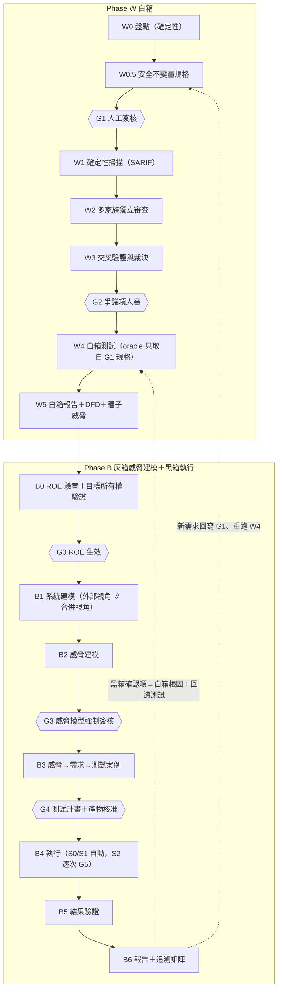

# 02 方法論：先白箱、後黑箱（威脅建模強制在前）

> 標記說明見 [README](../README.md#標記說明)。證據 ID 對應 [evidence/ledger.md](evidence/ledger.md)。

## 1. 總覽

### 1.1 流程

### 1.2 為什麼先白箱、後黑箱
- NIST SP 800-115 附錄 C：白箱技術對自製應用的缺陷**較有效率、成本較低**；黑箱技術用於元件之間、與使用者、其他系統、環境的互動；兩者合用稱為 gray-box [V][E:blackbox-31]。
- NIST SSDF SP 800-218 v1.1（目前的正式版；v1.2 仍是草案 [V][E:threat_modeling-48]）的三項實務剛好對應三個階段 [V][E:threat_modeling-49]：
  - PW.1.1 風險建模 → B2
  - PW.7 審查程式碼 → W1–W3
  - PW.8 測試可執行碼 → W4、B4
- 白箱產物（DFD、發現項、安全不變量）讓黑箱的威脅建模有具體依據。所以 **B 階段的威脅建模是灰箱**，**測試執行只經外部介面，是黑箱**。另外保留一組**只看外部視角**的威脅建模 agent，維持純黑箱觀點（見 [B1](#b1-系統建模兩個獨立視角)）。

### 1.3 人工關卡一覽

| 關卡 | 位置 | 核准內容 | 誰可以核准 | 為何必要 |
|---|---|---|---|---|
| G0 | B0 | ROE（範圍、時間窗、停止條件、目標所有權） | 已登錄金鑰的核准者（測試負責人＋管理層簽核頁）[V][E:blackbox-29] | 沒有授權就不能碰網路 |
| G1 | W0.5 | 安全不變量規格（ASVS 基準＋存取控制矩陣＋資料分級＋LLM 工具權限） | 應用擁有者 | vibe-coded 應用通常沒有安全需求，oracle 必須有人確認的來源 |
| G2 | W3 | DISPUTED 發現項 | 資安審查者 | 跨家族衝突無法自動判定 |
| G3 | B2 | 威脅模型（可部分核准） | 資安審查者＋應用擁有者 | LLM 威脅建模準確度有限 [V][E:threat_modeling-20][E:threat_modeling-21] |
| G4 | B3 | 測試計畫與每個產生的可執行產物（綁定 hash） | 資安審查者 | 產物可能被受測 repo 的內容影響 |
| G5 | B4 | 每一次 S2 侵入性執行 | 與發起者**不同**的核准者 | 可能影響 staging 可用性 |

核准記錄是**簽章紀錄**（核准者身分、角色、時間、產物 hash、逐項決定），由 Policy Engine 驗證；詳見 [03 §6](03-system-architecture.md#6-人工關卡服務)。

## 2. 白箱階段（W0–W5）

### W0 盤點（確定性）
- **輸入**：repo（唯讀）。
- **做法**：以確定性工具與解析器建立下列清單：
  - 路由表與 entry points（REST、GraphQL resolver、webhook、排程工作）
  - auth middleware 與角色定義
  - DB schema、RLS policy（Supabase／PostgreSQL 類）
  - 設定檔與環境變數名稱（**只取名稱，不取值**）
  - LLM 呼叫點、prompt 組裝位置、agent 工具清單與權限
  - 相依清單；Syft 產生 SBOM（CycloneDX／SPDX）[V][E:whitebox-14]
- **輸出**：`inventory.json`（結構化）、SBOM。
- **重點**：指揮官的規劃輸入**只用這些確定性產物**，不用 LLM 對程式碼的自由文字摘要。原因：受測 repo 可能含有影響 LLM 的文字，已有預印本顯示經 LLM 優化的 PR metadata 框架攻擊能讓 LLM 安全審查漏判 33 個 CVE 中的 32 個（範本式攻擊無效）[V：預印本][E:whitebox-29]。
- **完成條件**：每個 entry point 都有對應的 handler 位置；每個 DB table 都有 RLS 狀態（有／無／不適用）。

### W0.5 安全不變量規格（Security Invariants Spec）＋ G1
- **問題**：LLM 產生的測試傾向記錄程式「實際行為」而非「預期行為」[V][E:whitebox-43]。vibe coding 的原始定義就是「忘了程式碼的存在」、不讀 diff [V][E:vibe_risks-01]，因此通常也不會有書面安全需求 [H]，oracle 沒有可靠來源。
- **做法**：
  1. **基準需求**：依 W0 偵測到的功能（登入、檔案上傳、OAuth、LLM 呼叫…）篩選 **OWASP ASVS 5.0 Level 1**。L1 共 70 條，約佔全部需求的 20% [V][E:threat_modeling-43]，需求 ID 格式如 `v5.0.0-8.2.2` [V][E:threat_modeling-40]。
  2. **應用專屬不變量**：
     - 存取控制矩陣：角色 × 資源 × 動作 → 允許／拒絕
     - 資料分級：每個 store／欄位是否含個資、機密
     - LLM 工具權限矩陣：每個工具可被哪些角色觸發、哪些動作必須先經人確認（OWASP 對 Excessive Agency 的建議是最小權限＋高影響動作需人核准 [V][E:blackbox-32]）
  3. 由 Invariant Drafter agent 根據路由、schema、RLS **起草**，再由人在 **G1** 逐條確認、修改或刪除。
- **輸出**：`invariants.yaml`（每條有 ID、來源〔ASVS／應用專屬〕、簽核狀態）。
- **完成條件**：已簽核；W4 與 B3 的 oracle **只能引用已簽核條目**。

### W1 確定性掃描（建立基準，不用 LLM）
- **輸入**：repo、SBOM。執行位置：Z2 程式執行沙箱（見 [03 §2](03-system-architecture.md#2-部署與信任區)）。
- **工具**（輸出一律轉為 **SARIF 2.1.0** [V][E:whitebox-17]）：

| 類別 | 工具 | 注意 |
|---|---|---|
| SAST | Opengrep（LGPL-2.1，Semgrep CE 1.100.0 的 fork，含檔內跨函式 taint，需啟用 `--taint-intrafile`）[V][E:whitebox-06] 或 Semgrep CE | Semgrep 引擎是 LGPL，但官方規則自 2024-12 改用非開源的 Semgrep Rules License；CE 只做單檔、單函式分析 [V][E:whitebox-04] |
| SAST（Python） | Bandit（Apache-2.0，有 SARIF formatter）[V][E:whitebox-08] | — |
| SAST（選用） | CodeQL | CLI 授權只允許開源專案與學術研究免費使用，私有商業碼需付費 [V][E:whitebox-07] |
| 相依漏洞 | OSV-Scanner（Apache-2.0）[V][E:whitebox-11]、Grype（EPSS／KEV 排序）[V][E:whitebox-14] | OSV-Scanner 的可達性判斷（call analysis）是選配功能，且不是每個生態系都支援 [V][E:whitebox-11] |
| 套件存在性 | 自建檢查：每個相依到 registry 查存在性、首次發布時間、下載量 | 對應套件幻覺：19.7% 的套件引用是幻覺名稱；43% 的幻覺名稱在 10 次重複查詢中每次都出現 [V][E:vibe_risks-13][E:vibe_risks-15] |
| Secrets | Betterleaks [P][E:whitebox-09] 或 gitleaks（已宣布只修安全問題）；TruffleHog（AGPL-3.0）[V][E:whitebox-10] | TruffleHog 的驗證會把找到的憑證送到供應商 API → **預設 `--no-verification`**；若要驗證，必須寫進 ROE 並從 Z3 發出、留紀錄，否則建議直接輪替 |

- **Secrets 處理**：secrets 掃描**最先跑**。掃到的值在所有後續 LLM 輸入中遮罩；路徑黑名單（`.env*`、金鑰與憑證檔、auth-state 目錄、CI secrets 檔）**完全不進切片**；再以 pattern＋entropy 作第二層遮罩（掃描器 recall 不完美，Betterleaks 的 98.6% recall 只是廠商宣稱 [P][E:whitebox-09]）。
- **輸出**：`w1.sarif`、`deps-check.json`、`secrets-redaction-map`（只存位置與 hash，不存值）。
- **完成條件**：所有工具以鎖定版本執行完畢；任何工具失敗都要在報告中列出，不能靜默略過。

### W2 多家族獨立審查
- **輸入**：inventory、G1 規格、W1 SARIF、切片。
- **切片器（Slicer，確定性）**：
  1. 以每個 entry point 為錨，依靜態呼叫圖納入 handler、被呼叫函式、相關 model／schema／RLS policy、auth middleware，直到 token 預算上限。
  2. **同等性單位**：取所有參與模型中**最小的可用 context**。例如自架 Nemotron 3 Nano 的 Hugging Face 設定預設 256K [V][E:providers-05]，Claude 與 GPT-6 旗艦約 1M [V][E:providers-23][P][E:providers-31]。這樣可以確保各家族看到**相同輸入**。重新命名函式或變數就可能改變 LLM 的安全判斷 [P][E:multi_llm_bias-26]，所以輸入必須一致，比較才有意義。
  3. 流程超過上限時，以重疊方式切割並記錄；若某模型放不下某切片，就把該模型排除在此切片之外，並標記 `diversity_degraded`。**不允許靜默截斷**。
  4. 每個切片有 `slice_id`＝各檔案範圍的 sha256。
- **審查方式**：
  - 同一切片平行交給 N 個不同家族的 reviewer。**第一輪彼此看不到對方結果**。多輪辯論中模型常由對轉錯，原因未定，作者列出從眾、諂媚等可能因素 [P][E:multi_llm_bias-21]；多數決本身就拿到辯論的大部分效益 [V][E:multi_llm_bias-16]。
  - 審查面向（facet）：
    - 授權與 IDOR
    - 輸入處理與注入
    - 資料存取與 RLS
    - secrets 與設定
    - 商業邏輯（對照 G1 規格）
    - LLM 整合：prompt 組裝、工具權限、輸出處理
  - reviewer 沒有 shell、沒有網路，只讀切片。系統提示明確區分「指令」與「待審資料」。
- **發現項要求**：每個發現項必須附：
  - `file:line` 範圍
  - 逐字程式片段
  - CWE（可多個）、嚴重度、推理
  - 引用的 G1 條目（若有）

  Harness 以程式碼比對片段是否真的在該位置；對不到就標 `UNVERIFIED`，但不刪除（STRIDE-GPT 的證據比對做法）[V][E:threat_modeling-15]。
- **輸出**：`findings[]`（依 [schemas/finding.schema.json](schemas/finding.schema.json)）。
- **完成條件**：覆蓋下限（每個切片 × 每個必要面向）都有結果，或有記錄在案的缺票原因。

### W3 交叉驗證與裁決（＋G2）
- **輸入**：W2 發現項、W1 SARIF。
- **做法**（詳見 [05 §4](05-bias-calibration.md#4-叢集與裁決)）：
  1. **叢集**：以確定性叢集鍵合併不同模型描述的同一問題。
  2. **跨家族反駁式驗證**：驗證者必須與報告者不同 `family` 且不同 `lineage`；驗證時去除來源模型資訊、隨機排列候選順序；驗證者被要求「嘗試反駁」。
  3. **與 SARIF 相互佐證**。
  4. **規則式裁決**（Aggregator 是程式碼，不是 LLM）：`CONFIRMED_CORROBORATED`／`LIKELY`／`DISPUTED`／`REJECTED`。
  5. `DISPUTED` 送 **G2** 人審。
- **輸出**：`clusters[]`、`verdicts[]`。
- **完成條件**：每個叢集都有裁決；缺票與多樣性降低都已註記。

### W4 白箱測試（oracle 只取自 G1 規格）
- **輸入**：G1 規格、裁決為 LIKELY 以上的叢集、程式碼。
- **做法**：
  - 對每條安全不變量產生單元測試或性質測試：Python 用 Hypothesis，JS／TS 用 fast-check [V][E:whitebox-40]。可參考 agentic PBT 的做法，由 agent 推論性質並寫 Hypothesis 測試 [V][E:whitebox-41]。
  - 用覆蓋率回饋補測試（CoverUp 式迭代）[V][E:whitebox-36]；用 mutmut（Python）或 Stryker（JS／TS）評估測試強度 [V][E:whitebox-45]。
  - **TestGen-LLM 濾網**：只保留能 build、重複執行都通過、且有增加覆蓋的測試 [V][E:whitebox-34]。
  - A 家族生成、B 家族審查（Test Critic）。
  - **oracle 只能引用 G1 已簽核條目**。程式本身可能已有 bug 時，覆蓋率與變異分數不再是可靠指標 [V][E:whitebox-44]，所以只能當輔助訊號。
  - 測試只能 import 鎖定、預先核准的相依套件；在 Z2 執行（無憑證、無 LLM 出站）。Pynguin 的文件也警告，執行受測模組可能傷害主機 [V][E:whitebox-38]。
- **輸出**：測試檔、執行結果、覆蓋率、mutation score。
- **完成條件**：每條 G1 不變量都有至少一個測試，或被標記 `MANUAL`（附原因）。

### W5 白箱報告＋DFD＋種子威脅
- **DFD 骨幹由確定性方法產生**：
  - 路由與 handler → process
  - DB schema 與 RLS → data store
  - 外部 API 呼叫與 LLM 工具點 → external entity
  - 認證邊界、網路邊界、租戶邊界 → trust boundary

  LLM 只**提議**標籤與邊界，由人在 G3 確認。pytm 也是從明確的模型產生 DFD，不是推論出來的 [V：該條只有日期與數字被更正，此部分成立][E:threat_modeling-11]。
- **種子威脅**：每個 `LIKELY` 或 `DISPUTED` 的叢集轉成 B2 的種子威脅，帶 `source_finding_id`，且 B3 至少要替它產生一個測試；B6 必須逐項回報結果。這樣動態測試可以用來化解跨家族爭議。
- **輸出**：`whitebox-report.md`、`w.sarif`、`dfd.json`、`seed-threats.json`。

## 3. 黑箱階段（B0–B6）

### B0 ROE 與範圍（G0，機器可驗證）
- **內容**：依 NIST SP 800-115 附錄 B 的 ROE 樣板 [V][E:blackbox-29]：
  - 範圍、目標清單與排除清單
  - 允許與禁止的活動、授權工具
  - 測試時間窗
  - 停止條件（criteria for halting）、事件處理
  - 資料處理
  - 簽核頁
- **程式碼強制**（詳見 [04 §7](04-threat-to-testcase.md#7-roe-樣板) 與 [schemas/roe.schema.json](schemas/roe.schema.json)）：
  1. ROE 是正規化 YAML，附上**已登錄核准者金鑰的分離式數位簽章**，並有 `not_before`／`not_after` 與時間窗。
  2. **目標所有權驗證**：每個目標主機要在 DNS TXT 或 well-known path 放置本次委任的 token，每次執行開始前重新檢查。
  3. **預設拒絕**：出站白名單只由 ROE 目標 ID 產生。
  4. **範圍變更需重新簽署**。SP 800-115：偏離 ROE 需原簽署人許可，通常要書面 [V][E:blackbox-30]。
- **其他前提**（寫在 ROE 裡、由核准者聲明）：
  - staging 資料為合成資料。SP 800-115 建議可能暴露個資的測試使用非正式系統與測試資料 [V][E:blackbox-30]。
  - staging 的外部整合（email、SMS、金流、LLM API）都在 sandbox／test 模式並列入 ROE，否則在出站層阻擋。
  - staging 與正式環境的憑證、DB 分離。Replit 的 agent 在 code freeze 期間刪除了正式資料庫 [P][E:vibe_risks-27]，事後 Replit 才宣布開始推出自動 dev／prod 資料庫分離 [V][E:vibe_risks-28]。
- **適用範圍**：**所有接觸網路的步驟**（從 B1 開始，包括 TruffleHog 驗證）都必須先通過這道檢查。

### B1 系統建模（兩個獨立視角）
- **(a) 外部視角（純黑箱）**：
  - 匯入 OpenAPI／GraphQL schema。
  - ZAP spider／ajax spider：由 ROE 產生 context，設定 `includePaths`／`excludePaths` [V][E:blackbox-05]。
  - Playwright 以多個角色錄製流程（每個角色一個 BrowserContext／storageState）[V][E:blackbox-21]。
- **(b) 合併視角（灰箱）**：W5 DFD＋種子威脅＋(a) 的結果。
- **兩組威脅建模 agent**：一組只看 (a)，另一組看 (b)。兩者的差異代表「文件或介面與實作不一致」，或其中一方的盲點；這是覆蓋訊號，不是用來驗證 DFD。
- 爬行受 Scope Proxy 限制：擋掉越界 redirect；Playwright MCP 的 allowed-origins 不是安全邊界，也不管 redirect [V][E:blackbox-24]。

### B2 威脅建模（G3 強制簽核）
- **框架**：Threat Modeling Manifesto 的四個問題 [V][E:threat_modeling-01]：
  1. 我們在做什麼？
  2. 會出什麼錯？
  3. 要怎麼處理？
  4. 做得夠好嗎？

  OWASP Threat Modeling Cheat Sheet 的四階段：系統建模、威脅識別、緩解、審查驗證；緩解措施以 ASVS 與 CWE 寫成需求 [V][E:threat_modeling-02]。
- **方法組合**：

| 條件 | 方法 | 備註 |
|---|---|---|
| 一律 | STRIDE-per-element | 資料存放的 R（否認）只在存放稽核紀錄時適用；Microsoft 2006 圖表只給資料存放 T、I、D [P][E:threat_modeling-04] |
| 處理個資 | LINDDUN（7 類）[V][E:threat_modeling-07] | Threat Dragon 支援 LINDDUN [V][E:threat_modeling-09] |
| 有 LLM 功能 | OWASP Top 10 for LLM Applications | 版本見下方 |
| 有 Agent／工具呼叫 | OWASP Top 10 for Agentic Applications 2026（ASI01–ASI10）[V][E:threat_modeling-32]、CSA MAESTRO 七層 [V][E:threat_modeling-35] | — |
| 高風險威脅 | Attack tree：OR 節點取最便宜的子節點、AND 節點取總和 [V][E:threat_modeling-08] | — |

- **OWASP LLM Top 10 的版本**：
  - 2025 版（LLM01–LLM10）已完整查證 [V][E:threat_modeling-31]。
  - 2026 版已於 2026-08-03 發布 [S-01]。兩個獨立的二手來源列出一致的十項，Help Net Security 也報導了相同的變動：
    - Excessive Agency 升到 LLM03
    - Improper Output Handling 降到 LLM10
    - System Prompt Leakage 擴大並改名為 Hidden Context Exposure

    官方 PDF 本次未直接讀取 [P][S-01]。
  - → 每筆威脅都存 `taxonomy: "owasp-llm@2025"` 或 `"owasp-llm@2026"`；**預設 2025 版**，並提供 2025↔2026 對照表（[04 §2.3](04-threat-to-testcase.md#23-owasp-llm-top-10-20252026-對照)）。核對官方 PDF 之後再切換預設。
- **多模型流程**：
  1. 2–3 個不同家族的 Threat Modeler 各自產出。
  2. Merger 去重。
  3. Critic（另一家族）找遺漏。
  4. 每個威脅必須有證據（端點、資料流、程式位置）；證據對不到就標「未驗證」。
- **正本格式**：工具包自有 JSON schema（[schemas/threat.schema.json](schemas/threat.schema.json)）。pytm 的威脅是對元件屬性的條件式規則（引用 CAPEC／CWE），另有 LLM 元素的 LLM01–09；114 條威脅中 98 條引用 CAPEC、75 條引用 CWE [C][E:threat_modeling-11]。所以 pytm 匯出只算部分匯出，ASI、MAESTRO、LINDDUN 只存在自有 schema。
- **為何強制人簽核（G3）**：
  - 一項只分類 6 個 5G 威脅的研究：STRIDE 分類的平均準確度從 63%（zero-shot）到 71%（few-shot＋網路），最佳單一結果 72% [V][E:threat_modeling-20]。
  - 同一研究群的後續研究（兩篇並非彼此獨立）：更大或經領域調適的模型都沒有穩定改善 [V][E:threat_modeling-21]。
  - G3 允許**逐項**接受、拒絕、要求補充；被拒絕的威脅不產生測試，但保留在紀錄中。
- **輸出**：`threat-model.json`（已簽核版本附 hash）。

### B3 威脅 → 需求 → 測試案例
詳見 [04](04-threat-to-testcase.md)。重點：
- 追溯鏈的每條連結都標 `official`／`curated`／`llm-suggested`。
- `tool_binding` 三選一：`BUILTIN_CHECK`／`GENERATED_SCRIPT`／`MANUAL`。
- `safety_class` 由程式碼計算。
- 測試計畫與每個產物都要在 **G4** 綁定 hash 核准。

### B4 執行
- 執行位置：Z3，經 Scope Proxy 出站。
- 安全等級：
  - S0（被動）與 S1（良性主動）：ROE 允許就自動執行。
  - S2（侵入）：每次都要 **G5**。
  - S3：一律拒絕。
- 限速、停止條件、kill switch、DB 快照、LangGraph 節點邊界等細節，見 [03 §7](03-system-architecture.md#7-黑箱執行安全) 與 [06 §1](06-security-legal-limitations.md#1-工具包自身的安全)。

### B5 結果驗證
- **確定性判定**：通過或失敗由 oracle 決定；LLM 只負責解讀與撰寫說明。
- **重播**：確認為漏洞前必須能重播（同條件再跑一次得到相同結果）。
- **LLM 功能類採機率規則**：固定設定跑 n 次，記錄目標模型、版本與 temperature，報告成功率與信賴區間。只有確定性 oracle（工具呼叫紀錄、canary、狀態差異）成立才算 `CONFIRMED_EXECUTABLE`；只有 LLM 評分支持時，最高只到 `LIKELY`。promptfoo 以 LLM-as-a-judge 評分 [V][E:reference_systems-23]；PyRIT 的 scorer 可以是生成式 AI [V][E:reference_systems-19]；garak 的 detector 表現不穩定 [V][E:reference_systems-22]。
- **跨家族驗證**：由不同家族的 Result Analyst 驗證解讀。
- **PII**：若在回應中偵測到個資，觸發停止條件，B5 的解讀改成只用自架模型。

### B6 報告
- 輸出：
  - SARIF
  - 人讀報告（Markdown／HTML）
  - **追溯矩陣**：威脅 → 需求 → 測試 → 結果 → 回連白箱發現項
  - **威脅覆蓋率**：已簽核威脅中至少有一個已執行測試的比例
  - **未能測試清單**（`MANUAL` 與失敗的執行）
  - 每個種子威脅的結果
  - 回饋任務：確認項 → 白箱根因定位＋W4 回歸測試
- 報告由 Reporter 撰寫敘事，**不改裁決**。

## 4. 階段之間的交接與回饋

| 從 | 到 | 產物 | 規則 |
|---|---|---|---|
| W0.5（G1） | W4、B3 | `invariants.yaml` | oracle 只能引用已簽核條目 |
| W5 | B1、B2 | `dfd.json`、`seed-threats.json` | 每個種子威脅至少一個 B3 測試 |
| B2 | W0.5 | 威脅衍生的新需求 | 回寫規格 → 重新走 G1 → 重跑 W4 |
| B5 | W4 | 已確認的黑箱問題 | 定位到 file:line → 產生回歸測試（X 家族寫、Y 家族審） |
| W3 | B5 | `DISPUTED` 叢集 | 黑箱結果用來化解爭議 |

## 5. 完成條件總表

| 步驟 | 完成條件 |
|---|---|
| W0 | 每個 entry point 有 handler 位置；每個 table 有 RLS 狀態 |
| W0.5 | G1 簽核完成 |
| W1 | 所有工具以鎖定版本完成；失敗有列出 |
| W2 | 覆蓋下限全部有結果或缺票紀錄 |
| W3 | 每個叢集有裁決；DISPUTED 已送 G2 |
| W4 | 每條不變量有測試或 `MANUAL` 原因 |
| W5 | DFD、種子威脅已產出 |
| B0 | ROE 驗章通過、所有權驗證通過、未過期 |
| B1 | 兩個視角的系統模型都產出 |
| B2 | G3 簽核完成（可部分） |
| B3 | 每個已簽核威脅有測試案例或 `MANUAL`；G4 綁定 hash 核准 |
| B4 | 所有核准的測試已執行或記錄失敗原因；無停止條件未處理 |
| B5 | 每個結果有判定；機率類有 n、k、信賴區間 |
| B6 | 追溯矩陣完整；種子威脅逐項有結果 |
