# 03 系統架構

> 標記說明見 [README](../README.md#標記說明)。本文件是設計，尚未實作；所有數值都是設計假設，除非另附證據。

## v0.4 變更摘要

依 [2026-10-24 設計審查](evidence/review-2026-10-24.md) 修正（第一優先見 [02 v0.4](02-methodology.md#v04-變更摘要)；以下是第二優先的架構項目）：
- **Z3 工具容器需求**（§2）：比照 Z2 的沙箱表；每個 job 一個 gVisor／microVM、只能連 Scope Proxy、沒有 DNS 解析器、只解密本 job 角色的 storageState、沒有 Relay 憑證。
- **Scope Proxy 的位址與協定**（§2、[08 §11.7](08-implementation-spec.md#117-scope-proxy-實作)）：解析到的位址以參考實作 `safety.ip_problem` 判定（擋 NAT64、IPv4-mapped、6to4、Teredo、ULA、site-local、multicast 與一切非公開位址）；封鎖 `Upgrade: h2c`、HTTP/3（QUIC、`Alt-Svc`）與 CONNECT 後的非 TLS 流量；路徑的 `\` 視為 `/`。
- **執行期狀態不放在 checkpoint**（§5.8）：S2 與所有 B4 job 的冪等帳本放在 Z3 的 job 帳本（append-only），時間旅行重播或 checkpoint 回溯不會讓已執行的 job 再執行；每個 run 一把資料庫 advisory lock；kill switch 走圖外通道；有副作用的節點用同步 checkpoint。
- **LLM 快取鍵**（§5.8）加入 `engagement_id`、資料等級與取樣序號：不跨委任重用回應，重複取樣不會被壓成同一個答案。
- **設定檔釘選**（§6.1）：委任設定以 `config_pins` 釘選 `models.yaml`、`agents.yaml`、`tools.yaml`、`licenses.yaml` 的內容 hash（`E-ENG-CONFIG-PIN`）。
- **關卡時間以 Audit Writer 的收件時間為準**（§6.1、§13.1）：GateRecord 的 `timestamp` 只需與 `gate_decision` 事件的 `ts` 相差不超過 5 分鐘（`E-AUDIT-GATE`）；金鑰效期、ROE 有效期、逾時與時間窗都以收件時間判定。
- **跨境聲明在 G0a**（§8.4）：委任設定的 `data_transfer`（`E-ENG-TRANSFER`）；HMAC 遮罩金鑰改為每個 run 一把、只在 W0 job 內存在的臨時金鑰。

## v0.3 變更摘要

依 [2026-09-26 深度審查紀錄](evidence/review-2026-09-26.md) 修正。新元件的細部規格放在 [08 §11](08-implementation-spec.md#11-元件規格補充v03)，本文件只保留架構層級的說明與連結。

- **Commander 沒有工具，只看型別化視圖**（§4）：每個 CMD 節點的輸入由程式碼組成，只有 ID、狀態、CWE 桶、嚴重度、家族與計數，不含 LLM 輸出或 repo 的自由文字；`extra_dispatch[].target` 改為 `{kind, id}`；CMD-2 至多 2 輪並由 validator 檢查（`E-PLAN-ROUNDS`）；輸出不合規 → 修復 ≤2 次 → 程式碼的保底計畫；Commander 的計畫必須是覆蓋下限計畫的超集合（必要面向，`E-PLAN-FACETS`）。內嵌的計畫 JSON 改為標明「節錄」並連到範例檔（H-C2、N-6、L-04）。
- **W1 工具輸出不給 reviewer 與 verifier**（§5.3、§5.7、§9）：W1 結果只經 ToolResult 正規化器交給 Clusterer 與 Aggregator；SARIF 分為強佐證（`high_precision_rules`）與弱訊號（§5.9，規則見 05 §4.2）（H-A1）。
- **ToolResult 正規化器**（§1、§15）：W1 工具與 Clusterer 之間的新元件；`Clusterer.cluster(findings, tool_results)`（H-E2）。
- **Result Analyst 池**（§5.5、§9、§14.3）：`result_analyst_a`（`claude_sonnet`）、`result_analyst_b`（`gpt_flagship`）、`result_analyst`（`nemotron_self`）；有 PII 時只用自架模型；事先登記解讀的確定性 FAIL 不需要 LLM；B5 為黑箱起源的問題建立 `origin: black_box` 叢集（H-A3）。
- **遮罩是通往 LLM 的唯一路徑**（§1、§8.4、§9）：Inventory 不用 LLM；Invariant Drafter 的工具改為 `read_inventory`、`write_blackboard`（H-C1）。
- **run manifest**（§5.1）：RunState 與 run 紀錄加入 `config_refs`、`prompt_templates`、`tool_versions`、`rule_version`、`baseline_run_id`（N-5、H-E13）。
- **核准者來源、逐項核准與保證等級**（§6、新增 §6.3、§6.4）：G0a／G1／G2 看委任設定的 `gate_approvers`，G0b／G3／G4／G5 看 ROE；G3／G4／G5 須在 ROE 有效期內決定（v0.3 起 G3 也檢查，`E-GATE-ROE-VALIDITY`；G0b 是發現 ROE 尚未生效的系統驗證，不受此限）；核准綁逐項 approval hash（validator 重算 `item_sha256`），未變項目依規則沿用（沿用本身尚未由 validator 檢查，§6.3）、G5 永不沿用，取代「產物有任何變動，核准就失效」；叢集以 `fingerprint` 與 `baseline_state` 跨 run 對應；Lite 兼任需明示聲明、Team 的 ROE 角色須不同人（`E-ROE-SOD`）、Full 的 G5 需兩位資安審查者（`E-G5-TWO-PERSON`）（H-D2、H-B5、M-G3、N-11）。
- **寫入範圍與排除清單**（§2、§7.1）：所有寫入都要綁種子或 create-only 端點（`E-TC-MUTATION-SCOPE`）；路徑先正規化再不分大小寫比對；主機排除支援 `*.` 萬用字元；目標 URL 只接受 `https://`（localhost 例外）（H-B3、C-1、C-2、C-3）。
- **build 識別**（§5.5、§7、§15）：`B4_preflight` 依 ROE `build_identity.method`（`header`／`endpoint`／`none`）確認受測版本；`none` 的目標列入 `build_unverified_targets`（H-B4）。
- **Scope Proxy、Session、種子、共享平台網域**（§2、§7.4、§7.6）：TLS 以 Z3 本地 CA 終結、HTTP/2／WebSocket／SSE、DNS 固定與 CDN（08 §11.7）；MFA、CAPTCHA staging 略過、第三方 IdP、每批 whoami、加密 storageState（08 §11.8）；種子命名空間、建立與 teardown（08 §11.6）；共享平台網域改用 `platform_project` 證明（08 §11.9）（H-E7、H-E8、H-E6、H-D3）。
- **結構化輸出先投影、再降級**（§8.3）：送給 LLM 的 schema 移除 harness 欄位；選填 → 可為 null、`const` → 單值 `enum`；`$ref` 在投影時展開，開放物件、`allOf`／`not`／`if`／`patternProperties`、無法解析的 `$ref` 一律拒絕；`uniqueItems`／`pattern`／`format` 移除後由存檔 schema 重新驗證；8 種 LLM 產物登錄在 `LLM_OUTPUTS`（H-A4、C-7）。
- **Opus 4.8 的說法更正**（§8.1）：它是 `claude_sonnet` 的同家族 fallback，fallback 時可能投票，但使用自己的校準權重（§5.8 重跑前為 0），只記錄不計權（N-2）。
- **C 級路由依供應商宣告**（§8.4）：委任設定的 `providers[]`（ZDR、DPA、保留、區域）決定哪些家族能收 C 級資料（H-E14）。
- **成本模型**（§11）：W2 呼叫數改為 S × V × G（G＝面向組數，12 個面向分 3 組）；B2 為 V_tm＋1（確定性 merger；另設 LLM merger 時 V_tm＋2，與 02 B2 一致）；加入輸出與推理 token、W0.5、W4、B3、B5、relay、加派與校準；價格取自 `models.yaml` 的 `pricing`（null＝未知；委任設定的 `max_cost_usd` 一律必填）；費用上限只能來自委任設定（H-E12、L-03、L-22、N-11）。
- **CI**（§12）：本 repo 自己的 CI 也以 SHA 鎖定 Actions（M-R1、A-11）。
- **序列圖**（§14）：回應一律經 Model Gateway 回到 Run Controller；Aggregator 不呼叫 Gateway；新增 §14.3 B5 結果解讀（L-10）。
- **一致性對齊**：`diversity_degraded` 改用合格驗證家族 E 的新定義（§5.9，N-1）；`E-SARIF-REF` 也要求該工具在 `licenses.yaml` 的狀態為 `OK` 或 `注意`（§5.9，N-7）；relay 預設為腳本式多輪、adaptive 只限 `full`（§7.5，H-E15）；§9 名冊與 §10 資料模型反映本輪的新欄位與 agent。

## v0.2 變更摘要

- **狀態機完整化**（§5）：拆成主圖＋W 子圖＋B 子圖＋B4 執行迴圈＋中止／補償／resume 圖；每個關卡都有各自允許結果的邊（`PARTIALLY_APPROVED` 只限 G3／G4；G2 整關只有 `APPROVED`／`EXPIRED`；G0a／G0b 為 `VERIFIED`／`VERIFY_FAILED`／`EXPIRED`）；加上終止狀態與可續跑狀態。
- **新節點**：`run_init`、`claim_run`、`LA_static`、`LA_diff_review`、`W4_exec`、`W4_readjudicate`、`B0_ownership_verify`、`B1_crawl`、`B4_preflight`、`GB_budget_gate`、`abort_handler`、`run_resume`、`suspended_wait`、`stopped_wait`。
- **完整 RunState**（§5.1）：W 與 B 欄位、關卡紀錄、預算、`run_kind`、`parent_run_id`、狀態 enum。
- **節點規格表**（§5.7）：每個節點的執行區、是否用 LLM、冪等鍵、副作用、失敗邊；節點邊界規則延伸到新節點。
- **Secrets 先於 LLM**：W0 完全確定性；Model Gateway 對沒有 `redaction_map_ref` 的 run 一律拒絕（§8.4）。
- **金鑰登錄與驗章流程**（§6.1）、**關卡逾時預設值**（§6.2）、**稽核事件格式與類型**（§13）。
- **停止條件預設門檻**（§7.3）、**DB 快照與 oracle 唯讀存取路徑**（§7.6）、**Session Provider 介面**（§7.4）、**Z3→Z1 relay**（§7.5）、**Z2 沙箱需求**（§2）。
- **Blackboard、content-addressed store** 與其他元件的介面（§15）；每個元件標出負責的里程碑（§1）。
- 預算觸頂改由 `GB_budget_gate` 決定（§11）；Lane A 的單一家族審查只有參考性（§12）。
- 儀表板移出範圍：M5 只交付靜態 HTML＋SARIF＋JSON 報告。
- **v0.2 後續對齊（04／05）**：裁決規則改為 05 的 R0–R13；G2 之後才出現的 `DISPUTED` 不重開 G2（§5.3）；Snapshot Service 新增 `oracle_capture` 與 G4 核准的 `oracle_count`、種子重置失敗規則（§7.6、§15）；§7.1 無法分類工具的等級規則對齊 04 §5。
- **v0.2 後續對齊（06）**：§6.1 引用 [01 §7](01-research-survey.md#7-v02-補充研究2026-09-24) 的證據（已獨立查核），並加入嚴格 YAML 規則與 `legal_reviewer` 角色；G0b 加入 `legal_review` 檢查（§5.4）；Z2 加入版本鎖定與 CVE 更新要求（§2）；§8 補上 GPT-6 Luna 與模型退役提醒；§13.1 引用稽核鏈文獻；Executor 的 TruffleHog 驗證為選用。
- **v0.2 後續對齊（一致性）**：G0b 之前的節點不讀任何 ROE 欄位（W0 只用 G0a 已驗章的委任設定；元件授權過濾在 G0b，§5.4）；ROE 或 `legal_review` 在執行中**到期** → `SUSPENDED`，只有**驗章失效**（金鑰撤銷、簽章無效）才 `ABORTED`（§5.2、§5.5、§5.6）；保留期限的優先順序（§2）；稽核鏈尾端保護（§13.1）；簽署 JSON 文件拒絕重複鍵（§6.1）；DB 目標也對照 ROE 排除清單（§7.6）；`models.yaml` 佔位 ID 警告 `W-MODEL-PLACEHOLDER`（§8.1）。
- **v0.2 強化第二輪（與 validator 對齊）** [H]：保留期限錯誤碼分為 ROE > engagement → `E-ROE-RETENTION`、超過工具包上限 → `E-RETENTION`（§2）；gate 逾時在 G0b 之前只以委任設定的 `not_after` 為上限（§6.2）；嚴格 JSON 擴及溢位浮點數、超過 2^53 的整數與整數欄位的浮點數字面值（§6.1）；家族多樣性只計 verifier 的票（§5.9）；`sarif_refs` 必須對應同一 run 的工具稽核事件（§5.9、`E-SARIF-REF`）；DB endpoint 主機正規化（§7.6）；真實 run 的佔位模型 → `E-MODEL-PLACEHOLDER`（§8.1）；`audit_anchors` 與錨點事件一一對應、JSONL 只以 `\n` 分行（§13.1）。
- 模型命名統一：OpenAI 旗艦寫作 GPT-6 Astra／Sol（[P][E:providers-31]），設定檔中的代號為 `gpt_flagship`（§8.1）。

## 1. 元件總覽

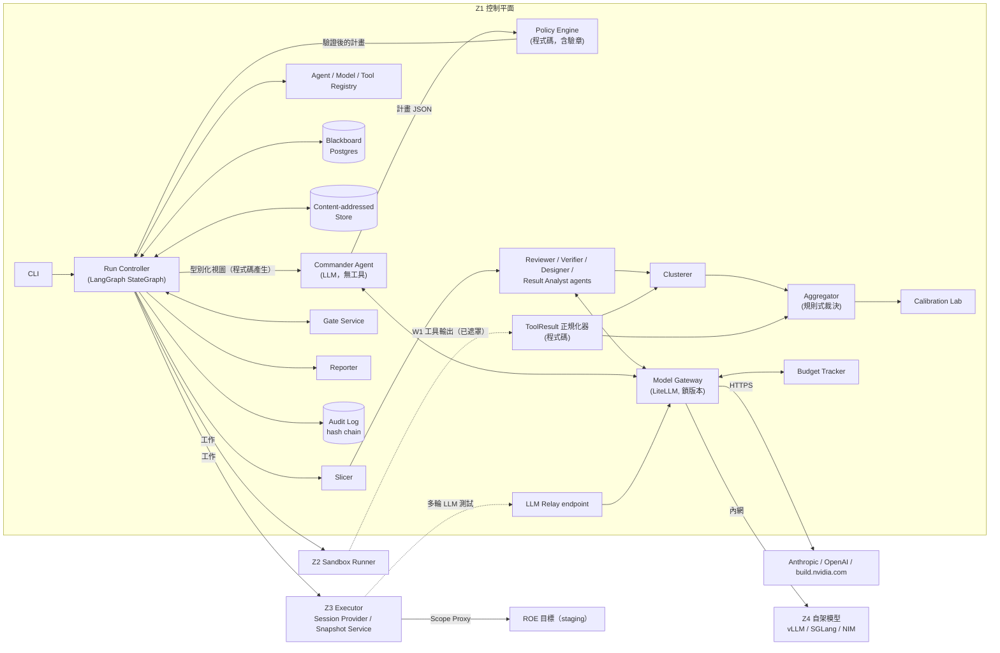

| 元件 | 責任 | 是否用 LLM | 區 | 里程碑 [H] |
|---|---|---|---|---|
| Run Controller | 依狀態機排程、並行、重試、限速、checkpoint | 否 | Z1 | M1（骨架）、M2（W 圖）、M3–M4（B 圖） |
| Commander Agent | 在 5 個決策節點提出計畫與加派（§4）；**沒有任何工具**，只收程式碼產生的型別化視圖 | 是 | Z1 | M2（CMD-1、CMD-2）、M3（CMD-3）、M4（CMD-4、CMD-5） |
| Policy Engine | 強制 ROE、資料分級、覆蓋下限（必要面向）、預算、安全等級計算、產物驗證、核准紀錄與簽章驗證（§6.1）；產生 Commander 的型別化視圖（§4） | 否 | Z1 | M1（資料等級、白名單、G0a／G0b、目標解析、驗章）、M2（CMD 計畫驗證、型別化視圖）、M4（安全等級計算、產物驗證）、M5（Relay 上限） |
| Agent／Model／Tool Registry | `agents.yaml`、`models.yaml`（含 `family`、`lineage`、能力、可處理的資料等級）、`tools.yaml`（工具 ID 與 `tool:mode`） | 否 | Z1 | M1（M2 加 `calibration.yaml`） |
| Blackboard | 型別化 artifact 的索引與唯一交換處；agent 之間**不直接對話**（OSS-CRS 也是只透過交換檔案協作 [V][E:reference_systems-13]） | 否 | Z1 | M1 |
| Content-addressed Store（CAS） | 以 sha256 為鍵存放所有產物本體（SARIF、切片、報告、產生的測試、LLM 請求與回應） | 否 | Z1 | M1 |
| ToolResult 正規化器 | 把 W1 各工具的輸出（SARIF、相依漏洞、secrets、套件存在性）轉成內部 `ToolResult`：區段對應到函式、合併位置。**W1 輸出只經這裡交給 Clusterer 與 Aggregator**，不進切片、不給 reviewer 與 verifier（細節見 [08 §11.2](08-implementation-spec.md#112-工具結果正規化與合併)） | 否 | Z1 | M2 |
| Slicer／Clusterer／Aggregator | 切片、叢集、裁決（[05 §4](05-bias-calibration.md#4-叢集與裁決)）；Clusterer 的輸入是發現項與 `ToolResult`（§15） | 否 | Z1 | M2、M4（黑箱證據）、M5（機率判定） |
| Calibration Lab | 量測各模型精準度、錯誤相關、自我偏好（[05 §5](05-bias-calibration.md#5-calibration--bias-lab)） | 被測對象是 LLM | Z1＋Z2 | M2 |
| Gate Service | 人工關卡的呈現、簽章核准、逾時、resume（§6） | 否 | Z1 | M1（只有 G0a／G0b 離線驗章）、M2（G1、G2、GB）、M3（G3）、M4（G4、G5） |
| Reporter | 唯一撰寫最終敘事者；不改裁決；輸出 SARIF、JSON、靜態 HTML | 是 | Z1 | M2（白箱報告）、M4（B6 JSON／SARIF／矩陣）、M5（靜態 HTML） |
| Model Gateway | 唯一有 LLM 出站、持有 API 金鑰的元件；沒有 `redaction_map_ref` 的 run 一律拒絕；送給模型的輸出 schema 是存檔 schema 的投影再降級（§8.3） | — | Z1 | M1（fail-closed 前置檢查、快取、修復、重試）、M2（真實供應商、fallback） |
| Budget Tracker | 追蹤每個 run 與階段的 token、費用、時間；觸頂時觸發 GB（§11） | 否 | Z1 | M2、M5（Relay 的花費上限） |
| Audit Log | append-only JSONL、hash chain、定期錨定（§13） | 否 | Z1 | M1 |
| Sandbox Runner | 在 Z2 執行 W0、W1、W4 與目標建置（§2） | 否 | Z2 | M1（W0／W1）、M2（W4） |
| Z3 Executor | M1 只做最小出站執行器：Scope Proxy＋所有權驗證＋經 proxy 的 HTTP GET；M3 加 B1 的 S0 爬行；M4 加工具 adapter 與停止條件 | 否 | Z3 | M1（最小）、M3（B1 爬行）、M4（完整）、M5（Relay 用戶端） |
| Scope Proxy | Z3 唯一出口（§2）；M4 起以 Z3 本地 CA 終結 TLS（[08 §11.7](08-implementation-spec.md#117-scope-proxy-實作)） | 否 | Z3 | M1（所有權驗證與 GET）、M3（B1 的 S0 爬行）、M4（黑箱工具的攔截式 proxy） |
| Session Provider | 測試角色登入、每批 whoami 確認與多工具憑證轉換（§7.4、[08 §11.8](08-implementation-spec.md#118-session-provider)） | 否 | Z3 | M4 |
| Snapshot Service | DB 快照、還原、還原演練、oracle 唯讀查詢（§7.6） | 否 | Z3 | M4 |
| LLM Relay | Z3 多輪 LLM 功能測試向 Z1 要下一輪輸入的受限通道（§7.5） | 經 Gateway | Z1 端點＋Z3 用戶端 | M5 |

- 里程碑欄與 [07 §2.1](07-roadmap.md#21-元件03-1) 一致；兩者不同時**以 07 為準**。例外：07 §2.1 目前沒有 ToolResult 正規化器這一列，本表的 M2 取自 [08 §11](08-implementation-spec.md#11-元件規格補充v03) 的總表（§11.2 列為 M2）。
- **W0 盤點不用 LLM** [H]：Inventory 抽取器是各框架的確定性解析器（支援矩陣見 [08 §11.1](08-implementation-spec.md#111-w0-盤點抽取器與支援矩陣)）；遮罩是內容通往 LLM 的唯一路徑（§8.4）。

**不在範圍內**：網頁儀表板。v0.2 起 M5 只交付靜態 HTML、SARIF 與 JSON 報告；Gate Service 以 CLI 為主。

## 2. 部署與信任區

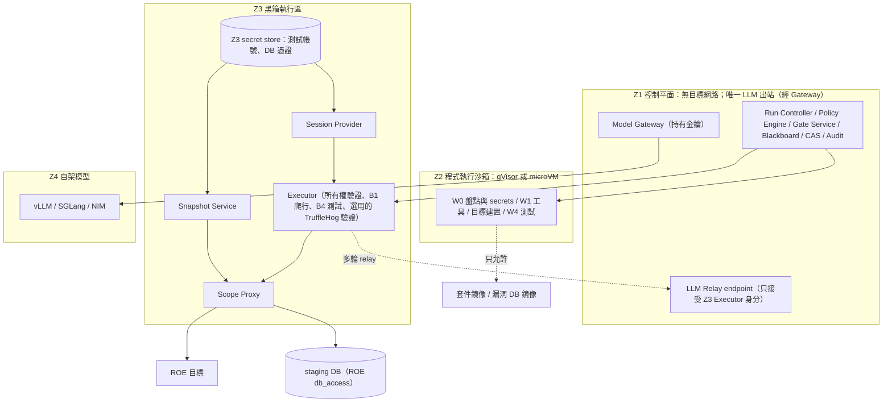

| 區 | 內容 | 出站 | 秘密 |
|---|---|---|---|
| Z1 | Run Controller、Policy Engine、Gate Service、Postgres、CAS、Audit Log、Model Gateway、Budget Tracker、LLM Relay endpoint | 只有 Gateway 能連 LLM 端點；**不能連目標**；唯一入站是 Z3 → Relay endpoint（mTLS）[H] | LLM API 金鑰（只在 Gateway） |
| Z2 | W0 盤點與 secrets 掃描、W1 掃描、目標應用建置與相依安裝、W4 測試 | 只能連套件鏡像與漏洞 DB 鏡像；**沒有 LLM、沒有目標** | 無 |
| Z3 | 所有權驗證、B1 爬行、B4 執行、Session Provider、Snapshot Service、TruffleHog 驗證（選用，需 ROE 允許且通過法務閘門） | 只經 Scope Proxy 到 ROE 目標與 ROE `db_access` 端點；另可連 Z1 Relay endpoint | 測試帳號與 DB 憑證，存在 Z3 自己的 secret store，**永遠不進 LLM context、不回傳 Z1** |
| Z4 | 自架模型伺服器 | 無對外出站；只接受 Gateway 連線 | 無 |

**隔離要求**：
- 不可信程式碼至少要用 gVisor [V][E:blackbox-34]，或 Firecracker microVM [V][E:blackbox-35]、Docker Sandboxes [V][E:blackbox-39]。**不能只用一般 Docker**。
- **絕不掛載 Docker socket**。Docker 官方文件：只有可信使用者能控制 daemon，因為容器可以掛載主機目錄 [V][E:blackbox-38]。
- gVisor、Firecracker、E2B 的逃逸抵抗力，本研究只找到廠商自述，未找到獨立評估（搜尋未窮盡）[研究限制]。
- 出站白名單在 proxy／namespace 層強制，例如 Anthropic sandbox-runtime 的 `allowedDomains`（research preview）[V][E:blackbox-40] 或 nftables。工具自己的 origin 選項不是安全邊界 [V][E:blackbox-24]。

**Z2 沙箱需求**（Sandbox Runner 必須滿足，全部 [H]，數值可在 `toolkit.yaml` 調整）：

| 項目 | 要求 |
|---|---|
| 執行環境 | gVisor 或 Firecracker microVM；每個 job 一個全新環境，結束即銷毀；不共用檔案系統 |
| 映像 | 以 digest 鎖定；工具版本登錄在 `tools.yaml`；不在 job 內下載工具 |
| 輸入 | repo 以唯讀複本掛入（路徑黑名單已排除）；其他輸入只從 CAS 取得並驗 hash |
| 網路 | 預設無網路；`mirror_only` 設定檔只允許套件鏡像與漏洞 DB 鏡像；W4 測試一律 `none` |
| 權限 | 非 root；無 Docker socket；無主機掛載；無憑證、無環境變數 secrets；預設關閉 lifecycle scripts |
| 資源上限（預設） | 2 vCPU、4 GiB 記憶體、10 GiB 磁碟；W1 每個工具 30 分鐘、W4 每批 10 分鐘；超過即終止並記 `ERROR` |
| 輸出 | 只收集指定輸出目錄與 stdout／stderr，單一 job 上限 200 MiB；離開 Z2 前套用 `secrets-redaction-map` 與 pattern＋entropy 遮罩，再寫入 CAS |
| 冪等 | job ID＝sha256（映像 digest＋指令＋輸入 hash）；結果已存在就不重跑 |
| 隔離層版本 | runsc／Firecracker 版本鎖定並列入 SBOM；每週比對 CVE，High 以上 7 天內升級。gVisor、Firecracker、Kata 都有逃逸或權限提升類 CVE／advisory [P][E:blackbox-41][E:blackbox-42][E:blackbox-45]～[E:blackbox-47][E:blackbox-51]～[E:blackbox-53]；一般 runc 容器也有多次逃逸 CVE [V][E:blackbox-54]～[E:blackbox-56]（詳見 [06 §1.4](06-security-legal-limitations.md#14-沙箱與網路)） |
| 主機設定 | Firecracker 不開 `--enable-pci`；Jailer 目錄只有 root 可寫；virtiofsd 等主機端輔助程式沙箱化執行 |
| 共置 | 同一台實體主機不同時執行不同 engagement 的 Z2 job（側通道，[V][E:blackbox-48]），或改用關閉 SMT 的專用主機 |

**Z3 工具容器需求**（v0.4，全部 [H]）：Z3 執行 G4 核准、但由 LLM 產生的腳本（Playwright、pytest 等）與第三方工具（ZAP、Schemathesis）。核准只證明有人看過，不證明腳本無害，所以 Z3 比照 Z2 隔離：

| 項目 | 要求 |
|---|---|
| 執行環境 | gVisor 或 Firecracker microVM；每個 job 一個全新環境，結束即銷毀；不同 job 不共用檔案系統 |
| 網路 | 每個 job 自己的網路命名空間；唯一可連的位址是 Scope Proxy（以該 job 的 proxy 權杖認證）；**沒有 DNS 解析器**（名稱由 Scope Proxy 解析）；不能連 Relay、Snapshot Service、Executor 的指令埠 |
| 憑證 | 只解密本 job 用到的角色的 storageState，放在 tmpfs；job 結束即抹除。Executor 的 mTLS 服務金鑰與 z3_executor 簽章金鑰不進工具容器 |
| LLM | 沒有 Relay 憑證；多輪測試的下一輪由 Executor（容器外）經 Relay 取得後再交給容器 |
| 輸出 | 只收集指定輸出目錄、stdout／stderr 與 Scope Proxy 的請求紀錄；離開 Z3 前做 PII 掃描 |
| 映像與權限 | 以 digest 鎖定；非 root；無 Docker socket、無主機掛載；工具的自動更新與遙測關閉（例如 ZAP 的 add-on 更新） |

**Scope Proxy（Z3 唯一出口）**：
- 只放行通過所有權驗證的 ROE 目標主機。目標 ID→主機名稱的對應由 Policy Engine 完成（不經 LLM）；DNS 解析結果由 Scope Proxy 固定。
- 擋內網、雲端 metadata 位址，以及 ROE 以外的 redirect。**位址判定**（v0.4）：每個解析結果以參考實作 `vchlib.safety.ip_problem` 判定，只接受公開的 unicast 位址；Python 的 `is_global` 會放行的 NAT64（`64:ff9b::/96`，例如 `64:ff9b::a9fe:a9fe` 經轉譯器到達 169.254.169.254）、IPv4-mapped、6to4、Teredo、`fec0::/10` 與 multicast 一律擋下。
- **請求內容**（v0.4）：移除 method override 標頭、擋下 `_method` 參數；寫入請求 body 與 query 中的 ID 類欄位必須是本請求綁定的種子或建立物件（[08 §11.7](08-implementation-spec.md#117-scope-proxy-實作)）。白名單本身只約束目標、方法與路徑，這是內容層的補強。
- **協定**（v0.4）：拒絕 `Upgrade: h2c`（h2c smuggling），移除回應中的 `Alt-Svc` 並封鎖 UDP 443（HTTP/3／QUIC 會繞過 TCP 上的 proxy），CONNECT 之後不是 TLS 的流量直接斷線。路徑正規化把 `\` 與 `%5C` 視為 `/`（部分伺服器如此解讀，否則可以繞過排除清單）。
- **每個 job 的請求白名單**：依測試案例的 `request_allowlist`（目標 ID × HTTP 方法 × 路徑樣板）逐一放行，並強制 `max_requests`。**每個寫入請求**（POST／PUT／PATCH／DELETE 與 GraphQL mutation）都要符合寫入範圍規則：只能經 `{seed:<id>}` 碰既有的種子物件，或是 seed manifest 列出的建立請求（§7.1）。路徑先正規化再比對排除清單（§7.1）。這是真正的強制點；對產物做的靜態抽取（§7.2）只是第一道檢查。B1 爬行 job 同樣有自己的 job 白名單，由 harness 以程式碼產生，預設規則見 [08 §11.7](08-implementation-spec.md#117-scope-proxy-實作)（`toolkit.yaml` 還沒有對應的設定區塊，預設值暫為程式常數，見 [09 BL-16](09-backlog.md)）。
- **TLS、協定與 CDN**（M4，[H]）：要逐一檢查 HTTPS 請求的方法與路徑，Scope Proxy 必須終結 TLS。它以 **Z3 本地 CA** 簽發的憑證面對 Executor 的工具，再以一般的 TLS 驗證連到目標；CA 私鑰只存在 Z3。HTTP/2、WebSocket、SSE 的處理方式，以及 DNS 固定如何與 CDN（同一主機名稱對應多個輪替 IP）共存，見 [08 §11.7](08-implementation-spec.md#117-scope-proxy-實作)。
- 每個主機設請求預算與並行上限，**與工具設定無關**；並計算停止條件所需的指標（§7.3）。
- **所有權驗證**從這裡發出：Executor 經 Scope Proxy 讀取目標的 DNS TXT 或 well-known path token，結果以 Z3 Executor 的服務金鑰簽署後回傳 Policy Engine（Z1 本身不能連目標）。
- **共享平台網域**（例如 `*.supabase.co`、`*.vercel.app`、`*.netlify.app`）[H]：租用者無法在這些網域放 DNS TXT，也不一定能控制 well-known path；而且即使能控制，基礎設施仍屬於平台，測試還要符合平台的測試政策。因此這類主機不接受 `dns_txt`／`well_known_path`，必須改用 `platform_project` 證明（平台、專案 ID、證據參照），並在 ROE 的 `platform_policies[]` 記錄已接受該平台的測試政策（`E-ROE-PLATFORM`）。網域清單與證明方式見 [08 §11.9](08-implementation-spec.md#119-共享平台網域的所有權證明)。
- **DB 連線**：只有 Snapshot Service 的身分可以用 TCP 轉送模式連到 ROE `db_access.endpoint`；Executor 的測試 job 不能直連 DB（§7.6）[H]。
- **第三方接觸是另一份白名單**：TruffleHog 驗證只能連到 ROE `secrets_verification.providers` 列出的供應商端點，每次都標記為「第三方接觸」並記錄；預設這份白名單是空的。
- 支援 kill switch：一鍵取消所有 Executor 工作、關閉所有 job 白名單，並記錄原因。

**Z3 與 LLM 的關係**：Z3 不持有 LLM 金鑰、不能直連 LLM 端點。
- 單輪的 LLM 功能測試：測試輸入（prompt、合成文件）在 Z1 經 Gateway 產生，成為 G4 核准的產物，再交給 Z3 送到目標；目標的回應回傳 Z1 評分。
- 多輪策略（例如 iterative、crescendo）需要邊測邊產生下一輪輸入：Z3 經一條**受限的 relay** 呼叫 Z1，由 Z1 經 Gateway 產生下一輪。relay 只允許 ROE 指定的模型，有每輪與總花費上限，並全部寫入 audit。細節見 [§7.5](#75-llm-功能測試的額外控制)。

**儲存**：
- Postgres：LangGraph checkpoint（PostgresSaver [V][E:orchestration-05]）、Blackboard 索引、gate 紀錄、run 紀錄。
- Content-addressed Store：SARIF、切片、報告、產生的測試與工具設定、LLM 請求與回應、請求紀錄，以 sha256 為鍵（介面見 §15）。
- Audit Log：JSONL 檔（hash chain，§13），大型內容只存 CAS hash。
- Audit Log、CAS 與 DB 快照：加密、套用與原始碼相同的資料等級、設保留期限、限制存取、secrets 遮罩。
- **保留期限的優先順序** [H]：`toolkit.yaml` 的 `retention` 是組織的**上限與預設值**；engagement 的 `retention_days` 是該委任的**實際值**，必須在 1 到工具包上限之間（P 級看 `p_days`、C 級看 `c_days_after_run_end`；否則 `E-RETENTION`）；ROE 的 `data_handling.retention_days` 必須 ≤ engagement（否則 `E-ROE-RETENTION`），也 ≤ 工具包上限（否則 `E-RETENTION`）。順序為 toolkit < engagement < ROE，後者只能更短；超過時 validator 拒絕（錯誤，不是警告）。稽核檔與 checkpoint 的期限只看 `toolkit.yaml`。細節見 [08 §5.2](08-implementation-spec.md#52-優先順序)、[08 §7.5](08-implementation-spec.md#75-保留與刪除)。

## 3. 框架選型

| 需求 | 選擇 | 理由 | 未採用的選項 |
|---|---|---|---|
| 流程與指揮 | **LangGraph 1.x**（MIT）[V][E:orchestration-01] | 1.0 起承諾 2.0 前無破壞性變更；每個 node 可用不同模型 [V][E:orchestration-02]；`Send` 可動態 fan-out，reducer 合併平行寫入 [V][S-03]；`interrupt()`＋checkpointer 提供人工關卡與中斷續跑 [V][E:orchestration-04][E:orchestration-05] | **Claude Agent SDK**：官方文件明言不支援把 Claude Code 路由到非 Claude 模型，不符多廠商需求 [V][E:orchestration-21]<br>**AutoGen**：維護模式 [V][E:orchestration-06]<br>**CrewAI**：hierarchical 模式由 manager LLM 派工 [V][E:orchestration-13]，且預設開匿名 telemetry [V][E:orchestration-15]<br>**OpenAI Agents SDK**：仍是 0.x [V][E:orchestration-16]<br>**Microsoft Agent Framework 1.0**：可行的備案 [V][E:orchestration-07][E:orchestration-09] |
| 多模型閘道 | **LiteLLM**（MIT core）[V][E:orchestration-29] | 提供 `anthropic/`、`openai/`、`nvidia_nim/` [V][E:providers-20]、`hosted_vllm/` [C][E:providers-22]；有預算、fallback、負載平衡 | **OpenRouter**：SaaS（查核者推定為封閉原始碼：未找到路由平台本身的原始碼），多一個資料接收者 [V][E:orchestration-32] |
| 工具互通 | 內部 Python adapter 為主，MCP 選配 | MCP 最新規格 2026-07-28（stateless）[V][E:orchestration-35]；遵循 MCP security best practices（禁止 token passthrough、最小權限、沙箱化本地 server）[V][E:orchestration-36] | — |

**LiteLLM 的供應鏈風險**：1.82.7 與 1.82.8 曾在 PyPI 被植入竊密程式（2026-03-24，約 40 分鐘）[V][E:orchestration-31]。→ 鎖版本＋hash、不在 Gateway 以外的地方持有金鑰。另外，fallback **只允許同家族**（§8.1）。

LangGraph 的 supervisor 模式（「以其他 agent 為工具的 agent」[V][E:orchestration-03]）**不是**本設計的主軸。本設計採「確定性狀態圖＋在指定節點呼叫 Commander」（§4）。

## 4. Harness／指揮官如何滿足需求

**Harness＝Run Controller（程式碼）＋ Commander Agent（LLM）**。

- Run Controller 決定**怎麼執行**：順序、並行、重試、限速、checkpoint。
- Commander 決定**要做什麼**：在下列 5 個決策節點產出計畫。

| 節點 | 時機 | Commander 決定 | Policy Engine 檢查 | 計畫不合規時 [H] |
|---|---|---|---|---|
| CMD-1 | W1 之後、Slicer 產出切片時 | 白箱計畫：切片 × 面向 × 指派 agent × 預算 | 覆蓋下限（每個切片都含全部必要面向，`E-PLAN-FACETS`）、資料等級與模型相容、agent 存在且角色相符、預算 | 修復 ≤2 次；仍不合規 → 使用程式碼產生的覆蓋下限計畫 |
| CMD-2 | W3 之後 | 對 DISPUTED 或票數不足的叢集加派審查者或驗證者；補覆蓋不足的切片（最多 2 輪） | `extra_dispatch[].target` 是 `{kind, id}` 且 ID 屬於本 run；計畫的 `round` ≤ 2（`E-PLAN-ROUNDS`）；加派的模型家族規則、預算 | 修復 ≤2 次；仍不合規 → 不加派，直接進 G2 路由 |
| CMD-3 | B1 之後 | 套用哪些威脅分類（STRIDE 一律；有個資加 LINDDUN；有 LLM／Agent 加 LLM Top 10、ASI、MAESTRO） | 確定性特徵觸發的分類不可移除 | 修復 ≤2 次；仍不合規 → 只用確定性特徵觸發的分類 |
| CMD-4 | G3 之後 | 測試設計計畫與 `tool_binding` 選擇 | 目標只能是 ROE 目標 ID；工具與模式在 ROE 允許清單中；安全等級由程式碼重算 | 修復 ≤2 次；仍不合規 → 該威脅標 `MANUAL` |
| CMD-5 | B5 之後 | 追加測試、後續 run 草稿（`followup`／`regression`） | 同上；後續 run 只是草稿，要由人啟動 | 修復 ≤2 次；仍不合規 → 不建立草稿，B6 列出建議 |

- 每個 CMD 節點的輸出都先以 schema 驗證，再經 Policy Engine 檢查；兩者任一失敗就要求修復（至多 2 次），之後改用上表最右欄**由程式碼決定的保底計畫**（CMD-1 寫稽核事件 `coverage_floor_applied`，其他節點寫 `policy_decision`）[H]。
- **CMD-2 的輪數上限由 validator 檢查**：計畫帶 `round`（1 或 2），超過 `max_extra_dispatch_rounds`（2）→ `E-PLAN-ROUNDS`；RunState 的 `cmd2_rounds` 只是執行中的計數（§5.1）[H]。

**覆蓋下限**：「每個切片 × 每個必要面向」的最小計畫由程式碼從 W0 inventory 產生。必要面向由 W0 的確定性特徵決定：`authz`、`authn_session`、`injection`、`data_access`、`secrets_config`、`business_logic` 一律必要；其他面向依 inventory 的 `features[]`、LLM 整合與公開前綴的環境變數加入（規則見 [02 W2](02-methodology.md#w2-多家族獨立審查)）[H]。Commander **只能加，不能減**：它的計畫必須是覆蓋下限計畫的**超集合**，每個切片都要包含全部必要面向，否則 → `E-PLAN-FACETS`（覆蓋下限計畫本身也受同一檢查）。v0.4 起 CMD-1 計畫還必須涵蓋 run 的每個切片（`E-PLAN-COVERAGE`），且每個切片的 reviewer 至少來自 min(2, 合格 reviewer 家族數) 個家族（`E-PLAN-FAMILIES`）；否則 Commander 可以漏掉切片或只派一個家族，讓多家族審查名存實亡。任何降權或略過都要記錄並出現在報告中。這也防止受測 repo 內容透過 Commander 讓覆蓋縮水。

**Commander 的輸入：型別化視圖** [H]：Commander **沒有任何工具**（`agents.yaml` 的 `tools: []`），不能讀 Blackboard、切片或 repo。每個 CMD 節點的輸入是 Policy Engine 以程式碼組成的**型別化視圖**：只有 ID、狀態、CWE 桶、嚴重度、家族、enum 值與計數，**沒有任何來自 LLM 輸出或受測 repo 的自由文字**（沒有發現項說明、推理、程式片段、威脅敘述、檔名或註解）。受測 repo 可能含有影響 LLM 的文字：經 LLM 最佳化的 PR metadata 框架攻擊，曾讓 LLM 安全審查漏判 33 個 CVE 中的 32 個 [V：預印本][E:whitebox-29]。各節點的視圖內容如下：

| 節點 | 視圖內容（全部是 ID、enum 或數字） |
|---|---|
| CMD-1 | 每個切片的 `slice_id`、錨點 endpoint 的 `kind` 與 `auth_required`、檔案數與 token 數、資料等級、必要面向（程式碼算出）；可用的 reviewer agent ID 與其家族；剩餘預算 |
| CMD-2 | 每個叢集的 `cluster_id`、裁決狀態、CWE 桶、成員最高嚴重度、`families`、有效票與計權合格票數、`no_eligible_verifier`／`diversity_degraded` 旗標；覆蓋不足的 `slice_id` × 面向；已用的加派輪數；可用的 agent ID 與家族；剩餘預算 |
| CMD-3 | W0 與 B1 的確定性特徵旗標（例如有個資欄位、有 LLM 整合、有 agent 工具）、DFD 各種元素與邊界 `kind` 的計數、已由特徵觸發的分類 |
| CMD-4 | G3 核准威脅的 `threat_id`、分類條目 ID、STRIDE 類別、嚴重度、對應的需求 ID；ROE 目標 ID；G0b 過濾後允許的 `tool:mode` 清單 |
| CMD-5 | 每個叢集的最新狀態、測試證據類別（`E_proof`／`E_fail_u`／`E_pass`／`E_inc`）的計數、未能測試清單中各 `kind` 的計數、可建立的後續 run 種類 |

- 視圖的欄位都是封閉的 enum、ID pattern 或數字；Policy Engine 組視圖時，不符 pattern 的值直接丟棄並記錄，不會以文字形式傳給 Commander [H]。
- Commander 的計畫理由（`rationale`）是 LLM 輸出，只寫入稽核與報告，**不會**回到任何 agent 的輸入。

**Commander 不能**：
- 使用任何工具（讀 Blackboard、切片、repo 或 W1 工具輸出）
- 新增 ROE 以外的目標
- 跳過任何關卡
- 判定發現項真偽（交給 Aggregator）
- 直接執行工具
- 把 C 級資料送到不允許的模型
- 撰寫最終報告敘事（只寫計畫理由；敘事交給 Reporter）
- 啟動後續 run（只能建立草稿）

**為什麼這樣設計**：
- AIxCC 的計分有準確度乘數 AM＝1−(1−r)^4（準確率 50% 時為 0.9375、40% 時為 0.8704），錯誤的關聯會讓獎勵變成懲罰 [單源：SoK][E:reference_systems-05]。AIxCC SoK 的關鍵發現是「穩定性與準確度決定勝負」「技術先進與工程良好是兩個不同的挑戰」[V][E:reference_systems-08]。
- 冠軍 Atlantis 是 ensemble-first，亞軍 Buttercup 是確定性流程＋只在工具不足處用 LLM [V][E:reference_systems-02]。本設計兩者兼取：流程確定、審查端多家族整合（ensemble）。
- OWASP LLM06:2025 Excessive Agency（2026 版為 LLM03 [V][S-01][E:threat_modeling-73]）的緩解建議：最小化 agent 可用的擴充、避免開放式工具、最小權限、高影響動作需人核准 [V][E:blackbox-32]。
- 裁決若交給 LLM，會有自我偏好問題 [V][E:multi_llm_bias-05]。

**加派機制**：用 LangGraph `Send` 從條件邊動態 fan-out 到多個平行分支 [V][S-03]；fan-in 節點採 **quorum**（容許晚到或失敗的分支，記為缺票）。

**Commander 計畫 JSON**（依 [schemas/commander-plan.schema.json](schemas/commander-plan.schema.json)）。下面是**節錄**，只列本節談到的欄位，省略的部分以 `…` 表示，**不是**可通過驗證的實例；完整、可通過 validator 的實例見 [schemas/examples/commander-plan.example.json](schemas/examples/commander-plan.example.json)（CMD-1）與 [schemas/examples/commander-plan.cmd5.example.json](schemas/examples/commander-plan.cmd5.example.json)（CMD-5）。

```text
（節錄，CMD-2 的一個加派項目）
"decision_node": "CMD-2",
"round": 1,
"extra_dispatch": [
  {"target": {"kind": "cluster", "id": "K-014"}, "agents": ["ver_3"], "reason": "…"}
],
…
```

- `extra_dispatch[].target` 是型別化的 `{kind, id}`：`kind` 為 `cluster`、`slice` 或 `threat`，`id` 依種類必須符合 `^K-[0-9]{3,}$`、`^sha256:[0-9a-f]{64}$`、`^T-[0-9]{3,}$`，而且要指向已存在的叢集、切片或威脅（validator：`E-PLAN-TARGET`）；`agents` 必須是 `agents.yaml` 中角色為 `reviewer` 或 `verifier` 的 agent（`E-PLAN-AGENTS`）；計畫層級的 `round` 為 1 或 2（`E-PLAN-ROUNDS`）。ID 是否屬於本 run 由 Policy Engine 在執行時檢查（上表）[H]。

## 5. Run Controller：LangGraph 狀態機

### 5.1 State（Pydantic，示意）

State 只存**參照**（CAS 的 `sha256:` hash 或 Blackboard ID），不存大型內容。持久化的 run 紀錄（`run.schema.json`）是 RunState 的子集；checkpoint 的中繼資料依 checkpoint metadata schema。**checkpoint 內容不是授權依據**（§6）。

v0.3 起 run 紀錄同時是 **run manifest**（`run.schema.json`）[H]：
- `config_refs`：`models`、`agents`、`tools`、`calibration`、`invariants`、`seed_manifest` 各一個 `{path, sha256}`。validator 以參照的檔案重算 sha256（`E-DERIVED`），並檢查路徑指向正確種類的設定檔；`seed_manifest` 只有 Lane A run 可以是 null（`E-RUN-CONFIG`）。
- `prompt_templates[]`：`{template_id, version, sha256}`；切片的 `prompt_template_sha256` 必須是其中之一（`E-SLICE-IDENTITY`）。
- `tool_versions[]`：`{adapter, version, image_digest}`；`adapter` 必須已登錄在 `tools.yaml`，而且與稽核 `tool_invocation_end` 事件的 `payload.tool_version` 一致（`E-RUN-CONFIG`）。
- `rule_version`：裁決規則版本，見下方的規則。
- `baseline_run_id`：比對叢集 `fingerprint` 的基準 run，null＝沒有基準；非 null 時必須是同一組資料中的另一個 run（`E-CLUSTER-BASELINE`）。
- 欄位語意與 prompt 範本登錄見 [08 §11.13](08-implementation-spec.md#1113-run-manifest-與-prompt-範本登錄)。

```python
from datetime import datetime
from enum import Enum
from operator import add
from typing import Annotated, Literal
from pydantic import BaseModel

ArtifactRef = str                       # "sha256:<hex>"，指向 content-addressed store

class RunStatus(str, Enum):
    RUNNING = "RUNNING"
    WAITING_GATE = "WAITING_GATE"
    SUSPENDED = "SUSPENDED"             # 可續跑：關卡逾時、時間窗外、GB 逾時
    STOPPED = "STOPPED"                 # 可續跑：停止條件、kill switch（需簽署 resume）
    ABORTED = "ABORTED"                 # 終止：授權不成立、G1 三輪未過、GB 中止
    FAILED = "FAILED"                   # 終止：無法恢復的技術錯誤、還原失敗
    COMPLETED = "COMPLETED"
    COMPLETED_WITH_GAPS = "COMPLETED_WITH_GAPS"

class RunKind(str, Enum):
    INITIAL = "initial"
    FOLLOWUP = "followup"
    REGRESSION = "regression"
    LANE_A = "lane_a"

GateId = Literal["G0a", "G0b", "G1", "G2", "G3", "G4", "G5", "GB"]
GateOutcome = Literal["APPROVED", "PARTIALLY_APPROVED", "REJECTED", "NEEDS_INFO", "EXPIRED",
                      "VERIFIED", "VERIFY_FAILED"]          # 後兩者只用於 G0a/G0b（系統驗證，非人工簽核）
# G0a/G0b：VERIFIED／VERIFY_FAILED／EXPIRED；G2 整關：APPROVED／EXPIRED；PARTIALLY_APPROVED 只限 G3/G4（validator 檢查）

class GateRef(BaseModel):
    gate: GateId
    gate_record_id: str | None          # EXPIRED 時為 None
    outcome: GateOutcome
    round: int = 1                      # G1/G3/G4 的重擬輪次
    subject_hash: ArtifactRef           # 被核准產物的 hash
    job_id: str | None = None           # 只有 G5
    opened_at: datetime
    decided_at: datetime | None = None

class PhaseBudget(BaseModel):
    max_input_tokens: int
    max_output_tokens: int
    max_cost_usd: float                 # 未設定 → Gateway 拒絕（fail-closed）
    max_compute_minutes: int            # 不含等待人工關卡的時間
    spent_input_tokens: int = 0
    spent_output_tokens: int = 0
    spent_cost_usd: float = 0.0
    compute_minutes: float = 0.0

class Budgets(BaseModel):
    run_total: PhaseBudget
    W: PhaseBudget
    B: PhaseBudget
    upstream_llm_spend_usd: float = 0.0 # 受測應用的上游 LLM 花費（ROE 上限）
    relay_spend_usd: float = 0.0        # Z3→Z1 relay 花費
    gb_return_node: str | None = None   # GB 核准「延長」後回到的節點

class FileRef(BaseModel):
    path: str
    sha256: str                         # validator 以參照的檔案重算

class ConfigRefs(BaseModel):            # run manifest（08 §11.13）
    models: FileRef
    agents: FileRef
    tools: FileRef
    calibration: FileRef
    invariants: FileRef
    seed_manifest: FileRef | None       # 只有 Lane A run 可為 None（E-RUN-CONFIG）

class PromptTemplateRef(BaseModel):
    template_id: str
    version: str
    sha256: str                         # 也進入 slice_id 與 LLM 快取鍵（§5.8）

class ToolVersion(BaseModel):
    adapter: str                        # "tool:mode"
    version: str
    image_digest: str | None

class OwnershipCheck(BaseModel):
    target_id: str
    method: Literal["dns_txt", "well_known_path", "platform_project"]   # 共享平台網域只接受 platform_project（§2）
    ok: bool
    checked_at: datetime
    batch_id: str | None                # None = B0；否則為 B4_preflight 的批次
    signed_result_ref: ArtifactRef      # Z3 Executor 服務金鑰簽署的結果

JobStatus = Literal["PENDING", "AWAITING_G5", "SNAPSHOTTED", "EXECUTING", "EXECUTED",
                    "INTERRUPTED", "RESTORED", "RESTORE_FAILED", "SKIPPED", "STOPPED"]

class JobState(BaseModel):
    job_id: str                         # sha256(testcase_id + 產物 hash + attempt)
    testcase_id: str
    safety_class: Literal["S0", "S1", "S2"]
    target_id: str
    status: JobStatus
    g5_record_id: str | None = None
    snapshot_ref: str | None = None
    restore_verified: bool = False
    result_ref: ArtifactRef | None = None
    skip_reason: str | None = None      # g4_rejected / g5_rejected / g5_expired / no_snapshot / ownership_failed / build_mismatch / session_unavailable …

class StopEvent(BaseModel):
    at: datetime
    scope: Literal["job", "target", "run"]
    condition: str                      # 對應 ROE stop_conditions 的鍵，或 kill_switch
    observed: float | None
    threshold: float | None
    job_id: str | None
    target_id: str | None

class Gap(BaseModel):                   # B6「未能測試清單」的來源
    kind: str                           # manual / g3_rejected / g4_rejected / g5_skipped / tool_failed / ownership_failed / build_mismatch / gb_stopped / error …
    ref: str
    reason: str

class ErrorRecord(BaseModel):
    node: str
    error_class: str                    # 錯誤分類（08 定義）
    attempt: int
    detail_ref: ArtifactRef | None

def merge_jobs(cur: dict[str, JobState], upd: dict[str, JobState]) -> dict[str, JobState]:
    return {**cur, **upd}               # 以 job_id 為鍵，更新同一 job 的狀態

class RunState(BaseModel):
    # --- 身分、種類、狀態 ---
    run_id: str
    engagement_id: str                  # 對應已簽章委任設定 / ROE
    run_kind: RunKind
    parent_run_id: str | None = None
    reuse: list[ArtifactRef] = []       # 沿用的上一 run 產物（輸入 hash 必須相同）
    trigger: Literal["manual", "schedule", "merge", "pull_request"]
    run_owner: str                      # 委任設定指定的人；自動觸發時的紀錄發起者
    initiators: Annotated[list[str], add] = []   # 啟動者、認領者（initiator_claim）、G4 核准者；都必須是人
    status: RunStatus = RunStatus.RUNNING
    status_reason: str | None = None
    current_node: str | None = None
    resume_node: str | None = None      # SUSPENDED/STOPPED 後要回到的節點
    resume_deadline: datetime | None = None      # 等待中關卡的 opened_at ＋ 委任設定的關卡逾時
    # --- 設定與授權（全部是 hash）---
    data_class: Literal["P", "C"] = "C"  # fail-closed：未標記即 C
    toolkit_config_ref: ArtifactRef
    key_registry_ref: ArtifactRef | None = None
    engagement_ref: ArtifactRef         # 含 assurance_profile、gate_approvers、providers[]（§6.3、§6.4、§8.4）
    roe_ref: ArtifactRef | None = None
    repo_commit: str                    # B4 以 build 識別比對（§5.5）
    # --- run manifest（v0.3；08 §11.13）---
    config_refs: ConfigRefs
    prompt_templates: list[PromptTemplateRef] = []
    tool_versions: list[ToolVersion] = []
    rule_version: str                   # 裁決規則版本（05 §4.2）；目前為 "05-v0.5"
    baseline_run_id: str | None = None  # 比對叢集 fingerprint 的基準 run（baseline_state，§6.3）
    # --- W 階段 ---
    inventory_ref: ArtifactRef | None = None
    sbom_ref: ArtifactRef | None = None
    redaction_map_ref: ArtifactRef | None = None # 為 None 時 Gateway 拒絕此 run 的所有請求
    invariants_ref: ArtifactRef | None = None
    invariants_changed: bool = True
    g1_round: int = 0
    w1_sarif_ref: ArtifactRef | None = None
    deps_check_ref: ArtifactRef | None = None
    tool_results_ref: ArtifactRef | None = None  # W1 輸出正規化後的 ToolResult 清單；只給 W3_cluster／W3_adjudicate（08 §11.2）
    slice_refs: Annotated[list[ArtifactRef], add] = []
    plan_ids: Annotated[list[str], add] = []     # Commander 計畫（已經 Policy Engine 驗證）
    findings: Annotated[list[str], add] = []     # 平行 reviewer 寫入以 reducer 合併
    cluster_ids: list[str] = []
    verdicts: Annotated[list[str], add] = []     # 每一版裁決都保留
    missing_votes: Annotated[list[dict], add] = []
    diversity_flags: Annotated[list[dict], add] = []
    cmd2_rounds: int = 0                # ≤ 2；validator 另以計畫的 round 檢查（E-PLAN-ROUNDS）
    g2_queue: list[str] = []            # 空 → 略過 G2
    w4_iteration: int = 0               # CoverUp 迭代輪次（≤3）
    w4_results: Annotated[list[ArtifactRef], add] = []
    whitebox_report_ref: ArtifactRef | None = None
    w_sarif_ref: ArtifactRef | None = None
    dfd_ref: ArtifactRef | None = None
    seed_threats_ref: ArtifactRef | None = None
    lane_a_advisories: list[str] = []   # Lane A 帶入的參考性發現項（最高 UNCORROBORATED；不計入 independent_families）
    calibration_version: int | None = None   # 裁決所用的校準版本（與 calibration.yaml 相同的整數）；未完成最小重跑的模型權重為 0
    disputed_after_g2: list[str] = []   # 推導值：本 run 中帶 w4_became_disputed 註記之裁決的 cluster_id（G3 另列；05 §4.2）
    # --- B 階段 ---
    egress_allowlist_ref: ArtifactRef | None = None
    ownership_results: Annotated[list[OwnershipCheck], add] = []
    b1_external_ref: ArtifactRef | None = None
    b1_merged_ref: ArtifactRef | None = None
    b1_diff_ref: ArtifactRef | None = None
    taxonomy_plan_id: str | None = None
    threat_model_ref: ArtifactRef | None = None
    b1_diff_dispositions_ref: ArtifactRef | None = None
    g3_round: int = 0
    testplan_ref: ArtifactRef | None = None
    testcase_ids: list[str] = []
    artifact_hashes: dict[str, ArtifactRef] = {}
    g4_round: int = 0
    approved_testcase_ids: list[str] = []
    restore_drill_ref: ArtifactRef | None = None
    jobs: Annotated[dict[str, JobState], merge_jobs] = {}
    executed_jobs: Annotated[list[str], add] = []   # 所有 job 的冪等鍵（不只 S2）
    stop_events: Annotated[list[StopEvent], add] = []
    kill_switch: bool = False
    testresults: Annotated[list[ArtifactRef], add] = []
    manual_review_clusters: list[str] = []   # B5_readjudicate 後轉為 DISPUTED 者（B6 人工複核清單）
    followup_drafts: list[str] = []
    report_manifest_ref: ArtifactRef | None = None
    # --- 共通 ---
    gate_records: Annotated[list[GateRef], add] = []  # 驗證一律以簽章紀錄為準
    budgets: Budgets
    gaps: Annotated[list[Gap], add] = []
    audit_anchors: Annotated[list[dict], add] = []    # 每個 audit_anchor 事件的 {seq, line_sha256}；line_sha256＝該錨點事件自己那一行原始位元組的 sha256（§13.1）
    errors: Annotated[list[ErrorRecord], add] = []
```

平行節點的更新以 reducer 合併：`new = reducer(current, update)`；列表用 `operator.add` 串接，不會覆蓋 [V][S-03]。

- run manifest 的欄位（`config_refs`、`prompt_templates`、`tool_versions`、`rule_version`、`baseline_run_id`）在 `run_init` 寫入後不再改變；同一 run 中途換設定檔或 prompt 範本必須開新的 run [H]。
- `rule_version` 必須等於 validator 裁決程式的版本（`vchlib.adjudicate.RULE_VERSION`，目前為 `05-v0.5`），而且本 run 每一版裁決的 `rule_version` 都與它相同（`E-RUN-RULE-VERSION`；裁決本身另由 `E-VERDICT-RULE-VERSION` 檢查）。v0.2 的 validator 接受任意字串。

### 5.2 主狀態圖

主圖只畫階段層級與終止狀態；細節見 §5.3–§5.6。`SUSPENDED`、`STOPPED` 以 interrupt 節點（`suspended_wait`、`stopped_wait`）實作，run 紀錄的 `status` 同步更新 [H]。

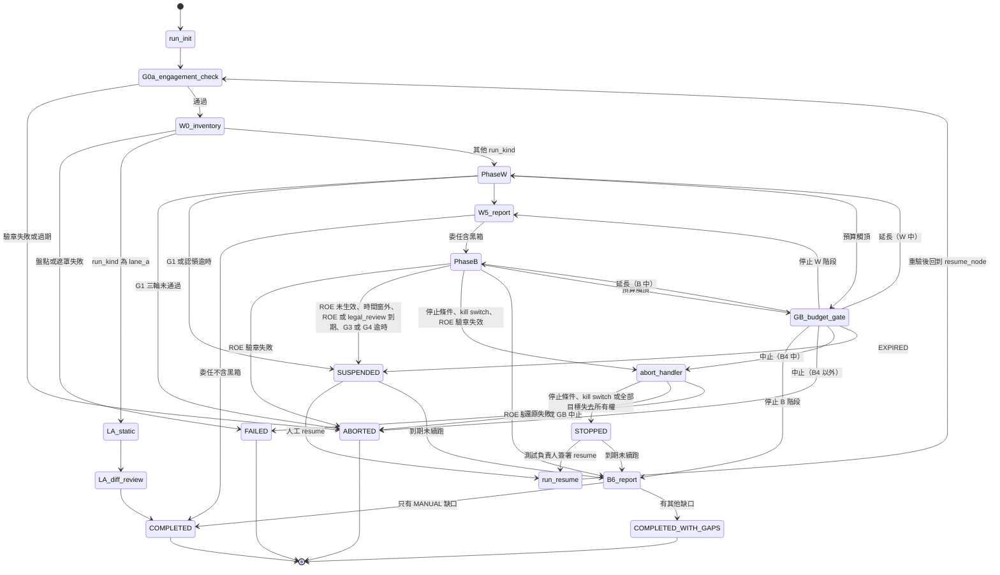

- `PhaseW`＝§5.3 的 W1–W4（含 W0.5、G1、G2、`claim_run`）；`PhaseB`＝§5.4 與 §5.5。
- 「到期未續跑」：委任設定的 `not_after` 過後由 Run Controller 的排程清理，以既有產物產生報告，狀態為 `COMPLETED_WITH_GAPS`（若還沒到 W5，報告只含已完成的部分）[H]。ROE 到期**不會**觸發清理：因 ROE 或 `legal_review` 到期而 `SUSPENDED` 的 run，在委任設定到期前都可以用新的有效 ROE 續跑。
- **「到期」與「驗章失效」的區別** [H]：ROE 的 `not_after` 或 `legal_review.expires_at` 在執行中到期 → `SUSPENDED`（checkpoint 保留；resume 需要一份新的有效 ROE，resume 時 G0b 重驗，`B4_preflight` 每批也檢查）。ROE 的簽章在執行中變成無效（簽署金鑰撤銷、文件被改）→ `abort_handler` → `ABORTED`。
- 預算觸頂的偵測在進入任何消耗預算的節點之前（條件邊），以及節點執行中 Gateway 回報 `BudgetExceeded` 時；兩者都先 checkpoint 再進 `GB_budget_gate` [H]。

### 5.3 W 子圖

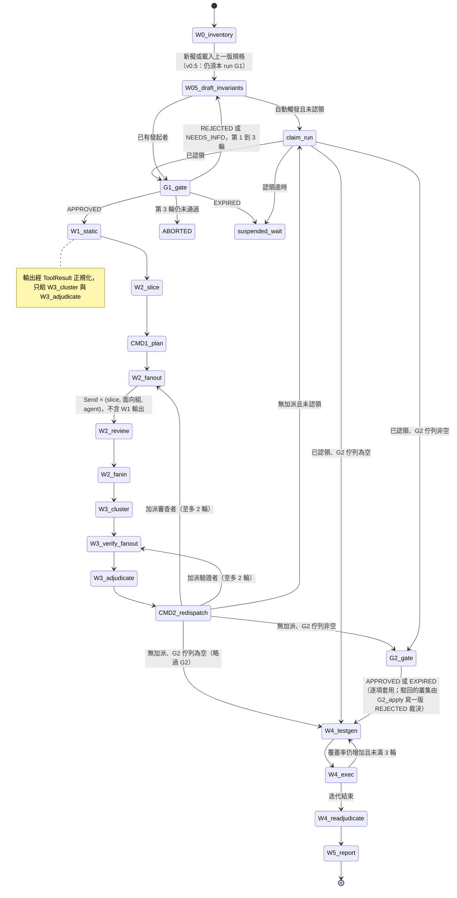

- **W1 輸出不給 reviewer 與 verifier** [H]：`W2_review`（含 CMD-2 加派的審查）與 `W3_verify_fanout` 的驗證者都收不到 W1 的工具輸出（SARIF、相依漏洞、secrets、套件存在性）。W1 結果經 ToolResult 正規化器（§1、[08 §11.2](08-implementation-spec.md#112-工具結果正規化與合併)）後只交給 `W3_cluster`（Clusterer）與 `W3_adjudicate`（Aggregator）。這樣 reviewer 的發現與工具結果才是兩個獨立來源；工具結果分成強佐證與弱訊號，規則見 [05 §4.2](05-bias-calibration.md#42-裁決狀態與有序規則)。
- **W2 的呼叫單位是面向組** [H]：13 個審查面向分成 3 組，每組 4～5 個（v0.4 新增 `cicd_iac`）；每次呼叫審一個切片的一個面向組，所以 fan-out 是 `slice × 面向組 × agent`（分組見 [02 W2](02-methodology.md#w2-多家族獨立審查)）。只有必要面向與 Commander 加入的面向會被審；某一組完全沒有要審的面向時不送出該組。
- **G2 之後的爭議** [H]：`W4_readjudicate` 產生的 `DISPUTED` 不回到 `G2_gate`（圖中沒有 W4 → G2 的邊），而是在該版裁決加註 `w4_became_disputed`（前一版不是 `DISPUTED`、W4 重新裁決後為 `DISPUTED`，與 G2 是否已決定無關），種子威脅與 run 的 `disputed_after_g2` 由此推導，G3 另列「W4 後轉為爭議」一區；`B5_readjudicate` 經 R11 產生的 `DISPUTED` 不加此註記、不進 `disputed_after_g2`，而是列入 B6 人工複核清單。G2 已 `REJECTED` 的叢集之後只註記 `post_g2_conflict`（05 R10）。
- G2 GateRecord 的整關 `outcome` 只有 `APPROVED` 或 `EXPIRED`；逐項的 reject／needs_info 記在 `decisions[]`，不接受整關 `REJECTED`／`NEEDS_INFO`（validator 檢查）[H]。
- G2 佇列由程式碼在 `W3_adjudicate` 計算：所有 `DISPUTED`，以及 rubric 嚴重度（v0.4，[08 §11.17](08-implementation-spec.md#1117-確定性輔助規則)）為 `critical`／`high` 的 `UNCORROBORATED`；上限、排序與逾時比例告警（[02 W3](02-methodology.md#w3-交叉驗證與裁決g2)）。
- `W4_exec` 在 Z2（無網路）；`W4_testgen` 與 `W4_exec` 只透過 Blackboard／CAS 交換產物。
- 自動觸發（`schedule`、`merge`）的 run：在 G1 前停在 `claim_run`（interrupt），認領寫入 `initiators` 與稽核事件 `initiator_claim`。v0.5 移除「沿用已簽核不變量」直接進 W1 的邊，所以沒有人認領之前只會跑 W0 與 W0.5 的草稿。

### 5.4 B 子圖（G0b 到 G4）

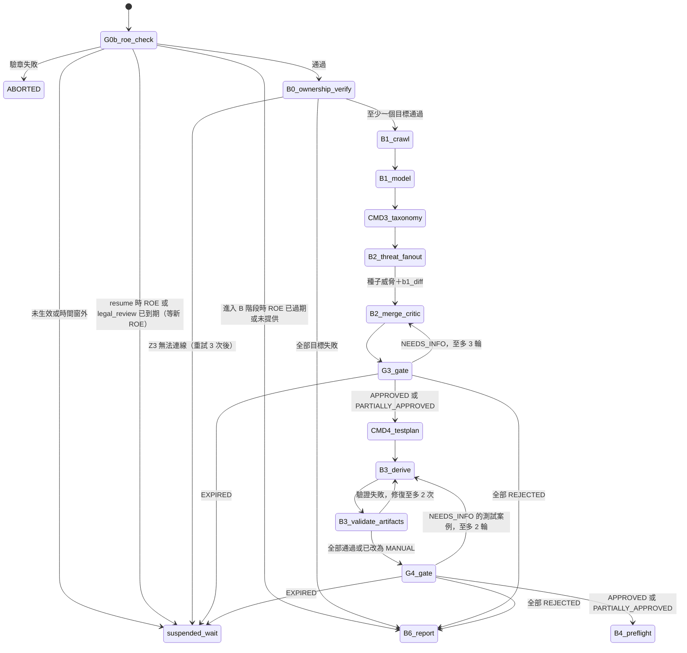

- `G0b_roe_check` 在 B 階段入口、每次 `run_resume` 之後都會執行。
- **G0b 之前不讀 ROE** [H]：G0b 之前的節點（`run_init`、`G0a_engagement_check`、`W0_inventory`、Phase W、`LA_*`）不使用 ROE 的任何欄位，只用 G0a 已驗章的委任設定與工具包設定。W0 能不能用 `trufflehog:scan`，只看工具包層級的法務閘門是否已結案（adapter 是否註冊，[08 §2.3](08-implementation-spec.md#23-擴充介面)），不看 `legal_review`。
- `G0b_roe_check` 同時檢查 ROE 的 `legal_review` 聲明（[06 §2.1.1](06-security-legal-limitations.md#211-roe-的法務審查聲明legal_reviewg0b-檢查h) 規則 L-1～L-6）[H]：L-1～L-4 失敗 → 「驗章失敗」邊（`roe_verify_failed`，理由如 `legal_review_missing`）；L-5（聲明者就是 `test_lead`）→ G0b 記為 `VERIFY_FAILED`（G0 的結果只有 `VERIFIED`／`VERIFY_FAILED`／`EXPIRED`），但 run 不走中止邊，而是等待 ROE 修正（`suspended_wait`）；L-6 → 法務閘門元件從允許清單移除並記為缺口；過濾後的允許工具清單寫入 G0b GateRecord 的 `verification` 區塊，B 階段（`CMD4_testplan`、`B3_derive`、B4 的 adapter）只用這份清單。`B4_preflight` 也檢查 ROE 與聲明都未到期，到期 → `suspended_wait`（不是 `abort_handler`）。
- `B2_merge_critic` 在交 G3 前檢查兩個條件：每個種子威脅都在模型中；每個 `b1_diff` 項目都已處置。任一不成立就不開 G3（修復 ≤2 次後以程式碼補上 `seed-only` 威脅或「未處置」標記交 G3）[H]。

### 5.5 B4 執行迴圈

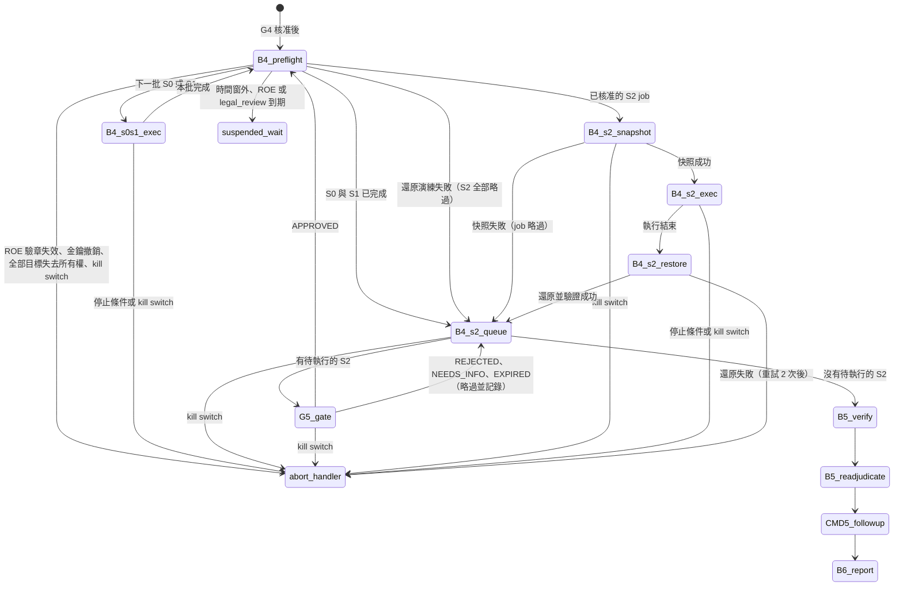

- **批次**：S0／S1 job 依目標分批，每批至多 `toolkit.yaml` 的 `b4_batch.max_jobs`（預設 20）個 job 或 `b4_batch.max_minutes`（預設 60）分鐘 [H]；每批開始都進 `B4_preflight`。每個 S2 job 自成一批。
- **`B4_preflight` 檢查**：ROE 驗章仍有效、ROE 與 `legal_review` 都未到期（到期 → `suspended_wait`），且在時間窗內；所有簽署金鑰未撤銷；該批目標的所有權重驗（DNS TXT／well-known token，共享平台網域為 `platform_project`，§2）；**build 識別**（見下）；`kill_switch` 為 false；預算足夠；該批每個角色的 session 可用，且 whoami 回應符合該角色（§7.4）；每個 S2 job 前，`toolkit.restore_drill_interval_days`（預設 7）天內有成功的 `restore_drill` 稽核事件（§7.6）；量測目標基準延遲（§7.3）。
- **build 識別**（H-B4，[H]）：確認 staging 跑的就是被審查的 commit。ROE 每個目標有 `build_identity.method`：
  - `header`：讀取目標回應中 ROE 指定的標頭（例如 `x-build-sha`）；
  - `endpoint`：讀取 ROE 指定路徑的回應，再以 JSON Pointer 取值；
  - `none`：目標無法提供版本資訊。
  - `header`／`endpoint` 時，觀察到的 build ID 寫入每筆測試結果的 `observed_build_id`，必須等於 run 的 `repo_commit`（完整值，或至少 12 字元的前綴）；不符 → 該目標本批的 job 標 `SKIPPED`（`build_mismatch`）並列入缺口，validator 對不符的結果報 `E-RESULT-BUILD`。
  - `none` 時照常執行，但報告清單把該目標列在 `build_unverified_targets[]`，報告標示「無法確認受測版本」。ROE `environment: tester_controlled` 的目標（例如 canary 伺服器）不是受測系統，不列入；validator 以 `E-RESULT-BUILD` 檢查這份清單剛好是「有測試結果、`method: none`、且不是 `tester_controlled`」的目標（範例報告清單為空）。
- 單一目標失去所有權 → 該目標的 job 標 `SKIPPED`（`ownership_failed`），其他目標繼續；全部失去 → `abort_handler` → `STOPPED`（與 kill switch 相同；ROE 驗章失效或金鑰撤銷 → `abort_handler` → `ABORTED`；時間窗外或 ROE／`legal_review` 到期 → `suspended_wait`）。
- 有狀態改變的 S1 job 結束後，由 Snapshot Service 依 seed manifest 重置種子資料 [H]。種子本身的建立、每個 run 的命名空間與 teardown 見 §7.6。
- **B5 的結果解讀**（H-A3，[H]；規則見 [05 §4.2](05-bias-calibration.md#42-裁決狀態與有序規則)）：
  - 任一 `controls[]` 不是 PASS 的結果是 `INVALID`，一律 `E_inc`；違反只由 `LLM_GRADER` 或 `HUMAN` 判定（`fail_oracles` 沒有確定性類型）的 FAIL 也是 `E_inc`。
  - **事先登記的確定性 FAIL 不需要 LLM**：G4 已核准的黑箱測試，若由確定性 oracle（`HUMAN`、`LLM_GRADER` 以外的類型）判定 FAIL，次數與重播規則都成立，就直接是 `E_proof`。解讀在 G4 已由人核准，所以不必再請 LLM 確認。
  - 其他 FAIL 由 **Result Analyst 池**中挑一位家族與血統都不在叢集中的分析者（§9）確認；回應中偵測到 PII 時只用自架模型。分析者的輸出記在測試結果的 `interpretation`（`{agrees, rationale}`）：同意 → `E_proof`；合格分析者不同意 → `E_inc`；沒有合格分析者 → `E_fail_u`。
  - **黑箱起源的問題**：沒有白箱叢集的威脅（例如 B1／B2 才發現的問題），由 `B5_verify` 建立 `origin: black_box` 的叢集（帶 `threat_id`，沒有成員；位置是 `canonical_location.endpoint`；fingerprint 以目標、方法、路徑樣板計算），讓 R1 等規則同樣適用；這類威脅的測試結果必須記在該威脅的黑箱叢集上（`E-CLUSTER-ORIGIN`）。範例：T-033 → K-201（`GET /api/invoices`），見 [04 §3](04-threat-to-testcase.md#3-測試案例欄位)。

### 5.6 中止、補償與 resume

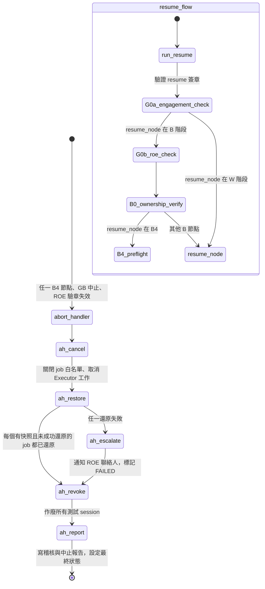

**`abort_handler`**（可重入、冪等）：
1. `ah_cancel`：設 `kill_switch`，Scope Proxy 關閉所有 job 白名單，取消 Executor 工作；正在執行的 job 標 `INTERRUPTED`。
2. `ah_restore`：對每個 `snapshot_ref` 不為空且 `restore_verified` 為 false 的 job，呼叫 Snapshot Service 還原並驗證（重試 2 次）。
3. `ah_escalate`：還原失敗時，立即通知 ROE `stop_conditions.contacts`，最終狀態為 `FAILED`（staging 狀態未知，需人工處理）。
4. `ah_revoke`：Session Provider 作廢本 run 的所有 session。
5. `ah_report`：寫入稽核事件（`stop_condition`／`kill_switch`、`snapshot_restored`／`restore_failed`、`run_status_changed`），由 Reporter 產生中止報告（確定性部分）；最終狀態：還原失敗 → `FAILED`；ROE 驗章失效（金鑰撤銷、簽章無效）、GB 中止、政策違規 → `ABORTED`；其他 → `STOPPED`。

**resume 規則** [H]：
- `SUSPENDED`：run_owner 或任何發起者以 `vibecheck run resume` 續跑；若停在關卡，重新開啟該關卡（新的 GateRecord，`round` 不增加）。
- `STOPPED`：需由 ROE 的 `test_lead` 簽署 resume 紀錄（稽核事件 `run_resume`，附簽章與停止原因已處理的說明）。
- 兩者都只能在委任設定的 `not_after` 之前續跑（停在關卡時，重開的關卡會得到新的 `resume_deadline`＝`opened_at`＋關卡逾時）；續跑一律重驗 G0a，若 `resume_node` 在 B 階段再重驗 G0b 與所有權。B 階段的 resume 需要當時有效的 ROE：原 ROE 已到期 → 必須提供新簽署的有效 ROE，否則 resume 被拒、run 維持 `SUSPENDED`。
- **job 的續跑規則**：`EXECUTED` 不重跑；`INTERRUPTED` 的 S0 可重跑；S1 先重置種子資料再重跑；S2 必須重新走 G5（原 G5 核准失效）。

### 5.7 節點規格表

| 節點 | 區 | LLM | 冪等鍵／副作用 | 失敗邊 |
|---|---|---|---|---|
| `run_init` | Z1 | 否 | `run_id`；建立 run 紀錄（已存在就略過）、寫 `run_created` | 設定不合法 → `FAILED` |
| `G0a_engagement_check` | Z1 | 否 | 純驗證；寫 `engagement_verified`／`engagement_verify_failed` | → `ABORTED` |
| `W0_inventory` | Z2 | 否 | Sandbox job ID；輸出寫 CAS | → `FAILED` |
| `LA_static`、`LA_diff_review` | Z2、Z1 | 否、可選單一家族 | job ID、LLM 請求快取 | 失敗只標示 PR 檢查失敗 |
| `W05_draft_invariants` | Z1 | 是 | LLM 請求快取鍵（§5.8）；Invariant Drafter 只有 `read_inventory`、`write_blackboard`，只讀遮罩後的 W0 inventory（此時還沒有切片） | 修復 ≤2 → 交空白矩陣 |
| `claim_run` | Z1 | 否 | 只做 interrupt | 逾時 → `suspended_wait` |
| `G1_gate`、`G2_gate`、`G3_gate`、`G4_gate`、`G5_gate`、`GB_budget_gate` | Z1 | 否 | 只做 interrupt；開關卡、通知由 Gate Service 在圖外處理 | 依 [02 §1.4](02-methodology.md#14-關卡結果與-run-狀態) |
| `W1_static` | Z2 | 否 | 每個工具一個 Sandbox job；輸出經 ToolResult 正規化（Z1，純函式）後只給 `W3_cluster`／`W3_adjudicate` | 單一工具 → 缺口；全部 → `FAILED` |
| `W2_slice` | Z1 | 否 | 切片以 `slice_id` 定址（`slice_id` 含遮罩表與 prompt 範本的 hash，[08 §11.3](08-implementation-spec.md#113-slicer)） | → `FAILED` |
| `CMD1_plan`…`CMD5_followup` | Z1 | 是 | 計畫 ID；Commander 無工具，輸入是型別化視圖；先經 schema 與 Policy Engine 驗證才寫入 state | 見 §4 |
| `W2_fanout`、`W3_verify_fanout`、`B2_threat_fanout` | Z1 | — | 只產生 `Send` | — |
| `W2_review`、`W3_adjudicate` 的驗證者分支 | Z1 | 是 | LLM 請求快取鍵；輸入**不含** W1 工具輸出 | 重試用盡 → 缺票 |
| `W2_fanin`、`W3_cluster`、`W3_adjudicate` | Z1 | 否 | 純函式（輸入 hash → 輸出 hash）；`W3_cluster` 的輸入是發現項與 `ToolResult`；依 05 R0–R13 | quorum 不足 → 獨立家族數變少並列入報告（不是 R8；[05 §3 規則 3](05-bias-calibration.md#3-設計規則)） |
| `W4_testgen` | Z1 | 是 | LLM 請求快取鍵 | 修復 ≤2 → `MANUAL` |
| `W4_exec` | Z2 | 否 | Sandbox job ID | 重試 1 次 → `ERROR` |
| `W4_readjudicate`、`B5_readjudicate` | Z1 | 否 | 新版裁決 append-only | — |
| `W5_report` | Z1 | 部分 | CAS | LLM 失敗 → 只輸出確定性部分 |
| `G0b_roe_check` | Z1 | 否 | 純驗證 | 見 §5.4 |
| `B0_ownership_verify` | Z3 | 否 | `(run_id, target_id, batch_id)`；只做 GET／DNS 查詢 | 見 §5.4 |
| `B1_crawl` | Z3 | 否 | 爬行 job ID；S0 | 停止條件 → 只用 schema |
| `B1_model`、`B2_merge_critic`、`B3_derive` | Z1 | 是 | LLM 請求快取鍵 | 見 §5.4 |
| `B3_validate_artifacts` | Z1 | 否 | 純函式 | 修復 ≤2 → `MANUAL` |
| `B4_preflight` | Z1＋Z3 | 否 | `(run_id, batch_id)`；只讀檢查與基準量測 | 見 §5.5 |
| `B4_s0s1_exec` | Z3 | 否 | 執行前檢查 `executed_jobs`；有狀態改變的 S1 結束後重置種子 | → `abort_handler` |
| `B4_s2_queue` | Z1 | 否 | 純函式 | — |
| `B4_s2_snapshot` | Z3 | 否 | `run_id + job_id`：快照已存在就略過 | 失敗 → job 略過 |
| `B4_s2_exec` | Z3 | 否 | 執行前檢查 `executed_jobs` 與 job 狀態；`EXECUTING` 中斷者不自動重跑 | → `abort_handler` |
| `B4_s2_restore` | Z3 | 否 | 以 `snapshot_ref` 為鍵；還原後驗證 checksum | 重試 2 → `abort_handler` |
| `abort_handler` | Z1＋Z3 | 否（中止報告的敘事可選） | 逐步檢查 state 後才動作，可重入 | 還原失敗 → `FAILED` |
| `B5_verify` | Z1 | 部分 | LLM 請求快取鍵；事先登記的確定性 FAIL 不呼叫 LLM；其他結果從 Result Analyst 池挑選分析者；建立黑箱起源叢集（§5.5） | 無合格 analyst → `E_fail_u`（不升級為 `E_proof`） |
| `B6_report` | Z1 | 是（敘事） | CAS；報告清單 | 見 §5.4 |
| `run_resume` | Z1 | 否 | resume 紀錄 ID；驗證簽章 | 簽章無效 → 維持原狀態 |
| `suspended_wait`、`stopped_wait` | Z1 | 否 | 只做 interrupt | 到期 → B6 |

### 5.8 節點邊界規則

- LangGraph 的 `interrupt()` 會在 resume 時**從該節點開頭重新執行**，所以 interrupt 之前的副作用必須是冪等的 [V][E:orchestration-04]。本設計讓每個 `G*_gate`、`claim_run`、`suspended_wait`、`stopped_wait` 節點**只做 interrupt**，前面沒有任何副作用；開啟關卡、發送通知、寫 `gate_opened` 稽核事件由 Gate Service 觀察到待處理的 interrupt 後在圖外完成 [H]。
- **LLM 呼叫的冪等**：每個請求以 sha256（`engagement_id`＋資料等級＋模型 ID＋版本＋參數＋prompt hash＋schema hash＋取樣序號）為快取鍵，回應存 CAS。節點重新執行（resume、重試、GB 延長後）時命中快取，不會重複花費 [H]。v0.4 加入前兩項與取樣序號：v0.3 的鍵會跨委任重用 C 級回應（也讓後寫入者的保留期限被忽略），並把同一切片的多次取樣（校準 ② 組、`single_best_resampled`）壓成同一個答案。取樣序號只在「刻意重複取樣」時遞增；重試與 resume 沿用同一個序號，所以仍命中快取。
- **Sandbox 與 Executor job**：job ID 由輸入 hash 決定；結果已存在就不重跑。
- `B4_s2_snapshot` 以 `run_id + job_id` 為冪等鍵：快照已存在就略過。
- `B4_s0s1_exec`、`B4_s2_exec` 執行前檢查 `executed_jobs`，防止 resume 或重試時重跑；狀態為 `EXECUTING` 卻沒有結果的 job 一律標 `INTERRUPTED`，依 §5.6 的續跑規則處理。
- **job 帳本在 checkpoint 之外**（v0.4）[H]：`executed_jobs` 只是快取；權威是 Z3 Executor 的 **job 帳本**（append-only，每筆 `{run_id, job_id, g5_gate_record_id, started_at, finished_at, outcome}`，由 z3_executor 金鑰簽署）。Executor 收到 job 時先查帳本：已有紀錄 → 拒絕執行並回傳原結果。理由：checkpoint 可以回溯（時間旅行重播、從較早的 checkpoint 分叉），回溯後 state 內的 `executed_jobs` 也會倒退；job_id 又是確定性的，可能對上原本的 G5 紀錄，於是 S2 job 會在沒有新 G5 的情況下重跑。
- **每個 run 一把鎖**（v0.4）[H]：Run Controller、Gate Service 的 `submit`／`expire_due` 與 `run abort` 修改同一個 run 之前，先取得以 `run_id` 為鍵的 PostgreSQL advisory lock。LangGraph 的 OSS 版本沒有 thread 層級的互斥，同時寫入會讓 checkpoint 歷史分叉。
- **kill switch 走圖外通道**（v0.4）[H]：`kill_switch` 在 state 中只是紀錄。觸發時 CLI 直接呼叫 `Executor.kill(run_id)` 與 Scope Proxy 的關閉介面（兩者都在 Z3，與圖的執行無關），再寫入 state；節點執行途中無法更新 state，所以不能靠圖內的欄位停止正在進行的 job。
- **durability**（v0.4）[H]：有外部副作用的節點（`B4_*`、`B0_ownership_verify`、Gate Service 寫入）使用同步 checkpoint；非同步模式在當機時可能遺失最後一個 checkpoint，讓已完成的副作用在 resume 時重做。
- **job 的原子領取、租約與 fencing**（v0.5）[H]：Z3 job 帳本（上面）是派送的權威。領取 job 以資料庫交易＋唯一 job 鍵＋條件更新完成，產生持有者、以資料庫時間計算的租約期限，與**單調遞增的 fencing token**；同時搶領只有一方成功。worker 續租、寫結果、每次發出新的副作用都帶 token；Scope Proxy、Sandbox 派送端與 Model Gateway 在**出口**檢查 token 與租約（只靠 worker 自我檢查不夠）。權威不可達、租約過期、kill switch 或 token 過舊時拒絕新請求，舊 worker 的遲到結果不能覆寫新狀態。fencing 擋得住新請求，擋不住已經送出的請求：開始衝突操作前，要先核對前次在途請求的效果。
- **結果不明**（v0.5）[H]：派送前先持久化意圖、操作 ID 與預算保留，完成後記錄回應與費用。已送出但沒有持久化結果（包括服務成功後 worker 當機）一律是「結果不明」，沿用 `INTERRUPTED` 的安全方向：**不自動重送**寫入、種子建立與沒有冪等保證的外部操作；先以操作 ID、唯讀核對或供應商狀態查詢釐清，釐清不了就交人工，費用標為不確定。只有證明未執行、且重新通過授權時才重新派送；S2 另要完成還原核對與新的 G5（重新核准本身不證明前次沒有副作用）。上面的 LLM 快取只避免「已成功持久化」的重複呼叫，不保證當機窗口內不重複計費。
- **還原範圍的排他權**（v0.5）[H]：命名空間只區分資料，整庫快照還原會一起還原同一資料庫上的所有寫入。凡是 `snapshot_restore`（S2 還原、`reset.method: snapshot_restore`、還原演練）都要先取得**該資料庫（或叢集）層級**的排他租約：以實際被快照的資源為鍵（不同 ROE 目標別名指向同一資源時共用一把鎖），從快照前持有到還原與驗證完成，跨 job、跨 run 都互斥；只鎖 job ID 或 run ID 不夠。排他範圍包含測試寫入、種子重置、背景工作與外部使用者的寫入；任何一個停不下來或隔離不了，就**禁止整庫還原**，改用獨立的拋棄式目標或不跑該工作流。失去租約時停止新副作用與還原，先核對資料狀態，再由重新取得排他權的復原流程處理；舊 worker 不能執行遲到的還原。優先做法是每個 run 一個獨立資料庫。
- `B4_s2_restore` 是**補償步驟**：中止、失敗、kill switch 觸發時由 `abort_handler` 也會執行，由 checkpoint 中的 `jobs` 狀態驅動。
- 每個 `CMD*` 節點的輸出都要先經 Policy Engine 驗證，才寫入 state。
- **稽核事件**在節點重新執行時可能重複寫入；每個事件帶 `idempotency_key`（run_id＋節點＋冪等鍵），讀取時去重 [H]。

### 5.9 fan-out／fan-in、重試、缺票
- 每個節點設重試上限（例如 schema 驗證失敗最多修復 2 次、429 依 Retry-After 最多 3 次）。
- 重試用盡就寫入 `missing_votes`，**不無限重試**。
- fan-in 採 quorum：容許晚到或失敗的分支，記為缺票，**仍照常裁決**。缺票是否造成 `diversity_degraded`，依 05 的定義判斷：計權合格票的家族數少於 min(2, 可投票的合格家族數) 時才標記，這時只靠投票得到的確認上限為 `LIKELY`；可執行證明與**強**工具佐證不受此限（[05 §4.2](05-bias-calibration.md#42-裁決狀態與有序規則) R8）。
- `diversity_degraded` 的最終值由 validator 推導（v0.3 修正了 v0.2 的倒置，定義以 [05 §3](05-bias-calibration.md#3-設計規則) 第 3 條為準）[H]：
  - 合格驗證家族 E（叢集）＝ `agents.yaml` 中角色為 `verifier`、家族不在叢集 `families`、血統不在叢集 `lineages` 的 agent 之家族；`no_eligible_verifier` ＝ E 為空（validator 推導並比對，`E-VERDICT-NOELIGIBLE`）。
  - `diversity_degraded` ＝ 非 Lane A、E 不為空，且計權合格票的不同家族數 < min(2, |E|)；Lane A 一律 false。
  - 家族由 `voter_agent_id` → `agents.yaml` → `models.yaml` 解析；**只計入角色為 `verifier` 的 agent 所投的票**，其他角色的票 → `E-VERDICT-VOTER-ROLE`，且不計入計權合格票與家族多樣性。
  - fan-in 可以提早標記，但必須與推導值一致，不一致 → `E-VERDICT-DIVERSITY`。
- **工具佐證不能自行宣告** [H]：叢集的每個 `sarif_refs` 項目，都必須等於同一 run 中某個 `tool_invocation_end` 稽核事件的 `payload_refs` 項目，而且該事件在 Z2、`payload.ok` 為 true、`payload.adapter` 是 `tools.yaml` 已登錄的白箱工具模式（`b4_executable: false`），而且該工具在 `licenses.yaml` 的狀態是 `OK` 或 `注意`（`法務閘門`、`不採用`、`待查`、`參考` 都不行）；對不上 → `E-SARIF-REF`。範例的 K-014 因此改用 `opengrep:scan` 1.6.0 的結果（規則 `vc.authz.update-without-owner`）。`sarif_refs` 與裁決的 `tool_corroboration`、`tool_signal` 都不能有重複項目。
- **強佐證與弱訊號** [H]：已解析的 SARIF 只有在它的 `adapter`、`rule_id` 與執行時的工具版本（稽核事件的 `payload.tool_version`）都符合校準結果 `result.high_precision_rules[]` 的某一條（`{adapter, rule_id, tool_version, cwe_bucket, n, precision_lower95}`；同一 CWE 桶，`precision_lower95` ≥ `result.thresholds.high_precision_min`，範例值 0.9）時，才是**強**佐證，記在裁決的 `tool_corroboration`；其他 SARIF 與 `E_fail_u` 結果都是**弱**的工具訊號，記在 `tool_signal`，只算一個獨立來源（`independent_sources`）。SARIF 結果的 `rule_id` 取自稽核事件的 `payload.sarif_results[]`。範例 `calibration.yaml` 的清單還是空的，所以 SARIF 一律是弱訊號（例如 K-014：`tool_signal` 有一筆、`tool_corroboration` 為空，經 R6 成為 `LIKELY`）。這些欄位都由 validator 重算（`E-VERDICT-TOOLCORR`、`E-VERDICT-TOOLSIGNAL`、`E-VERDICT-SOURCES`），規則見 [05 §4.2](05-bias-calibration.md#42-裁決狀態與有序規則)。

## 6. 人工關卡服務

- **介面**：CLI 優先（網頁介面不在本版範圍）。
  - `vibecheck gate list`
  - `vibecheck gate show <gate-id>`：顯示已叢集、排序、附證據的項目（file:line、片段、CWE、殘餘風險）
  - `vibecheck gate approve <gate-id> --decisions decisions.yaml --sign`
  - `vibecheck run claim <run-id> --sign`（認領自動觸發的 run）
  - `vibecheck run resume <run-id> [--sign]`（`STOPPED` 必須簽署）
- **可部分核准**：逐項 `accept`／`reject`／`needs_info`。被拒絕的項目不進入下游，但保留紀錄。整體結果與處理路徑見 [02 §1.4](02-methodology.md#14-關卡結果與-run-狀態)。
- **核准紀錄（GateRecord）**，依 [schemas/gate-record.schema.json](schemas/gate-record.schema.json)：
  - `gate`（G0a、G0b、G1–G5、GB）、`outcome`、`round`
  - 核准者（可多人）的身分、角色、時間；每個關卡要求的角色見 [02 §1.3](02-methodology.md#13-人工關卡一覽)
  - 被核准產物的 sha256
  - 逐項決定，每項帶該項內容的 `item_sha256`（§6.3；G3 駁回種子威脅、降低風險等級時理由必填；GB 附選項與新上限）
  - `signatures[]`：每位核准者各一筆（格式見 §6.1）
  - **G0a／G0b 例外**：它們記錄的是**系統的驗證結果**，不是人工簽核，所以 `signatures: []`，另有 `verification` 區塊：`document_ref`、`key_registry_version`、`signer_results[]`（`person_id`、`key_fingerprint`、`ok`、`reason`）
- **金鑰的信任根**：核准者的公鑰登錄在組織的**金鑰登錄**（`key-registry.yaml`）中（out-of-band，由資安團隊管理，含登錄、輪替、撤銷流程）。ROE 與委任設定只引用登錄中的指紋，不能自己宣告新的可信金鑰；驗章時同時檢查金鑰未被撤銷。
- **驗證**：Policy Engine 驗的是**簽章紀錄**，不是 checkpoint 內容。只要能寫 checkpoint DB 就能偽造 resume 值，所以 checkpoint 不能當作授權依據。OpenAI Agents SDK 的文件也提醒，只能從可信儲存反序列化快照 [V][E:orchestration-18]。核准綁在**逐項的 approval hash** 上：產物變動時，只有 hash 改變的項目失去核准；hash 不變的項目可依 §6.3 的規則沿用，G5 永不沿用。
- **核准者從哪裡來**：G0a／G1／G2 看委任設定的 `gate_approvers`；G0b／G3／G4／G5 看 ROE，其中 G3／G4／G5 必須在 ROE 有效期內決定（§6.3）。保證等級（Lite／Team／Full）改變「誰可以簽」（§6.4）。
- **職責分離**：G5（S2 執行）的核准者不能是發起者。發起者是啟動該次執行、認領自動觸發的執行，或核准 G4 的**人**，不能記成自動化帳號，否則職責分離形同虛設。自動化帳號列在 `toolkit.yaml` 的 `automation_accounts`（例如 `run-controller`、`scheduler`、`ci-bot`），**永遠不能是發起者或任何關卡的核准者**，驗證器會強制檢查。自動觸發的 run 以委任設定的 `run_owner` 為紀錄發起者，直到有人認領。
- 核准後以 `Command(resume=<gate_record_id>)` 繼續圖的執行 [V][E:orchestration-04]。

### 6.1 金鑰登錄與驗章流程

**設計（[H]）**：方案本身是設計選擇；所依據的外部事實見 [01 §7](01-research-survey.md#7-v02-補充研究2026-09-24)，並已獨立查核。

| 物件 | 內容 |
|---|---|
| 設定檔釘選（v0.4） | 委任設定的 `config_pins` 記錄 `models.yaml`、`agents.yaml`、`tools.yaml`、`licenses.yaml` 的內容 hash（sha256(JCS)；v0.5 加入 `calibration.yaml`、`crosswalk.yaml`），受 G0a 簽章保護；載入的檔案與釘選值不同 → `E-ENG-CONFIG-PIN`。這四份決定 C 級資料路由、家族多樣性、S0／S2 與法務閘門，v0.3 卻沒有簽章 |
| `toolkit.yaml`（`toolkit-config.schema.json`） | 釘選組織根金鑰：`org_root_key.fingerprint`、`alg`；`key_registry.location`；`key_registry.min_version`（防回滾）；`automation_accounts`；`restore_drill_interval_days` |
| `key-registry.yaml`（`key-registry.schema.json`） | `registry_id`、`version`（單調遞增）、`issued_at`、`entries[]`：`person_id`、`roles[]`（含 `legal_reviewer`、`z3_executor`）、`public_key`、`alg`、`fingerprint`、`not_before`、`not_after`、`revoked_at`、`revocation_reason`（`compromised`／`role_change`／`retired`）；`signatures[]`：組織根金鑰的簽章 |
| 被簽署的文件 | `engagement.yaml`、`roe.yaml`、GateRecord（G0a／G0b 除外）；人為的稽核事件 `initiator_claim`、`run_resume`。每位簽署人在 `signatures[]` 中一筆：`{signer, key_fingerprint, alg: ed25519, value}`（舊的 `signature_ref` 欄位已移除） |

**提案的簽章方案** [H]：Ed25519 簽章，`value` 的簽署對象是「解析文件後、移除 `signatures` 欄位（稽核事件則移除 `signature`），再以 JCS 正規化」的位元組。
- **金鑰指紋**：`ed25519:SHA256:` 加上原始 32-byte 公鑰之 SHA-256 的 base64（不含 padding）[H]。
- 相關事實：Ed25519 定義於 RFC 8032（IRTF CFRG 的 Informational 文件），公鑰 32 bytes、簽章 64 bytes、簽章是確定性的 [V][E:orchestration-43]。JCS 是 **RFC 8785（Informational，Independent Submission），不是 IETF 標準**；輸入必須是 I-JSON（無重複屬性名稱），數字以 IEEE-754 double 表示並以 ECMAScript 方式序列化，鍵依 UTF-16 code unit 排序 [V][E:orchestration-44]。
- 候選實作：Python `rfc8785`（Apache-2.0）[V][E:orchestration-45]；`cryptography` 的 Ed25519 API，驗證失敗時 `verify()` 丟出 `InvalidSignature` [V][E:orchestration-46]。
- **嚴格 YAML 載入**：YAML 1.2 是 JSON 的超集合，且規定 mapping 的鍵必須唯一 [P][E:orchestration-52]；但 PyYAML 是 YAML 1.1 解析器 [V][E:orchestration-53]，而且有一個仍未關閉的 issue 回報它（以及 libyaml）會**靜默接受重複鍵**，不報錯 [P][E:orchestration-54]。所以簽署文件必須用自訂的嚴格載入器 [H]：
  - (a) 拒絕重複鍵（不能用預設的 `safe_load`）；
  - (b) 不使用 YAML 1.1 隱式型別（yes／no／on／off 布林、未加引號的時間、八進位、六十進位）；時間一律是加引號、帶時區的 ISO 8601 字串；
  - (c) 整數必須在 ±2^53 以內，更大的數值寫成字串；
  - (d) 不允許 NaN、Infinity、anchor／alias、自訂 tag；
  - (e) 簽署文件（engagement、ROE、`key-registry.yaml`、GateRecord）的任何違反都記為 `signature_invalid`（CLI 結束碼 4），**不是**解析警告；同一載入器也用於未簽署的設定檔（`toolkit.yaml`、`models.yaml`、`agents.yaml` 等），違反時是設定錯誤（結束碼 3），見 [08 §4.1](08-implementation-spec.md#41-共用選項與結束碼)。
  - (f) **JSON 格式的文件**（例如 GateRecord、稽核事件、JSON 範例實例）同樣嚴格解析：重複鍵或 NaN／Infinity → `E-JSON-STRICT`（與 YAML 的 `E-YAML-STRICT` 對應），理由與 YAML 相同（檢視工具與驗證器可能對同一個鍵取不同的值）；該文件連同它的簽章與 hash chain 一律拒絕，簽署文件記為 `signature_invalid`（validator 強制）[H]。
  - 攻擊範例：ROE 有兩個 `targets:` 鍵；若檢視工具與驗證器對重複鍵取不同的值（例如一個取第一個、一個取最後一個），簽署人核准的範圍就會與實際執行的範圍不同 [H]。
- **現成簽章工具的備案**：`vibecheck sign` 可以呼叫 OpenSSH `ssh-keygen -Y sign/verify`（8.1 起），它有 namespace（`-n`）、allowed_signers 的 `valid-after`／`valid-before` 與撤銷檔（`-r`）[V][E:orchestration-47]。minisign 沒有撤銷與效期機制 [V][E:orchestration-48]；cosign keyless 需要線上的 Fulcio／Rekor，key 模式則沒有透明紀錄 [V][E:orchestration-49]。選擇哪一種由實作規格決定；無論用哪種，金鑰登錄仍是唯一的信任來源 [H]。

**驗證流程**（Policy Engine，Z1）：
1. 讀 `toolkit.yaml`（隨部署設定管理，不由 run 輸入）取得根金鑰指紋 `org_root_key.fingerprint`。
2. 驗證 `key-registry.yaml` 的根簽章；`version` < `key_registry.min_version` → 拒絕（回滾）；登錄的 `registry_id`、`toolkit.yaml` 的 `key_registry.location` 與委任設定／ROE 的 `key_registry_ref` 必須一致。
3. 對被簽署文件：解析 → 移除 `signatures` → 正規化 → 對每份簽章以登錄中的公鑰驗證。
4. 檢查每位簽署人：`key_fingerprint` 在登錄中、角色符合該文件或關卡的要求、簽署時間在 `not_before`–`not_after` 之間。**簽署時間**：
   - GateRecord（v0.4）：以 Audit Writer 寫入 `gate_decision` 事件時的 `ts`（收件時間）為準；v0.5 起有關卡紀錄的 run 一定要有稽核紀錄，找不到收件時間就是錯誤（`E-AUDIT-GATE`），不退回自填時間；核准者自填的 `timestamp` 必須與它相差不超過 5 分鐘（`E-AUDIT-GATE`）。金鑰效期、撤銷、ROE 有效期、關卡逾時與 G5 時間窗都以收件時間判定，所以核准者無法把決定倒填到撤銷之前或 ROE 效期之內。
   - 委任設定與 ROE 的 `issued_at`、人為稽核事件：仍是自行宣告的時間；G0a／G0b 驗章本身發生在收件時間，過期與撤銷照該時間判定。
   - 收件時間來自 Audit Writer 所在主機的時鐘，不是可信時間戳記服務；同時控制 Audit Writer 與其時鐘的人仍能偽造（限制，見 06 §3 #25）。
5. **撤銷**：`revocation_reason = compromised` → 該金鑰的**所有**簽章都無效（不論簽署時間）；其他原因 → `revoked_at` 之前的簽章仍有效，之後的無效。
6. 核准者來源依關卡而定（§6.3）：G0a／G1／G2 的核准者必須列在委任設定的 `gate_approvers`（`E-GATE-APPROVER-ENG`）；G0b 以後的核准者必須列在 ROE 的 `signatories` 或 `gate_approvers` 中（`E-GATE-ROE-APPROVER`）；G3／G4／G5 的決定時間還必須在 ROE 有效期內（`E-GATE-ROE-VALIDITY`）。`legal_review` 由 `management` 聲明時產生警告 `W-L2-MANAGEMENT`（不是錯誤）。
7. 結果寫入稽核（`key_registry_loaded`、`signature_verified`／`signature_invalid`），`key_registry_ref` 寫入 run；G0a／G0b 的結果寫成 GateRecord 的 `verification` 區塊。

- 工具包**不持有任何核准者私鑰**；簽章在核准者自己的裝置或硬體金鑰上產生（`vibecheck sign` 只呼叫外部簽章程式）[H]。
- Z3 Executor 的服務金鑰（簽署所有權驗證結果）也登錄在金鑰登錄中，角色為 `z3_executor` [H]。

### 6.2 關卡逾時預設值

在 `toolkit.yaml` 設定，委任設定可以縮短。上限依關卡位置而定 [H]：G0b 之前的關卡（`claim_run`、G1、G2，以及 W 階段的 GB）只以委任設定的 `not_after` 為上限，因為 G0b 才是第一個讀取 ROE 的節點；從 G0b 起（G3、G4、G5，以及 B 階段的 GB）同時以委任設定與 ROE 的 `not_after` 為上限（取較早者）。關卡開啟時 `resume_deadline`＝`opened_at`＋逾時 [H]：

| 關卡 | 預設逾時 | 逾時結果 |
|---|---|---|
| `claim_run` | 7 天 | `SUSPENDED` |
| G1 | 7 天 | `SUSPENDED` |
| G2 | 7 天 | 未決項視同 NEEDS_INFO，run 繼續 |
| G3 | 7 天 | `SUSPENDED` |
| G4 | 3 天 | `SUSPENDED` |
| G5 | 該 job 所在時間窗的結束時間（最長 24 小時） | 該 job 略過 |
| GB | 24 小時 | `SUSPENDED` |

### 6.3 核准者來源與逐項核准

**核准者來源**（validator 強制）[H]：

| 關卡 | 核准者（或被驗章的簽署人）必須列在 | 其他條件 |
|---|---|---|
| G0a | 委任設定的 `gate_approvers.G0a` | G0a 是系統驗證：紀錄中的核准者就是被驗章的委任設定簽署人，必須與委任設定的 `signatories` 完全相同（`E-GATE-G0-APPROVERS`），而且每一位都列在 `gate_approvers.G0a` |
| G1、G2 | 委任設定的 `gate_approvers.G1`／`gate_approvers.G2` | 金鑰登錄中有對應角色；這兩關在 G0b 之前，不讀 ROE（§5.4） |
| G0b | ROE 的簽署人 | 系統驗證：核准者必須與 ROE 的 `signatories` 完全相同（`E-GATE-G0-APPROVERS`），也都是 ROE 的人員（`E-GATE-ROE-APPROVER`）。G0b 不檢查 ROE 有效期：它正是發現 ROE 尚未生效、記錄 `VERIFIED` 並讓 run 暫停的那一步（[02 §1.4](02-methodology.md#14-關卡結果與-run-狀態)），所以紀錄可以早於 `not_before` |
| G3、G4、G5 | ROE 的 `signatories` 或 `gate_approvers` | 決定時間在 ROE 的 `not_before`–`not_after` 之內（`E-GATE-ROE-VALIDITY`；v0.3 起 G3 也檢查，v0.2 只檢查 G4／G5）；G5 另有職責分離（§6） |

- v0.2 的 G1／G2 只要求金鑰登錄中的角色，所以任何有該角色的人都能核准任何委任的 G1／G2。v0.3 改為每個委任自己列出核准者；範例委任設定為 `G0a: [frank, carol]`、`G1: [frank]`、`G2: [erin, heidi]`。
- 錯誤碼：G0a／G1／G2 的核准者不在委任設定清單 → `E-GATE-APPROVER-ENG`；G0b／G3／G4／G5 的核准者不在 ROE 的 `signatories`／`gate_approvers` → `E-GATE-ROE-APPROVER`；G3／G4／G5 在 ROE 有效期外決定 → `E-GATE-ROE-VALIDITY`（G0b 除外）。任何關卡都必須在委任設定的有效期內決定（`E-GATE-ENGAGEMENT`）。

**逐項核准與沿用** [H]：
- GateRecord 的每個逐項決定都帶 `item_sha256`，也就是該項目內容的 approval hash（G1 是一條不變量、G2 是一個叢集的呈現內容、G3 是一個威脅、G4／G5 是一個測試案例連同它的產物；G0a／G0b 是被驗章文件的 hash；GB 為 null）。approval hash 不含審查狀態、簽核與簽章欄位；validator 對每個逐項決定重算這個值（`E-DERIVED`）。核准只對 hash 相同的內容有效。
- **同一 run 內重擬**（G1、G3、G4 的下一輪）：下一輪是一份新的完整 GateRecord，由合格核准者逐項決定並簽署整份；hash 沒變的項目可以在畫面上預先帶入上一輪的決定，但仍由本輪簽署。
- **跨 run**（`followup`、`regression`）：
  - 叢集有穩定的 `fingerprint`＝sha256(JCS({cwe_bucket, file, symbol}))，不含行號；黑箱起源的叢集改用目標、方法與路徑樣板。
  - 對 run 的 `baseline_run_id` 計算每個叢集的 `baseline_state`：`new`、`unchanged`、`updated` 或 `absent`，四個值對應 SARIF 2.1.0 的 `baselineState` [V][E:whitebox-56]。`absent` 只出現在報告的 `absent_fingerprints[]`；之前 `absent`、這次又出現的叢集加註 `reopened`（只是資訊）。
  - **v0.5 起所有關卡都由本 run 重新決定**：內容可以重用，授權不能重用。v0.4 以前「G1 不變量沒變就整份沿用、G3 的 `unchanged` 威脅沿用前一個 run 的決定」已停用，因為 validator 無法驗證來源（見下方「實作現況」）。
  - 重新啟用 G1／G3 沿用的條件（[09 BL-21](09-backlog.md)）：逐項記錄來源 run、GateRecord、項目與 hash；重新驗證來源簽章、現行撤銷狀態、核准者資格、委任範圍與效期；G3 另要求同一份仍有效的 ROE（G1 不要求尚未進入的黑箱 ROE）。任一項缺漏或改變都要重新核准，不能只憑 `unchanged` 判斷。
  - G0a、G0b、G2、G4、GB 永遠每個 run 重新決定。
- **G5 永不沿用**：每個 S2 job 的每次執行都要新的 G5 核准；resume、重試與跨 run 都一樣（§5.6）。
- 未來重新啟用後，沿用也只省下「重審內容」，不省下簽章：沿用的項目仍逐項列在新的 GateRecord 中並指出來源紀錄，由該關卡的合格核准者簽署整份紀錄。
- **實作現況**：跨 run 的 G1／G3 沿用在 v0.5 停用，原因就是下面這點：沿用目前是**設計規則，validator 尚未檢查**。`gate-record.schema.json` 的逐項決定只有 `item_id`、`item_sha256`、`decision`、`risk_override`、`note`，沒有記錄沿用來源的欄位；validator 只重算每一項的 `item_sha256`，不比對前一輪或前一個 run 的紀錄（見 [09 待辦清單](09-backlog.md)）。

### 6.4 保證等級對簽署的影響

保證等級寫在委任設定的 `assurance_profile`（`lite`／`team`／`full`），定義與選擇方式見 [02 §1.7](02-methodology.md#17-保證等級liteteamfull)。它只改變**誰可以簽**與**允許哪些等級的工作**，不改變安全底線 [H]：

| 等級 | 簽署規則 | 其他限制 |
|---|---|---|
| `lite` | 一人可以兼任多個 ROE 或關卡角色，但委任設定必須有 `role_consolidation` 聲明（`acknowledged: true`，`person_id` 是金鑰登錄中的人，並附 `statement`）；沒有聲明時依 `team` 規則。`role_consolidation` 只能用在 `lite`（`E-ENG-PROFILE`）。`legal_review` 的聲明者同時是 `test_lead` 時，`lite` 兼任下只發出警告 `W-L5-LITE`（報告首頁要寫明法務聲明是自簽），不是 `E-L5` | 只允許 S0／S1（`E-PROFILE-SAFETY`；`MANUAL` 測試案例不執行，所以不受限；run 的 job 也檢查），所以不會有 G5；所有權證明照樣必要；平台的測試政策仍要在 ROE 中接受 |
| `team` | v0.2 的規則，另加：ROE 每個必要的簽署角色都必須由**不同的人**簽署（`E-ROE-SOD`）；同一份 GateRecord 中一個人只能以一個角色核准（`E-GATE-SOD`） | — |
| `full` | `team` 的規則，另加：G5 需要**兩位不同的** `security_reviewer` 核准（`E-G5-TWO-PERSON`） | 只有 `full` 允許 adaptive relay（§7.5） |

- **所有等級都相同的安全底線**：Scope Proxy 與 job 白名單、ROE 排除清單、kill switch、secrets 遮罩、不測正式環境。
- G5 的職責分離（核准者不能是發起者）在任何等級都成立；`lite` 沒有 S2，所以不會出現 G5。
- `lite` 的兼任是**明示接受的限制**：同一人簽署多個角色時，簽章只證明這個人同意，不能提供職責分離（[06 §3](06-security-legal-limitations.md#3-做不到不承諾的事) 第 26 條）。範例委任設定是 `team`，`role_consolidation` 為 null。

## 7. 黑箱執行安全

以下都**由程式碼強制**；更完整的威脅分析見 [06 §1](06-security-legal-limitations.md#1-工具包自身的安全)。每批執行前的檢查（`B4_preflight`，含所有權、build 識別與 whoami）見 [§5.5](#55-b4-執行迴圈)。

### 7.1 安全等級由程式碼計算

| 等級 | 定義 | 例子 | 放行條件 |
|---|---|---|---|
| S0 被動 | 只觀察，不送出會改變狀態的請求 | ZAP passive scan、回應標頭檢查 | ROE 有效即可 |
| S1 良性主動 | 用測試帳號、低速、只碰種子資料的主動請求 | 多角色授權矩陣、Schemathesis 限速測試、LLM 功能測試 | ROE 允許該類活動 |
| S2 侵入 | 大量或非預期輸入，可能影響可用性 | ZAP active scan、高量 fuzz | 每次 G5 核准＋DB 快照與有效的還原演練（§7.6） |
| S3 拒絕 | 破壞性或範圍外 | 見下 | **一律拒絕** |

- **計算依據**：工具與模式（`tool:mode`）、HTTP 方法（會改變狀態的方法至少 S1）、寫入範圍、請求量、是否命中 ROE 排除清單。演算法以 [04 §5](04-threat-to-testcase.md#5-安全等級計算規則) 為準。
- LLM 提議的等級**只當下限**，取兩者中較高者。
- **無法分類時**（規則見 [04 §5](04-threat-to-testcase.md#5-安全等級計算規則)）：`adapter` 不在 `tools.yaml` 或格式錯誤 → S3（拒絕）；已登錄但 `base_class` 為 null 的模式 → 至少 S2。
- **寫入範圍規則**（v0.3，[H]）：S1 的「只碰種子資料」由程式碼強制，不只限 DELETE。每個 POST／PUT／PATCH／DELETE 請求（以及 GraphQL mutation）必須符合下列其中一項，否則 → S3（`E-TC-MUTATION-SCOPE`）：
  - (a) 只以 `{seed:<key>}` 指向既有物件，而且該種子屬於這個路徑的資源：seed manifest 中該種子的 `path_templates[]` 必須有一個與請求路徑同形的樣板（例如 `tenant_b_invoice` 只宣告 `/api/invoices/{id}`，所以 `/api/users/{seed:tenant_b_invoice}` → S3）。這條對所有請求都檢查，不只寫入；
  - (b) 是 seed manifest `create_only_endpoints[]`（`{target_id, method, path_template}`）列出的建立請求，在本 run 的命名空間中建立新物件；該請求在 allow-list 中帶 `step_id`，同一 allow-list 中之後、同一目標的請求才能以 `{created:<step_id>}` 指向它建立的物件。v0.5：建立端點必須宣告 `created_resource`（`type`、回應中 ID 的 `id_pointer`、之後可用的 `path_templates`）；`{created:<step_id>}` 只能用在其中一條路徑，路徑上其他變數段綁定那次建立請求的值，所以建立的 ID 不能搬到別的資源（例如 `/api/users/{created:open_session}` → S3）。
  - GraphQL 請求以 allow-list 項目的 `graphql_operation`（`query`／`mutation`／`introspection`／null）標示；`query` 與 `introspection` 不算寫入（不需綁種子），但以 POST 送出仍至少是 S1；`mutation` 一律算寫入。
  - Schemathesis 的 `use_after_free` 檢查會在成功的 DELETE 之後預期 404，而且只在 stateful 階段觸發，單次 `call_and_validate()` 不會觸發 [V][E:blackbox-66]。stateful 階段 DELETE 的目標可能取自其他回應或由工具產生，不限於工具自己建立的物件，也無法確認能限制在種子上 [H]；所以執行這個 check → S3，「刪除後不可存取」改以綁種子的 GENERATED_SCRIPT 驗證（[04 §4.2](04-threat-to-testcase.md#42-adapter-與-oracle-語意)）。
- **排除清單的比對**（v0.3，[H]）：
  - **路徑先正規化再比對**：percent-decode 一次、去掉每一段的 `;參數`、合併 `//`、解析 `.` 與 `..`，再**不分大小寫**比對；正規化後命中排除樣板就排除（fail-closed）。v0.2 區分大小寫又接受 `;` 路徑參數，`/Admin/billing/x` 或 `/admin;jsessionid=1/billing/x` 會繞過 `/admin/billing/*`；若目標的路由不分大小寫，請求就會真的打到被排除的路徑。細節與測試見 [04 §5](04-threat-to-testcase.md#5-安全等級計算規則)。
  - **主機排除支援前置萬用字元**：`exclusions.hosts` 的 `*.example.com` 比對所有子網域，但不含 `example.com` 本身；比對前主機先正規化（去掉結尾的 `.`、大小寫摺疊、IDNA 轉換，與 §7.6 的 DB 主機相同）。
- **目標 URL 只接受 HTTPS**（v0.3，[H]）：ROE 的 `base_url` 與 `health_url` 必須是含主機的絕對 `https://` URL；只有 `localhost`、`127.0.0.1`、`[::1]` 可用 `http://`（本地拋棄式目標）。其他 scheme 或格式錯誤 → validator 拒絕該 ROE（`E-ROE-URL`）；安全等級演算法本身只接受 `http`／`https` 的主機，其他 scheme 或無法解析的主機 → S3。schema 用到 validator 沒有檢查器的 `format` 時報錯（`E-SCHEMA-FORMAT`），不會默默略過。
- **S3 拒絕清單**：
  - Nuclei code-protocol 模板（`nuclei:code_protocol`；Nuclei 的 code、headless、fuzz 模板本來就要明確旗標才會執行 [V][E:blackbox-10]）
  - 非拋棄式環境中的 RESTler fuzz 模式（`restler:fuzz`；官方文件警告可能造成服務中斷 [V][E:blackbox-16]）
  - 不符寫入範圍規則的寫入（v0.2 只限制 DELETE）
  - 正規化後命中排除清單的路徑，以及被排除的主機（含萬用字元）

### 7.2 產物驗證（G4 之前）
- 產生的測試計畫與工具設定中，目標**只能寫 ROE 目標 ID**，由 Policy Engine 解析成主機。
- 執行前，以確定性方法抽出每個產物（ZAP YAML、Schemathesis 設定、Playwright 腳本、promptfoo 設定、Nuclei 模板、CLI 旗標）中的所有 host、URL、HTTP 方法、旗標，與 ROE 及安全等級比對，**不符就拒絕**。
- 對任意程式碼（例如產生的 pytest／Playwright 腳本）做靜態抽取**無法保證完整**，所以這只是第一道檢查；真正的強制在 Scope Proxy 的每個 job 請求白名單（§2）。
- 人在 G4 核准時綁定產物 hash。
- Playwright Test Agents 的 healer 會自動修復失敗的測試 [V][E:blackbox-23]；任何自動修復產生的新版本都要重新走 G4。

### 7.3 限速與停止條件
- Scope Proxy 的每主機請求預算，與工具設定互相獨立。
- 工具設定由 ROE 產生並檢查：
  - **ZAP**：預設 `delayInMs` 為 0、`threadPerHost` 為 2×核心數、持續時間不限 [V][E:blackbox-06]。→ 必須設 `maxScanDurationInMins` > 0，且 `delayInMs` 不低於 ROE 下限。
  - **Nuclei**：`-rl` 預設 150 req/s [V][E:blackbox-10]，要調低。只跑自簽章模板；注意 `-dut` 是**略過**未簽章模板，而不是讓執行失敗 [P][E:blackbox-11]，所以要另外檢查略過數。
  - **Schemathesis**：`--rate-limit`；用 include／exclude 篩選操作 [V][E:blackbox-15]。
  - **EvoMaster**（選用）：`--ratePerMinute` [V][E:blackbox-19]。
- **停止條件自動化**：由 Scope Proxy 計算指標、Executor 判定；工具自己的機制只是輔助：
  - ZAP 2.17 的 Insights 可以提早停止掃描 [V][E:blackbox-08]
  - k6 的 `abortOnFail` 只用於限流驗證 [V][E:blackbox-27]
  - kill switch

**預設門檻**（全部 [H]，在 ROE `stop_conditions` 覆寫；ROE 沒寫的鍵用 `toolkit.yaml` 預設值；指標以每個目標的 60 秒滑動視窗計算，視窗內至少 20 個請求才判定）：

| 條件 | 預設門檻 | 範圍 | 動作 |
|---|---|---|---|
| 5xx 比例 | > 5%（`max_5xx_ratio: 0.05`） | 目標 | run 停止 → `abort_handler` |
| 連續 5xx | ≥ 10 個 | 目標 | run 停止 |
| p95 延遲 | > 3000 ms（`max_p95_latency_ms`），或 > 3 × `B4_preflight` 量到的基準 p95 | 目標 | run 停止 |
| 連線錯誤或逾時比例 | > 10% | 目標 | run 停止 |
| 目標回 429 | 60 秒內 ≥ 3 次 → 速率減半；持續 5 分鐘 | 目標 | 先降速，持續則 run 停止 |
| 健康檢查（ROE 提供 `health_url` 時） | 連續 3 次失敗（每 30 秒一次） | 目標 | run 停止 |
| 回應中偵測到 PII | 任一次高信心命中 | job | job 停止；B5 只用自架模型 |
| job 請求數 | 達到 `max_requests` | job | Scope Proxy 拒絕後續請求，job 結束 |
| 越界請求（不在 job 白名單） | 單一 job ≥ 3 次被擋，或任何一次指向 ROE 以外的主機 | job | job 停止，產物標記為可疑並列入報告 |
| 第三方接觸白名單以外的連線 | 任一次 | job | job 停止＋`policy_violation` 稽核事件 |
| 受測應用上游 LLM 花費 | ≥ ROE `spend_cap_usd` | run | 停止所有 LLM 功能測試 |
| 時間窗結束 | 到達 `end` | run | 等進行中的請求完成（最多 60 秒）→ `SUSPENDED`（不是停止條件） |
| kill switch | 手動 | run | 立即 → `abort_handler` |

### 7.4 測試帳號與 Session Provider（Z3）
多角色授權測試會同時用到好幾個工具，但它們的認證機制互不相通。所以 Z3 設一個 **Credential／Session Provider**（M4）：
- **角色憑證集**：ROE 列出的每個測試角色（例如 `tenantA_user`、`tenantB_user`、`admin`）各有一組 staging 專用帳號，存在 Z3 的 secret store，**永不進 LLM context**。
- **一次登入，多種轉換**：

| 工具 | 轉換成的形式 |
|---|---|
| Playwright | storageState 檔：加密存放在 Z3（ROE `storage_state_encrypted: true`），不以明文放在一般路徑（Playwright 提醒 state 檔含敏感 cookie）[V][E:blackbox-21] |
| Playwright API 測試 | 與瀏覽器 context 共用 storageState [V][E:blackbox-22] |
| ZAP Automation Framework | context 的 `authentication`、`sessionManagement`、`users`（TOTP 由 Browser Based Authentication 支援）[V][E:blackbox-05] |
| Schemathesis | auth header 或 hook |
| promptfoo／PyRIT | target 設定中的 header |

- **登入方式由 ROE 宣告**（v0.3，[H]；細節見 [08 §11.8](08-implementation-spec.md#118-session-provider)）：
  - `mfa`：`none`、`totp` 或 `other`；
  - `captcha_bypass`：`not_needed`、`staging_bypass_token`（staging 專用的略過權杖，存在 Z3 secret store）或 `blocked`；
  - `idp`：`local`、`oauth_third_party`、`saml` 或 `other`。
  - `captcha_bypass: blocked`，或第三方 IdP 沒有 staging 用的測試 IdP 時，該角色的 job 一律 `SKIPPED` 並列入缺口；工具包不嘗試自動破解 CAPTCHA 或代登第三方帳號。
- **每批 whoami**：ROE 為每個角色指定 whoami 請求（路徑、JSON Pointer、預期值）。每批開始前（`B4_preflight`）以該角色的 session 呼叫一次，回應不符合角色 → 該角色本批的 job 標 `SKIPPED`（`session_unavailable`），避免以錯的身分測授權。
- **Session 維護**：遇到 401 或 token 過期就自動重新登入。長時間的 ZAP 掃描要有 re-auth 設定。
- **範圍**：所有憑證都綁定 ROE 的 engagement ID 與到期日；ROE 到期或驗章失效時一併作廢（resume 時以新 ROE 重新建立）。
- **介面**（[H]，完整簽名見 §15）：`materialize(role, form, job_id) → SessionHandle`、`refresh(handle)`、`revoke_run(run_id)`。`SessionHandle` 只含 Z3 本機路徑或不透明 ID，**不含憑證值**；Z1 只看到角色名稱與 handle ID。
- 每次登入寫稽核事件 `session_login`（角色、結果、時間；不含憑證）。

### 7.5 LLM 功能測試的額外控制
- **promptfoo**：紅隊攻擊預設由 promptfoo 雲端生成 [V][E:reference_systems-23]，而 promptfoo 已被 OpenAI 收購 [V][E:reference_systems-25]。沒有 API key 時，還會把應用的 `purpose`、送給目標的 prompt、目標的回應（評分用）、使用者 email 送到 `api.promptfoo.app` [V][S-08]。所以：
  - 設定 `PROMPTFOO_DISABLE_REMOTE_GENERATION=true`（範圍比 `PROMPTFOO_DISABLE_REDTEAM_REMOTE_GENERATION` 廣，後者會保留 SimulatedUser 的遠端生成）與 `PROMPTFOO_DISABLE_TELEMETRY=1` [V][S-08]。
  - 評分用的 grader 指定為 Gateway 上允許的模型。
  - 在出站層封鎖 `api.promptfoo.app` 等 promptfoo 雲端網域；上述環境變數**不會**停用帳號或授權檢查、分享、Cloud 同步 [V][S-08]。
  - 已有使用者 issue 回報 iterative／crescendo 策略會繞過設定 [單源][S-09] → 上線前以出站紀錄實測確認。
- **受測應用的上游 LLM**：ROE 要列出受測應用呼叫的 LLM 供應商，使用者要確認自己與該供應商的條款允許這類測試；S1 LLM 測試要設花費與請求上限（OWASP：Unbounded Consumption）。
- **判定規則**：見 [05 §4.2](05-bias-calibration.md#42-裁決狀態與有序規則)，採機率規則。

**Z3→Z1 LLM Relay**（M5，全部 [H]）：
- **預設是腳本式多輪**（v0.3）：ROE `relay.mode` 預設 `scripted`，測試案例帶 G4 核准的固定使用者輪次 `script_turns[]`，執行時不需要 relay 產生下一輪。下面描述的邊測邊產生（`adaptive`）只在保證等級 `full` 允許（§6.4；多輪測試見 [08 §11.15](08-implementation-spec.md#1115-多輪對話測試)）。
- **方向**：只有 Z3 Executor 能呼叫 Z1 的 Relay endpoint（mTLS，用戶端憑證綁定 Executor 服務身分）；Z1 不主動連 Z3。
- **請求**：`{run_id, job_id, testcase_id, turn, transcript_ref, target_response_ref}`；目標回應先存入 CAS，relay 只傳 hash。
- **Z1 檢查**：該測試案例在 G4 核准時標為多輪（`multi_turn: true`）且模板 hash 相符；模型在 ROE 允許的 relay 模型清單中，且在委任設定對該資料等級的允許清單中；`turn ≤ max_turns`（預設 10）；該 job 與整個 run 的 relay 花費未超過上限（預設每 job 2 USD、每 run 20 USD，ROE 可改）。
- **產生下一輪**：只用 G4 核准的策略模板；目標回應在 prompt 中以「待處理資料」區塊放入，不當指令；先做 PII 掃描，命中就觸發停止條件並改用自架模型。
- **輸出檢查**：下一輪輸入不得含 URL 或主機名稱（除了 ROE 目標 ID 對應者）、不得含遮罩對照表中的任何 hash 對應內容。
- **稽核**：每次 relay 寫 `relay_call`（模型、token、費用、輸入輸出 hash）。

### 7.6 DB 快照、種子資料與 oracle 唯讀存取

v0.1 沒有定義 Z3 如何碰到 staging DB。v0.2 的設計（全部 [H]；ROE 欄位見 [schemas/roe.schema.json](schemas/roe.schema.json) 的 `db_access`）：

| 項目 | 設計 |
|---|---|
| 授權來源 | ROE `db_access` 區塊：`endpoint`（host:port，列為 ROE 目標，`kind: database`）、`snapshot_method`（`provider_api`／`logical_dump`／`none`）、`snapshot_credential_ref`、`oracle_readonly_credential_ref`、`oracle_tables`、`seed_manifest_ref`。由基礎設施擁有者在 ROE 中簽署 |
| 執行區 | **Z3 的 Snapshot Service**；憑證只在 Z3 secret store |
| 網路路徑 | Snapshot Service → Scope Proxy（TCP 轉送模式，只允許 `db_access.endpoint`，只接受 Snapshot Service 身分）→ staging DB。`provider_api` 模式則經 Scope Proxy 連到 ROE 列出的雲端 API 端點 |
| 快照與還原憑證 | `snapshot_credential_ref`：只能對 staging DB 做快照與還原，不能碰其他 DB；只在 `B4_s2_snapshot`、`B4_s2_restore`、`abort_handler`、還原演練中使用 |
| oracle 讀取憑證 | `oracle_readonly_credential_ref`：DB 唯讀角色，只對 `oracle_tables` 有 SELECT 權限；用於測試前後的狀態比對（例如 [04 §6](04-threat-to-testcase.md#6-完整範例) 範例 A 的發票資料列比對） |
| 測試前狀態擷取 | `oracle_capture(run_id, job_id, tables)`：在 job 執行前，用 **oracle 唯讀憑證**（不是快照憑證）擷取 `oracle_tables` 中相關資料列的 hash，存在 Z3，回傳 `before_ref`。S1 job 沒有 DB 快照，也能用這個方法做前後比對 |
| 計數型 oracle | `oracle_count(query_id, params)`：只執行 **G4 核准**的參數化 `SELECT COUNT(*)` 查詢；v0.4 另有 `returns: row_hash`（每一列正規化內容的 sha256，只回傳 hash、不回傳值），用來偵測 PUT／PATCH 這類不改變列數的就地修改（查詢文字以產物 hash 綁定在測試案例中，參數只能是 seed manifest 中的 ID 或測試案例宣告的常數），只回傳整數。例如「工具呼叫紀錄表中沒有未確認的 `refund` 呼叫」（[04 §6](04-threat-to-testcase.md#6-完整範例) 範例 B）[H] |
| 回傳 Z1 的內容 | 只回傳**比對結果**：每個資料列的 hash 是否改變、改變的欄位名稱與列數；**不回傳欄位值** |
| 種子資料 | seed manifest（`seed-manifest.schema.json`）的 `seeds.<key>` 列出每個種子物件的 `id`、`table`、`owner_role` 與所屬資源的路徑樣板 `path_templates[]`，`reset` 記錄重置方式，`create_only_endpoints[]` 列出可建立新物件的端點（§7.1 寫入範圍規則）；有狀態改變的 S1 job 結束後、S2 還原後都依 manifest 重置。**生命週期**（v0.3，細節見 [08 §11.6](08-implementation-spec.md#116-種子資料生命週期)）：每個 run 有自己的命名空間前綴（`namespace`，例如 `vc-{run_id}-`）；建立種子本身是一個冪等的 S1 job（`seeding: {job_kind: S1_seed, idempotent: true}`），同樣經 Scope Proxy 執行、受 S1 的規則約束；LLM 機率型測試可設 `reseed_per_trial`，每次試驗前重建；run 結束時依 `teardown.method`（`delete_namespace`／`restore_snapshot`／`manual`）清除。範例 manifest 是 `vc-{run_id}-`、`restore_snapshot`、`reseed_per_trial: true`；這些生命週期欄位只由 schema 檢查形狀，`create_only_endpoints[]` 的目標必須是 ROE 的 http 目標（`E-SEED-MANIFEST`）。**重置失敗**：之後所有使用同一份 seed manifest 的 job 標 `SKIPPED`（`skip_reason: seed_reset_failed`），寫稽核事件 `seed_reset_failed`，列入 B6 未能測試清單；其他 job 繼續 [H] |
| 還原演練 | 「快照 → 修改一筆種子資料 → 還原 → 驗證 checksum」，結果寫成 `restore_drill` 稽核事件並存 `restore_drill_ref`。**每個 S2 job 開始前**，必須有一筆成功的 `restore_drill` 事件，且距今不超過 `toolkit.restore_drill_interval_days`（預設 7 天）；沒有就由 `B4_preflight` 先做一次演練。演練失敗 → 該 run 的所有 S2 job 略過 |
| ROE 排除清單 | DB 目標的主機 ＝ `endpoint` 的 host 部分；`endpoint` 的格式必須是 `host:port` 或 `[IPv6]:port`，無法解析 → `E-ROE-DB-SCOPE`。比對前主機先正規化（去掉結尾的 `.`、大小寫摺疊、IDNA 轉換），正規化後不能在 `exclusions.hosts`（同樣正規化）中（精確比對，或符合 `*.` 前置萬用字元樣板，§7.1）；`db_access.endpoint` 的主機必須是某個 ROE DB 目標的主機，也不能被排除；違反 → validator 拒絕該 ROE（`E-ROE-DB-SCOPE`）。04 §5 的安全等級演算法第 4 步也對 DB 目標套用主機排除（→ S3）[H] |
| 還原的排他權（v0.5） | 整庫還原前取得資料庫層級的排他租約，並確認背景工作與外部寫入已停止；做不到就不還原（§5.8）。這也是 v0.4 把整庫還原限制在 S2、種子改用命名空間刪除的原因 |
| `snapshot_method: none` | 不能執行 S2；需要 DB oracle 的測試改用只看 API 回應的 oracle，或標 `MANUAL` |

**做不到**：快照只能還原 DB；已經送出的 email、webhook、第三方呼叫無法撤回，所以 ROE 必須讓外部整合處於 sandbox 模式（[02 B0](02-methodology.md#b0-roe-與範圍g0b機器可驗證)）。

## 8. Model Gateway

### 8.1 模型登錄、家族與 fallback
`models.yaml` 每個模型都要有 `family`（廠商或主要訓練者）與 `lineage`（基礎模型血統）。例如 Llama-Nemotron 是 Llama 衍生模型 [V][E:providers-04]，`family: nvidia`、`lineage: llama`；Nemotron 3 則是 `lineage: nemotron3`。

- **命名**：本文件稱 OpenAI 旗艦為 **GPT-6 Astra／Sol**（Astra 2026-09-03、Sol 2026-09-22 發布；兩者都是 1,050,000 tokens context [P][E:providers-31]）；設定檔中的代號是 `gpt_flagship`。API 模型 ID 為 `gpt-6-astra`、`gpt-6-sol`、`gpt-6-luna` [V][E:providers-46]。依使用者決定（[08 §10](08-implementation-spec.md#10-尚未決定需使用者決定) U-12），`gpt_flagship` 綁 **GPT-6 Sol**（`openai/gpt-6-sol`；[examples/models.yaml](examples/models.yaml)）；Sol 在 Chat Completions 只有 `reasoning_effort` 為 `none` 時才能 function calling，因此走 Responses API [P][E:providers-47]。
- **退役日期**：`models.yaml` 記錄每個模型最早的退役日期，Gateway 在剩不到 30 天時發出警告並寫稽核事件 [H]。例如 Claude Haiku 4.5（`claude-haiku-4-5-20251001`）最早 2026-10-15 退役 [V][E:providers-49]，因此範例已依使用者決定（08 §10 U-11）換成 Claude Opus 4.8（`claude_opus_48`＝`claude-opus-4-8`，legacy、最早 2027-05-28 退役 [V][單源][E:providers-52]）。它的用途有三個：不參與裁決的 reporter（有跨家族 fallback）、選用的 Lane A diff 審查，以及 `claude_sonnet` 的**同家族 fallback**。因為 `claude_sonnet` 同時擔任 reviewer（`rev_a`）與 verifier（`ver_2`），Opus 4.8 在 fallback 時可能替 `rev_a` 產出發現項（同家族，家族計算不變），也**可能投票**（v0.2 寫它「不作為任何投票角色」是錯的）。這張票照樣保存，但使用 **Opus 4.8 自己的校準權重**，不是 `claude_sonnet` 的；在它完成 [05 §5.8](05-bias-calibration.md#58-模型版本變更時的最小重跑集) 的重跑之前權重為 0，所以只記錄、不計權（不是計權合格票）[H]。validator 在委任期間內遇到退役日時發出 `W-MODEL-RETIREMENT`，須在退役前換成後繼版本並重新校準。
- **佔位 ID**：`models.yaml` 中尚未確定的模型 ID（目前只剩 `nemotron_cloud` 的模型名待確認；`gpt_flagship` 已依 [08 §10](08-implementation-spec.md#10-尚未決定需使用者決定) U-12 換成 `gpt-6-sol`）以 `placeholder: true` 標記。佔位的判斷（啟發式）涵蓋 `<...>`、`{...}`、`TBD`、`TODO`、`FIXME`、`實作時確認`；`litellm` 符合這些樣式卻沒有標記 → `E-MODEL-PLACEHOLDER`（錯誤）[H]。**只有 repo 的範例**（`docs/examples/`）對已標記的佔位模型發出警告 `W-MODEL-PLACEHOLDER`；**真實 run**（validator `--real-run` 與 G0a）中，任何 agent 可達的佔位模型（主要模型或 fallback）都是 `E-MODEL-PLACEHOLDER` → G0a `VERIFY_FAILED`（不能帶著未確定的模型 ID 開始 run）[H]。
- **不自評**：驗證者的 `family` 與 `lineage` 都必須和報告者不同。
- **不跨家族 fallback**：reviewer 與 verifier 只允許同家族 fallback（例如 Claude Opus → Claude Sonnet），並寫入 Verdict 紀錄。跨家族 fallback 會讓兩個「獨立」審查者變成同一家族，驗證就等於同家族自評：LLM 評審會偏好自己或同供應商的輸出 [V][E:multi_llm_bias-02][E:multi_llm_bias-05][E:multi_llm_bias-08]。錯誤相關性本來就跨供應商存在 [V][E:multi_llm_bias-01]，同家族是否更高沒有直接證據 [H]，但沒有理由讓它更糟。
- 跨家族 fallback 只能在 `agents.yaml` 對**不參與裁決**的角色（目前只有 reporter）設定 `fallback_models`；`models.yaml` 的 `fallback` 一律同家族。兩者都由 `tools/validate_schemas.py` 檢查。
- **Lane A 的單一家族審查**：與「驗證者必須不同家族」不衝突，因為 Lane A 的結果只有參考性、最高 `UNCORROBORATED`，不進入任何 `CONFIRMED_*`（§12）。Lane A 使用的模型必須在 G0a 的允許清單中。

範例見 [examples/models.yaml](examples/models.yaml)。

### 8.2 Nemotron 雙模式

| 模式 | 端點 | 可處理的資料 | 注意事項 |
|---|---|---|---|
| 雲端 | build.nvidia.com，OpenAI 相容 `https://integrate.api.nvidia.com/v1`；LiteLLM `nvidia_nim/<model>`、`NVIDIA_NIM_API_KEY` [V][E:providers-09][E:providers-20] | **只用於評估與原型，且只限公開或合成程式碼** | NVIDIA API Trial Terms（2025-09-19 版）[V][E:providers-10]：<br>・僅供有限試用，不得用於正式用途<br>・不得提交機密資訊<br>・NVIDIA 會收集使用者內容與生成內容，以改善其產品與 AI 模型<br>・未經書面授權不得測試其 API 服務本身的安全性<br><br>其他：官方 FAQ 說 API catalog 是試用體驗，只供評估與原型 [V][E:providers-09]；有速率限制但未公布數字；未找到 NVIDIA 託管端點的 ZDR 或 DPA；託管端點是否支援 json_schema **未確認** |
| 自架 vLLM／SGLang | 開放權重。Nemotron 3 Nano／Super 採 NVIDIA Nemotron Open Model License（可商用、需標示來源）[V][E:providers-06]；Ultra 與 3.5 Lightning 採 OpenMDW-1.1 [V][E:providers-07] | 可處理 C 級 | ・工具呼叫要在**伺服器端**設定：vLLM 用 `--enable-auto-tool-choice --tool-call-parser qwen3_coder`（reasoning parser `nemotron_v3`）；SGLang 只用 `--tool-call-parser qwen3_coder`（reasoning parser `nemotron_3`）[V][E:providers-14]<br>・LiteLLM `hosted_vllm/` 會移除 tools 的 `strict` 與 `additionalProperties` [C][E:providers-22]<br>・結構化輸出用 `response_format` json_schema 或 vLLM `structured_outputs`；`guided_*` 已在 vLLM v0.12.0 移除 [P][E:providers-18] |
| 自架 NIM | NIM 容器（OpenAI 相容） | 可處理 C 級 | ・免費授權限研究、開發、測試，且 ≤16 GPU；「正式用途」依**用途**而非 GPU 數定義，需 NVIDIA AI Enterprise → **需法務確認** [P][E:providers-12]<br>・NIM 不會自己連 MCP server，要由用戶端把工具轉成 OpenAI tools 格式 [P][E:providers-15]<br>・NIM 2.x 的 json_schema 支援只有 release note 可證 [P][E:providers-18] |

**硬體**（廠商模型卡）[V][E:providers-13]：
- Nemotron 3 Nano 30B-A3B（約 30B total／3.2–3.5B active [V][E:providers-01]）：單張 A100／H100 級
- Nemotron 3 Super 120B-A12B（BF16）：至少 8×H100-80GB
- Nemotron 3 Ultra 550B-A55B：8×B200／H200 或 16×H100

實務上，自架多半是 Nano 或 3.5 Lightning（30B-A3B，OpenMDW，在單張 H100 驗證過 256K context）[V][E:providers-03]。這會影響三家族的實際效益（[06 §3](06-security-legal-limitations.md#3-做不到不承諾的事) 第 4 條）。

**自架 OpenAI 家族**：gpt-oss-120b 採 Apache-2.0，支援 function calling 與 Structured Outputs [V][E:providers-37]，可在 C 級資料無法送往 OpenAI API 時使用（`family: openai`、`lineage: gpt-oss`）。

### 8.3 結構化輸出（跨廠商最小公約數）

| 來源 | 限制 |
|---|---|
| Claude [V][E:providers-25] | 不支援遞迴 schema、數值 min／max、字串長度限制；陣列 `minItems` 只能是 0 或 1；另依查核：不支援 `multipleOf`、複雜 enum、外部 `$ref`。Claude Opus 5.5 會以 400 錯誤拒絕強制 `tool_choice`，要改用 `auto`＋strict tool use 或 structured outputs [V][E:providers-26] |
| OpenAI [V][E:providers-32] | Structured Outputs 需 `additionalProperties: false`，且每個欄位都列為 required；Chat Completions 用 `response_format`，Responses API 用 `text.format`；拒答另有 `refusal` 欄位。GPT-6 Astra 的工具呼叫需用 Responses API；GPT-6 Sol 在 Chat Completions 只有 `reasoning_effort` 為 none 時支援 function calling [P][E:providers-31]，GPT-6 Luna 也有相同限制 [P][E:providers-47] → `gpt_flagship` 與 Luna 一律走 Responses API |
| Nemotron | 自架 vLLM 可用 json_schema；NIM 2.x 只部分查證；託管端點未確認（§8.2） |

**設計**：
- [docs/schemas/](schemas/) 是「存檔與交換用」的完整 schema。送給 LLM 的「輸出用」schema 由它**先投影、再降級**產生，只用上述交集：所有欄位列為 required、可為 null；`additionalProperties: false`；不用數值或長度限制、`multipleOf`、遞迴、外部 `$ref`；陣列 `minItems` 只用 0 或 1。
- **第一步：投影（projection）**（v0.3，[H]）：先從存檔 schema 移除所有**由 harness 填寫的欄位**，模型根本看不到、也填不了這些欄位。欄位分類如下：
  - 識別碼：`finding_id`、`run_id`、`slice_id`、叢集、威脅與測試案例的 ID 等；
  - hash 與比對結果：`snippet_sha256`、`match`、`fingerprint` 等；
  - 出處與身分：`reporter`、family、lineage、模型、`voter_*`；
  - 推導的狀態與分數：`status`、權重、`valid`／`weighted_valid`、安全等級、`baseline_state`；
  - 核准與簽章：GateRecord 參照、`review` 狀態、`signatures`；
  - 時間戳記與 run 層級的參照。
  - 驗證者的輸出只剩立場、理由與引用的證據（`stance`、`rationale`、`cited_evidence`；`votes[].cited_evidence` 在存檔 schema 中也是必填）。
  - 投影清單登錄在 `tools/vchlib/llm_schema.py` 的 `LLM_OUTPUTS`，共 8 種 LLM 產物，每種指定存檔 schema、模型負責的部分，以及要移除的 `harness_owned` 欄位或只保留的 `keep` 欄位：
    - `finding`：移除 `finding_id`、`run_id`、`slice_id`、`reporter`、`status`、`evidence[].snippet_sha256`、`evidence[].match`；
    - `vote`（verdict 的 `votes[]` 項目）：只保留 `stance`、`rationale`、`cited_evidence`；
    - `threat`：移除 `threat_id`、`source_cluster_id`、`source_finding_ids`、`modeled_by`、`review`、`evidence[].match`，以及 `crosswalk[]` 的 `provenance`、`source_ref`、`reviewed_by`；
    - `testcase`：移除 `testcase_id`、`threat_id`、`source_cluster_id`、`safety_class_computed`、`seed_manifest_ref`、`oracle.oracle_query_sha256`、`tool_binding.params`、`strategy_template_sha256`、`artifact_sha256`；
    - `commander-plan`：移除 `plan_id`、`decision_node`、`round`、`followup_drafts[].draft_id`；
    - `invariants`：移除 `engagement_id`、`run_id`、`round`、`drafted_by`、`signoff`，以及 `invariants[]` 的 `requirement_id`、`ref`、`signoff`；
    - `dfd`：移除 `dfd_id`、`run_id`、`viewpoint`、`elements[].provenance`、`b1_diff`；
    - `result-interpretation`（testresult 的 `interpretation`）：只保留 `agrees`、`rationale`。
  - 測試確認每一種投影再降級後不含 `FORBIDDEN_FOR_LLM` 中的關鍵字，也不含任何 harness 欄位。
- **第二步：降級（degrade）**（v0.3，[H]）：
  - 存檔 schema 中**不是 required** 的欄位先改成可為 null（`[T, "null"]`），之後才把全部欄位列為 required，所以「選填」變成「必填但可為 null」；
  - `const` → 只有一個值的 `enum`；type 陣列保留；
  - `$ref` 在投影時就全部展開（包含指向 `common.schema.json` 等其他檔案的參照），降級後的 schema 不含 `$ref`／`$defs`；
  - **無法安全降級的結構一律拒絕**（fail-closed，報錯並列出路徑）：開放物件（沒有 `properties`，或 `additionalProperties` 為 true 或一個 schema）、`allOf`／`oneOf`／`not`／`if`／`then`／`else`、`patternProperties`、`dependentSchemas`／`dependentRequired`、`unevaluatedProperties`／`unevaluatedItems`、`prefixItems`／`additionalItems`，以及無法解析的 `$ref`。v0.2 會把外部 `$ref` 換成 `{}`，等於允許任何值。遇到這些結構時，要嘛由投影移除該欄位（例如 testcase 的 `tool_binding.params`），要嘛修改存檔 schema；
  - 數值與長度限制、`multipleOf`、`pattern`、`format`、`contains`、`uniqueItems`、`minProperties`／`maxProperties`、`propertyNames`、`default` 直接移除，改由存檔 schema 在 harness 補上自己的欄位之後再驗證一次；
  - `minItems` 壓到 0 或 1。
  - 降級後不得出現的關鍵字集合是 `FORBIDDEN_FOR_LLM`（移除的、改寫的與拒絕的三類合併），清單列在 [schemas/README.md](schemas/README.md)。
- **往返驗證**：LLM 的回答通過降級 schema → harness 補上投影移除的欄位 → 以存檔 schema 驗證；任何一步失敗就要求修復或重試（有上限）。validator 的測試對每種 LLM 產物都驗證這條路徑。
- **所有 LLM 輸出一律用 Pydantic 再驗證一次**，失敗就要求修復或重試（有上限）。

### 8.4 資料治理
- **Secrets 先於任何 LLM**：Model Gateway 對每個請求檢查所屬 run 的 `redaction_map_ref`；為空就拒絕（稽核事件 `llm_refused_policy`）。請求內容在送出前再以 pattern＋entropy 掃描一次，命中遮罩對照表中任何值的 HMAC 就拒絕 [H]。
- **遮罩是通往 LLM 的唯一路徑** [H]：W0 的 Inventory 與 secrets 掃描完全不用 LLM；第一個 LLM 節點（`W05_draft_invariants`）在切片產生之前執行，所以 Invariant Drafter 只有 `read_inventory` 與 `write_blackboard` 兩個工具，只讀遮罩後的 inventory，不讀切片（v0.2 還留著用不到的 `read_slice`）。agent 的工具權限由 validator 檢查：reviewer 與 verifier 只有 `read_slice`；Commander 沒有工具；Invariant Drafter 沒有 `read_slice`（`E-AGENT-TOOLS`）。
- **資料等級採 fail-closed**：未標記＝C（機密）。等級寫在已簽章的委任設定中，**LLM 不能決定**。
- **跨境聲明在 G0a**（v0.4）[H]：W2 在 G0b 之前就把 C 級程式碼送往雲端模型，所以跨境與資料處理的聲明必須在委任設定（G0a）中，而不只在 ROE 的 `legal_review`。每個能收 C 級資料的雲端家族都要在 `providers[]` 寫明處理區域（不得為 null），並在 `data_transfer.transfers[]` 有同區域的一筆；跨出 `source_jurisdiction` 時，機制不能是 `same_jurisdiction` 且要有文件參照（`E-ENG-TRANSFER`）。ROE 的 `legal_review.scope.cross_border` 涵蓋 B 階段（Relay、Result Analyst），委任設定已宣告跨境傳輸時它不能寫「不適用」（`E-ROE-TRANSFER`）。Gateway 在執行時再比對模型的區域與聲明，不符就拒絕。工具包只比對宣告，不判斷傳輸機制在法律上是否有效。
- **遮罩的 HMAC 金鑰**（v0.4）[H]：每個 run 由 Z1 的 KMS 產生一把臨時金鑰，以 W0 job 的公鑰包裝後交給該 job，只存在 job 的 tmpfs，W0 結束即銷毀；遮罩對照表的 `hmac_key_ref` 指向 KMS 中包裝後的版本，Gateway 在 Z1 以同一把金鑰比對送出內容。v0.3 寫成「金鑰在 Z1 secret store」，但遮罩在 Z2 執行，而 Z2 規定沒有憑證：二者矛盾，結果只會是金鑰長期進 Z2，或原始 secret 離開 Z2。
- **C 級的端點與參數白名單**：
  - 只允許一般對話端點。
  - 不用 Batch、Files、background mode。Anthropic ZDR 不涵蓋 Batch（29 天保留）與 Files [V][E:providers-28]；OpenAI 的 files、batches 等端點不適用 ZDR [V][E:providers-35]。
  - OpenAI Responses API 與 Chat Completions 都強制 `store=false`；否則 Responses 的回應資料**至少**保留 30 天 [V][E:providers-34]。
- **JSON schema 不放程式碼或 secrets**：OpenAI 把 schema 視為 system data，可能存放在所選資料駐留區以外 [V][E:providers-36]；Anthropic 的 schema 會快取最多 24 小時，所以結構化輸出在 ZDR 下只算「有條件適用」[V][E:providers-28]。
- **各家保留政策**：
  - Anthropic：
    - 預設 30 天內從後端刪除輸入與輸出（政策 2026-07-01 更新）；被標記違反使用政策的內容最多保留 2 年；信任與安全分類分數最多保留 7 年 [V][E:providers-27]。Anthropic 的兩份文件對「預設保留」的說法不一致（一份說 30 天內刪除，另一份說除 Covered Models 外預設不保留），研究時無法確認如何對應 [P：研究限制]。
    - ZDR 以組織為單位洽業務；在 ZDR 下使用不適用的功能不會被擋，而是讓該部分資料落到 ZDR 之外 [V][E:providers-28]。
    - Covered Models（例如 Claude Fable 5.1）需保留 30 天；除非 Anthropic 明確授權，ZDR 組織呼叫時會收到 400 錯誤 [V][E:providers-29]。
  - OpenAI：API 資料預設不用於訓練；濫用監控紀錄預設保留最多 30 天（法律要求或為保護服務而合理必要時可更久）；ZDR 需事前核准 [V][E:providers-33]。
- **C 級資料的路由依供應商宣告**（v0.3，[H]；欄位見 [08 §11.14](08-implementation-spec.md#1114-供應商資料處理宣告)）：委任設定的 `providers[]` 為每個家族宣告 `zdr`（`confirmed`／`not_available`／`unknown`）、`zdr_evidence_ref`、`dpa_signed`、`retention_days`、`region`。能收到 C 級資料的 agent，模型必須是自架（`api_base` 在 Z4），或所屬家族 `zdr: confirmed` 且 `dpa_signed: true`；否則 → `E-ENG-PROVIDER`，Gateway 也拒絕該請求。fallback 鏈上的每個模型同樣要允許該資料等級（`E-MODEL-FALLBACK-CLASS`）。
- **能力限制**：工具包只能比對「組織層級設定的**宣告值**」，**無法從 API 證實 ZDR 真的生效**。宣告不符或無法確認（`unknown`）時，拒絕送出 C 級資料。
- **非閘道的資料流**（promptfoo 雲端、工具 telemetry）也納入同一政策：預設關閉並在出站層封鎖。CrewAI 預設開 telemetry 就是一個例子 [V][E:orchestration-15]。

### 8.5 背壓
- 每個家族設並行上限，並以 token bucket 限速。
- 遵守 `Retry-After`；重試有上限，用盡記為缺票。
- NVIDIA 試用端點的速率限制沒有公布數字 [V][E:providers-09]，所以預設並行度要低，並依觀察到的 429 自動降速。
- 每次執行的 token 預算由 LiteLLM proxy 追蹤，Budget Tracker 彙整到 run 與階段層級（§11）。OSS-CRS 也是用 proxy 限制每個系統的 USD 預算 [V][E:reference_systems-13]。

## 9. Agent 名冊

「範例登錄」欄是 [examples/agents.yaml](examples/agents.yaml) 中的 agent ID（括號內是模型代號）；角色名稱依 `agent-registry.schema.json` 的 `role` enum。

| 階段 | Agent | 範例登錄 | 用 LLM | 權限與限制 |
|---|---|---|---|---|
| W | Inventory、Secrets（W0）、Static Runner、Supply-chain（W1） | 不在 `agents.yaml`；工具模式登錄在 `tools.yaml`（例如 `inventory:fastapi`、`opengrep:scan`） | **否** | Z2，唯讀；Inventory 是各框架的確定性抽取器（[08 §11.1](08-implementation-spec.md#111-w0-盤點抽取器與支援矩陣)）；W1 輸出經 ToolResult 正規化後只給 Clusterer／Aggregator |
| W | Invariant Drafter | `invariant_drafter`（`gpt_flagship`） | 是 | 工具只有 `read_inventory`、`write_blackboard`；只收遮罩後的 inventory，不讀切片；只起草；G1 簽核 |
| W | Reviewer ×N | `rev_a`（`claude_sonnet`）、`rev_b`（`gpt_flagship`）、`rev_c`（`nemotron_self`） | 是（不同家族） | 只讀切片（`read_slice`）；**看不到 W1 工具輸出**；無 shell、無網路、無寫入；每位都列出全部 13 個面向，每次審一個面向組 |
| W | Refuter／Verifier ×M | `ver_1`（`nemotron_self`）、`ver_2`（`claude_sonnet`）、`ver_3`（`gpt_oss_self`） | 是 | 只讀切片；家族與血統都和叢集的回報者不同；看不到來源模型，也**看不到 W1 工具輸出** |
| W | Test Generator／Test Critic | `test_gen`（`gpt_flagship`）、`test_critic`（`claude_sonnet`） | 是（不同家族） | 產物在 Z2 執行；只能用鎖定的相依套件 |
| W | Lane A Diff Reviewer | `lane_a`（`claude_opus_48`，角色 `lane_a_reviewer`） | 是（單一家族） | 只有參考性；結果最高 `UNCORROBORATED` |
| B | System Modeler | 無（schema 沒有對應角色） | 部分 | 確定性骨幹＋LLM 標籤 |
| B | Threat Modeler ×V_tm、Critic；Merger | `tm_a`、`tm_b`（`merged` 視角）、`tm_c`（`external` 視角）；`tm_critic`；`tm_merger`（`claude_sonnet`） | 是（不同家族）；Merger 預設是程式碼 | 一組只看外部視角；Critic 處置 `b1_diff`。合併預設由程式碼依合併鍵執行（[02 B2](02-methodology.md#b2-威脅建模g3-強制簽核)）；範例另登錄 LLM merger `tm_merger`，它只提議合併、由程式碼套用 |
| B | Test Designer、Test Implementer | `test_designer`（`claude_sonnet`）；`test_implementer` 是 schema 的角色，範例未登錄 | 是 | 產物須經 Policy Engine 驗證＋G4 |
| B | Executor（含 Scope Proxy） | `executor`、`scope_proxy`（`model: null`） | 否 | Z3；只經 Scope Proxy |
| B | Result Analyst 池 | `result_analyst_a`（`claude_sonnet`）、`result_analyst_b`（`gpt_flagship`）、`result_analyst`（`nemotron_self`） | 是 | 每個家族一位；harness 挑家族與血統都不在叢集中的一位；回應中有 PII 時只能用自架模型（`nemotron_self`）；事先登記解讀的確定性結果不需要分析者（§5.5）；角色必須是 `result_analyst`（`E-RESULT-ANALYST-ROLE`） |
| B | Cross-family Verifier | 無；`cross_family_verifier` 是 schema 的角色，範例未登錄 | 是 | 只讀結果；有 PII 時只用自架模型。B5 的跨家族解讀目前由 Result Analyst 池執行，validator 只接受 `result_analyst` 角色的解讀 |
| 全 | Commander | `commander`（`claude_sonnet`，`tools: []`） | 是 | **沒有工具**；輸入只有程式碼產生的型別化視圖（§4）；只在 CMD-1～5 產出計畫 |
| 全 | Reporter | `reporter`（`claude_opus_48`，跨家族 fallback `gpt_flagship`） | 是 | 只寫敘事，不改裁決 |
| 全 | Aggregator | `aggregator`（`model: null`） | 否 | 確定性裁決（[05 §4.2](05-bias-calibration.md#42-裁決狀態與有序規則)） |

- agent 的工具權限由 validator 檢查（`E-AGENT-TOOLS`）：reviewer 與 verifier 只有 `read_slice`；Commander 沒有工具；Invariant Drafter 沒有 `read_slice`。

## 10. 資料模型

完整 JSON Schema 在 [docs/schemas/](schemas/)，範例實例在 [docs/schemas/examples/](schemas/examples/)，用 `python3 tools/validate_schemas.py` 驗證。

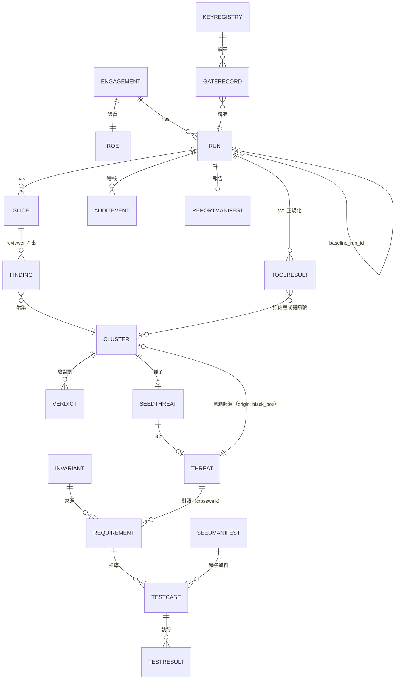

| Schema | 用途（「v0.3：」後是本輪新增的主要欄位） |
|---|---|
| `inventory.schema.json` | W0 盤點。v0.3：`frameworks[]`（含支援程度）、endpoint 的 `kind`／`auth_required`／`middleware_refs`、`db`（表、RLS、policy、函式、storage）、`auth`、`env_vars[]`（只有名稱與公開前綴旗標）、`blind_spots[]`、`features[]` |
| `finding.schema.json` | reviewer 發現項（含 Evidence）。v0.3：evidence 分三種 `kind`（`code_snippet`、`inventory_fact`、`config_fact`），各用 `file`／`line_start`／`line_end`／`snippet`、`fact_ref`（W0 inventory 的 JSON Pointer）或 `file`＋`key_path`，後兩種以 `asserted` 寫主張的值，用不到的欄位為 null；`match` 為 `MATCHED`／`MATCHED_SHIFTED`／`NOT_FOUND`／`NOT_CHECKED`（對遮罩後文字做容錯比對）；13 個面向（v0.4 新增 `cicd_iac`） |
| `cluster.schema.json` | 叢集鍵、成員、家族。v0.3：`origin`（`white_box`／`black_box`）與 `threat_id`（只有黑箱起源叢集有值）、`canonical_location.endpoint`（`{target_id, method, path_template}`，黑箱起源叢集的位置）、`fingerprint`、`baseline_state`（`new`／`unchanged`／`updated`／`absent`／null）、`reopened` |
| `verdict.schema.json` | 驗證票與裁決狀態。v0.3：`tool_corroboration`（只含強佐證）、`tool_signal`（弱訊號）、`independent_sources`、`provisional`（校準前的暫定裁決）、`votes[].cited_evidence`（必填）；`rule_version` 為 `05-v0.3`（v0.4 起 `05-v0.4`，v0.5 起 `05-v0.5`） |
| `threat.schema.json` | 威脅（含分類版本、證據、簽核狀態、種子來源、attack tree 參照） |
| `requirement.schema.json` | 需求（ASVS／AISVS／G1 不變量）與 crosswalk 連結來源 |
| `testcase.schema.json` | 測試案例（tool_binding、oracle、安全等級、機率規則）。v0.3：`oracle.types`（陣列，含 `LLM_GRADER`）、`controls[]`（至少一個 `reachability`）、`script_turns[]` |
| `testresult.schema.json` | 測試結果（ERROR／SKIPPED／STOPPED 屬執行失敗，列入未能測試清單）。v0.3：`controls[]` 結果、outcome `INVALID`、`fail_oracles`、`observed_build_id`、`request_log_sha256`、`interpretation`（Result Analyst 的 `{agrees, rationale}`，沒有分析者時為 null）；`precondition_reached` 與 `positive_control` 改為由 `controls[]` 推導的值 |
| `gate-record.schema.json` | 人工關卡的簽章紀錄（G0a、G0b、G1–G5、GB）；逐項決定帶 `item_sha256`（§6.3）。沒有記錄沿用來源的欄位（§6.3 的沿用規則尚未由 validator 檢查） |
| `roe.schema.json` | 交戰規則。v0.3：`targets[].build_identity`、`ownership_proof.method: platform_project`、`platform_policies[]`、登入的 `mfa`／`captcha_bypass`／`idp`／`whoami`、`storage_state_encrypted`、`relay.mode` |
| `commander-plan.schema.json` | 指揮官計畫。v0.3：`extra_dispatch[].target` 為 `{kind, id}`、`round` |
| `engagement.schema.json` | 委任設定（G0a）：程式碼所有權、資料等級、每個等級允許的模型。v0.3：`assurance_profile`、`role_consolidation`、`gate_approvers`、`providers[]` |
| `model-registry.schema.json` | `models.yaml`（family、lineage、資料等級、同家族 fallback）。v0.3：`pricing`、`rate_limits`、`tokenizer`（都可為 null） |
| `agent-registry.schema.json` | `agents.yaml`（角色、模型、工具權限）。v0.3：Commander 無工具、Invariant Drafter 用 `read_inventory`、Result Analyst 池 |
| `run.schema.json`（v0.2） | run 紀錄：狀態 enum、`run_kind`、`parent_run_id`、`reuse`、預算、關卡參照。v0.3：`config_refs`、`prompt_templates[]`、`tool_versions[]`、`rule_version`、`baseline_run_id` |
| `slice.schema.json`（v0.2） | 切片（`slice_id`、檔案範圍、token 數、排除的模型）。v0.3：`redaction_map_sha256`、`prompt_template_sha256`，兩者都納入 `slice_id` |
| `invariants.schema.json`（v0.2） | `invariants.yaml`：`source = invariant` 的需求清單。v0.3：`data_classification[]`、`llm_tools[]`、`limits[]`、`policies[]`、`access_matrix[].ownership`；頂層的 `level_triggers[]`（`baseline` 是陣列，所以觸發條件與它並列）與 `baseline_levels`（`{asvs, aisvs}`，1–3） |
| `dfd.schema.json`（v0.2） | DFD（外部視角與合併視角）。v0.3：信任邊界的 `kind`、每個元素的 `provenance`、browser → BaaS 資料流 |
| `seed-threats.schema.json`（v0.2） | 種子威脅清單 |
| `crosswalk.schema.json`（v0.2） | 對照表 |
| `seed-manifest.schema.json`（v0.2） | 種子資料清單（ID、表、重置方式）。v0.3：`namespace`、`seeding`、`teardown`、`reseed_per_trial`、`create_only_endpoints[]`（`{target_id, method, path_template}`）、每個種子的 `path_templates[]` |
| `calibration.schema.json`（v0.2） | 校準設定與結果。v0.3：`result.high_precision_rules[]`（強佐證的規則白名單：`adapter`、`rule_id`、`tool_version`、`cwe_bucket`、`n`、`precision_lower95`）與門檻 `result.thresholds.high_precision_min` |
| `report-manifest.schema.json`（v0.2） | 報告清單（產物 hash）。v0.3：`metrics`（`results_total`、`results_invalid`、`control_pass_rate`）、`build_unverified_targets[]`（不含 `tester_controlled` 目標）、`absent_fingerprints[]` |
| `tool-registry.schema.json`（v0.2） | `tools.yaml`：工具 ID 與 `tool:mode` |
| `key-registry.schema.json`（v0.2） | 金鑰登錄（§6.1） |
| `audit-event.schema.json`（v0.2） | 稽核事件（§13） |
| `toolkit-config.schema.json`（v0.2） | `toolkit.yaml`：根金鑰指紋、預設門檻、逾時、預算 |

- 另有 `redaction-map.schema.json`（W0 的遮罩對照表，只有位置、偵測器與 HMAC）、`checkpoint-metadata.schema.json`（LangGraph checkpoint 的中繼資料）、`licenses.schema.json`（`licenses.yaml`，[06 §2.3](06-security-legal-limitations.md#23-授權登錄表)）、`selftest-report.schema.json`（工具包自測結果）與共用定義 `common.schema.json`。
- `ToolResult` 是 Z1 內部的正規化結構，沒有獨立的交換 schema（[08 §11.2](08-implementation-spec.md#112-工具結果正規化與合併)）；run 紀錄也沒有 `tool_results_ref`，它只存在於 RunState。
- 上表的 v0.3 欄位已與 [docs/schemas/](schemas/) 逐一核對；兩者不同時以 schema 為準。

## 11. 成本與延遲模型

**呼叫數公式**（全部 [H]；細節與執行前估算見 [08 §11.12](08-implementation-spec.md#1112-成本模型與價格)）：

| 項目 | 呼叫數 | 符號與說明 |
|---|---|---|
| W0.5 不變量起草 | ≈ R_g1 ×（1＋修復） | R_g1＝G1 輪數（≤ 3）；修復 ≤ 2 |
| CMD-1～CMD-5 | 每個節點 1＋修復 | 修復 ≤ 2；不合規時改用程式碼的保底計畫（§4），不再呼叫 |
| W2 審查 | ≈ S × V × G | S＝切片數、V＝家族數、G＝每個切片要審的**面向組數**。13 個面向分成 3 組、每組 4～5 個，一次呼叫審一組（[02 W2](02-methodology.md#w2-多家族獨立審查)）；G ≤ 3 |
| CMD-2 加派 | ≤ 2 輪 × 每輪加派數 | 加派的審查同樣以面向組為單位 |
| W3 驗證 | ≈ K × M | K＝叢集數、M＝每個叢集的驗證者數 |
| W4 測試 | ≈ R_w4 × N_b × 2 | R_w4＝CoverUp 迭代輪數（≤ 3）、N_b＝不變量批次數；生成＋Test Critic |
| B1 建模 | ≈ 1 | 確定性骨幹上的 LLM 標籤 |
| B2 威脅建模 | ≈ V_tm＋1 | V_tm 個家族各建模一次＋critic；merger 預設是確定性程式碼，不呼叫 LLM。部署另設 LLM merger（只提議合併，例如範例的 `tm_merger`）時再加 1，即 V_tm＋2（與 [02 B2](02-methodology.md#b2-威脅建模g3-強制簽核) 一致） |
| B3 測試設計 | ≈ T × 2 ×（1＋修復） | T＝G3 核准的威脅數；Test Designer＋Test Implementer；修復 ≤ 2 |
| B5 結果解讀 | ≈ N_a | N_a＝需要 Result Analyst 的結果數；事先登記解讀的確定性 FAIL 不需要（§5.5） |
| relay | ≤ Σ（每個 adaptive job 的輪數） | 每個 job ≤ `max_turns`（預設 10）；另有 relay 自己的花費上限（§7.5）。腳本式多輪不經 relay |
| 報告 | ≈ 2–4 | W5、B6 的敘事 |
| 校準 | 另列 | Calibration Lab 的語料實驗與 [05 §5.8](05-bias-calibration.md#58-模型版本變更時的最小重跑集) 的重跑，不算在單一 run 的預算內 |

- **每次呼叫的 token**＝輸入＋輸出＋推理（reasoning）。推理 token 一律當成輸出 token 計入上限（保守估計）[H]。LLM 快取命中（§5.8）不重複計費。
- **費用**＝Σ（輸入 token × `input_usd_per_mtok`＋（輸出＋推理）token × `output_usd_per_mtok`）÷ 10^6。單價只取自 `models.yaml` 每個模型的 `pricing`（`input_usd_per_mtok`、`output_usd_per_mtok`、`as_of`、`source`）[H]。
- **`pricing` 為 null＝價格未知**：執行前估算只能列 token，費用欄標「未知」；此時費用上限只靠委任設定明確給出的 `max_cost_usd`（fail-closed）。validator 不看價格是否已知：engagement 的 `budgets.run_total`／`W`／`B` 三層都必須有 `max_cost_usd`（schema 必填，null → `E-ENG-BUDGET`）。範例檔的 `pricing` 都是 null（`rate_limits`、`tokenizer` 也是），因為本文件不列未查證的價格。

**示意計算（全部是假設值，pilot 時實測取代）**：

| 參數 | 假設值 |
|---|---|
| S | 40 |
| V | 3 |
| G | 3 |
| K | 100 |
| M | 2 |
| 每次審查 | 輸入約 30k tokens；輸出（含推理）約 3k tokens |
| 每次驗證 | 輸入約 10k tokens；輸出（含推理）約 1.5k tokens |

→ W2 共 360 次、約 10.8M 輸入與 1.1M 輸出 tokens；W3 共 200 次、約 2M 輸入與 0.3M 輸出 tokens。W2＋W3 約 **12.8M 輸入、1.4M 輸出 tokens**，另加 W0.5、CMD、W4 與報告（pilot 實測）。面向組從 v0.2 假設的 2 組變成 3 組，是 W2 增加的主因。

**預算**（Budget Tracker，[H]）：
- 預算分三層：run 總額、W 階段、B 階段；每層有輸入 token、輸出 token、費用（USD）、運算時間（不含等待人工關卡）。
- `toolkit.yaml` 的預設值：W 階段 15M 輸入 tokens、B 階段 5M 輸入 tokens、每階段 24 小時運算時間。上面的示意 run 已接近 W 的預設值，實際上限應依執行前估算，在委任設定中設定。
- **費用上限沒有預設值**：`toolkit.yaml` 的 `max_cost_usd` 一律是 null，金額**只能由已簽章的委任設定**（engagement 的 `budgets`）提供，這是 `toolkit-config.schema.json` 的規定；沒有有效的上限時，Gateway 拒絕該 run 的請求（fail-closed）。
- **執行前估算**：Budget Tracker 在 `W2_slice` 之後（此時已知切片數與面向組數）估算 W 階段，在 `B1_model` 之前估算 B 階段；估算的 token 與費用寫入稽核並顯示給 run_owner，超過剩餘額度時先進 `GB_budget_gate`。
- 消耗達 80% 時寫稽核事件 `budget_threshold` 並通知 run_owner；達 100%，或下一個 fan-out 的預估消耗會超過剩餘額度時，進入 **`GB_budget_gate`**。

**預算用盡時**：
1. 先 checkpoint。
2. `GB_budget_gate` 由人決定：**延長**（新上限寫入 GateRecord）、**停止本階段**（W → 直接到 W5；B → 直接到 B6；最終 `COMPLETED_WITH_GAPS`）、或**中止**。延長時也可以附帶「降低 V」或「移除校準權重最低的家族」，這些取捨寫入 GateRecord。
3. **絕不靜默刪減覆蓋**；所有取捨都寫入報告。

**延遲**：人工關卡（G1–G5、GB）與事先簽署（G0a、G0b）是主要延遲來源；AIxCC 決賽在無人介入下跑了約 143 小時 [單源：SoK；DARPA 只確認名次][E:reference_systems-08]，SoK 的人工審 patch 花了兩人週 [V][E:reference_systems-07]。實際人力需在 pilot 中量測。

## 12. CI 整合（兩條線）

| 線 | 觸發 | 內容 | 預期時間 |
|---|---|---|---|
| Lane A（同步，`run_kind: lane_a`） | 每個 PR | W0、W1、secrets、套件存在性；可選單一家族只審 diff（參考性） | 分鐘級（待量測） |
| Lane B（非同步，`initial`／`followup`／`regression`） | 手動、排程或合併到主幹 | 完整多家族白箱＋所有關卡＋黑箱；以 checkpoint 續跑，並發送通知；結果回貼 PR | 小時到天（受人工關卡影響） |

- Lane A 只審 diff：RoboDuck 的 delta 模式縮小範圍後，誤報大幅減少 [V][E:reference_systems-12]。
- **Lane A 的結果只有參考性**：單一家族的發現項最高只能是 `UNCORROBORATED`（05 R9），永遠不會進入 `CONFIRMED_*`，也不計入下一個 Lane B run 的 `independent_families`；它們會被帶入同一 repo 的下一個 Lane B run，作為額外輸入（`lane_a_advisories`）。Lane A 的模型必須在 G0a 的允許清單中；Lane A 也要先跑 W0，沒有遮罩對照表就不送任何 diff 給 LLM。
- **排程與合併觸發的 Lane B**：只自動執行 W0–W3（無網路出站、不執行受測程式），紀錄發起者是 `run_owner`；在 G1 決定、W4 或任何 B 節點之前，必須有人認領（`claim_run`）。
- CI 中的 GitHub Actions 鎖 commit SHA，binary 用 cosign 驗證；Trivy CVE-2026-33634 的官方建議是鎖 SHA、cosign 驗證、輪替 secrets [V][E:whitebox-13]；本設計再加上「掃描器在沒有 CI secrets 的環境中執行」[H：設計推論]。
- 本 repo 自己的 CI（`.github/workflows/validate.yml`）在 v0.3 也改為以 commit SHA 鎖定所用的 Actions（`actions/checkout`、`actions/setup-python`），與上面的規則一致。

## 13. 可觀測性與稽核
- 每次 LLM 呼叫記錄：模型、family、lineage、prompt 範本 ID 與版本（對應 run manifest 的 `prompt_templates`，§5.1）、prompt hash、回應 hash、輸入／輸出／推理 token、費用（`pricing` 為 null 時記為未知）、延遲、fallback、重試、schema 修復次數。
- 每次工具呼叫記錄：產物 hash、目標 ID、安全等級、請求數、停止原因。
- 可用 checkpoint 重播整次執行，時間旅行與容錯是 LangGraph 持久化功能的一部分 [V][E:orchestration-05]。
- Audit Log 加密、分級、有保留期限、secrets 遮罩、限制存取。

### 13.1 稽核事件格式（`audit-event.schema.json`，[H]）
- **儲存**：append-only JSONL，每個 run 一個檔（另有一個 engagement 層級的檔記錄跨 run 事件）；寫入端與讀取端都**只以 `\n` 分行**（不把 `\r`、U+2028 等其他換行字元當成行界，避免兩邊對「一行」的切法不同而使行 hash 不一致）[H]；大型內容（prompt、回應、請求紀錄）只存 CAS hash，本體加密存在 CAS。
- **欄位**：`seq`（從 1 起連續）、`ts`、`run_id`、`engagement_id`、`event_type`、`actor`（`{kind: human|agent|system, id}`）、`node`、`zone`、`data_class`、`idempotency_key`、`payload`（小型結構化內容）、`payload_refs[]`（CAS hash）、`prev_hash`、`signature`。全部欄位都必填；只有人為的 `initiator_claim` 與 `run_resume` 事件有簽章（Ed25519，簽署對象是移除 `signature` 後事件的 JCS），其他事件 `signature: null`。
- **`ts`**（v0.4）：Audit Writer 寫入該行時的時鐘（收件時間），不是事件來源自填的時間；關卡決定的所有時間規則以它為準（§6.1 步驟 4）。
- **hash chain**：`prev_hash` ＝ 前一行原始位元組（不含換行）的 sha256；第一行的 `prev_hash` ＝ sha256(`run_id`)。只有 Audit Writer 一個寫入者，以檔案鎖序列化。
- **錨定**：每個 `gate_decision` 之後**緊接**一個 `audit_anchor` 事件；run 結束時以 `payload.reason: run_end` 的 `audit_anchor` 收尾。另外每 500 個事件與每個階段結束也寫一個 [H]。每個 `audit_anchor` 事件以 `{seq, line_sha256}` 寫入 run 紀錄的 `audit_anchors`（Postgres）：`seq` 是該錨點事件的序號，`line_sha256` 是該錨點事件**自己那一行**原始位元組（不含換行）的 sha256；因為這一行含 `prev_hash`，錨點同時承諾它之前的整條鏈；可選擇另外寫到 WORM 儲存或外部系統 [H]。
- **Z3 副簽**（v0.4）：每個 `audit_anchor` 的 `payload.z3_countersignature` 是 Z3 Executor 服務金鑰（金鑰登錄中角色 `z3_executor` 的 `z3-executor`）對 JCS(`{run_id, seq, prev_hash}`) 的 Ed25519 簽章。Run Controller 寫錨點前把這三個值送到 Z3 取得簽章；Z3 只簽 `seq` 遞增、`prev_hash` 與它上次看到的鏈一致的請求 [H]。validator 以金鑰登錄驗證，缺少或無效 → `E-AUDIT-ANCHOR-SIG`。
- **報告清單**：`report-manifest` 中 `audit_log` 產物的 sha256，等於 `report_published` 事件的 `prev_hash`，也就是發布之前的整份稽核紀錄。
- **驗證**：`vibecheck audit verify <run-id>` 重算整條鏈並與錨點比對。
- **尾端保護**（validator 強制）[H]：
  - 每個 `audit_anchors` 項目指名的 `seq` 必須在稽核檔範圍內，否則 → `E-AUDIT-TRUNCATED`（檔案被截到錨點之前）；該行的 sha256 必須等於 `line_sha256`，否則 → `E-AUDIT-ANCHOR-MISMATCH`；指名的行必須是 `audit_anchor` 事件；`audit_anchors` 必須與稽核檔中的 `audit_anchor` 事件**一一對應**（每個錨點事件恰好列一次，不能遺漏、重複或多列），否則 → `E-AUDIT-ANCHOR`。
  - 稽核檔中最後一個 `audit_anchor` 事件之後的行是**未錨定的尾端**（以稽核檔本身的錨點事件為準）：非終態的 run（含 `RUNNING`、`WAITING_GATE`、`SUSPENDED`、`STOPPED`）會有這一段，validator 發出 `W-AUDIT-UNANCHORED-TAIL`（警告）。
  - **終態的 run**（`COMPLETED`、`COMPLETED_WITH_GAPS`、`ABORTED`、`FAILED`）必須有稽核檔，且最後一行必須是 `payload.reason: run_end` 的錨點；不是 → `E-AUDIT-TAIL`（錯誤）。
  - 因此尾端截斷只能偵測到最後一個錨點為止：未錨定的尾端被刪掉，無法從鏈本身看出來。
- **限制（做不到）**：hash chain 只能**偵測**竄改，不能防止。v0.4 起錨點由 Z3 副簽，只控制 Z1（稽核檔與 run 紀錄）的人重寫鏈之後，錨點簽章就驗不過；同時控制 Z1 與 Z3 金鑰的人仍可以整條重寫（包括錨點）。只有把錨點寫到該人無法修改的外部系統，才能防止這種情況（[06 §3](06-security-legal-limitations.md#3-做不到不承諾的事) 第 16 條）。
- **與文獻的關係**：防竄改紀錄要靠持有先前承諾（錨點）的稽核者；純 hash chain 的證明長度與紀錄大小成線性 [V][E:orchestration-51]，以每個 run 的規模來說可以接受 [H]。Certificate Transparency v2（RFC 9162，Experimental）改用 Merkle tree 提供包含與一致性證明，並警告紀錄可能對不同用戶端呈現不同視圖 [V][E:orchestration-50]；若日後需要跨 run 的公開驗證，可改用 Merkle 結構 [H]。

### 13.2 事件類型（enum）

| 類別 | 事件 |
|---|---|
| run 生命週期 | `run_created`、`run_status_changed`、`initiator_claim`、`run_resume`、`resume_expired`、`config_loaded` |
| 授權與驗章 | `key_registry_loaded`、`signature_verified`、`signature_invalid`、`engagement_verified`、`engagement_verify_failed`、`roe_verified`、`roe_verify_failed`、`ownership_check` |
| secrets 與資料 | `redaction_map_created`、`secret_detected`（只含位置與 hash）、`pii_detected` |
| LLM | `llm_request`、`llm_response`、`llm_refused_policy`、`schema_repair`、`retry`、`missing_vote`、`fallback_used`、`relay_call` |
| 規劃與政策 | `commander_plan`、`policy_decision`（allow／deny＋規則 ID）、`coverage_floor_applied` |
| 關卡 | `gate_opened`、`gate_decision`、`gate_expired`、`gate_skipped` |
| 預算 | `budget_threshold`、`budget_exhausted` |
| 產物與裁決 | `artifact_stored`、`artifact_validation`、`verdict_changed` |
| 執行 | `sandbox_job_start`、`sandbox_job_end`、`tool_invocation_start`、`tool_invocation_end`、`session_login`、`egress_blocked`、`third_party_contact`、`job_skipped` |
| 停止與補償 | `stop_condition`、`kill_switch`、`snapshot_created`、`snapshot_restored`、`restore_failed`、`restore_drill`、`seed_reset_failed`、`policy_violation` |
| 報告 | `report_published`、`followup_draft_created` |
| 稽核本身 | `audit_anchor` |

## 14. 序列圖

### 14.1 白箱：一個切片的多家族審查與裁決

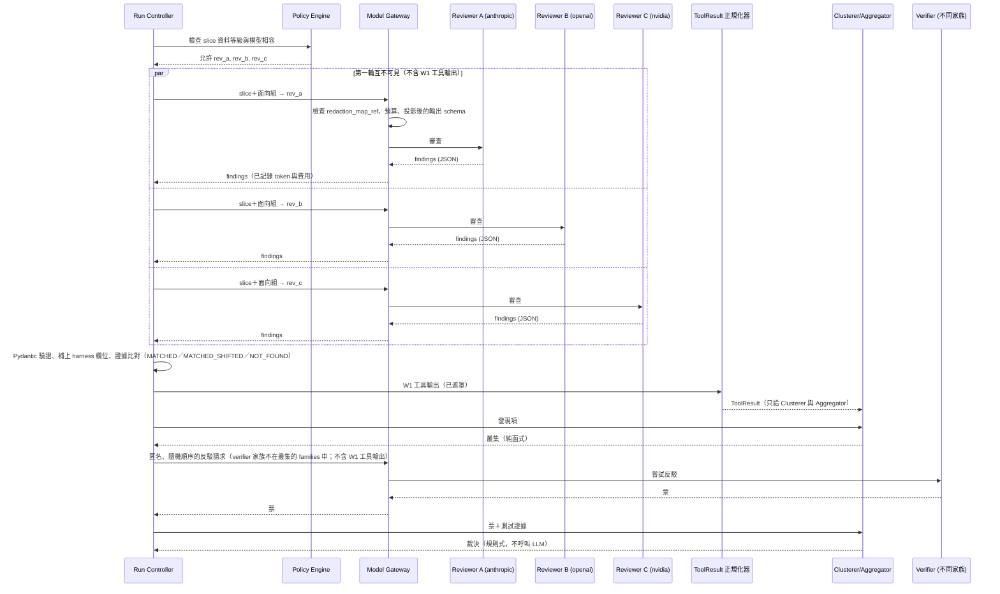

- Aggregator 是確定性程式碼，**從不呼叫 Model Gateway**；所有 LLM 請求與回應都經 Gateway 往返 Run Controller（v0.2 的圖有兩處畫錯：回應繞過 Gateway、Aggregator 直接呼叫 Gateway）。

### 14.2 黑箱：一次 S2 執行

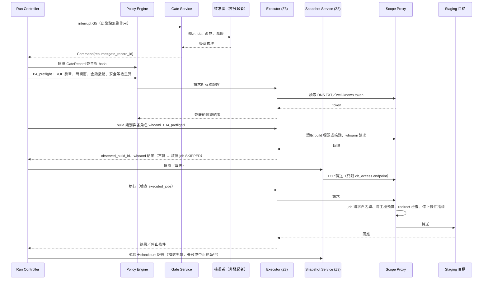

### 14.3 B5：結果解讀與重新裁決

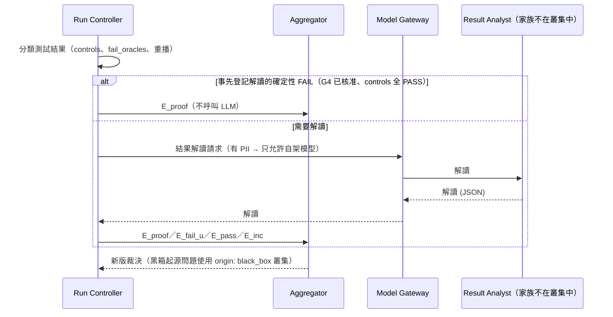

## 15. 元件介面（[H]）

以下是元件層級的介面草案；模組配置、錯誤分類與 CLI 細節以 [08 實作規格](08-implementation-spec.md) 為準（兩者不一致時由 08 更新本節）。v0.3 新增 ToolResult 正規化器、`Clusterer.cluster(findings, tool_results)`（取代 v0.2 的 `cluster(findings, sarif)`，[08 §11.2](08-implementation-spec.md#112-工具結果正規化與合併)）、Commander 視圖、build 識別、whoami 與執行前估算；Clusterer 的簽名與 [08 §2.3](08-implementation-spec.md#23-擴充介面) 相同。

```python
from typing import Protocol, Literal, Iterable
from pydantic import BaseModel

ArtifactRef = str   # "sha256:<hex>"

class Provenance(BaseModel):
    producer: str                       # agent_id 或元件名稱
    model: str | None                   # LiteLLM 模型 ID（含版本）
    family: str | None
    lineage: str | None
    input_refs: list[ArtifactRef]       # 產生此產物所用的全部輸入
    node: str
    run_id: str

# --- Content-addressed Store（Z1；M1）---
class ContentStore(Protocol):
    def put(self, data: bytes, media_type: str, data_class: Literal["P", "C"],
            retention_days: int) -> ArtifactRef: ...          # 已存在則直接回傳同一 hash
    def get(self, ref: ArtifactRef) -> bytes: ...             # 讀取時重算 hash，不符即丟例外
    def exists(self, ref: ArtifactRef) -> bool: ...
    def gc(self, now: str) -> int: ...                        # 只刪除超過保留期限且沒有 legal hold 者

# --- Blackboard（Z1 Postgres 索引；M1）---
class Blackboard(Protocol):
    def publish(self, run_id: str, kind: str, obj: BaseModel,
                schema: str, provenance: Provenance) -> ArtifactRef: ...  # 先以完整 schema 驗證；append-only
    def get(self, ref: ArtifactRef, model: type[BaseModel]) -> BaseModel: ...
    def query(self, run_id: str, kind: str, **filters) -> list[ArtifactRef]: ...
    # 沒有 update / delete：新版本以新的 publish 表示（例如裁決的每一版）

# --- 驗章（Policy Engine 內，Z1；M1）---
class SignatureVerifier(Protocol):
    def load_registry(self, registry_bytes: bytes) -> "KeyRegistry": ...   # 驗根簽章與版本
    def verify_document(self, doc_bytes: bytes, detached: list[bytes],
                        required_roles: set[str], at: str) -> "VerifyResult": ...

# --- 稽核（Z1；M1）---
class AuditWriter(Protocol):
    def append(self, event: BaseModel) -> str: ...            # 回傳該行 sha256；自動填 seq 與 prev_hash
    def anchor(self, run_id: str) -> str: ...                 # 寫 audit_anchor，回傳錨點 hash
    def verify(self, run_id: str) -> bool: ...

# --- Model Gateway 外層（Z1；M1）---
class ModelGateway(Protocol):
    def complete(self, run_id: str, agent_id: str, request: BaseModel,
                 output_schema: dict) -> BaseModel: ...
    # output_schema：存檔 schema 先投影（移除 harness 欄位）再降級的版本（§8.3）
    # 拒絕條件：redaction_map_ref 為空、資料等級不允許（含 providers[] 的 ZDR／DPA 宣告，§8.4）、
    #           端點或參數不在白名單、預算不足（BudgetExceeded）

# --- ToolResult 正規化與叢集（Z1 純函式；M2）：W1 輸出只到這裡；欄位以 08 §11.2 為準 ---
class ToolResult(BaseModel):            # 示意
    adapter: str                        # "tool:mode"（tools.yaml 登錄）
    rule_id: str
    cwe_bucket: str | None
    file: str | None
    symbol: str | None                  # 區段 → 函式（依 W0 inventory 對應）
    sarif_ref: ArtifactRef | None       # 必須對應同一 run 的 tool_invocation_end 事件（§5.9）

class ToolResultNormalizer(Protocol):
    def normalize(self, run_id: str, raw_refs: list[ArtifactRef]) -> list[ToolResult]: ...

class Clusterer(Protocol):
    def cluster(self, findings: list[BaseModel], tool_results: list[ToolResult]) -> list[BaseModel]: ...
    # 回傳 cluster.schema.json 的物件；tool_results 不會傳給任何 LLM（§5.3）

# --- Commander 的型別化視圖（Policy Engine 內，Z1；M2）---
class CommanderViewBuilder(Protocol):
    def build(self, run_id: str, node: Literal["CMD-1", "CMD-2", "CMD-3", "CMD-4", "CMD-5"]) -> BaseModel: ...
    # 只含 ID、enum 與數字（§4）；不符 pattern 的值丟棄並記錄，不以文字傳給 Commander

# --- Z2 Sandbox Runner（M1）---
class SandboxJobSpec(BaseModel):
    image_digest: str
    argv: list[str]
    inputs: list[ArtifactRef]
    network: Literal["none", "mirror_only"]
    cpu: int = 2
    memory_mib: int = 4096
    timeout_s: int
    output_dirs: list[str]

class SandboxResult(BaseModel):
    job_id: str
    exit_code: int | None
    outputs: list[ArtifactRef]          # 已遮罩
    stdout_ref: ArtifactRef
    stderr_ref: ArtifactRef
    killed_reason: str | None           # timeout / oom / output_too_large

class SandboxRunner(Protocol):
    def run(self, spec: SandboxJobSpec) -> SandboxResult: ...   # job_id 由 spec 的 hash 決定

# --- Z3 Executor（M1 最小版：ownership + GET；M4 完整版）---
class Executor(Protocol):
    def verify_ownership(self, run_id: str, target_id: str, batch_id: str | None) -> ArtifactRef: ...
    def http_get(self, run_id: str, target_id: str, path: str) -> ArtifactRef: ...       # M1
    def observe_build_id(self, run_id: str, target_id: str) -> str | None: ...   # M4；ROE build_identity.method 為 none 時回傳 None（§5.5）
    def run_job(self, run_id: str, job_id: str, adapter: str,
                artifact_refs: list[ArtifactRef], session_roles: list[str]) -> ArtifactRef: ...  # M4
    def kill(self, run_id: str, reason: str) -> None: ...

# --- Session Provider（Z3；M4）---
class SessionHandle(BaseModel):
    handle_id: str
    role: str
    form: Literal["storage_state", "zap_context", "header", "cookie_jar"]
    expires_at: str                     # 不含任何憑證值

class SessionProvider(Protocol):
    def materialize(self, run_id: str, role: str, form: str, job_id: str) -> SessionHandle: ...
    def refresh(self, handle: SessionHandle) -> SessionHandle: ...
    def whoami(self, handle: SessionHandle) -> bool: ...     # 依 ROE 的 whoami 設定確認身分；每批一次（§7.4）
    def revoke_run(self, run_id: str) -> None: ...

# --- Snapshot Service（Z3；M4）---
class SnapshotService(Protocol):
    def snapshot(self, run_id: str, job_id: str) -> str: ...          # 冪等：同一 (run_id, job_id) 回傳同一 snapshot_ref
    def restore(self, snapshot_ref: str) -> bool: ...                 # 還原後驗證 checksum
    def restore_drill(self, engagement_id: str) -> ArtifactRef: ...
    def reset_seeds(self, seed_manifest_ref: ArtifactRef) -> None: ...
    def oracle_capture(self, run_id: str, job_id: str, tables: list[str]) -> str: ...  # 唯讀憑證；回傳 before_ref（hash 存在 Z3）
    def oracle_diff(self, before_ref: str, tables: list[str]) -> ArtifactRef: ...  # 只回傳 hash 比對結果
    def oracle_count(self, query_id: str, params: dict[str, str]) -> int: ...     # 只執行 G4 核准（hash 綁定）的 SELECT COUNT

# --- LLM Relay（Z1 端點＋Z3 用戶端；M5）---
class RelayRequest(BaseModel):
    run_id: str
    job_id: str
    testcase_id: str
    turn: int
    transcript_ref: ArtifactRef
    target_response_ref: ArtifactRef

class LlmRelay(Protocol):
    def next_turn(self, req: RelayRequest) -> ArtifactRef: ...        # 超過 turn/花費上限或模型不允許 → 拒絕

# --- Budget Tracker（Z1；M2）---
class BudgetTracker(Protocol):
    def estimate(self, run_id: str, phase: Literal["W", "B"]) -> dict: ...   # 執行前估算（§11）；pricing 為 null 時費用為 None
    def reserve(self, run_id: str, phase: Literal["W", "B"], est_tokens: int) -> bool: ...
    def record(self, run_id: str, phase: str, tokens_in: int, tokens_out: int,
               tokens_reasoning: int, cost_usd: float | None) -> None: ...   # 推理 token 計入輸出上限；價格未知時 cost_usd 為 None
    def status(self, run_id: str) -> "Budgets": ...
```
