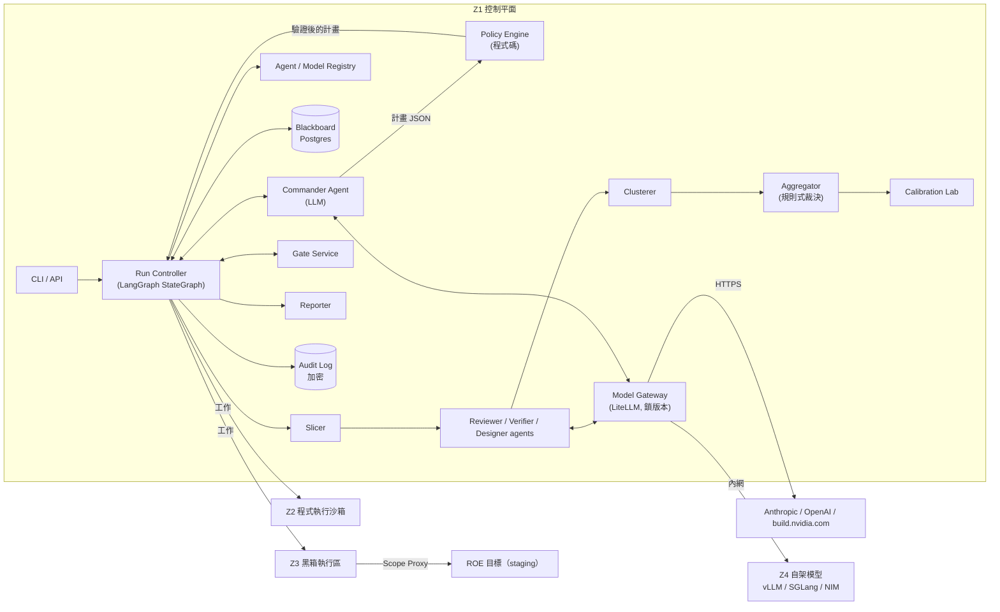
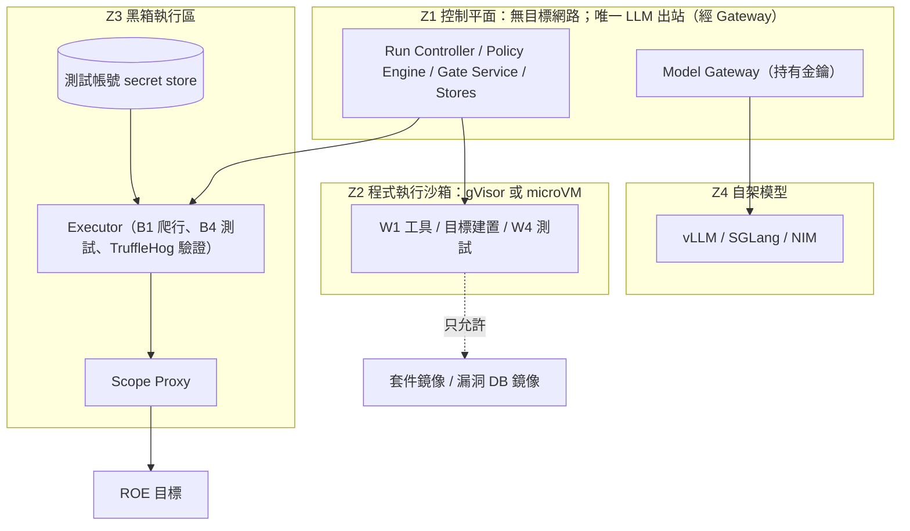
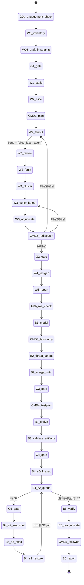
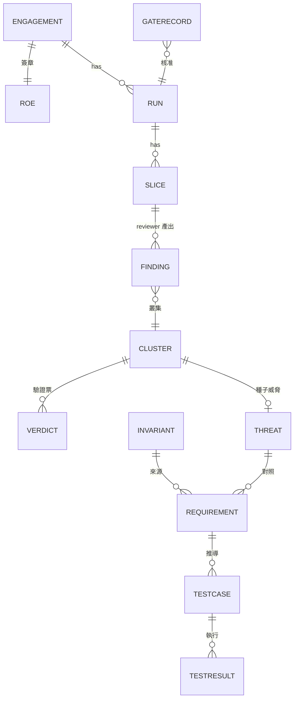
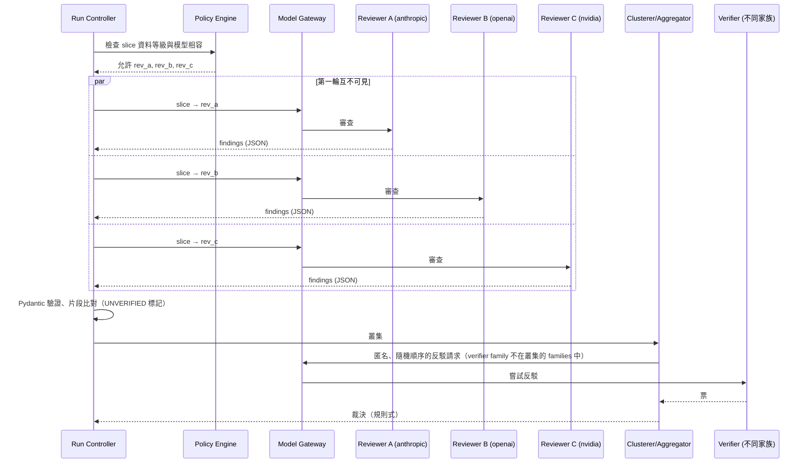

# 03 系統架構

> 標記說明見 [README](../README.md#標記說明)。本文件是設計，尚未實作；所有數值都是設計假設，除非另附證據。

## 1. 元件總覽



| 元件 | 責任 | 是否用 LLM |
|---|---|---|
| Run Controller | 依狀態機排程、並行、重試、限速、checkpoint | 否 |
| Commander Agent | 在 5 個決策節點提出計畫與加派（§4） | 是 |
| Policy Engine | 強制 ROE、資料分級、覆蓋下限、預算、安全等級計算、產物驗證、核准紀錄驗證 | 否 |
| Agent／Model Registry | `agents.yaml`、`models.yaml`（含 `family`、`lineage`、能力、可處理的資料等級） | 否 |
| Blackboard | 型別化 artifact 的唯一交換處；agent 之間**不直接對話**（OSS-CRS 也是只透過交換檔案協作 [V][E:reference_systems-13]） | 否 |
| Slicer／Clusterer／Aggregator | 切片、叢集、裁決（[05 §4](05-bias-calibration.md#4-叢集與裁決)） | 否 |
| Calibration Lab | 量測各模型精準度、錯誤相關、自我偏好（[05 §5](05-bias-calibration.md#5-calibration--bias-lab)） | 被測對象是 LLM |
| Gate Service | 人工關卡的呈現、簽章核准、resume（§6） | 否 |
| Reporter | 唯一撰寫最終敘事者；不改裁決 | 是 |
| Model Gateway | 唯一有 LLM 出站、持有 API 金鑰的元件 | — |
| Audit Log | 保存每次 prompt、回應、工具呼叫、費用；加密、分級、有保留期限 | 否 |

## 2. 部署與信任區



| 區 | 內容 | 出站 | 秘密 |
|---|---|---|---|
| Z1 | Run Controller、Policy Engine、Gate Service、Postgres、檔案庫、Model Gateway | 只有 Gateway 能連 LLM 端點；**不能連目標** | LLM API 金鑰（只在 Gateway） |
| Z2 | W1 掃描、目標應用建置與相依安裝、W4 測試 | 只能連套件鏡像與漏洞 DB 鏡像；**沒有 LLM、沒有目標** | 無 |
| Z3 | B1 爬行、B4 執行、TruffleHog 驗證（若 ROE 允許） | 只經 Scope Proxy 到 ROE 目標 | 只有測試帳號，存在 Z3 自己的 secret store，**永遠不進 LLM context** |
| Z4 | 自架模型伺服器 | 無對外出站；只接受 Gateway 連線 | 無 |

**隔離要求**：
- 不可信程式碼至少要用 gVisor [V][E:blackbox-34]，或 Firecracker microVM [V][E:blackbox-35]、Docker Sandboxes [V][E:blackbox-39]。**不能只用一般 Docker**。
- **絕不掛載 Docker socket**。Docker 官方文件：只有可信使用者能控制 daemon，因為容器可以掛載主機目錄 [V][E:blackbox-38]。
- gVisor、Firecracker、E2B 的逃逸抵抗力，本研究只找到廠商自述，未找到獨立評估（搜尋未窮盡）[研究限制]。
- 出站白名單在 proxy／namespace 層強制，例如 Anthropic sandbox-runtime 的 `allowedDomains`（research preview）[V][E:blackbox-40] 或 nftables。工具自己的 origin 選項不是安全邊界 [V][E:blackbox-24]。

**Scope Proxy（Z3 唯一出口）**：
- 只放行 ROE 目標的主機。目標 ID→主機名稱的對應由 Policy Engine 完成（不經 LLM）；DNS 解析結果由 Scope Proxy 固定。
- 擋內網、雲端 metadata 位址，以及 ROE 以外的 redirect。
- **每個 job 的請求白名單**：依測試案例的 `request_allowlist`（目標 ID × HTTP 方法 × 路徑樣板）逐一放行，並強制 `max_requests`。DELETE 只允許 seed manifest 中的 ID。這是真正的強制點；對產物做的靜態抽取（§7.2）只是第一道檢查。
- 每個主機設請求預算與並行上限，**與工具設定無關**。
- **所有權驗證**從這裡發出：Executor 經 Scope Proxy 讀取目標的 DNS TXT 或 well-known path token，結果簽署後回傳 Policy Engine（Z1 本身不能連目標）。
- **第三方接觸是另一份白名單**：TruffleHog 驗證只能連到 ROE `secrets_verification.providers` 列出的供應商端點，每次都標記為「第三方接觸」並記錄；預設這份白名單是空的。
- 支援 kill switch：一鍵取消所有 Executor 工作並記錄原因。

**Z3 與 LLM 的關係**：Z3 不持有 LLM 金鑰、不能直連 LLM 端點。
- 單輪的 LLM 功能測試：測試輸入（prompt、合成文件）在 Z1 經 Gateway 產生，成為 G4 核准的產物，再交給 Z3 送到目標；目標的回應回傳 Z1 評分。
- 多輪策略（例如 iterative、crescendo）需要邊測邊產生下一輪輸入：Z3 經一條**受限的 relay** 呼叫 Z1，由 Z1 經 Gateway 產生下一輪。relay 只允許 ROE 指定的模型，有每輪與總花費上限，並全部寫入 audit。

**儲存**：
- Postgres：LangGraph checkpoint（PostgresSaver [V][E:orchestration-05]）、blackboard、audit、gate 紀錄。
- Content-addressed 檔案庫：SARIF、報告、產生的測試與工具設定，以 sha256 為鍵。
- Audit Log 與 DB 快照：加密、套用與原始碼相同的資料等級、設保留期限、限制存取、secrets 遮罩。

## 3. 框架選型

| 需求 | 選擇 | 理由 | 未採用的選項 |
|---|---|---|---|
| 流程與指揮 | **LangGraph 1.x**（MIT）[V][E:orchestration-01] | 1.0 起承諾 2.0 前無破壞性變更；每個 node 可用不同模型 [V][E:orchestration-02]；`Send` 可動態 fan-out，reducer 合併平行寫入 [V][S-03]；`interrupt()`＋checkpointer 提供人工關卡與中斷續跑 [V][E:orchestration-04][E:orchestration-05] | **Claude Agent SDK**：官方文件明言不支援把 Claude Code 路由到非 Claude 模型，不符多廠商需求 [V][E:orchestration-21]<br>**AutoGen**：維護模式 [V][E:orchestration-06]<br>**CrewAI**：hierarchical 模式由 manager LLM 派工 [V][E:orchestration-13]，且預設開匿名 telemetry [V][E:orchestration-15]<br>**OpenAI Agents SDK**：仍是 0.x [V][E:orchestration-16]<br>**Microsoft Agent Framework 1.0**：可行的備案 [V][E:orchestration-07][E:orchestration-09] |
| 多模型閘道 | **LiteLLM**（MIT core）[V][E:orchestration-29] | 提供 `anthropic/`、`openai/`、`nvidia_nim/` [V][E:providers-20]、`hosted_vllm/` [C][E:providers-22]；有預算、fallback、負載平衡 | **OpenRouter**：SaaS（查核者推定為封閉原始碼：未找到路由平台本身的原始碼），多一個資料接收者 [V][E:orchestration-32] |
| 工具互通 | 內部 Python adapter 為主，MCP 選配 | MCP 最新規格 2026-07-28（stateless）[V][E:orchestration-35]；遵循 MCP security best practices（禁止 token passthrough、最小權限、沙箱化本地 server）[V][E:orchestration-36] | — |

**LiteLLM 的供應鏈風險**：1.82.7 與 1.82.8 曾在 PyPI 被植入竊密程式（2026-03-24，約 40 分鐘）[V][E:orchestration-31]。→ 鎖版本＋hash、不在 Gateway 以外的地方持有金鑰。另外，fallback **只允許同家族**（§8.1）。

LangGraph 的 supervisor 模式（「以其他 agent 為工具的 agent」[V][E:orchestration-03]）**不是**本設計的主軸。本設計採「確定性狀態圖＋在指定節點呼叫 Commander」（§4）。

## 4. Harness／指揮官如何滿足需求

**Harness＝Run Controller（程式碼）＋ Commander Agent（LLM）**。

- Run Controller 決定**怎麼執行**：順序、並行、重試、限速、checkpoint。
- Commander 決定**要做什麼**：在下列 5 個決策節點產出計畫。

| 節點 | 時機 | Commander 決定 | Policy Engine 檢查 |
|---|---|---|---|
| CMD-1 | W1 之後、Slicer 產出切片時 | 白箱計畫：切片 × 面向 × 指派 agent × 預算 | 覆蓋下限、資料等級與模型相容、預算 |
| CMD-2 | W3 之後 | 對 DISPUTED 或票數不足的叢集加派審查者；補覆蓋不足的切片 | 加派的模型家族規則、預算 |
| CMD-3 | B1 之後 | 套用哪些威脅分類（STRIDE 一律；有個資加 LINDDUN；有 LLM／Agent 加 LLM Top 10、ASI、MAESTRO） | 確定性特徵觸發的分類不可移除 |
| CMD-4 | G3 之後 | 測試設計計畫與 `tool_binding` 選擇 | 目標只能是 ROE 目標 ID；安全等級由程式碼重算 |
| CMD-5 | B5 之後 | 追加測試、回饋任務（白箱根因、回歸測試） | 同上 |

**覆蓋下限**：「每個切片 × 每個必要面向」的最小計畫由程式碼從 W0 inventory 產生。Commander **只能加，不能減**；任何降權或略過都要記錄並出現在報告中。這也防止受測 repo 內容透過 Commander 讓覆蓋縮水。

**Commander 不能**：
- 新增 ROE 以外的目標
- 跳過任何關卡
- 判定發現項真偽（交給 Aggregator）
- 直接執行工具
- 把 C 級資料送到不允許的模型
- 撰寫最終報告敘事（只寫計畫理由；敘事交給 Reporter）

**為什麼這樣設計**：
- AIxCC 的計分有準確度乘數 AM＝1−(1−r)^4（準確率 50% 時為 0.9375、40% 時為 0.8704），錯誤的關聯會讓獎勵變成懲罰 [單源：SoK][E:reference_systems-05]。AIxCC SoK 的關鍵發現是「穩定性與準確度決定勝負」「技術先進與工程良好是兩個不同的挑戰」[V][E:reference_systems-08]。
- 冠軍 Atlantis 是 ensemble-first，亞軍 Buttercup 是確定性流程＋只在工具不足處用 LLM [V][E:reference_systems-02]。本設計兩者兼取：流程確定、審查端多家族整合（ensemble）。
- OWASP LLM06:2025 Excessive Agency（2026 版為 LLM03 [P][S-01]）的緩解建議：最小化 agent 可用的擴充、避免開放式工具、最小權限、高影響動作需人核准 [V][E:blackbox-32]。
- 裁決若交給 LLM，會有自我偏好問題 [V][E:multi_llm_bias-05]。

**加派機制**：用 LangGraph `Send` 從條件邊動態 fan-out 到多個平行分支 [V][S-03]；fan-in 節點採 **quorum**（容許晚到或失敗的分支，記為缺票）。

**Commander 計畫 JSON（示意，依 [schemas/commander-plan.schema.json](schemas/commander-plan.schema.json)）**：

```json
{
  "plan_id": "plan-2026-09-23-001",
  "decision_node": "CMD-1",
  "slices": [
    {"slice_id": "sha256:3f2a…", "facets": ["authz", "data_access"], "agents": ["rev_a", "rev_b", "rev_c"]}
  ],
  "extra_dispatch": [],
  "budget_tokens": 2000000,
  "rationale": "路由 /api/invoices/* 無 owner 條件的疑慮，加重 authz 面向"
}
```

## 5. Run Controller：LangGraph 狀態機

### 5.1 State（Pydantic，示意）

```python
from typing import Annotated
from operator import add
from pydantic import BaseModel

class RunState(BaseModel):
    run_id: str
    engagement_id: str                      # 對應已簽章 ROE / 委任設定
    data_class: str = "C"                   # fail-closed：未標記即 C
    inventory_ref: str | None = None        # 檔案庫 sha256
    invariants_ref: str | None = None
    findings: Annotated[list[dict], add] = []      # 平行 reviewer 寫入以 reducer 合併
    verdicts: Annotated[list[dict], add] = []
    missing_votes: Annotated[list[dict], add] = []
    diversity_flags: Annotated[list[dict], add] = []
    gate_records: Annotated[list[str], add] = []   # 只存 GateRecord ID，驗證以簽章紀錄為準
    executed_jobs: Annotated[list[str], add] = []  # S2 冪等鍵
    budget_spent_tokens: int = 0
```

平行節點的更新以 reducer 合併：`new = reducer(current, update)`；列表用 `operator.add` 串接，不會覆蓋 [V][S-03]。

### 5.2 節點與邊界



- `G0a_engagement_check` 與 `G0b_roe_check` 是**離線簽章的驗證**（委任設定、ROE），不是等待人的 interrupt；驗證失敗就停止。
- `B5_readjudicate`：測試結果寫回叢集，由 Aggregator 重新裁決（[05 §4.2](05-bias-calibration.md#42-裁決狀態與有序規則)）。W4 的測試結果也以同樣方式回寫。
- 回饋（新需求回寫 G1、黑箱確認項的回歸測試）由 CMD-5 建立**後續執行**（同一個 engagement 的新 run），不在同一張圖內回圈。

**節點邊界規則**：
- LangGraph 的 `interrupt()` 會在 resume 時**從該節點開頭重新執行**，所以 interrupt 之前的副作用必須是冪等的 [V][E:orchestration-04]。本設計讓每個 `G*_gate` 節點**只做 interrupt**，前面沒有任何副作用。
- `B4_s2_snapshot` 以 `run_id + job_id` 為冪等鍵：快照已存在就略過。
- `B4_s2_exec` 執行前檢查 `executed_jobs`，防止 resume 或重試時重跑。
- `B4_s2_restore` 是**補償步驟**：中止、失敗、kill switch 觸發時也會執行，由 checkpoint 狀態驅動。
- 每個 `CMD*` 節點的輸出都要先經 Policy Engine 驗證，才寫入 state。

### 5.3 fan-out／fan-in、重試、缺票
- 每個節點設重試上限（例如 schema 驗證失敗最多修復 2 次、429 依 Retry-After 最多 3 次）。
- 重試用盡就寫入 `missing_votes`，**不無限重試**。
- fan-in 採 quorum：例如 3 家族中至少 2 家族有結果。少於 quorum 時**仍照常裁決**，但只靠投票得到的確認上限為 `LIKELY`，並標記 `diversity_degraded`；可執行證明與工具佐證不受此限（[05 §4.2](05-bias-calibration.md#42-裁決狀態與有序規則) R8）。

## 6. 人工關卡服務

- **介面**：CLI 優先，之後可加網頁。
  - `vibecheck gate list`
  - `vibecheck gate show <gate-id>`：顯示已叢集、排序、附證據的項目（file:line、片段、CWE、殘餘風險）
  - `vibecheck gate approve <gate-id> --decisions decisions.yaml --sign`
- **可部分核准**：逐項 `accept`／`reject`／`needs_info`。被拒絕的項目不進入下游，但保留紀錄。
- **核准紀錄（GateRecord）**，依 [schemas/gate-record.schema.json](schemas/gate-record.schema.json)：
  - 核准者（可多人）的身分、角色、時間；每個關卡要求的角色見 [02 §1.3](02-methodology.md#13-人工關卡一覽)
  - 被核准產物的 sha256
  - 逐項決定
  - 每位核准者各自簽章
- **金鑰的信任根**：核准者的公鑰登錄在組織的**金鑰登錄**中（out-of-band，由資安團隊管理，含登錄、輪替、撤銷流程）。ROE 與委任設定只引用登錄中的指紋，不能自己宣告新的可信金鑰；驗章時同時檢查金鑰未被撤銷。
- **驗證**：Policy Engine 驗的是**簽章紀錄**，不是 checkpoint 內容。只要能寫 checkpoint DB 就能偽造 resume 值，所以 checkpoint 不能當作授權依據。OpenAI Agents SDK 的文件也提醒，只能從可信儲存反序列化快照 [V][E:orchestration-18]。產物有任何變動，核准就失效。
- **職責分離**：G5（S2 執行）的核准者不能是發起者。發起者是啟動該次執行或核准 G4 的**人**，不能記成自動化帳號（例如 `run-controller`），否則職責分離形同虛設。
- 核准後以 `Command(resume=<gate_record_id>)` 繼續圖的執行 [V][E:orchestration-04]。

## 7. 黑箱執行安全

以下都**由程式碼強制**；更完整的威脅分析見 [06 §1](06-security-legal-limitations.md#1-工具包自身的安全)。

### 7.1 安全等級由程式碼計算

| 等級 | 定義 | 例子 | 放行條件 |
|---|---|---|---|
| S0 被動 | 只觀察，不送出會改變狀態的請求 | ZAP passive scan、回應標頭檢查 | ROE 有效即可 |
| S1 良性主動 | 用測試帳號、低速、只碰種子資料的主動請求 | 多角色授權矩陣、Schemathesis 限速測試、LLM 功能測試 | ROE 允許該類活動 |
| S2 侵入 | 大量或非預期輸入，可能影響可用性 | ZAP active scan、高量 fuzz | 每次 G5 核准＋DB 快照與還原演練 |
| S3 拒絕 | 破壞性或範圍外 | 見下 | **一律拒絕** |

- **計算依據**：工具、模式、HTTP 方法（會改變狀態的方法至少 S1）、請求量、是否命中 ROE 排除清單。
- LLM 提議的等級**只當下限**，取兩者中較高者；無法分類的一律當 S2 或拒絕。
- **S3 拒絕清單**：
  - Nuclei code-protocol 模板（Nuclei 的 code、headless、fuzz 模板本來就要明確旗標才會執行 [V][E:blackbox-10]）
  - 非拋棄式環境中的 RESTler fuzz 模式（官方文件警告可能造成服務中斷 [V][E:blackbox-16]）
  - 對非種子資料的 DELETE
  - 排除清單中的路徑

### 7.2 產物驗證（G4 之前）
- 產生的測試計畫與工具設定中，目標**只能寫 ROE 目標 ID**，由 Policy Engine 解析成主機。
- 執行前，以確定性方法抽出每個產物（ZAP YAML、Schemathesis 設定、Playwright 腳本、promptfoo 設定、Nuclei 模板、CLI 旗標）中的所有 host、URL、HTTP 方法、旗標，與 ROE 及安全等級比對，**不符就拒絕**。
- 對任意程式碼（例如產生的 pytest／Playwright 腳本）做靜態抽取**無法保證完整**，所以這只是第一道檢查；真正的強制在 Scope Proxy 的每個 job 請求白名單（§2）。
- 人在 G4 核准時綁定產物 hash。
- Playwright Test Agents 的 healer 會自動修復失敗的測試 [V][E:blackbox-23]；任何自動修復產生的新版本都要重新走 G4。

### 7.3 限速與停止條件
- Scope Proxy 的每主機請求預算，與工具設定互相獨立。
- 工具設定由 ROE 產生並檢查：
  - **ZAP**：預設 `delayInMs` 為 0、`threadPerHost` 為 2×核心數、持續時間不限 [V][E:blackbox-06]。→ 必須設 `maxScanDurationInMins` > 0，且 `delayInMs` 不低於 ROE 下限。
  - **Nuclei**：`-rl` 預設 150 req/s [V][E:blackbox-10]，要調低。只跑自簽章模板；注意 `-dut` 是**略過**未簽章模板，而不是讓執行失敗 [P][E:blackbox-11]，所以要另外檢查略過數。
  - **Schemathesis**：`--rate-limit`；用 include／exclude 篩選操作 [V][E:blackbox-15]。
  - **EvoMaster**（選用）：`--ratePerMinute` [V][E:blackbox-19]。
- **停止條件自動化**：
  - 5xx 比例或延遲超過門檻
  - ZAP 2.17 的 Insights 可以提早停止掃描 [V][E:blackbox-08]
  - k6 的 `abortOnFail` 只用於限流驗證 [V][E:blackbox-27]
  - kill switch

### 7.4 測試帳號與 Session Provider（Z3）
多角色授權測試會同時用到好幾個工具，但它們的認證機制互不相通。所以 Z3 設一個 **Credential／Session Provider**：
- **角色憑證集**：ROE 列出的每個測試角色（例如 `tenantA_user`、`tenantB_user`、`admin`）各有一組 staging 專用帳號，存在 Z3 的 secret store，**永不進 LLM context**。
- **一次登入，多種轉換**：

| 工具 | 轉換成的形式 |
|---|---|
| Playwright | storageState 檔，放在 gitignore 路徑（Playwright 提醒 state 檔含敏感 cookie）[V][E:blackbox-21] |
| Playwright API 測試 | 與瀏覽器 context 共用 storageState [V][E:blackbox-22] |
| ZAP Automation Framework | context 的 `authentication`、`sessionManagement`、`users`（TOTP 由 Browser Based Authentication 支援）[V][E:blackbox-05] |
| Schemathesis | auth header 或 hook |
| promptfoo／PyRIT | target 設定中的 header |

- **Session 維護**：遇到 401 或 token 過期就自動重新登入。長時間的 ZAP 掃描要有 re-auth 設定。
- **範圍**：所有憑證都綁定 ROE 的 engagement ID 與到期日；ROE 失效時一併作廢。

### 7.5 LLM 功能測試的額外控制
- **promptfoo**：紅隊攻擊預設由 promptfoo 雲端生成 [V][E:reference_systems-23]，而 promptfoo 已被 OpenAI 收購 [V][E:reference_systems-25]。沒有 API key 時，還會把應用的 `purpose`、送給目標的 prompt、目標的回應（評分用）、使用者 email 送到 `api.promptfoo.app` [V][S-08]。所以：
  - 設定 `PROMPTFOO_DISABLE_REMOTE_GENERATION=true`（範圍比 `PROMPTFOO_DISABLE_REDTEAM_REMOTE_GENERATION` 廣，後者會保留 SimulatedUser 的遠端生成）與 `PROMPTFOO_DISABLE_TELEMETRY=1` [V][S-08]。
  - 評分用的 grader 指定為 Gateway 上允許的模型。
  - 在出站層封鎖 `api.promptfoo.app` 等 promptfoo 雲端網域；上述環境變數**不會**停用帳號或授權檢查、分享、Cloud 同步 [V][S-08]。
  - 已有使用者 issue 回報 iterative／crescendo 策略會繞過設定 [單源][S-09] → 上線前以出站紀錄實測確認。
- **受測應用的上游 LLM**：ROE 要列出受測應用呼叫的 LLM 供應商，使用者要確認自己與該供應商的條款允許這類測試；S1 LLM 測試要設花費與請求上限（OWASP：Unbounded Consumption）。
- **判定規則**：見 [05 §4.2](05-bias-calibration.md#42-裁決狀態與有序規則)，採機率規則。

## 8. Model Gateway

### 8.1 模型登錄、家族與 fallback
`models.yaml` 每個模型都要有 `family`（廠商或主要訓練者）與 `lineage`（基礎模型血統）。例如 Llama-Nemotron 是 Llama 衍生模型 [V][E:providers-04]，`family: nvidia`、`lineage: llama`；Nemotron 3 則是 `lineage: nemotron3`。

- **不自評**：驗證者的 `family` 與 `lineage` 都必須和報告者不同。
- **不跨家族 fallback**：reviewer 與 verifier 只允許同家族 fallback（例如 Claude Opus → Claude Sonnet），並寫入 Verdict 紀錄。跨家族 fallback 會讓兩個「獨立」審查者變成同一家族，驗證就等於同家族自評：LLM 評審會偏好自己或同供應商的輸出 [V][E:multi_llm_bias-02][E:multi_llm_bias-05][E:multi_llm_bias-08]。錯誤相關性本來就跨供應商存在 [V][E:multi_llm_bias-01]，同家族是否更高沒有直接證據 [H]，但沒有理由讓它更糟。
- 跨家族 fallback 只能在 `agents.yaml` 對**不參與裁決**的角色（目前只有 reporter）設定 `fallback_models`；`models.yaml` 的 `fallback` 一律同家族。兩者都由 `tools/validate_schemas.py` 檢查。

範例見 [examples/models.yaml](examples/models.yaml)。

### 8.2 Nemotron 雙模式

| 模式 | 端點 | 可處理的資料 | 注意事項 |
|---|---|---|---|
| 雲端 | build.nvidia.com，OpenAI 相容 `https://integrate.api.nvidia.com/v1`；LiteLLM `nvidia_nim/<model>`、`NVIDIA_NIM_API_KEY` [V][E:providers-09][E:providers-20] | **只用於評估與原型，且只限公開或合成程式碼** | NVIDIA API Trial Terms（2025-09-19 版）[V][E:providers-10]：<br>・僅供有限試用，不得用於正式用途<br>・不得提交機密資訊<br>・NVIDIA 會收集使用者內容與生成內容，以改善其產品與 AI 模型<br>・未經書面授權不得測試其 API 服務本身的安全性<br><br>其他：官方 FAQ 說 API catalog 是試用體驗，只供評估與原型 [V][E:providers-09]；有速率限制但未公布數字；未找到 NVIDIA 託管端點的 ZDR 或 DPA；託管端點是否支援 json_schema **未確認** |
| 自架 vLLM／SGLang | 開放權重。Nemotron 3 Nano／Super 採 NVIDIA Nemotron Open Model License（可商用、需標示來源）[V][E:providers-06]；Ultra 與 3.5 Lightning 採 OpenMDW-1.1 [V][E:providers-07] | 可處理 C 級 | ・工具呼叫要在**伺服器端**設定：vLLM 用 `--enable-auto-tool-choice --tool-call-parser qwen3_coder`（reasoning parser `nemotron_v3`）；SGLang 只用 `--tool-call-parser qwen3_coder`（reasoning parser `nemotron_3`）[V][E:providers-14]<br>・LiteLLM `hosted_vllm/` 會移除 tools 的 `strict` 與 `additionalProperties` [C][E:providers-22]<br>・結構化輸出用 `response_format` json_schema 或 vLLM `structured_outputs`；`guided_*` 已在 vLLM v0.12.0 移除 [P][E:providers-18] |
| 自架 NIM | NIM 容器（OpenAI 相容） | 可處理 C 級 | ・免費授權限研究、開發、測試，且 ≤16 GPU；「正式用途」依**用途**而非 GPU 數定義，需 NVIDIA AI Enterprise → **需法務確認** [P][E:providers-12]<br>・NIM 不會自己連 MCP server，要由用戶端把工具轉成 OpenAI tools 格式 [P][E:providers-15]<br>・NIM 2.x 的 json_schema 支援只有 release note 可證 [P][E:providers-18] |

**硬體**（廠商模型卡）[V][E:providers-13]：
- Nemotron 3 Nano 30B-A3B（約 30B total／3.2–3.5B active [V][E:providers-01]）：單張 A100／H100 級
- Nemotron 3 Super 120B-A12B（BF16）：至少 8×H100-80GB
- Nemotron 3 Ultra 550B-A55B：8×B200／H200 或 16×H100

實務上，自架多半是 Nano 或 3.5 Lightning（30B-A3B，OpenMDW，在單張 H100 驗證過 256K context）[V][E:providers-03]。這會影響三家族的實際效益（[06 §3](06-security-legal-limitations.md#3-做不到不承諾的事) 第 4 條）。

**自架 OpenAI 家族**：gpt-oss-120b 採 Apache-2.0，支援 function calling 與 Structured Outputs [V][E:providers-37]，可在 C 級資料無法送往 OpenAI API 時使用（`family: openai`、`lineage: gpt-oss`）。

### 8.3 結構化輸出（跨廠商最小公約數）

| 來源 | 限制 |
|---|---|
| Claude [V][E:providers-25] | 不支援遞迴 schema、數值 min／max、字串長度限制；陣列 `minItems` 只能是 0 或 1；另依查核：不支援 `multipleOf`、複雜 enum、外部 `$ref`。Claude Opus 5.5 會以 400 錯誤拒絕強制 `tool_choice`，要改用 `auto`＋strict tool use 或 structured outputs [V][E:providers-26] |
| OpenAI [V][E:providers-32] | Structured Outputs 需 `additionalProperties: false`，且每個欄位都列為 required；Chat Completions 用 `response_format`，Responses API 用 `text.format`；拒答另有 `refusal` 欄位。GPT-6 Astra 的工具呼叫需用 Responses API [P][E:providers-31] |
| Nemotron | 自架 vLLM 可用 json_schema；NIM 2.x 只部分查證；託管端點未確認（§8.2） |

**設計**：
- 所有 schema 只用上述交集：所有欄位列為 required、可為 null；`additionalProperties: false`；不用數值或長度限制、`multipleOf`、遞迴、外部 `$ref`；陣列 `minItems` 只用 0 或 1。
- **所有 LLM 輸出一律用 Pydantic 再驗證一次**，失敗就要求修復或重試（有上限）。
- 這一版 [docs/schemas/](schemas/) 是「存檔與交換用」的完整 schema；送給 LLM 的「輸出用」schema 由它自動降級產生。

### 8.4 資料治理
- **資料等級採 fail-closed**：未標記＝C（機密）。等級寫在已簽章的委任設定中，**LLM 不能決定**。
- **C 級的端點與參數白名單**：
  - 只允許一般對話端點。
  - 不用 Batch、Files、background mode。Anthropic ZDR 不涵蓋 Batch（29 天保留）與 Files [V][E:providers-28]；OpenAI 的 files、batches 等端點不適用 ZDR [V][E:providers-35]。
  - OpenAI Responses API 與 Chat Completions 都強制 `store=false`；否則 Responses 的回應資料**至少**保留 30 天 [V][E:providers-34]。
- **JSON schema 不放程式碼或 secrets**：OpenAI 把 schema 視為 system data，可能存放在所選資料駐留區以外 [V][E:providers-36]；Anthropic 的 schema 會快取最多 24 小時，所以結構化輸出在 ZDR 下只算「有條件適用」[V][E:providers-28]。
- **各家保留政策**：
  - Anthropic：
    - 預設 30 天內從後端刪除輸入與輸出（政策 2026-07-01 更新）；被標記違反使用政策的內容最多保留 2 年；信任與安全分類分數最多保留 7 年 [V][E:providers-27]。Anthropic 的兩份文件對「預設保留」的說法不一致（一份說 30 天內刪除，另一份說除 Covered Models 外預設不保留），研究時無法確認如何對應 [P：研究限制]。
    - ZDR 以組織為單位洽業務；在 ZDR 下使用不適用的功能不會被擋，而是讓該部分資料落到 ZDR 之外 [V][E:providers-28]。
    - Covered Models（例如 Claude Fable 5.1）需保留 30 天；除非 Anthropic 明確授權，ZDR 組織呼叫時會收到 400 錯誤 [V][E:providers-29]。
  - OpenAI：API 資料預設不用於訓練；濫用監控紀錄預設保留最多 30 天（法律要求或為保護服務而合理必要時可更久）；ZDR 需事前核准 [V][E:providers-33]。
- **能力限制**：工具包只能比對「組織層級設定的**宣告值**」，**無法從 API 證實 ZDR 真的生效**。宣告不符或無法確認時，拒絕送出 C 級資料。
- **非閘道的資料流**（promptfoo 雲端、工具 telemetry）也納入同一政策：預設關閉並在出站層封鎖。CrewAI 預設開 telemetry 就是一個例子 [V][E:orchestration-15]。

### 8.5 背壓
- 每個家族設並行上限，並以 token bucket 限速。
- 遵守 `Retry-After`；重試有上限，用盡記為缺票。
- NVIDIA 試用端點的速率限制沒有公布數字 [V][E:providers-09]，所以預設並行度要低，並依觀察到的 429 自動降速。
- 每次執行的 token 預算由 LiteLLM proxy 追蹤。OSS-CRS 也是用 proxy 限制每個系統的 USD 預算 [V][E:reference_systems-13]。

## 9. Agent 名冊

| 階段 | Agent | 用 LLM | 權限與限制 |
|---|---|---|---|
| W | Inventory、Static Runner、Supply-chain、Secrets | 否（Inventory 可少量） | Z2，唯讀 |
| W | Invariant Drafter | 是 | 只起草；G1 簽核 |
| W | Reviewer ×N | 是（不同家族） | 只讀切片；無 shell、無網路、無寫入 |
| W | Refuter／Verifier ×M | 是 | 家族與血統都和報告者不同；看不到來源模型 |
| W | Test Generator／Test Critic | 是（不同家族） | 產物在 Z2 執行；只能用鎖定的相依套件 |
| B | System Modeler | 部分 | 確定性骨幹＋LLM 標籤 |
| B | Threat Modeler ×N、Merger、Critic | 是（不同家族） | 一組只看外部視角 |
| B | Test Designer、Test Implementer | 是 | 產物須經 Policy Engine 驗證＋G4 |
| B | Executor | 否 | Z3；只經 Scope Proxy |
| B | Result Analyst、Cross-family Verifier | 是 | 只讀結果；有 PII 時只用自架模型 |
| 全 | Commander | 是 | 只在 CMD-1～5 產出計畫 |
| 全 | Reporter | 是 | 只寫敘事，不改裁決 |

## 10. 資料模型

完整 JSON Schema 在 [docs/schemas/](schemas/)，範例實例在 [docs/schemas/examples/](schemas/examples/)，用 `python3 tools/validate_schemas.py` 驗證。



| Schema | 用途 |
|---|---|
| `finding.schema.json` | reviewer 發現項（含 Evidence） |
| `cluster.schema.json` | 叢集鍵、成員、家族 |
| `verdict.schema.json` | 驗證票與裁決狀態 |
| `threat.schema.json` | 威脅（含分類版本、證據、簽核狀態、種子來源） |
| `requirement.schema.json` | 需求（ASVS／AISVS／G1 不變量）與 crosswalk 連結來源 |
| `testcase.schema.json` | 測試案例（tool_binding、oracle、安全等級、機率規則） |
| `gate-record.schema.json` | 人工關卡的簽章紀錄 |
| `roe.schema.json` | 交戰規則 |
| `commander-plan.schema.json` | 指揮官計畫 |
| `engagement.schema.json` | 委任設定（G0a）：程式碼所有權、資料等級、每個等級允許的模型 |
| `testresult.schema.json` | 測試結果（ERROR／SKIPPED／STOPPED 屬執行失敗，列入未能測試清單） |
| `model-registry.schema.json` | `models.yaml`（family、lineage、資料等級、同家族 fallback） |
| `agent-registry.schema.json` | `agents.yaml`（角色、模型、工具權限） |

## 11. 成本與延遲模型

**公式**：
- W2 呼叫數 ≈ S × V × P（S＝切片數、V＝家族數、P＝面向組數；可把多個面向合在同一次呼叫）
- W3 呼叫數 ≈ K × M（K＝叢集數、M＝每個叢集的驗證者數）
- B2 呼叫數 ≈ V_tm × 2＋1（各家族建模＋merger＋critic）

**示意計算（全部是假設值，pilot 時實測取代）**：

| 參數 | 假設值 |
|---|---|
| S | 40 |
| V | 3 |
| P | 2 |
| K | 100 |
| M | 2 |
| 每次審查輸入 | 約 30k tokens |
| 每次驗證輸入 | 約 10k tokens |

→ W2 共 240 次、約 7.2M tokens；W3 共 200 次、約 2M tokens；一次完整白箱**約 9–10M 輸入 tokens**。費用依當時定價計算，本文件不列價格（未查證）。

**預算用盡時**：
1. 先 checkpoint。
2. 由人決定：加預算、降低 V、或移除校準權重最低的家族。
3. **絕不靜默刪減覆蓋**；所有取捨都寫入報告。

**延遲**：人工關卡（G0–G5）是主要延遲來源；AIxCC 決賽在無人介入下跑了約 143 小時 [單源：SoK；DARPA 只確認名次][E:reference_systems-08]，SoK 的人工審 patch 花了兩人週 [V][E:reference_systems-07]。實際人力需在 pilot 中量測。

## 12. CI 整合（兩條線）

| 線 | 觸發 | 內容 | 預期時間 |
|---|---|---|---|
| Lane A（同步） | 每個 PR | W0、W1、secrets、套件存在性；可選單一家族只審 diff | 分鐘級（待量測） |
| Lane B（非同步） | 手動、排程或合併到主幹 | 完整多家族白箱＋所有關卡＋黑箱；以 checkpoint 續跑，並發送通知；結果回貼 PR | 小時到天（受人工關卡影響） |

- Lane A 只審 diff：RoboDuck 的 delta 模式縮小範圍後，誤報大幅減少 [V][E:reference_systems-12]。
- CI 中的 GitHub Actions 鎖 commit SHA，binary 用 cosign 驗證；Trivy CVE-2026-33634 的官方建議是鎖 SHA、cosign 驗證、輪替 secrets [V][E:whitebox-13]；本設計再加上「掃描器在沒有 CI secrets 的環境中執行」[H：設計推論]。

## 13. 可觀測性與稽核
- 每次 LLM 呼叫記錄：模型、family、lineage、prompt hash、回應、token、費用、延遲、fallback、重試、schema 修復次數。
- 每次工具呼叫記錄：產物 hash、目標 ID、安全等級、請求數、停止原因。
- 可用 checkpoint 重播整次執行，時間旅行與容錯是 LangGraph 持久化功能的一部分 [V][E:orchestration-05]。
- Audit Log 加密、分級、有保留期限、secrets 遮罩、限制存取。

## 14. 序列圖

### 14.1 白箱：一個切片的多家族審查與裁決



### 14.2 黑箱：一次 S2 執行

```mermaid
sequenceDiagram
  participant RC as Run Controller
  participant PE as Policy Engine
  participant GS as Gate Service
  participant H as 核准者（非發起者）
  participant EX as Executor (Z3)
  participant SP as Scope Proxy
  participant T as Staging 目標
  RC->>PE: S2 job（產物 hash、目標 ID）
  PE->>PE: ROE 驗章、時間窗、安全等級重算
  PE->>EX: 請求所有權驗證
  EX->>SP: 讀取 DNS TXT／well-known token
  SP-->>EX: token
  EX-->>PE: 簽署的驗證結果
  PE-->>RC: 需要 G5
  RC->>GS: interrupt（此節點無副作用）
  GS->>H: 顯示 job、產物、風險
  H-->>GS: 簽章核准
  GS-->>RC: Command(resume=gate_record_id)
  RC->>PE: 驗證 GateRecord 簽章與 hash
  RC->>EX: 快照（冪等）
  RC->>EX: 執行（檢查 executed_jobs）
  EX->>SP: 請求
  SP->>SP: job 請求白名單、每主機預算、redirect 檢查
  SP->>T: 轉送
  T-->>EX: 回應
  EX-->>RC: 結果／停止條件
  RC->>EX: 還原（補償步驟，失敗或中止也執行）
```


